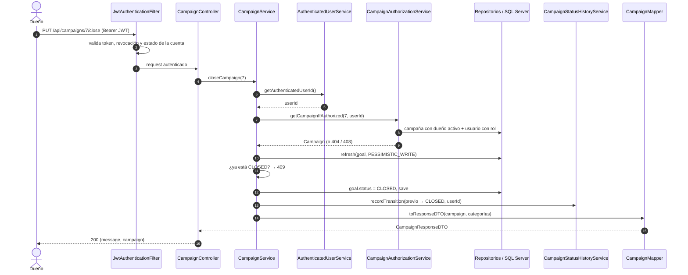

# Arquitectura

VaPaTi es un monolito Spring Boot organizado **en capas** y, dentro de cada capa, **por dominio**. No hay módulos Maven separados ni microservicios: un solo artefacto, una sola base de datos.

## Capas

```mermaid
flowchart TD
    C[Cliente HTTP] --> F[JwtAuthenticationFilter<br/>security/]
    F --> SC[Reglas de SecurityConfig<br/>y @PreAuthorize]
    SC --> CT[controller/<br/>@RestController]
    CT --> SV[service/<br/>orquesta el caso de uso]
    SV --> VA[validation/<br/>reglas de negocio]
    SV --> RP[repository/<br/>Spring Data JPA]
    VA --> RP
    SV --> MP[mapper/<br/>entidad ↔ DTO]
    RP --> EN[entity/<br/>JPA]
    EN --> DB[(SQL Server)]
    CT -. "excepciones" .-> EH[exception/GlobalExceptionHandler]
    SV -. "excepciones" .-> EH
    VA -. "excepciones" .-> EH
```

| Capa | Paquete | Responsabilidad | Ejemplo |
|---|---|---|---|
| Controller | `controller/<dominio>/` | Recibir el request, validar el body con `@Valid`, delegar en un service de su dominio y armar la respuesta. No tiene lógica de negocio. | `controller/campaign/CampaignController.java` |
| Service | `service/<dominio>/` | Orquestar un caso de uso: saber quién llama, ejecutar las validaciones en orden, escribir con los repositorios y mapear a DTO. Define los límites transaccionales (`@Transactional`). | `service/campaign/CampaignService.java` |
| Validation | `validation/<dominio>/` | Reglas de negocio: existencia, propiedad, visibilidad, transiciones de estado, autorreferencias. Lanza excepciones o devuelve la entidad ya cargada. | `validation/campaign/CampaignAuthorizationService.java` |
| Mapper | `mapper/<dominio>/` | Convertir entidades en DTOs y DTOs en entidades. Escritos a mano. | `mapper/campaign/CampaignMapper.java` |
| DTO | `dtos/<dominio>/` | Contratos de entrada y salida de la API, con las anotaciones de Bean Validation. | `dtos/campaign/CreateCampaignRequestDTO.java` |
| Entity | `entity/<dominio>/` | Entidades JPA y los enums de estado o tipo del dominio. | `entity/campaign/Goal.java`, `entity/campaign/CampaignStatus.java` |
| Repository | `repository/<dominio>/` | Interfaces de Spring Data JPA, con queries JPQL cuando hace falta filtrar visibilidad o traer relaciones en el mismo `SELECT`. | `repository/campaign/CampaignRepository.java` |

### Por qué hay una capa `validation` separada

Los services se leen como una lista de pasos: "quién llama → validar → escribir → mapear". Las reglas que deciden si algo se puede hacer viven aparte, en clases `*ValidationService` (y `CampaignAuthorizationService` para la propiedad de campañas). Eso tiene tres efectos visibles en el código:

- **Validar y cargar en un solo paso.** Muchos métodos de validación devuelven la entidad que validaron (`findVisibleCampaignByIdOrThrow`, `getCampaignIfAuthorized`, `validateAndGetCategories`), así el service no vuelve a consultarla.
- **Reglas compartidas entre dominios.** La visibilidad de una campaña se decide en `validation/campaign/` y la reutilizan `service/donation/DonationService.java`, `validation/donation/DonationValidationService.java`, `validation/publication/PublicationValidationService.java` y `validation/report/ReportValidationService.java`. Así, una campaña oculta responde igual en todos los endpoints que la tocan.
- **Tests enfocados.** Las reglas se prueban en tests propios (`validation/<dominio>/*Test`) sin pasar por el service (ver [Testing](07-testing.md)).

### Por qué los mappers son a mano

No hay MapStruct ni ModelMapper. Los mappers arman DTOs que no son copia directa de la entidad: `CampaignMapper.toResponseDTO` recibe la campaña y sus `CampaignCategory` ya cargadas, y aplana datos de `Goal` y del dueño en un solo DTO. Escribirlos a mano deja explícito de dónde sale cada campo y qué relaciones tienen que estar cargadas antes de mapear.

La mayoría son beans de Spring (`@Component`). Los de campaña (`CampaignMapper`, `CampaignStatusHistoryMapper`) son clases con métodos estáticos.

## Organización de paquetes

Raíz: `src/main/java/com/vaPaTi/vaPaTi/`.

```
VaPaTiApplication.java
controller/   dtos/   entity/   mapper/   repository/   service/   validation/
   └── <dominio>/   (auth, user, category, campaign, donation, follower,
                     publication, comment, bankaccount, verification, report)
validation/common/   código de validación compartido (SortValidationService, TextValidationService, RoleValidationService, UrlValidationService)
exception/           excepciones y GlobalExceptionHandler
security/            SecurityConfig, JwtAuthenticationFilter, AuthenticatedUserService, CorsConfig, OpenAPIConfig
utils/               ValidationUtils, PasswordHashGenerator
```

- **Por capa, y dentro por dominio.** Todo lo de un dominio se encuentra buscando la misma subcarpeta en cada capa. Ningún `.java` vive suelto en una carpeta de capa.
- **No todos los dominios tienen todas las capas.** `auth` no tiene mapper (sus DTOs se arman en `AuthenticationService`), `category` no tiene `validation/`, y `campaign` tiene dos clases de validación.
- **Un dominio grande reparte sus reglas en varias `*ValidationService`.** `user` tiene cuatro en `validation/user/`: `UserAccountValidationService` (cuenta y credenciales), `UserCategoryValidationService` (categorías de interés), `UserProfileValidationService` (lo público del perfil) y `UserValidationService` (lo genérico). El service del dominio las inyecta todas.
- **Un controller solo inyecta services de su dominio (y `validation/common`).** Ninguno inyecta el service de otro dominio: `ReportController`, `UserController`, `SupporterController`, `DonationController` y `CommentController` inyectan su service más `validation/common/SortValidationService` (`CommentController` inyecta `CommentService` y `SortValidationService`). Si una ruta cuelga del recurso de otro dominio, el controller vive en el dominio dueño de los datos: `controller/donation/SupporterController.java` atiende `GET /api/users/{userId}/supporters` y `GET /api/users/{userId}/support-feed`, igual que `controller/follower/FollowerController.java` atiende las rutas de seguidores bajo `/api/users/{userId}` y `controller/comment/CommentController.java` atiende `/api/publications/{publicationId}/comments` (ver [Decisiones de diseño](08-decisiones-de-diseno.md#la-ruta-no-decide-el-dominio-del-código)).
- **Los enums viven con su entidad.** `CampaignStatus` está en `entity/campaign/`, `ReportStatus` en `entity/report/`.
- **Lo transversal no se divide por dominio.** `exception/`, `security/` y `utils/` son planos.

## Convenciones de nombres

| Qué | Convención | Ejemplos |
|---|---|---|
| DTO de entrada | `Create*DTO`, `Update*DTO` | `CreateDonationDTO`, `UpdateBankAccountDTO`, `CreateCampaignRequestDTO` |
| DTO de salida | `*ResponseDTO`, o `*DTO` cuando es la representación general | `CampaignResponseDTO`, `UserDTO`, `BankAccountDTO` |
| Validación | `*ValidationService` | `DonationValidationService` |
| Validar y devolver | `validateAndGet*`, `find*OrThrow` | `validateAndGetCategories`, `findVisibleCampaignByIdOrThrow` |
| Repositorios con visibilidad | sufijo `VisibleTo` | queries `*VisibleTo` de `CampaignRepository` |

Las clases DTO terminan en `DTO`, pero las variables y métodos usan `Dto` en camelCase (`responseDTO` como nombre de variable aparece en controllers; en los services predomina `dto`).

## Cómo obtiene un service al usuario que llama

Nunca se confía en un id de usuario que venga en el body. El service le pregunta a `security/AuthenticatedUserService.java`:

- `getAuthenticatedUserId()`, en endpoints autenticados: saca el JWT de las credenciales del `Authentication` que dejó `JwtAuthenticationFilter` y devuelve el `userId` del token.
- `findAuthenticatedUserId()`, en endpoints públicos: devuelve `Optional.empty()` si el request no trae token (Spring deja un `AnonymousAuthenticationToken`), así el mismo service sirve a visitantes y a usuarios autenticados. Con eso se decide, por ejemplo, si el que llama puede ver una campaña `CLOSED` propia.

## Recorrido de un request: cerrar una campaña

`PUT /api/campaigns/{campaignId}/close`, llamado por el dueño de la campaña.



Paso a paso:

1. **Filtro.** `security/JwtAuthenticationFilter.java` valida el JWT, comprueba que no esté revocado y que la cuenta no esté sancionada, y deja el token en las credenciales del `Authentication`. Detalle en [Seguridad](03-seguridad.md).
2. **Autorización por ruta.** La ruta no está en las listas públicas de `SecurityConfig`, así que exige estar autenticado. La regla fina (ser el dueño) no está acá sino en la capa de validación.
3. **Controller.** `CampaignController.closeCampaign` solo delega y envuelve el DTO en `{ "message": "Campaign closed successfully", "campaign": ... }`.
4. **Quién llama.** El service obtiene el `userId` del token.
5. **Validación con carga.** `CampaignAuthorizationService.getCampaignIfAuthorized` busca la campaña con su dueño activo y el usuario con su rol. Si quien llama no es el dueño ni ADMIN, responde `403`, salvo que la campaña esté `CLOSED`: en ese caso responde `404`, para que un tercero no distinga una campaña cerrada de una inexistente.
6. **Bloqueo pesimista.** `lockGoal` hace `entityManager.refresh(goal, PESSIMISTIC_WRITE)`. El estado se relee bloqueado, así un cierre y una donación simultáneos no se pisan.
7. **Regla de estado.** Si ya estaba `CLOSED`, lanza `ConflictException` → `409`.
8. **Escritura e historial.** Cambia `Goal.status`, guarda y registra la transición en `CampaignStatusHistory` con el usuario que la hizo.
9. **Mapeo y respuesta.** `CampaignMapper` arma el `CampaignResponseDTO`.

Si cualquier paso lanza una excepción de `exception/`, `GlobalExceptionHandler` la convierte en una respuesta `{error, message, timestamp}` con el status que corresponde (ver [Errores y validación](05-errores-y-validacion.md)).

## Excepciones como parte del diseño

Las reglas de negocio no devuelven códigos de error: lanzan excepciones. Todas heredan de `exception/MessageException.java`:

| Excepción | Uso |
|---|---|
| `MessageException` | Regla de negocio violada en general. |
| `ResourceNotFoundException` | No existe, o no es visible para quien llama. |
| `ForbiddenActionException` | Existe y es visible, pero quien llama no tiene permiso. |
| `ConflictException` | El estado actual no permite la operación (por ejemplo, cerrar algo ya cerrado). |
| `InvalidCredentialsException` | Login fallido. |

El status HTTP de cada una lo decide `GlobalExceptionHandler`, no el código que la lanza.

## Forma de las respuestas

No hay un envoltorio único. Cada controller elige:

- **DTO directo**, como `GET /api/campaigns/{campaignId}` (`CampaignResponseDTO`).
- **Mapa con mensaje**, como `POST /api/campaigns/create` (`{message, campaignId, status}`) o el cierre de campaña (`{message, campaign}`). Cinco controllers usan `ResponseEntity<Map<String, Object>>` en al menos un endpoint.

La forma exacta de cada endpoint está en el documento de su dominio.
