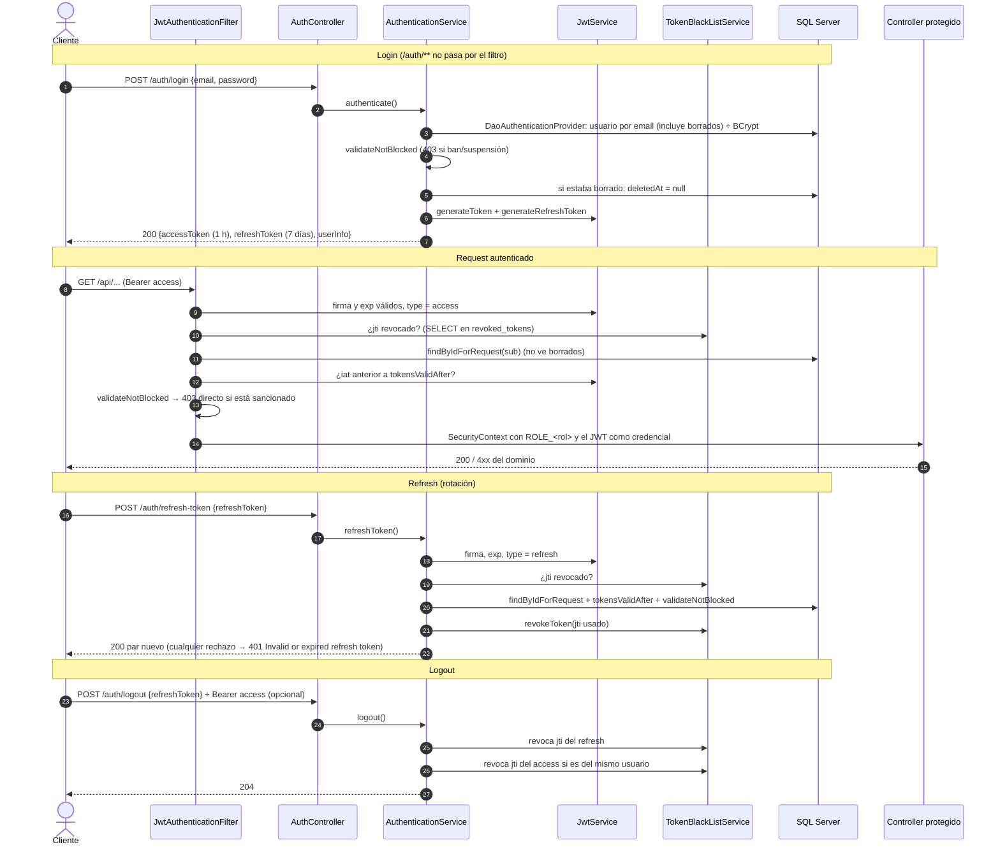
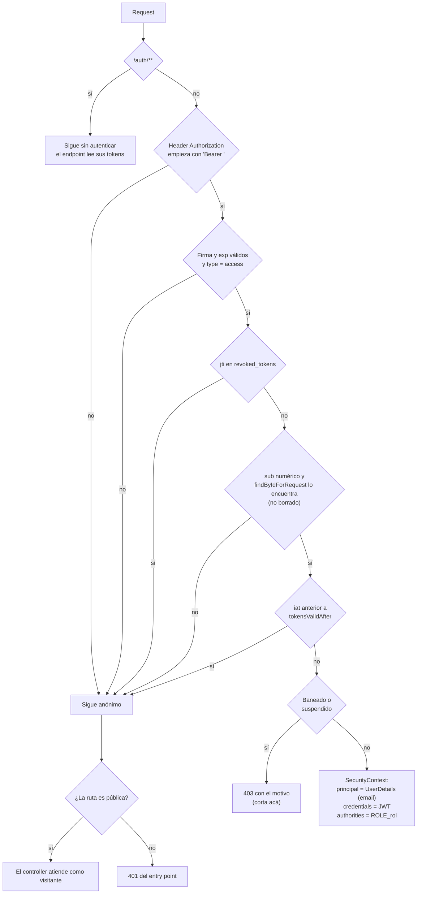

# Seguridad

La API es **stateless**: no hay sesión en el servidor ni cookies. Cada request se autentica con un JWT en el header `Authorization: Bearer <token>`, y el servidor decide en cada request si ese token sigue sirviendo (firma, vencimiento, revocación, cambio de credenciales y estado de la cuenta).

Este archivo explica cómo se arma esa cadena. Lo que pasa adentro de los endpoints de login, refresh y logout (reglas, mensajes, errores) está en [Auth](dominios/auth.md); acá se resume solo lo necesario para entender el flujo completo.

## Piezas

| Clase | Rol |
|---|---|
| `security/SecurityConfig.java` | Cadena de filtros de Spring Security: rutas públicas, sesión stateless, respuestas `401`/`403` de la capa de seguridad, `PasswordEncoder` (BCrypt) y `AuthenticationProvider`. Activa `@PreAuthorize` con `@EnableMethodSecurity`. |
| `security/JwtAuthenticationFilter.java` | Lee el `Bearer`, valida el access token y, si todo está bien, deja el usuario autenticado en el `SecurityContext`. Corta con `403` a las cuentas sancionadas. |
| `service/auth/JwtService.java` | Firma y lee los tokens: claims, tipo (`access`/`refresh`), `jti`, vencimiento, comparación con `tokensValidAfter`. Valida `JWT_SECRET` al arrancar. |
| `service/auth/AuthenticationService.java` | Login, refresh (con rotación) y logout. |
| `service/auth/TokenBlackListService.java` + `entity/auth/RevokedToken.java` + `repository/auth/RevokedTokenRepository.java` | Lista negra de tokens por `jti` (tabla `revoked_tokens`). |
| `service/auth/CustomUserDetailsService.java` | Carga el usuario por email (login) o por id (cada request) y arma sus autoridades `ROLE_<rol>`. |
| `validation/auth/AccountStatusValidationService.java` | Única definición de "cuenta sancionada" (ban o suspensión vigente). |
| `security/AuthenticatedUserService.java` | Forma estándar en que un service sabe quién llama. |
| `security/CorsConfig.java` | Orígenes permitidos para el navegador. |
| `security/OpenAPIConfig.java` | Esquema `bearerAuth` de Swagger UI. |

## Flujo completo: login → request autenticado → refresh → logout

El access token viejo no se revoca en el refresh: sigue sirviendo hasta su vencimiento, salvo que se haga logout mandándolo en el header.

## `SecurityConfig`

### Configuración general

- **CSRF desactivado.** La autenticación no viaja en cookies sino en un header que el navegador no agrega solo, así que no hay sesión que un sitio ajeno pueda reutilizar.
- **`SessionCreationPolicy.STATELESS`.** Spring no crea `HttpSession`: el `SecurityContext` se arma de cero en cada request a partir del token.
- **`JwtAuthenticationFilter` antes de `UsernamePasswordAuthenticationFilter`.** Cuando llega a las reglas de autorización, el request ya está autenticado o es anónimo.
- **`DaoAuthenticationProvider` con `BCryptPasswordEncoder`.** Lo usa solo el login (a través del `AuthenticationManager`). Las contraseñas se guardan como hash BCrypt; `utils/PasswordHashGenerator.java` es una clase `main` aparte (no es un bean ni un endpoint) para generar el hash del primer ADMIN que inserta `scripts/create-admin-user.sql`.
- **`@EnableMethodSecurity(prePostEnabled = true)`.** Habilita `@PreAuthorize` en los controllers.

### Reglas por ruta

Las reglas se evalúan en orden y gana la primera que coincide:

1. `PUBLIC_URLS`: públicas para **cualquier método**.
2. `GET /api/campaigns/my-campaigns`: autenticada.
3. `PUBLIC_GET_URLS`: públicas **solo con GET**.
4. Todo lo demás: autenticado (`anyRequest().authenticated()`).

**`PUBLIC_URLS`**

| Patrón | Qué expone |
|---|---|
| `/auth/**` | Login, refresh y logout. |
| `/api/categories/list` | Listado de categorías. |
| `/api/users/create` | Registro de usuarios. |
| `/swagger-ui/**`, `/swagger-ui.html`, `/v3/api-docs/**`, `/swagger-resources/**`, `/webjars/**` | Swagger UI y la especificación OpenAPI. |
| `/favicon.ico`, `/error` | Recursos de soporte. |

**`PUBLIC_GET_URLS`**

| Patrón | Endpoint |
|---|---|
| `/api/campaigns/list` | Listado de campañas. |
| `/api/campaigns/*` | Detalle de una campaña. |
| `/api/campaigns/*/publications` | Publicaciones de una campaña. |
| `/api/donations/campaign/*` | Donaciones de una campaña. |
| `/api/donations/campaign/*/statistics` | Estadísticas de donaciones de una campaña. |

`/api/campaigns/my-campaigns` también coincide con `/api/campaigns/*`; por eso tiene su propia regla `authenticated()` **antes** de la lista pública. Si se invirtiera el orden, un visitante sin token llegaría a `CampaignService.getCampaignsByAuthenticatedUser`, que usa `getAuthenticatedUserId()` y fallaría con un `500` en lugar del `401`.

En los endpoints de `PUBLIC_GET_URLS` el service resuelve a quien llama como opcional (`AuthenticatedUserService.findAuthenticatedUserId`): un visitante ve lo público y un usuario con token ve además sus propias campañas `CLOSED`. Detalle en [Campañas](dominios/campaign.md) y [Donaciones](dominios/donation.md).

No hay reglas por rol en `SecurityConfig`: ninguna ruta pide `hasRole` a nivel de URL. Los roles se controlan con `@PreAuthorize` y la propiedad de los recursos en la capa `validation/`.

### Respuestas de la capa de seguridad

Cuando el request no llega al controller, la respuesta la escribe `SecurityConfig` (o el filtro) a mano, con un campo `path` que las respuestas de `GlobalExceptionHandler` no tienen (ver [Errores y validación](05-errores-y-validacion.md)):

| Status | Quién | `error` | `message` | Cuándo |
|---|---|---|---|---|
| 401 | `authenticationEntryPoint` | `Unauthorized` | `Full authentication is required to access this resource` | Ruta no pública y el request quedó anónimo: sin token, token inválido, vencido, revocado, de tipo `refresh`, de una cuenta borrada o emitido antes de `tokensValidAfter`. |
| 403 | `JwtAuthenticationFilter.writeForbidden` | `Forbidden` | `Your account has been banned. Reason: <motivo>` o `Your account is suspended until <fecha>. Reason: <motivo>` | Token válido de una cuenta sancionada, **en cualquier ruta** salvo `/auth/**` (incluso las públicas). |
| 403 | `accessDeniedHandler` | `Forbidden` | `You don't have permission to access this resource` | Denegación en las reglas por URL. Como hoy no hay reglas por rol en URL, en la práctica no se dispara: el `403` de `@PreAuthorize` lo produce `GlobalExceptionHandler` con el mismo mensaje. |

El `401` no distingue el motivo: el filtro no escribe nada cuando rechaza un token, simplemente no autentica. Así, quien prueba tokens no sabe si falló la firma, el vencimiento o la revocación.

## Autorización: tres niveles

| Nivel | Dónde | Qué decide |
|---|---|---|
| Ruta | `SecurityConfig` | Público o autenticado. |
| Rol | `@PreAuthorize("hasRole('ADMIN')")` en el controller | Endpoints solo para ADMIN. |
| Recurso | `validation/<dominio>/` | Propiedad, visibilidad y sanciones (ser el dueño de la campaña, no ver campañas `CLOSED` ajenas, etc). |

Los 10 endpoints con `@PreAuthorize`, todos con `hasRole('ADMIN')`:

| Controller | Endpoints |
|---|---|
| `controller/user/UserController.java` | `GET /api/users/list`, `GET /api/users/list/paginated` |
| `controller/category/CategoryController.java` | `POST /api/categories/create`, `PUT /api/categories/update/{id}`, `DELETE /api/categories/delete/{id}` |
| `controller/report/ReportController.java` | `GET /api/reports`, `GET /api/reports/{id}`, `PUT /api/reports/{id}/review`, `GET /api/reports/stats` |
| `controller/verification/VerificationRequestController.java` | `PUT /verifications/process` |

El resto de los endpoints autenticados no tiene `@PreAuthorize`: cualquier `USER` o `ADMIN` llega al service, y la regla fina (si la hay) la aplica la capa de validación. Cuáles son esas reglas, endpoint por endpoint, está en cada archivo de [dominios](README.md#dominios).

`hasRole('ADMIN')` compara contra la autoridad `ROLE_ADMIN`, que `CustomUserDetailsService` arma con `"ROLE_" + rol.toUpperCase()` leyendo el rol **de la base**, no del claim `role` del token. Un cambio de rol se aplica en el siguiente request, sin esperar a que venza el token.

`@Valid` sobre el body se evalúa antes que `@PreAuthorize`: un `USER` que manda un body inválido a un endpoint de ADMIN recibe `400` de validación en lugar de `403`.

## `JwtAuthenticationFilter`

Es un `OncePerRequestFilter` que corre en todos los requests salvo los de `/auth/**` (`shouldNotFilter`): esos endpoints leen sus propios tokens del body o del header, y un access token vencido en el header no tiene que impedir hacer login o refresh.

Puntos que conviene saber:

- **Cualquier excepción deja el request anónimo.** Todo el cuerpo está en un `try/catch (Exception)`; el error solo se imprime con `System.err` (sin el token). Un token con `sub` no numérico (formato de tokens viejos, donde `sub` era el email) termina en `401` por esta vía.
- **Un token inválido en una ruta pública no da error.** El request sigue como visitante y el endpoint público responde igual que sin token.
- **La sanción sí corta en rutas públicas.** El `403` se escribe en el propio filtro, antes de las reglas de autorización, con el mismo mensaje que el login. Un usuario baneado con un token vigente no puede usar la API ni como visitante mientras mande el token.
- **Cuenta borrada → `401`, no `403`.** `findByIdForRequest` respeta el borrado lógico; el usuario tiene que volver a loguearse (lo que restaura la cuenta).
- **Costo por request autenticado:** dos consultas, `existsByJti` y `findByIdForRequest` (que trae `userInfo` y `role` en el mismo `SELECT`).
- **La credencial del `Authentication` es el JWT crudo.** De ahí lo lee `AuthenticatedUserService`.

## `JwtService` y `JWT_SECRET`

- **Algoritmo HS256** con una clave derivada de `jwt.secret`. En `src/main/resources/application.properties` y `application-docker.properties` la propiedad vale `${JWT_SECRET}`, sin valor por defecto.
- **Validación al arrancar** (`@PostConstruct init`): la aplicación no arranca si el secreto está vacío, si es el placeholder público que aparecía en ejemplos (`PLACEHOLDER_SECRET`) o si tiene menos de 32 bytes (el mínimo de HS256). El mensaje de error nunca imprime el secreto.
- **Duraciones** (`jwt.expiration`, `jwt.refresh-expiration`): `3600000` ms (1 hora) para el access token y `604800000` ms (7 días) para el refresh, iguales en los dos perfiles.
- **Claims:** `sub` = id del usuario, `type` (`access`/`refresh`), `userId`, `jti` (UUID) y, solo en el access token, `role`, `email`, `firstName`, `lastName` y `userName`. La tabla completa está en [Auth](dominios/auth.md). El backend solo lee `sub`, `type`, `jti`, `iat`, `exp` y `userId`; los datos de perfil del access token son para el cliente.
- **`type` separa los tokens:** el filtro solo acepta `access`; refresh y logout solo aceptan `refresh`. Un token sin `type` no sirve para nada.
- **`isIssuedBefore(token, tokensValidAfter)`:** compara el `iat` con `User.tokensValidAfter`, truncado a segundos porque `iat` tiene precisión de segundos.

## Invalidar tokens antes de su vencimiento

Hay dos mecanismos, porque resuelven casos distintos:

| Mecanismo | Alcance | Quién lo activa | Dónde |
|---|---|---|---|
| Lista negra por `jti` (`revoked_tokens`) | Un token puntual | Logout (refresh + access opcional) y cada refresh (el refresh usado) | `service/auth/TokenBlackListService.java` |
| `User.tokensValidAfter` | Todos los tokens del usuario emitidos antes de ese instante | Cambio de email o contraseña en `PUT /api/users/update` | `service/user/UserService.java`, `JwtService.isIssuedBefore` |

Con la lista negra sola, cambiar la contraseña no cerraría las sesiones abiertas en otros dispositivos, porque el servidor no sabe qué tokens emitió. `tokensValidAfter` lo resuelve con una sola columna.

La lista negra guarda solo el `jti` y el vencimiento del token. Pasado ese vencimiento la fila ya no hace falta, porque el token lo rechaza la validación de `exp`. `TokenBlackListService.cleanupExpiredTokens` está anotado con `@Scheduled(cron = "0 0 2 * * ?")` para borrarlas, pero ninguna clase del proyecto tiene `@EnableScheduling`, así que Spring no lo programa y la tabla solo crece.

## Login, refresh y logout

Resumen; las reglas, los mensajes y los errores de cada endpoint están en [Auth](dominios/auth.md).

- **Login:** `AuthenticationManager` valida email y contraseña (email inexistente y contraseña incorrecta dan el mismo `401`). Después se valida el estado de la cuenta, y si estaba borrada se restaura.
- **Refresh:** acepta solo un refresh token vigente, no revocado, de una cuenta no borrada, emitido después de `tokensValidAfter` y no sancionada. Revoca el usado y emite un par nuevo (rotación). Dos refresh simultáneos con el mismo token: el segundo `INSERT` viola el `UNIQUE` de `jti` y recibe `401`.
- **Logout:** revoca el refresh token y, si viene en el header, el access token del mismo usuario. Es idempotente.

## Saber quién llama: `AuthenticatedUserService`

Los services nunca toman el id del usuario del body o de la ruta para decidir quién actúa: lo sacan del token con `security/AuthenticatedUserService.java`.

| Método | Para | Comportamiento |
|---|---|---|
| `getAuthenticatedUserId()` | Endpoints autenticados | Lee el JWT de `Authentication.getCredentials()` y devuelve el claim `userId`. Si no hay JWT falla con una excepción no controlada (`500`). En una ruta autenticada no pasa, porque el entry point corta antes con `401`; por eso los endpoints públicos tienen que usar el método siguiente. |
| `findAuthenticatedUserId()` | Endpoints de `PUBLIC_GET_URLS` | `Optional.empty()` si el request es anónimo (Spring deja un `AnonymousAuthenticationToken` en las rutas públicas). |

El id sale del claim `userId`, mientras que el filtro usa el `sub` para cargar el usuario. Los dos tienen el mismo valor porque `JwtService` los escribe juntos.

Hay dos excepciones a la regla de "el usuario sale del token": las cuentas bancarias y las solicitudes de verificación toman el `userId` del body o de la ruta (ver [Cuentas bancarias](dominios/bankaccount.md) y [Verificación](dominios/verification.md)).

## Sanciones: `AccountStatusValidationService`

Es la única definición de "cuenta sancionada" del proyecto:

- **Baneada:** `User.banned = true`.
- **Suspendida:** `User.suspendedUntil` en el futuro. Una suspensión vencida no bloquea y no hace falta levantarla.

Tiene dos métodos con el mismo criterio y distinto uso:

| Método | Qué hace | Lo usan |
|---|---|---|
| `validateNotBlocked(user)` | Lanza `ForbiddenActionException` con el motivo (`bannedReason`, o `Violation of terms` si es `null`). | Login y refresh (`AuthenticationService`) y el filtro JWT. Le habla al propio titular de la cuenta. |
| `isBlocked(user)` | Devuelve `boolean`, sin decir qué sanción aplica. | `validation/user/UserValidationService.java`, `validation/follower/FollowerValidationService.java`, `validation/report/ReportValidationService.java`, para ocultar al usuario sancionado a terceros con `404`. |

Así el titular se entera de su sanción y del motivo, y los demás no pueden distinguir a un usuario sancionado de uno inexistente. Quién banea y suspende está en [Reportes](dominios/report.md).

## CORS

`security/CorsConfig.java` registra la configuración en Spring MVC (`WebMvcConfigurer.addCorsMappings`) para `/**`:

| Opción | Valor |
|---|---|
| Orígenes | `cors.allowed-origins`, separados por coma. Viene de la variable `CORS_ALLOWED_ORIGINS`; por defecto `http://localhost:3000`. |
| Métodos | `GET`, `POST`, `PUT`, `DELETE`, `OPTIONS` (no hay endpoints `PATCH`). |
| Headers | todos |
| Credenciales | `allowCredentials(true)` |

`SecurityConfig` no llama a `.cors(...)`. Spring Security 6.2 aplica CORS por su cuenta cuando encuentra un único bean `CorsConfigurationSource`, y en una aplicación Spring MVC ese bean es el `HandlerMappingIntrospector`, que expone la configuración de `CorsConfig`. Así los preflight `OPTIONS` sin token se responden antes de que la regla `authenticated()` los rechace. Si algún día se agrega otro bean `CorsConfigurationSource`, esa activación automática deja de ocurrir y hay que declarar `.cors(...)` explícitamente.

Como el origen por defecto es solo `http://localhost:3000`, en cualquier otro despliegue hay que definir `CORS_ALLOWED_ORIGINS`. No se puede usar `*`: con `allowCredentials(true)` Spring lo rechaza.

## OpenAPI

`security/OpenAPIConfig.java` define el título y la versión, y un esquema de seguridad `bearerAuth` (HTTP bearer, formato JWT) aplicado a toda la API. En Swagger UI (`/swagger-ui.html`) se pega el access token una vez en "Authorize" y se manda en todos los requests. Como el requisito es global, Swagger muestra el candado también en los endpoints públicos; mandar el token ahí no cambia nada, salvo para los `PUBLIC_GET_URLS`, que con token muestran además las campañas `CLOSED` propias.

Swagger UI y `/v3/api-docs` son públicos en todos los perfiles.

## Configuración

| Propiedad | Variable de entorno | Valor |
|---|---|---|
| `jwt.secret` | `JWT_SECRET` | Obligatoria, al menos 32 bytes. Sin valor por defecto. |
| `jwt.expiration` | — | `3600000` (1 hora) |
| `jwt.refresh-expiration` | — | `604800000` (7 días) |
| `cors.allowed-origins` | `CORS_ALLOWED_ORIGINS` | Por defecto `http://localhost:3000` |

Los perfiles y cómo se pasan estas variables en Docker están en [Infraestructura](06-infraestructura.md).
