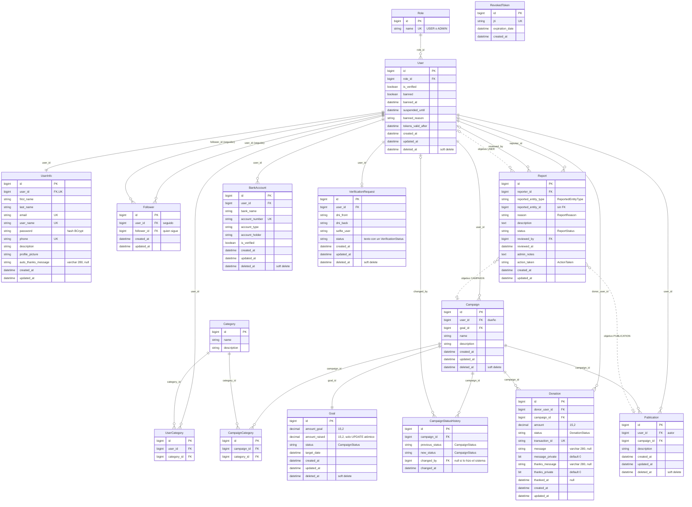

# Modelo de datos

Este archivo describe las entidades JPA de `entity/`, cómo se relacionan, los enums que guardan, el borrado lógico (soft delete) y cómo nace el esquema de la base. Las reglas de negocio de cada entidad están en el archivo de su dominio (ver [Dominios](README.md#dominios)); acá va lo transversal.

La base es **SQL Server** (`ApiVaPaTiJava`). Todas las entidades usan `@Id @GeneratedValue(strategy = GenerationType.IDENTITY)`: la clave es una columna `IDENTITY` de SQL Server, no una secuencia.

## Diagrama entidad-relación

Incluye las 16 clases `@Entity` de `entity/`. Los nombres de las cajas son los de las clases; los de las columnas, los de la tabla. Las líneas punteadas del final son referencias sin FK (el objetivo polimórfico de un reporte).



## Entidades

### Usuarios

| Entidad | Archivo | Tabla | Campos relevantes | Relaciones |
|---|---|---|---|---|
| `User` | `entity/user/User.java` | `[user]` (entre corchetes porque `user` es palabra reservada en SQL Server) | `verified` (columna `is_verified`), estado de sanción (`banned`, `bannedAt`, `suspendedUntil`, `bannedReason`), `tokensValidAfter`, `createdAt`, `updatedAt`, `deletedAt` | `role` (`@ManyToOne` LAZY); inversas: `userInfo` y `verificationRequest` (`@OneToOne mappedBy`), `userCategories` y `bankAccounts` (`Set`), `campaigns` (`List`). Todas las inversas tienen `cascade = ALL`; las colecciones, además, `orphanRemoval = true`. |
| `UserInfo` | `entity/user/UserInfo.java` | `user_info` | Datos de perfil y credenciales: `firstName`, `lastName`, `email`, `userName`, `password`, `phone`, `description`, `profilePicture`, y el mensaje de agradecimiento predeterminado `autoThanksMessage` (opcional, hasta 280) | Dueña de la FK `user_id` (`@OneToOne` LAZY, `unique`). |
| `Role` | `entity/user/Role.java` | `roles` | `name` (`unique`) | Ninguna. No es un enum: es una tabla con dos filas que siembra `data.sql`. |
| `UserCategory` | `entity/user/UserCategory.java` | `user_category` | Tabla intermedia con id propio | `user` y `category` (`@ManyToOne`). |

`User` y `UserInfo` están separados: `User` tiene el estado de la cuenta (rol, verificación, sanciones, borrado) y `UserInfo` los datos que el usuario edita y con los que se loguea. El email, el nombre de usuario y el teléfono son `unique` en `user_info`. Como el borrado de un usuario es lógico y no toca `user_info`, esos valores siguen ocupados por la cuenta borrada (y el login la puede restaurar, ver [Auth](dominios/auth.md)).

`User.setUserInfo` está escrito a mano para mantener los dos lados de la relación: asigna `userInfo` y le pone `user` a la vez. Ver [User](dominios/user.md).

### Campañas

| Entidad | Archivo | Tabla | Campos relevantes | Relaciones |
|---|---|---|---|---|
| `Campaign` | `entity/campaign/Campaign.java` | `campaign` | `name`, `description`, `createdAt`, `updatedAt`, `deletedAt` | `user` (dueño, `@ManyToOne` con `@NotFound`), `goal` (`@OneToOne`, `cascade = ALL`). |
| `Goal` | `entity/campaign/Goal.java` | `goal` | `amountGoal`, `amountRaised`, `status` (`CampaignStatus`, por defecto `ACTIVE`), `targetDate`, `deletedAt` | Solo la apunta `Campaign.goal_id`. |
| `CampaignCategory` | `entity/campaign/CampaignCategory.java` | `campaign_category` | Tabla intermedia con id propio | `campaign` (`@NotFound`, no actualizable) y `category` (`optional = false`). |
| `CampaignStatusHistory` | `entity/campaign/CampaignStatusHistory.java` | `campaign_status_history` | `previousStatus` (null en la creación), `newStatus`, `changedAt` | `campaign`, `changedBy` (`@ManyToOne`; `null` cuando la transición la hace el sistema, como la meta alcanzada por una donación). |
| `Category` | `entity/category/Category.java` | `category` | `name`, `description` | Ninguna propia; la usan `UserCategory` y `CampaignCategory`. Sin `@Table`: Hibernate usa el nombre de la clase en singular. |

**El estado de la campaña vive en `Goal`, no en `Campaign`.** `Goal.status` es un `CampaignStatus`, y las queries filtran por `c.goal.status`. Así, el estado y los montos que lo determinan (`amountGoal`, `amountRaised`) están en la misma fila, que es la que se bloquea y actualiza al donar. El ciclo de estados está en [Campaign](dominios/campaign.md).

**`Goal.amountRaised` no es actualizable** (`updatable = false`). Según el comentario de la entidad, solo lo cambia `GoalRepository.addToAmountRaised` con un `UPDATE` atómico (`amount_raised = amount_raised + :amount`); si se pudiera escribir desde la entidad, cualquier `save` de una campaña escribiría el total que leyó al cargarla y pisaría las donaciones sumadas mientras tanto. El `INSERT` de una campaña nueva sí escribe el `0` inicial. Los `UPDATE` masivos se saltean `@UpdateTimestamp` y `@PreUpdate`, por eso `addToAmountRaised` y `completeIfGoalReached` ponen `updatedAt` en la propia query. Cuando una edición necesita decidir el estado con los montos reales, `CampaignService` relee el `Goal` con un bloqueo pesimista (`entityManager.refresh(goal, PESSIMISTIC_WRITE)`). El flujo completo está en [Donation](dominios/donation.md) y [Campaign](dominios/campaign.md).

### Donaciones, publicaciones y seguidores

| Entidad | Archivo | Tabla | Campos relevantes | Relaciones |
|---|---|---|---|---|
| `Donation` | `entity/donation/Donation.java` | `donation` | `amount`, `status` (`DonationStatus`), `transactionId` (`unique`), `message` (opcional, hasta 280), `messagePrivate` (`bit NOT NULL`, default `0`), la respuesta del dueño `thanksMessage` (opcional, hasta 280), `thanksPrivate` (`bit NOT NULL`, default `0`) y `thankedAt`, `createdAt`, `updatedAt`, y las copias de solo lectura `campaignId` y `donorUserId` | `donor` y `campaign` (`@ManyToOne` con `@NotFound`, no actualizables). |
| `Publication` | `entity/publication/Publication.java` | `publication` | `description`, `createdAt`, `updatedAt`, `deletedAt`, y la copia de solo lectura `campaignId` | `user` (autor) y `campaign` (`@ManyToOne` con `@NotFound`, no actualizables). |
| `Follower` | `entity/follower/Follower.java` | `followers` | `createdAt`, `updatedAt` | `user` (el seguido) y `follower` (quien sigue), ambos `@ManyToOne` a `User`. `UNIQUE (user_id, follower_id)`: no se puede seguir dos veces a la misma persona. |

Los montos son `BigDecimal` con `precision = 15, scale = 2` (`DECIMAL(15,2)`), y los DTOs de entrada los limitan con `@Digits(integer = 13, fraction = 2)`, que coincide con la columna. No hay `double` ni `float` para dinero.

### Moderación, cuentas bancarias, verificación y tokens

| Entidad | Archivo | Tabla | Campos relevantes | Relaciones |
|---|---|---|---|---|
| `Report` | `entity/report/Report.java` | `report` | `reportedEntityType` + `reportedEntityId` (objetivo), `reason`, `description`, `status`, `reviewedAt`, `adminNotes`, `actionTaken`, `createdAt`, `updatedAt` | `reporter` y `reviewedBy` (`@ManyToOne` a `User` con `@NotFound`). `UNIQUE (reporter_id, reported_entity_type, reported_entity_id)`: un usuario reporta cada cosa una sola vez. |
| `BankAccount` | `entity/bankaccount/BankAccount.java` | `bank_accounts` | `bankName`, `accountNumber` (`unique`), `accountType`, `accountHolder`, `isVerified`, `deletedAt` | `user` (`@ManyToOne` LAZY). |
| `VerificationRequest` | `entity/verification/VerificationRequest.java` | `verification_request` | `dniFront`, `dniBack`, `selfieUser`, `status` (texto), `deletedAt` | `user` (`@OneToOne`, dueña de la FK). |
| `RevokedToken` | `entity/auth/RevokedToken.java` | `revoked_tokens` | `jti` (`unique`, 36 caracteres), `expirationDate`, `createdAt` | Ninguna: guarda el identificador del JWT, no al usuario. |

**El objetivo de un reporte es polimórfico.** `Report` no tiene una relación JPA con lo reportado: guarda el tipo (`ReportedEntityType`) y el id, sin FK. Por eso un reporte sobrevive al borrado de lo que reporta, y la existencia del objetivo la comprueba `validation/report/ReportValidationService.java` al crear el reporte. Ver [Report](dominios/report.md).

`RevokedToken` es la lista de JWT revocados por logout o refresh (ver [Seguridad](03-seguridad.md)). `TokenBlackListService.cleanupExpiredTokens` está anotado con `@Scheduled` para borrar los vencidos cada noche, pero la aplicación no declara `@EnableScheduling`, así que hoy esa limpieza no corre (ver [Deuda técnica](deuda-tecnica.md)).

## Fetch types y cascadas

JPA carga por defecto en forma **EAGER** las relaciones `@ManyToOne` y `@OneToOne`, y casi ninguna del proyecto declara otro `fetch`. El costo se controla desde los repositorios, no desde las entidades: las queries de listados traen las relaciones que el mapper va a leer en el mismo `SELECT` con `JOIN FETCH` o `@EntityGraph`, y los comentarios de cada query explican por qué.

| Relación | Tipo | Fetch | Cascada | Observación |
|---|---|---|---|---|
| `User.role` | `@ManyToOne` | LAZY | — | `existsByIdAndRole_Name` pregunta el rol sin cargarlo. |
| `User.userInfo` | `@OneToOne` inversa | LAZY declarado | `ALL` | Una `@OneToOne` del lado inverso no se puede hacer perezosa sin *bytecode enhancement*: Hibernate la carga con un `SELECT` aparte. Por eso las queries agregan `LEFT JOIN FETCH u.userInfo`. |
| `User.verificationRequest` | `@OneToOne` inversa | LAZY declarado | `ALL` | Igual que `userInfo`: se trae con `LEFT JOIN FETCH` o `@EntityGraph`. |
| `User.userCategories` | `@OneToMany` (`Set`) | LAZY | `ALL` + `orphanRemoval` | El `orphanRemoval` es lo que borra la fila de `user_category` al sacar una categoría del set. |
| `User.bankAccounts` | `@OneToMany` (`Set`) | LAZY | `ALL` + `orphanRemoval` | |
| `User.campaigns` | `@OneToMany` (`List`) | LAZY | `ALL` + `orphanRemoval` | Ningún código lee esta colección. |
| `UserInfo.user` | `@OneToOne` | LAZY | — | Dueña de la FK. |
| `UserCategory.user`, `UserCategory.category` | `@ManyToOne` | EAGER | — | |
| `Campaign.user` | `@ManyToOne` | EAGER | — | `@NotFound(IGNORE)`, `updatable = false`. |
| `Campaign.goal` | `@OneToOne` | EAGER | `ALL` | Borrar la campaña borra (lógicamente) su meta. |
| `CampaignCategory.campaign` | `@ManyToOne` | EAGER | — | `@NotFound(IGNORE)`, `updatable = false`. |
| `CampaignCategory.category` | `@ManyToOne` | EAGER | — | `optional = false`. |
| `CampaignStatusHistory.campaign`, `.changedBy` | `@ManyToOne` | EAGER | — | Sin `@NotFound`. |
| `Donation.donor`, `.campaign` | `@ManyToOne` | EAGER | — | `@NotFound(IGNORE)`, `updatable = false`. |
| `Publication.user`, `.campaign` | `@ManyToOne` | EAGER | — | `@NotFound(IGNORE)`, `updatable = false`. |
| `Follower.user`, `.follower` | `@ManyToOne` | EAGER | — | Sin `@NotFound`. |
| `Report.reporter` | `@ManyToOne` | EAGER | — | `@NotFound(IGNORE)`, `updatable = false`. |
| `Report.reviewedBy` | `@ManyToOne` | EAGER | — | `@NotFound(IGNORE)`. |
| `BankAccount.user` | `@ManyToOne` | LAZY | — | |
| `VerificationRequest.user` | `@OneToOne` | EAGER | — | Sin `@NotFound`. |

Ejemplos de cómo se evitan los `SELECT` por fila:

- `repository/user/UserRepository.java`: `findByIdForRequest` (lo usa el filtro JWT en cada request) trae `userInfo`, `role` y `verificationRequest` con `@EntityGraph`. El listado paginado de usuarios va en dos pasos (`findPageOfIds` pagina ids en SQL y `findAllWithDetailsByIdIn` carga esos usuarios con sus colecciones), porque traer colecciones en la query paginada haría que Hibernate pagine en memoria.
- `repository/campaign/CampaignRepository.java`: la constante `LISTING_FETCH` reúne los `JOIN FETCH` del dueño, su `userInfo`, su `verificationRequest` y la meta. Las categorías de un listado se cargan aparte con `CampaignCategoryRepository.findByCampaignIdIn`, en bloques para no pasar el límite de 2100 parámetros de SQL Server.
- `repository/donation/DonationRepository.java`, `repository/follower/FollowerRepository.java`, `repository/publication/PublicationRepository.java` y `repository/report/ReportRepository.java` siguen el mismo patrón. En `findAllWithUsers` de reportes solo se traen relaciones a uno, para que la paginación siga siendo SQL, y el `countQuery` es explícito porque no se puede derivar de una query con `FETCH`.

Las cascadas de `User` sirven para el alta: `UserService.createUser` guarda el `User` y, por `cascade = ALL`, se insertan su `UserInfo` y sus `UserCategory`. Al actualizar, `orphanRemoval` borra las `UserCategory` que se sacaron del set. La cascada de borrado no se usa: ningún código llama a `delete` sobre un usuario (ver la sección siguiente).

## Enums

Todos los enums que se guardan en la base usan `@Enumerated(EnumType.STRING)`: la columna tiene el nombre del valor, no su posición, así que reordenar o agregar valores no corrompe los datos existentes.

| Enum | Archivo | Valores | Dónde se guarda | Notas |
|---|---|---|---|---|
| `CampaignStatus` | `entity/campaign/CampaignStatus.java` | `ACTIVE`, `COMPLETED`, `CLOSED` | `Goal.status`, `CampaignStatusHistory.previousStatus` y `.newStatus` (`VARCHAR(50)`) | Máquina de estados en [Campaign](dominios/campaign.md). |
| `DonationStatus` | `entity/donation/DonationStatus.java` | `PENDING`, `COMPLETED`, `FAILED`, `REFUNDED` | `Donation.status` (`VARCHAR(20)`) | La entidad usa `PENDING` por defecto, pero la aprobación es simulada: `DonationService` crea cada donación directamente en `COMPLETED`. Ver [Donation](dominios/donation.md). |
| `ReportStatus` | `entity/report/ReportStatus.java` | `PENDING`, `UNDER_REVIEW`, `RESOLVED`, `REJECTED` | `Report.status` | Por defecto `PENDING`. Ver [Report](dominios/report.md). |
| `ReportReason` | `entity/report/ReportReason.java` | `SPAM`, `INAPPROPRIATE_CONTENT`, `HARASSMENT`, `FRAUD`, `MISINFORMATION`, `IMPERSONATION`, `OTHER` | `Report.reason` | |
| `ReportedEntityType` | `entity/report/ReportedEntityType.java` | `USER`, `PUBLICATION`, `CAMPAIGN` | `Report.reportedEntityType` | Define a qué tabla apunta `reportedEntityId`. |
| `ActionTaken` | `entity/report/ActionTaken.java` | `NO_ACTION`, `WARNING_SENT`, `CONTENT_REMOVED`, `USER_SUSPENDED`, `USER_BANNED`, `OTHER` | `Report.actionTaken` | Qué acciones admite cada tipo de objetivo lo decide `ReportValidationService`; las ejecuta `service/report/ReportActionService.java`. |
| `VerificationStatus` | `entity/verification/VerificationStatus.java` | `PENDING`, `APPROVED`, `REJECTED` | `VerificationRequest.status`, como texto | No está mapeado con `@Enumerated`: la columna es un `String` y el código convierte con `name()` y `valueOf()`. Ver [Verification](dominios/verification.md). |

Los roles (`USER`, `ADMIN`) no son un enum: son filas de la tabla `roles`.

## Borrado lógico (soft delete)

Seis entidades no se borran físicamente: tienen una columna `deleted_at` y `@SQLRestriction("deleted_at IS NULL")`. Esa restricción hace que Hibernate agregue la condición a toda carga de la entidad (`findById`, queries JPQL y derivadas, colecciones), así que para la aplicación una fila borrada no existe.

| Entidad | `@SQLDelete` | Cómo se borra en la práctica | Se puede restaurar |
|---|---|---|---|
| `User` | `UPDATE [user] SET deleted_at = GETDATE()` | `UserService.deleteUser` pone `deletedAt` a mano y guarda; antes cierra todas sus campañas (`CampaignService.closeAllByOwner`). El `@SQLDelete` no se usa. | Sí: el login con la contraseña correcta pone `deletedAt = null` (ver [Auth](dominios/auth.md)). |
| `Campaign` | `UPDATE campaign SET deleted_at = GETDATE()` | `CampaignService.closeAndSoftDelete` cierra la meta, registra la transición y llama a `campaignRepository.delete`, que ejecuta el `@SQLDelete`. | No. |
| `Goal` | `UPDATE goal SET deleted_at = GETDATE()` | Por la cascada de `Campaign.goal` al borrar la campaña. | No. |
| `Publication` | `UPDATE publication SET deleted_at = GETDATE()` | `publicationRepository.delete`, cuando la borra su autor (`PublicationService.deletePublication`) o por moderación (`CONTENT_REMOVED` en `ReportActionService`). | No. |
| `BankAccount` | `UPDATE bank_accounts SET deleted_at = now()` | `BankAccountService` pone `deletedAt` a mano y guarda. El `@SQLDelete` no se usa. | Sí: dar de alta otra vez el mismo número para el mismo usuario (ver [Bank account](dominios/bankaccount.md)). |
| `VerificationRequest` | `UPDATE verification_request SET deleted_at = CURRENT_TIMESTAMP` | Ningún flujo la borra hoy. | — |

Lo que **no** tiene soft delete se borra con `DELETE`: dejar de seguir (`Follower`), las categorías de una campaña (se reemplazan completas al editarla, con un `DELETE` JPQL masivo), una categoría (`Category`, solo si nadie la usa), las `UserCategory` sacadas del set y los tokens revocados vencidos. `Donation`, `Report`, `CampaignStatusHistory`, `UserInfo` y `Role` no se borran nunca.

### Leer a través del borrado

Algunos casos necesitan ver filas borradas. Como `@SQLRestriction` se aplica a todo lo que pasa por JPA, se usan queries **nativas**:

| Query | Para qué |
|---|---|
| `UserRepository.findByEmailIncludingDeleted` | Login: encontrar una cuenta borrada para restaurarla o rechazarla si está sancionada. |
| `UserRepository.findByIdIncludingDeleted` | Moderación: banear o suspender también una cuenta borrada, para que restaurarla con el login no esquive la sanción. |
| `CampaignRepository.findNamesByIdsIncludingDeleted` | Historial de donaciones: mostrar el nombre de una campaña ya borrada. |
| `BankAccountRepository.findByAccountNumberIgnoreDeleted`, `findByUserIdAndAccountNumberAndDeletedAtIsNotNull` | Alta de cuenta bancaria: decidir si un número está libre, es de otro usuario o se puede restaurar. |
| `DonationRepository.findSupportersByCreatorId` | Supporters de un creador: una fila por donante con `SUM(amount)`, `COUNT_BIG(*)` y `MAX(created_at)` de sus donaciones `COMPLETED` a campañas con `user_id = :creatorId`, paginada. Cuenta campañas borradas y donantes borrados. |
| `DonationRepository.countSupportersByCreatorId` | El total de esa página: `COUNT_BIG(DISTINCT donor_user_id)` con el mismo `WHERE`. |

Las dos queries de supporters hacen `JOIN` de `donation` con `campaign` sin mirar `campaign.deleted_at`, y no tocan `[user]`: por eso suman las donaciones a campañas borradas y las de donantes borrados (el dinero se recibió igual). Qué se muestra de un donante borrado lo decide el servicio, que carga los donantes por JPA y no los encuentra (ver [Donation](dominios/donation.md#supporters-de-un-creador)).

`findSupportersByCreatorId` lleva el `ORDER BY` y el `OFFSET ... FETCH NEXT` escritos en la query, en lugar de recibir un `Pageable`, para que el desempate (`donor_user_id ASC`) sea fijo y no dependa de cómo Spring Data ordena una query nativa. Su forma sale de reglas de SQL Server:

- Un alias no se puede usar dentro de una expresión del `ORDER BY`: se repiten `SUM(d.amount)` y `MAX(d.created_at)`.
- Un mismo `CASE` no puede devolver `decimal` en una rama y `datetime2` en otra: hay un `CASE` por campo.
- `ASC`/`DESC` no se pueden parametrizar: hay un `CASE` por dirección (`:sortBy` y `:descending`). Los `CASE` que no aplican valen `NULL` en todas las filas y no alteran el orden.

Las columnas de la proyección `SupporterProjection` llegan como `bigint` (`donorUserId`), `decimal(38,2)` (`totalAmount`, el tipo de `SUM` sobre `decimal(15,2)`), `bigint` (`donationsCount`, por `COUNT_BIG`) y `datetime2(6)` (`lastDonationAt`), que coinciden con `Long`, `BigDecimal`, `Long` y `LocalDateTime` sin conversiones.

Las queries nativas no se validan al arrancar: un error de SQL aparece recién al llamarlas. Para correr `findSupportersByCreatorId` a mano hay que mandarla parametrizada, como la manda JDBC. Con valores literales en lugar de los parámetros, SQL Server la rechaza con `Msg 408` (una expresión constante en la lista del `ORDER BY`).

### Relaciones hacia filas borradas: `@NotFound` y FKs de solo lectura

El problema: una donación apunta a una campaña con `deleted_at` puesto. Para Hibernate esa campaña "no existe" (la oculta `@SQLRestriction`), pero la FK sigue teniendo valor. Sin ningún cuidado pasan dos cosas: si la relación es obligatoria, Hibernate resuelve la carga con un `INNER JOIN` y la donación misma desaparece del resultado; y si la relación es opcional, Hibernate no encuentra la fila referenciada y lanza una excepción.

El proyecto resuelve esto con el mismo patrón en `Campaign.user`, `CampaignCategory.campaign`, `Donation.donor`, `Donation.campaign`, `Publication.user`, `Publication.campaign`, `Report.reporter` y `Report.reviewedBy`:

1. **Relación opcional en el mapeo** (sin `nullable = false` ni `optional = false`), así Hibernate usa `LEFT JOIN` y no descarta la fila que apunta a algo borrado.
2. **`@NotFound(action = NotFoundAction.IGNORE)`**: si la fila apuntada no aparece, la relación queda en `null` en lugar de fallar. Como efecto, la relación es siempre EAGER: Hibernate tiene que cargarla para saber si existe (lo dice el comentario de `Report.reporter`).
3. **`updatable = false` en la `@JoinColumn`**: al guardar la entidad, el `UPDATE` no incluye la FK. Si no, el `null` cargado para el destino borrado se escribiría en la columna y se perdería la referencia.
4. **Copia de la FK como columna de solo lectura** (`insertable = false, updatable = false`) en `Donation.campaignId`, `Donation.donorUserId` y `Publication.campaignId`. Conservan el valor aunque la relación esté en `null`, y permiten filtrar por FK sin hacer `JOIN` con la tabla borrada: `DonationRepository.countUniqueDonorsByCampaignId` y `findByDonorIdOrderByCreatedAtDesc`, o `PublicationRepository.findAllByCampaignId`.

Consecuencias que se ven en el código:

- Los mappers preguntan por `null` antes de leer estas relaciones (`CampaignMapper`, `ReportMapper`, `DonationMapper`).
- Las reglas de visibilidad usan ese `null`: una publicación cuyo autor fue borrado responde `404` como si no existiera (ver [Publication](dominios/publication.md)).
- `Report.reviewedBy` es la única de la lista sin `updatable = false`; no pierde la referencia porque `ReportService.reviewReport` la vuelve a asignar en cada revisión.

Las relaciones a entidades con soft delete que **no** usan este patrón son `CampaignStatusHistory.changedBy`, `CampaignStatusHistory.campaign`, `Follower.user`, `Follower.follower`, `UserCategory.user`, `BankAccount.user` y `VerificationRequest.user`. Las queries que las leen filtran o hacen `JOIN` del lado borrado (por ejemplo, los listados de seguidores usan `JOIN FETCH` y así dejan afuera a los usuarios borrados). Ver [Deuda técnica](deuda-tecnica.md) para los casos en que eso no alcanza.

### Usuarios borrados frente a usuarios bloqueados

Borrado y bloqueo son cosas distintas en el modelo. Un usuario **borrado** tiene `deleted_at`; un usuario **bloqueado** tiene `banned = true` o un `suspended_until` en el futuro. `@SQLRestriction` solo resuelve el primero. El segundo lo filtran las queries con la constante `UserRepository.NOT_BLOCKED`:

```
(u.banned IS NULL OR u.banned = false) AND (u.suspendedUntil IS NULL OR u.suspendedUntil <= :now)
```

El `:now` lo pasa el service desde la JVM, no lo calcula la base. `banned` es un `Boolean` y la condición acepta `NULL` porque los usuarios creados con `User.builder()` no toman el valor inicial del campo y quedan con `banned` en `NULL`. Las queries `*VisibleTo` y `*Visible*` de campañas y seguidores la combinan con `u.deletedAt IS NULL`. La regla es la misma que aplica `validation/auth/AccountStatusValidationService.java` en Java; ver [Seguridad](03-seguridad.md).

## Fechas de auditoría

No hay un mecanismo único para `createdAt` y `updatedAt`:

| Mecanismo | Entidades |
|---|---|
| `@CreationTimestamp` / `@UpdateTimestamp` de Hibernate y además `@PrePersist` / `@PreUpdate` | `Campaign`, `Goal`, `Donation` |
| Solo `@PrePersist` / `@PreUpdate` | `User`, `BankAccount`, `Report`, `Publication` (en `Publication` el mapper también las asigna) |
| `@CreationTimestamp` solo | `CampaignStatusHistory.changedAt` |
| Asignadas a mano en service, validation o mapper | `UserInfo`, `VerificationRequest`, `Follower.createdAt` |
| En el constructor | `RevokedToken.createdAt` |

`Follower` tiene `@CreatedDate` y `@LastModifiedDate` de Spring Data, pero esas anotaciones solo funcionan con `@EnableJpaAuditing` y `AuditingEntityListener`, que el proyecto no configura. `createdAt` lo pone `FollowerService` a mano y `updatedAt` queda siempre en `NULL`.

## Lombok en las entidades

Las entidades usan `@Data` (getters, setters, `equals`, `hashCode` y `toString` con todos los campos), casi siempre con `@Builder`, `@NoArgsConstructor` y `@AllArgsConstructor`. En las relaciones bidireccionales, `@EqualsAndHashCode(exclude = ...)` y `@ToString(exclude = ...)` sacan el lado que vuelve hacia el padre para evitar recursión: `UserInfo`, `UserCategory`, `BankAccount`, `VerificationRequest` y `CampaignCategory` excluyen su `user` o `campaign`, y `User` excluye sus colecciones y relaciones inversas.

Dos detalles a tener en cuenta al tocar entidades:

- Con `@Builder`, los valores iniciales de los campos solo se respetan si llevan `@Builder.Default`. `Goal.status`, `Donation.status`, `Donation.messagePrivate`, `Donation.thanksPrivate` y `Report.status` lo tienen; los campos de `User` (`banned`, `userCategories`, `bankAccounts`) no, y en un `User` creado con el builder quedan en `null`.
- `User` no excluye `campaigns` de `toString`, y `Campaign` y `Follower` no excluyen nada: llamar a `toString` sobre esas entidades puede recorrer la relación de ida y vuelta (ver [Deuda técnica](deuda-tecnica.md)).

## Esquema de la base y datos iniciales

### Quién crea las tablas

No hay herramienta de migraciones (ni Flyway ni Liquibase en `pom.xml`). El esquema lo genera Hibernate a partir de las entidades:

| Propiedad | `src/main/resources/application.properties` | `src/main/resources/application-docker.properties` |
|---|---|---|
| `spring.jpa.hibernate.ddl-auto` | `update` | `update` |
| `spring.jpa.properties.hibernate.dialect` | `org.hibernate.dialect.SQLServerDialect` | `org.hibernate.dialect.SQLServerDialect` |
| `spring.jpa.show-sql` | `true` | `true` (y `format_sql=true`) |
| `spring.sql.init.mode` | `always` | `always` |
| `spring.jpa.defer-datasource-initialization` | `true` | `true` |

Con `update`, Hibernate crea en cada arranque las tablas y columnas que falten, pero nunca borra ni modifica columnas existentes. Por eso el esquema real de una base depende de su historia: un cambio en una anotación (`nullable`, `length`, `unique`) se aplica solo en una base nueva, no en una que ya tenía la columna. Los comentarios de varias entidades hablan de columnas que "siguen siendo `NOT NULL`" aunque el mapeo ya no lo declare; eso vale para una base creada antes de ese cambio, no para una base nueva.

El perfil `docker` (el que activan `docker-compose.dev.yml` y `docker-compose.prod.yml` con `SPRING_PROFILES_ACTIVE`) usa la misma estrategia. Los perfiles de test tienen la suya; ver [Testing](07-testing.md).

`spring.jpa.open-in-view` no está configurado, así que queda en el valor por defecto de Spring Boot (activado): la sesión de Hibernate vive durante todo el request y una relación LAZY se puede cargar incluso fuera de un método `@Transactional`.

### `src/main/resources/data.sql`

Siembra los datos que la aplicación necesita para funcionar:

- Los roles `USER` y `ADMIN`. `UserService.createUser` busca el rol `USER` por nombre; sin el seed, el alta de usuarios falla.
- Seis categorías: `Technology`, `Health`, `Education`, `Environment`, `Arts`, `Sports`.

Corre en **cada arranque** (`spring.sql.init.mode=always`) y **después** de que Hibernate crea o actualiza el esquema (`defer-datasource-initialization=true`); si no, la primera vez las tablas no existirían. Cada `INSERT` va dentro de un `IF NOT EXISTS` de T-SQL, así que reiniciar no duplica filas ni falla. El script es específico de SQL Server.

### `init-db.sql`

Crea la base `ApiVaPaTiJava` si no existe. `docker-compose.dev.yml` lo monta en el contenedor de SQL Server, pero el `command` del servicio no lo ejecuta: corre la misma sentencia en línea con `sqlcmd` después de levantar el servidor. `docker-compose.prod.yml` ni siquiera lo monta. Ver [Infraestructura](06-infraestructura.md).

### `scripts/create-admin-user.sql`

No hay endpoint para crear administradores: `POST /api/users/create` siempre asigna el rol `USER`. Este script inserta a mano un `User` con el rol `ADMIN` y su `UserInfo`. Pide que la aplicación haya arrancado antes (para que existan los roles) y que el hash BCrypt de la contraseña se genere con `utils/PasswordHashGenerator.java`. El `INSERT` en `[user]` incluye una columna `is_active`, que ninguna entidad declara: en una base creada por Hibernate a partir de las entidades actuales esa columna no existe (ver [Deuda técnica](deuda-tecnica.md)).

## Clases involucradas

- Entidades: todo `entity/` (16 entidades y 7 enums).
- Repositorios con queries de soft delete, bloqueo o fetch: `repository/user/UserRepository.java`, `repository/campaign/CampaignRepository.java`, `repository/campaign/CampaignCategoryRepository.java`, `repository/campaign/GoalRepository.java`, `repository/donation/DonationRepository.java`, `repository/follower/FollowerRepository.java`, `repository/publication/PublicationRepository.java`, `repository/report/ReportRepository.java`, `repository/bankaccount/BankAccountRepository.java`.
- Configuración y scripts: `src/main/resources/application.properties`, `src/main/resources/application-docker.properties`, `src/main/resources/data.sql`, `init-db.sql`, `scripts/create-admin-user.sql`.
