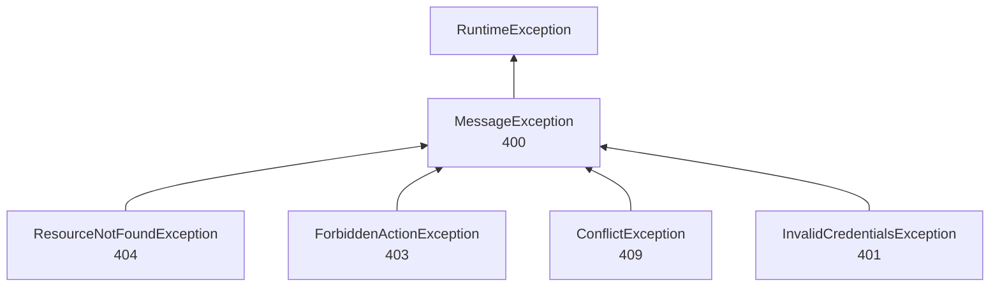

# Errores y validación

Las reglas de negocio no devuelven códigos de error: lanzan excepciones. Un único `@ControllerAdvice`, `exception/GlobalExceptionHandler.java`, las traduce a un status HTTP y a un cuerpo JSON con forma fija. La validación de entrada se reparte en tres lugares: Bean Validation en los DTOs, la capa `validation/` y unas pocas utilidades compartidas.

## Forma de las respuestas de error

Todas las respuestas que produce `GlobalExceptionHandler` tienen esta forma:

```json
{
  "error": "Resource not found",
  "message": "Campaign not found with id: 42",
  "timestamp": "2026-10-09T14:30:12.123456"
}
```

- `error`: categoría fija por tipo de excepción (ver la tabla de abajo).
- `message`: el detalle. En las excepciones de negocio es el texto con el que se lanzó; en las de Spring lo arma el handler.
- `timestamp`: `LocalDateTime.now()` del servidor, sin zona horaria.

Los errores de Bean Validation agregan un cuarto campo, `fields`, con el mensaje de cada campo inválido:

```json
{
  "error": "Validation failed",
  "message": "One or more fields are invalid",
  "fields": { "amount": "Amount must be greater than zero", "message": "Message must be at most 280 characters" },
  "timestamp": "2026-10-09T14:30:12.123456"
}
```

**Las respuestas de la capa de seguridad tienen un campo más, `path`.** El `401` del entry point, el `403` del `accessDeniedHandler` y el `403` de cuenta sancionada que escribe `JwtAuthenticationFilter` no pasan por el `@ControllerAdvice` (ocurren antes de llegar al controller), así que se arman a mano en `security/SecurityConfig.java` y `security/JwtAuthenticationFilter.java` con la forma `{error, message, timestamp, path}`. Detalle en [Seguridad](03-seguridad.md).

## Excepciones del proyecto

Todas viven en `exception/` y heredan de `MessageException`, que es una `RuntimeException`. Ninguna regla de negocio lanza otra cosa.



| Excepción | Status | `error` | Cuándo se usa |
|---|---|---|---|
| `MessageException` | 400 | `Business logic error` | Regla de negocio violada en general: montos, estados que no permiten la acción, autorreferencias (`Users cannot follow themselves`), parámetros de paginación inválidos. |
| `ResourceNotFoundException` | 404 | `Resource not found` | No existe, está borrado lógicamente o **no es visible** para quien llama (ver "404 en lugar de 403"). |
| `ForbiddenActionException` | 403 | `Forbidden` | Existe y es visible, pero quien llama no puede hacer eso (no es el dueño), o su propia cuenta está sancionada. |
| `ConflictException` | 409 | `Conflict` | El estado actual choca con la operación: `User is already being followed`, `Campaign goal is already closed`, `There is already a pending request for this user.`, etc. |
| `InvalidCredentialsException` | 401 | `Invalid credentials` | Login fallido y refresh/logout con token inválido. |

Cada clase tiene además `@ResponseStatus` con el mismo status. No es lo que decide la respuesta (para eso está el handler), pero mantiene el status correcto si alguna vez se lanzara fuera del alcance del `@ControllerAdvice`.

Como hay un handler por subclase, Spring elige el más específico: un `ResourceNotFoundException` cae en su propio handler y no en el de `MessageException`.

## Tabla completa de `GlobalExceptionHandler`

| Excepción | Status | `error` | `message` | Origen típico |
|---|---|---|---|---|
| `ResourceNotFoundException` | 404 | `Resource not found` | el de la excepción | Capa `validation/` |
| `ForbiddenActionException` | 403 | `Forbidden` | el de la excepción | Capa `validation/`, login y refresh de cuentas sancionadas |
| `ConflictException` | 409 | `Conflict` | el de la excepción | Capa `validation/` y services |
| `InvalidCredentialsException` | 401 | `Invalid credentials` | el de la excepción (`Invalid email or password`, `Invalid or expired refresh token`) | `service/auth/AuthenticationService.java` |
| `MessageException` | 400 | `Business logic error` | el de la excepción | Capa `validation/`, `utils/ValidationUtils.java`, `validation/common/SortValidationService.java` |
| `AccessDeniedException` (Spring Security) | 403 | `Forbidden` | `You don't have permission to access this resource` | `@PreAuthorize("hasRole('ADMIN')")` denegado |
| `AuthenticationException` (Spring Security) | 401 | `Authentication failed` | el de la excepción | Fallos del `AuthenticationManager` en el login que no son `BadCredentialsException` |
| `BadCredentialsException` | 401 | `Invalid credentials` | `Email or password is incorrect` | Ninguno hoy: el login la captura y la convierte en `InvalidCredentialsException` |
| `UsernameNotFoundException` | 404 | `User not found` | el de la excepción | Ninguno hoy: en el login `DaoAuthenticationProvider` la convierte en `BadCredentialsException`, y en el filtro JWT la captura el propio filtro |
| `MethodArgumentNotValidException` | 400 | `Validation failed` | `One or more fields are invalid` + `fields` | `@Valid @RequestBody` con un body inválido |
| `HandlerMethodValidationException` | 400 | `Validation failed` | `One or more fields are invalid` + `fields` | Validación de parámetros del método (ver "Bean Validation") |
| `HttpMessageNotReadableException` | 400 | `Malformed request` | ver abajo | JSON inválido, body faltante, valor de tipo incorrecto |
| `MethodArgumentTypeMismatchException` | 400 | `Invalid parameter` | `Invalid value '<valor>' for parameter '<nombre>'` | `/api/campaigns/abc` donde se espera un `Long` |
| `MissingServletRequestParameterException` | 400 | `Invalid parameter` | `Required parameter '<nombre>' is missing` | Query param obligatorio ausente |
| `HttpRequestMethodNotSupportedException` | 405 | `Method not allowed` | `Method <método> is not supported for this endpoint` | Método HTTP incorrecto; agrega el header `Allow` con los métodos soportados |
| `HttpMediaTypeNotSupportedException` | 415 | `Unsupported media type` | `Content type '<tipo>/<subtipo>' is not supported. Use application/json` (o `Content type is not supported. Use application/json` si no vino `Content-Type`) | Body que no es JSON |
| `DataIntegrityViolationException` | 409 | `Conflict` | `The request conflicts with existing data` | Un `UNIQUE` o `FOREIGN KEY` violado en la base que no se detectó antes; se loguea con `warn` |
| `NoResourceFoundException` | 404 | `Resource not found` | `No endpoint found for this request` | Ruta inexistente |
| `Exception` (cualquier otra) | 500 | `Internal server error` | `An unexpected error occurred. Please try again later.` | Todo lo no previsto; se loguea con `error` y el stack trace, pero no se devuelve al cliente |

`HttpMessageNotReadableException` arma el `message` según la causa:

| Causa | `message` |
|---|---|
| Valor de tipo incorrecto en un campo (`InvalidFormatException`) | `Invalid value '<valor>' for field '<ruta.del.campo>'` |
| Lo mismo, cuando el campo es un enum | lo anterior + `. Allowed: <VALOR1>, <VALOR2>, ...` |
| Body ausente en un endpoint que lo exige | `Request body is required` |
| Cualquier otro JSON inválido | `Malformed request body` |

Así el cliente ve, por ejemplo, los valores válidos de `ReportReason` o `VerificationStatus` sin tener que leer el código.

### Qué termina en `500`

El handler genérico garantiza que ningún error filtre un stack trace, pero también convierte en `500` lo que no es una de las excepciones de arriba. En el código actual:

- `service/campaign/CampaignService.java` (`createCampaign`) lanza un `RuntimeException("User not found with id: ...")` si el usuario del token no existe. En la práctica no ocurre, porque el filtro JWT ya rechazó esa cuenta con `401`.
- `security/AuthenticatedUserService.java` (`getAuthenticatedUserId`) falla si se lo llama desde una ruta pública sin token. Hoy ningún endpoint público lo hace: usan `findAuthenticatedUserId`.
- `service/auth/JwtService.java` lanza `IllegalArgumentException` con argumentos `null`, pero siempre se lo llama desde caminos que ya los descartaron o que capturan la excepción.
- Errores de infraestructura (base caída, timeout del bloqueo pesimista de `CampaignService.lockGoal`).

Las propiedades `server.error.*` de `src/main/resources/application.properties` y `application-docker.properties` (`include-stacktrace=never`, `include-message=always`, `include-binding-errors=always`, `include-exception=false`) solo afectan al `/error` de Spring Boot, que se usa cuando un error ocurre fuera de los controllers y no pasa por el `@ControllerAdvice`. Como `/error` está en las rutas públicas, esa respuesta no se convierte en un `401`.

## Bean Validation en los DTOs

### Dónde se activa

Los controllers marcan el body con `@Valid` (14 usos en los controllers). Sin `@Valid` las anotaciones del DTO no se evalúan: es el caso de `dtos/auth/AuthRequest.java` y `dtos/auth/RefreshTokenRequest.java`, que no tienen anotaciones y cuyos errores salen de `AuthenticationService` (ver [Auth](dominios/auth.md)).

`dtos/user/UserUserInfoRequestDTO.java` anida dos DTOs (`user` y `userInfo`) con `@NotNull @Valid`, así que se validan en cascada y los errores llegan con la ruta del campo (`userInfo.email`).

Ningún controller usa `@Validated` a nivel de clase, así que no aparecen `ConstraintViolationException` (que caerían en el `500`). Los errores de validación llegan siempre como `MethodArgumentNotValidException` o `HandlerMethodValidationException`, las dos con la misma respuesta.

`@Valid` se evalúa al resolver los argumentos del método, antes de que el proxy de `@PreAuthorize` llegue a decidir: en los endpoints de ADMIN, un `USER` que manda un body inválido recibe `400 Validation failed` y no `403`.

### Anotaciones por DTO

| DTO | Campo | Reglas |
|---|---|---|
| `dtos/campaign/CreateCampaignRequestDTO.java` | `name` | `@NotBlank`, `@Size(max = 255)` |
| | `description` | `@NotNull`, `@Size(max = 255)` |
| | `amountGoal` | `@NotNull`, `@Positive`, `@Digits(integer = 13, fraction = 2)` |
| | `categoryIds` | `@NotEmpty`, `@Size(min = 1, max = 5)` |
| `dtos/campaign/UpdateCampaignRequestDTO.java` | `name` | `@Size(max = 255)`, `@Pattern(".*\\S.*", message = "must not be blank")` |
| | `description` | `@Size(max = 255)` |
| | `amountGoal` | `@Positive`, `@Digits(integer = 13, fraction = 2)` |
| | `categoryIds` | `@NotEmpty`, `@Size(min = 1, max = 5)` |
| `dtos/donation/CreateDonationDTO.java` | `campaignId`, `recipientUserId` | Sin anotaciones: que llegue exactamente uno lo valida `DonationValidationService.validateInput` (`Campaign ID or recipient user ID is required` / `Only one of campaignId or recipientUserId can be set`) |
| | `amount` | `@NotNull(message = "Amount is required")`, `@Positive(message = "Amount must be greater than zero")`, `@Digits(integer = 13, fraction = 2)` |
| | `message` | `@Size(max = 280, message = "Message must be at most 280 characters")` (el blanco lo rechaza `DonationValidationService`) |
| `dtos/donation/CreateDonationThanksDTO.java` | `thanksMessage` | `@Size(max = 280, message = "Thanks message must be at most 280 characters")` (ausente o en blanco lo rechaza `DonationValidationService`) |
| `dtos/user/UpdateAutoThanksDTO.java` | `autoThanksMessage` | `@Size(max = 280, message = "Auto thanks message must be at most 280 characters")` (ausente o en blanco lo rechaza `UserValidationService`) |
| `dtos/publication/CreatePublicationDTO.java` | `description` | `@NotBlank`, `@Size(max = 255)` |
| `dtos/category/CreateCategoryDTO.java` | `name` | `@NotBlank`, `@Size(max = 255)` |
| | `description` | `@Size(max = 255)` |
| `dtos/category/UpdateCategoryDTO.java` | `name` | `@Size(max = 255)`, `@Pattern(".*\\S.*", message = "must not be blank")` |
| | `description` | `@Size(max = 255)` |
| `dtos/bankaccount/CreateBankAccountDTO.java` | `bankName`, `accountHolder` | `@NotBlank`, `@Size(max = 100)` |
| | `accountNumber`, `accountType` | `@NotBlank`, `@Size(max = 50)` |
| `dtos/bankaccount/UpdateBankAccountDTO.java` | `bankName`, `accountHolder` | `@Size(max = 100)` con mensaje propio (`Bank name cannot exceed 100 characters`, `Account holder cannot exceed 100 characters`) |
| | `accountNumber`, `accountType` | `@Size(max = 50)` con mensaje propio |
| `dtos/user/UserUserInfoRequestDTO.java` | `user`, `userInfo` | `@NotNull`, `@Valid` |
| `dtos/user/CreateUserInfoDTO.java` | `firstName`, `lastName` | `@NotBlank`, `@Size(max = 255)` |
| | `email` | `@NotBlank`, `@Size(max = 254)` (el formato se valida en `UserValidationService`) |
| | `userName`, `password` | `@NotBlank` (largo, caracteres y reglas de contraseña en `UserValidationService`) |
| | `phone` | `@NotBlank`, `@Size(max = 20)` |
| | `description` | `@NotNull`, `@Size(max = 255)` |
| | `profilePicture` | `@Size(max = 255)` |
| `dtos/user/UpdateUserDTO.java` | `firstName`, `lastName`, `description`, `profilePicture` | `@Size(max = 255)` |
| | `email` | `@Size(max = 254)` |
| | `phone` | `@Size(max = 20)` |
| `dtos/report/CreateReportDTO.java` | `reportedEntityType`, `reason` | `@NotNull` |
| | `reportedEntityId` | `@NotNull`, `@Positive` |
| | `description` | `@Size(max = 1000)` |
| `dtos/report/ReviewReportDTO.java` | `status` | `@NotNull` |
| `dtos/verification/CreateVerificationRequestDTO.java` | `dniFront`, `dniBack`, `selfieUser` | `@NotBlank`, `@Size(max = 255)` |
| `dtos/verification/ProcessVerificationRequestDTO.java` | `requestId` | `@NotNull`, `@Positive` |
| | `status` | `@NotNull` |

Ningún `@Size` supera el largo de su columna: los `String` de las entidades no declaran `length`, así que Hibernate los crea con 255, salvo `Donation.message`, `Donation.thanksMessage` y `UserInfo.autoThanksMessage`, que declaran `length = 280` igual que su `@Size`, y la descripción del reporte es `TEXT`. Un texto demasiado largo se rechaza con `400` en lugar de llegar a la base y volver como `DataIntegrityViolationException` (`409`). `@Digits(integer = 13, fraction = 2)` cumple el mismo papel con los montos, que en la base son `precision = 15, scale = 2` (`entity/campaign/Goal.java`, `entity/donation/Donation.java`).

La mayoría de las anotaciones no define `message`, así que el cliente recibe el texto por defecto de Hibernate Validator en inglés (`must not be blank`, `size must be between 0 and 255`, `must be greater than 0`). Solo `CreateDonationDTO`, `CreateDonationThanksDTO`, `UpdateAutoThanksDTO`, `UpdateBankAccountDTO` y los `@Pattern` de los DTOs de actualización traen mensajes propios.

`fields` es un mapa con una entrada por campo: si un mismo campo viola dos reglas a la vez (por ejemplo `categoryIds: []` viola `@NotEmpty` y `@Size(min = 1)`), solo se ve uno de los dos mensajes.

### Actualizaciones parciales: "si viene, que no esté vacío"

Los DTOs `Update*` tienen todos los campos opcionales: un campo `null` deja el valor actual. Qué pasa cuando el campo viene vacío (`""` o solo espacios) depende del dominio:

| Dominio | Mecanismo | Resultado con `"name": "  "` |
|---|---|---|
| Campaña, categoría | `@Pattern(regexp = ".*\\S.*")` en el DTO | `400 Validation failed`, `fields.name = must not be blank` |
| Cuenta bancaria | `ValidationUtils.validateIfPresent` en `validation/bankaccount/BankAccountValidationService.java` | `400 Business logic error`, `Bank name cannot be empty` |
| Usuario | `isValidString` en `validation/user/UserValidationService.java` | El campo se ignora y la actualización sigue (`200`) |

## Validación fuera de los DTOs

Bean Validation solo cubre forma (presente, largo, signo). Todo lo que depende de la base o de otras reglas va en la capa `validation/` (ver [Arquitectura](02-arquitectura.md)): existencia, propiedad, visibilidad, transiciones de estado, unicidad, formato de email y contraseña. Esas clases lanzan las excepciones de `exception/`, así que el cliente recibe la misma forma de error venga de donde venga.

### `utils/ValidationUtils.java`

Métodos estáticos que lanzan `MessageException` (`400`):

| Método | Regla | Mensaje |
|---|---|---|
| `validateNotBlank(valor, campo)` | No `null` ni vacío tras `trim()` | `<campo> cannot be empty` |
| `validateIfPresent(valor, campo)` | Si no es `null`, aplica `validateNotBlank` | `<campo> cannot be empty` |
| `validateAtLeastOneFieldPresent(campos...)` | Al menos un argumento distinto de `null` | `At least one field must be provided for update` |

Hoy solo los usa `validation/bankaccount/BankAccountValidationService.java`. En la creación, `validateNotBlank` repite lo que ya garantizó `@NotBlank` en `CreateBankAccountDTO`, así que sus mensajes no llegan a verse.

`utils/` contiene también `PasswordHashGenerator`, que no participa en la validación: es un `main` para generar hashes BCrypt (ver [Seguridad](03-seguridad.md)).

### `validation/common/SortValidationService.java`

Valida y arma el `Pageable` de los listados paginados. Cada controller le pasa su propia lista blanca de campos de orden:

| Controller | Endpoint | Campos de orden permitidos | Por defecto |
|---|---|---|---|
| `controller/user/UserController.java` | `GET /api/users/list/paginated` | `id`, `createdAt` | `page=0`, `size=10`, `sortBy=id`, `sortDirection=asc` |
| `controller/report/ReportController.java` | `GET /api/reports` | `createdAt`, `status` | `page=0`, `size=10`, `sortBy=createdAt`, `sortDirection=desc` |
| `controller/donation/SupporterController.java` | `GET /api/users/{userId}/supporters` | `totalAmount`, `lastDonationAt` | `page=0`, `size=10`, `sortBy=totalAmount`, `sortDirection=desc` |
| `controller/donation/SupporterController.java` | `GET /api/users/{userId}/support-feed` | `createdAt` (fijo: el cliente no elige orden) | `page=0`, `size=10`, `sortBy=createdAt`, `sortDirection=desc`; solo `page` y `size` son parámetros |
| `controller/donation/DonationController.java` | `GET /api/donations/received` | `createdAt`, `amount` | `page=0`, `size=10`, `sortBy=createdAt`, `sortDirection=desc` |

Reglas, en este orden, todas con `400 Business logic error`:

| Regla | Mensaje |
|---|---|
| `page >= 0` | `Page must be greater than or equal to 0` |
| `1 <= size <= 100` | `Size must be between 1 and 100` |
| `sortBy` en la lista blanca | `Invalid sortBy '<valor>'. Allowed: <campos>` |
| `sortDirection` es `asc` o `desc` (sin distinguir mayúsculas) | `Invalid sortDirection '<valor>'. Allowed: asc, desc` |

La lista blanca evita que un `sortBy` arbitrario llegue a la query y falle en la base con un `500`. En usuarios se limita a columnas de `User` porque la query paginada usa `SELECT DISTINCT` y SQL Server no acepta `ORDER BY` sobre columnas de tablas unidas que no estén en el `SELECT` (lo explica el comentario de `USER_SORT_FIELDS`). El tope de `size` impide pedir la tabla entera en una sola página.

Si `page` o `size` no son números, el error lo produce Spring antes de llegar al servicio: `400 Invalid parameter`, `Invalid value 'abc' for parameter 'page'`.

En los supporters, los campos de orden no son columnas: el servicio lee `sortBy` y la dirección del `Pageable` y los pasa como parámetros a una query nativa con el `ORDER BY` escrito (ver [Modelo de datos](04-modelo-de-datos.md#leer-a-través-del-borrado)). La lista blanca dice qué campos existen, pero no quién puede usarlos: `lastDonationAt` además lo restringe `DonationValidationService.validateSupporterSort` al propio creador y al ADMIN (`400 Only the creator or an admin can sort supporters by lastDonationAt`). Esa regla depende de quién llama, así que va en el dominio y corre en el servicio, después de los chequeos del creador. Ver [Donation](dominios/donation.md#supporters-de-un-creador).

### `validation/common/TextValidationService.java`

Regla de texto obligatorio que comparten dos dominios. Un solo método, `normalizeRequiredText(text, fieldLabel, maxLength)`, que lanza `MessageException` (`400 Business logic error`) o devuelve el texto con `trim`:

| Regla | Mensaje |
|---|---|
| No `null`, ni vacío, ni solo espacios (incluidos saltos de línea y tabulaciones) | `<fieldLabel> cannot be blank` |
| Hasta `maxLength` caracteres, medidos después del `trim` | `<fieldLabel> must be at most <maxLength> characters` |

| Quién lo usa | `fieldLabel` | `maxLength` | Nota |
|---|---|---|---|
| `DonationValidationService.validateAndNormalizeMessage` | `Message` | 280 | El mensaje del donante es opcional: `null` devuelve `null` sin llamar al servicio. |
| `DonationValidationService.validateAndNormalizeThanksMessage` | `Thanks message` | 280 | La respuesta del receptor a una donación. |
| `UserValidationService.validateAndNormalizeAutoThanksMessage` | `Auto thanks message` | 280 | El mensaje predeterminado del usuario. |

En los tres casos el DTO tiene además un `@Size(max = 280)` con su propio mensaje, que corta antes (`400 Validation failed`, con `fields`). `@Size` mide el texto con los espacios de los extremos, así que el chequeo de largo del servicio no se alcanza por la API. El blanco sí lo rechaza el servicio y no el DTO, porque es una regla de negocio.

## `404` en lugar de `403`: no revelar lo que no se puede ver

El criterio del proyecto es que **un recurso que quien llama no puede ver responde igual que uno que no existe**. `403` se reserva para lo que quien llama sí puede ver pero no puede modificar.

| Caso | Respuesta | Mensaje | Dónde |
|---|---|---|---|
| Campaña `CLOSED` de otro usuario (visitante o `USER` que no es el dueño) | 404 | `Campaign not found with id: <id>` | `validation/campaign/CampaignValidationService.java` (`findVisibleCampaignByIdOrThrow`), `validation/campaign/CampaignAuthorizationService.java` |
| Campaña de un dueño baneado o suspendido (para quien no es ADMIN) | 404 | `Campaign not found with id: <id>` | `CampaignValidationService.findVisibleCampaignById` y las queries `*VisibleTo` de `repository/campaign/CampaignRepository.java` |
| Donar, publicar o reportar sobre una campaña oculta | 404 | el mismo de la campaña | `validation/donation/DonationValidationService.java`, `validation/publication/PublicationValidationService.java`, `validation/report/ReportValidationService.java` |
| Donar directo a un usuario inexistente, borrado, baneado o suspendido (también si dona un ADMIN) | 404 | `User not found` | `DonationValidationService.validateAndGetRecipient`, con `UserValidationService.getUserById` y `validateProfileNotBlocked` |
| Perfil, seguidores, supporters, feed de apoyos o reporte de un usuario baneado o suspendido (para quien no es ADMIN) | 404 | `User not found` | `validation/user/UserValidationService.java` (`validateProfileNotBlocked`, también desde `service/donation/SupporterService.java`, en supporters y feed de apoyos), `validation/follower/FollowerValidationService.java`, `validation/report/ReportValidationService.java` |
| Recurso borrado lógicamente | 404 | el de "no encontrado" del dominio | `@SQLRestriction` sobre `deleted_at` en `User`, `Campaign`, `Goal`, `Publication`, `BankAccount` y `VerificationRequest` (ver [Modelo de datos](04-modelo-de-datos.md)) |
| Campaña visible pero ajena, al modificarla, cerrarla o ver su historial | 403 | `You are not authorized to perform this action` | `CampaignAuthorizationService.validateOwnershipOrAdmin` |
| Responder o borrar la respuesta de una donación ajena, **sin importar si la campaña es visible** | 403 | Donación a campaña: `Only the campaign owner can reply to this donation` / `Only the campaign owner or an admin can delete this reply`. Donación directa: `Only the recipient can reply to this donation` / `Only the recipient or an admin can delete this reply` | `DonationValidationService.validateIsRecipient` / `validateIsRecipientOrAdmin` (el literal lo elige `campaignId`) |
| Endpoint de ADMIN llamado por un `USER` | 403 | `You don't have permission to access this resource` | `@PreAuthorize` + `GlobalExceptionHandler` |
| Cuenta propia baneada o suspendida | 403 | `Your account has been banned. Reason: ...` / `Your account is suspended until ... Reason: ...` | `validation/auth/AccountStatusValidationService.java` |

La consecuencia observable es que un tercero no puede usar la API para averiguar si una campaña existe pero está cerrada, ni si un usuario existe pero está sancionado: el `404` es idéntico, incluido el mensaje. Por eso `CampaignAuthorizationService` vuelve a comprobar si la campaña está `CLOSED` antes de decidir entre `404` y `403`: un `403` sobre una campaña cerrada revelaría que existe.

**Excepción conocida: `/api/donations/{donationId}/thanks`.** Los dos endpoints buscan la donación por id y no aplican la visibilidad de la campaña. Un tercero recibe `404 Donation not found` si la donación no existe y `403` si existe, también cuando es de una campaña `CLOSED` ajena o de un dueño baneado o suspendido, y vale igual para las donaciones directas (con los literales de receptor). El `400 Cannot reply to a donation of a deleted campaign` también confirma la existencia. Lo único que se revela es que hay una donación con ese id: ni el texto, ni el monto, ni la campaña. Ver [Donation](dominios/donation.md#visibilidad-y-permisos).

El titular de una cuenta sancionada, en cambio, sí recibe `403` con el motivo: es el único que tiene que enterarse (ver `validateNotBlocked` frente a `isBlocked` en [Seguridad](03-seguridad.md)).

Para que este ocultamiento funcione, el mensaje del `404` tiene que ser exactamente el mismo en todos los caminos. El `User not found` está definido como constante en varias clases (`service/user/UserService.java`, `validation/user/UserValidationService.java`, `validation/report/ReportValidationService.java`, `validation/bankaccount/BankAccountValidationService.java`): si alguna copia cambia, la sanción vuelve a distinguirse.

La regla exacta de cada endpoint (cuándo `404`, cuándo `403`) está en la sección "Visibilidad y permisos" de cada archivo de [dominios](README.md#dominios).
