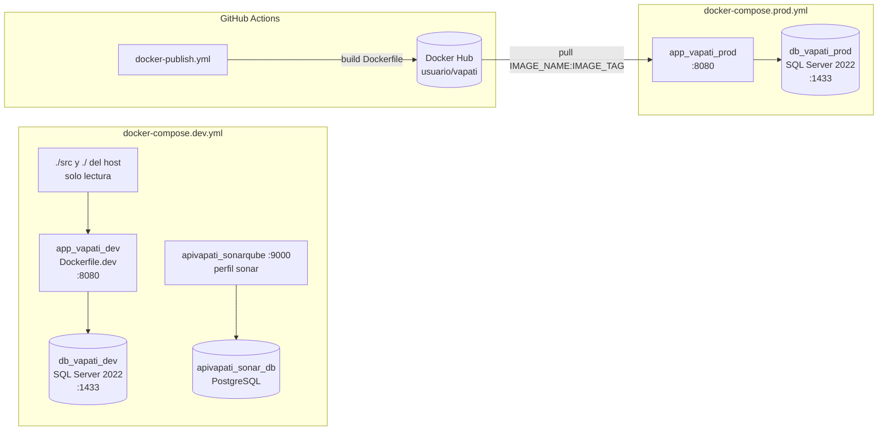
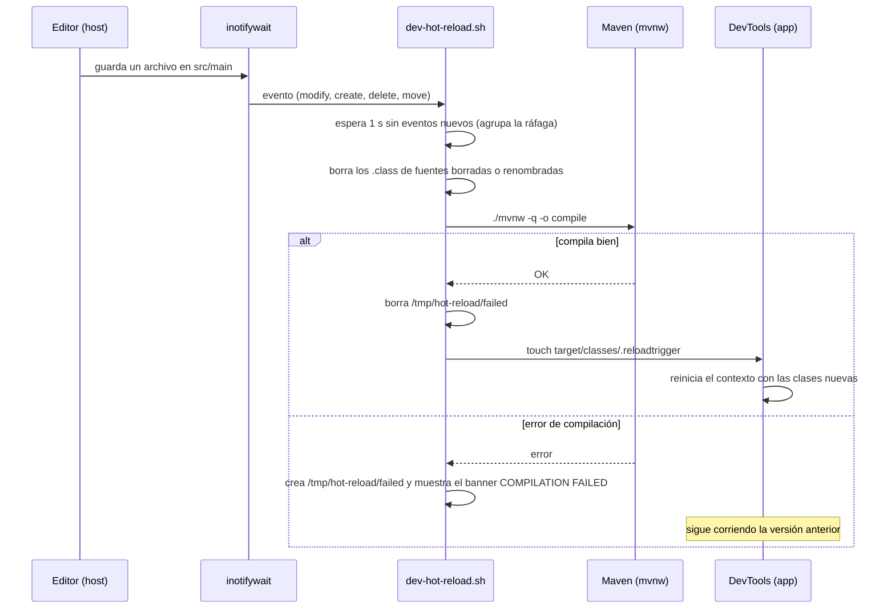
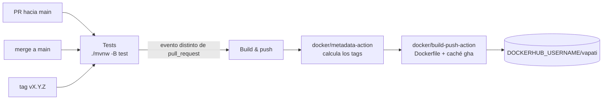

# Infraestructura

Cómo se configura, se levanta, se construye y se publica VaPaTi: perfiles de Spring, variables de entorno, imágenes Docker, los dos stacks de Compose, el hot reload de desarrollo, la inicialización de la base y el workflow de GitHub Actions.

## Panorama

Hay tres formas de correr la aplicación, y todas usan SQL Server:

| Forma | Perfil Spring | Base de datos | Código fuente |
|---|---|---|---|
| Local, `./mvnw spring-boot:run` | ninguno (`application.properties`) | SQL Server en `localhost:1433`, levantado aparte | el del disco |
| Stack de desarrollo, `docker-compose.dev.yml` | `docker` | contenedor `db_vapati_dev` | montado de solo lectura, con hot reload |
| Stack de producción, `docker-compose.prod.yml` | `docker` | contenedor `db_vapati_prod` | ninguno: corre la imagen publicada |



## Perfiles de Spring

La configuración vive en `src/main/resources/`. No hay perfiles `dev` ni `prod`: los dos stacks de Compose activan el mismo perfil `docker` (`SPRING_PROFILES_ACTIVE: docker`), así que desarrollo y producción en contenedores comparten configuración y solo se diferencian por las variables de entorno.

| Propiedad | `application.properties` (sin perfil) | `application-docker.properties` (perfil `docker`) |
|---|---|---|
| `spring.datasource.url` | `jdbc:sqlserver://localhost:1433;databaseName=ApiVaPaTiJava;trustServerCertificate=true` | igual, pero con host `sqlserver` (el nombre del servicio en Compose) |
| `spring.datasource.username` | `sa` | `sa` |
| `spring.datasource.password` | `${DB_PASSWORD:...}`, con un valor por defecto escrito en el archivo | igual |
| `spring.jpa.hibernate.ddl-auto` | `update` | `update` |
| `spring.jpa.show-sql` | `true` | `true`, más `hibernate.format_sql=true` |
| `spring.sql.init.mode` + `spring.jpa.defer-datasource-initialization` | `always` + `true` | igual |
| `jwt.secret` | `${JWT_SECRET}` (sin valor por defecto) | igual |
| `jwt.expiration` / `jwt.refresh-expiration` | 1 hora / 7 días (en ms) | igual |
| `server.error.*` | sin stacktrace ni nombre de excepción; con mensaje y errores de binding | igual |
| `cors.allowed-origins` | `${CORS_ALLOWED_ORIGINS:http://localhost:3000}` | igual |
| `server.port` / `server.address` | por defecto (8080) | `8080` / `0.0.0.0` |
| DevTools | por defecto | `spring.devtools.restart.enabled` y `livereload.enabled` en `true` |
| Logging | por defecto | `com.vaPaTi.vaPaTi` y `org.hibernate.SQL` en `DEBUG` |
| `spring.test.database.replace` | — | `none` (es una propiedad de tests; en runtime no tiene efecto) |

Consecuencias que conviene tener presentes:

- **El esquema lo genera Hibernate** (`ddl-auto=update`) en todos los entornos, incluido producción. No hay migraciones versionadas: una columna nueva aparece sola al arrancar, pero un renombre o un borrado no se aplican.
- **`data.sql` corre en cada arranque** (`spring.sql.init.mode=always`), después de que Hibernate crea o actualiza las tablas (`defer-datasource-initialization=true`). Por eso sus `INSERT` están protegidos con `IF NOT EXISTS`: siembran los roles `USER` y `ADMIN` y las seis categorías iniciales sin duplicarlos.
- **El perfil `docker` también rige en producción**, con SQL y logs de la aplicación en `DEBUG`.
- `SERVER_PORT` pisa a `server.port` aunque el perfil `docker` lo fije en `8080`, porque Spring da prioridad a las variables de entorno sobre los archivos de propiedades.

## Variables de entorno

El archivo de referencia es `.env.example`, versionado y con los valores vacíos. Los `.env` y `.env.*` reales están en `.gitignore` (salvo `.env.example`), y Compose los lee de la raíz del repo.

| Variable | Quién la usa | Obligatoria | Qué hace |
|---|---|---|---|
| `JWT_SECRET` | los dos compose → `jwt.secret` | **sí** | Clave HMAC para firmar los JWT. Los compose la declaran como `${JWT_SECRET:?JWT_SECRET is required}`, así que sin ella Compose ni crea el contenedor. Además, `service/auth/JwtService.java` valida al arrancar que no esté vacía, que no sea el placeholder público de ejemplo y que tenga al menos 32 bytes; si no, la aplicación no levanta. Se genera con `openssl rand -base64 64 \| tr -d '\n'`. |
| `DB_PASSWORD` | los dos compose → `MSSQL_SA_PASSWORD` del contenedor de SQL Server y `spring.datasource.password` | en la práctica sí | Password del usuario `sa`. SQL Server exige una política mínima de complejidad. A diferencia de `JWT_SECRET`, los compose no la marcan como obligatoria (`${DB_PASSWORD}` sin `:?`). |
| `CORS_ALLOWED_ORIGINS` | `cors.allowed-origins` → `security/CorsConfig.java` | no | Orígenes permitidos separados por coma. Por defecto `http://localhost:3000`. |
| `SERVER_PORT` | los dos compose | no (8080) | Puerto en el que escucha Spring dentro del contenedor. |
| `APP_PORT` | los dos compose | no (8080) | Puerto del host mapeado a la aplicación. |
| `DB_PORT` | los dos compose | no (1433) | Puerto del host mapeado a SQL Server. |
| `IMAGE_NAME`, `IMAGE_TAG` | solo `docker-compose.prod.yml` | no (`app_vapati_prod:latest`) | Imagen a correr, normalmente `<usuario-dockerhub>/vapati` y una versión. |

`docker-compose.dev.yml` agrega variables propias que no salen del `.env`: `SPRING_DEVTOOLS_RESTART_ENABLED`, `SPRING_DEVTOOLS_LIVERELOAD_ENABLED`, `SPRING_DEVTOOLS_RESTART_TRIGGER_FILE` (ver [Hot reload](#hot-reload-en-desarrollo)), `DOCKER_HOST` y `TESTCONTAINERS_RYUK_DISABLED`.

Para correr local sin Docker hay que exportar `JWT_SECRET` (y `DB_PASSWORD` si la base no usa la password por defecto) antes de `./mvnw spring-boot:run`.

## Imagen de producción: `Dockerfile`

Build multi-stage:

1. **Stage `build`** (`maven:3.9-eclipse-temurin-21`): copia primero `pom.xml`, `.mvn/` y el wrapper, corre `./mvnw dependency:go-offline` para que las dependencias queden en una capa cacheada, y recién después copia `src/` y empaqueta con `./mvnw clean package -DskipTests`. Así, un cambio de código no vuelve a descargar dependencias.
2. **Stage runtime** (`eclipse-temurin:21-jre`): copia solo el JAR como `app.jar`, expone el `8080` y arranca con `java $JAVA_OPTS -jar app.jar` (`JAVA_OPTS="-Xmx512m -Xms256m"` por defecto).

La imagen final no tiene Maven ni el código fuente. Los tests no corren en el build: en CI corren en un job previo (ver [CI](#ci-y-publicación-githubworkflowsdocker-publishyml)). `.dockerignore` deja fuera `target/` (salvo los `*.jar`), archivos de IDE, `.git/` y los Markdown.

DevTools no llega a la imagen: está declarado como `runtime` + `optional` en `pom.xml`, y el plugin de Spring Boot lo excluye del JAR empaquetado. Las propiedades de DevTools del perfil `docker` no tienen efecto en producción.

## Imagen de desarrollo: `Dockerfile.dev`

Parte de `maven:3.9-eclipse-temurin-21` (con JDK y Maven, a diferencia de la de producción), instala `inotify-tools`, copia `pom.xml` y el wrapper, descarga las dependencias en una capa cacheada y copia `scripts/dev-hot-reload.sh` como comando del contenedor. **No copia el código**: `docker-compose.dev.yml` lo monta. Fija `SPRING_PROFILES_ACTIVE=docker` y expone `8080` (aplicación) y `35729` (LiveReload).

## Stack de desarrollo: `docker-compose.dev.yml`

```bash
docker compose -f docker-compose.dev.yml up -d            # levantar (la primera vez, o si cambió Dockerfile.dev o el script, con --build)
docker compose -f docker-compose.dev.yml logs -f app-dev  # ver la aplicación y los errores de compilación
docker compose -f docker-compose.dev.yml restart app-dev  # aplicar un cambio de pom.xml
```

### Servicio `sqlserver` (`db_vapati_dev`)

- Imagen `mcr.microsoft.com/mssql/server:2022-latest`, puerto `${DB_PORT:-1433}`.
- Datos en el volumen con nombre fijo `sql_data_apivapati_java`.
- El `command` arranca `sqlservr` en segundo plano, espera 20 segundos y crea la base `ApiVaPaTiJava` con `sqlcmd` si no existe. Es la única creación de la base: las tablas las crea Hibernate al arrancar la aplicación.
- Monta `./init-db.sql` y `./init-db.sh`, pero el `command` no los ejecuta (ver [Inicialización de la base](#inicialización-de-la-base)).
- Healthcheck: un `SELECT 1` con `sqlcmd` cada 10 segundos. La aplicación espera a que el servicio esté `healthy` (`depends_on: condition: service_healthy`).

### Servicio `app-dev` (`app_vapati_dev`)

- Se construye con `Dockerfile.dev`.
- **Montajes:** `./src` en `/app/src` y la raíz del repo en `/workspace`, los dos de solo lectura; el volumen `maven-cache-dev` en `/root/.m2`; y el socket de Docker del host. `target/` vive dentro del contenedor, así que la compilación del contenedor no pisa la del host.
- `init: true`: corre `tini` como PID 1, que reenvía `SIGTERM` al script y recoge procesos hijos.
- Límite de memoria de 2 GB, `restart: unless-stopped`.
- Healthcheck: `unhealthy` si existe `/tmp/hot-reload/failed` (la última compilación falló) o si la aplicación no responde HTTP en `/` (cualquier status, incluido `401`, cuenta como respuesta). Tiene `start_period` de 180 segundos porque el primer arranque compila todo.

### Perfil `sonar`

Con `docker compose -f docker-compose.dev.yml --profile sonar up -d` se suman `apivapati_sonarqube` (SonarQube 10.4 en el puerto `9000`) y su base `apivapati_sonar_db` (PostgreSQL 15). Las credenciales de esa base están escritas en el compose: es una herramienta local de análisis. La configuración del análisis está en las propiedades `sonar.*` de `pom.xml`, que excluyen de la cobertura los paquetes sin lógica de negocio (`controller`, `dtos`, `entity`, `exception`, `mapper`, `repository`, `security`, `utils`), las mismas exclusiones que usa JaCoCo (ver [Testing](07-testing.md#cobertura-jacoco)).

## Hot reload en desarrollo

El hot reload no usa `docker compose watch`. Lo implementa `scripts/dev-hot-reload.sh`, que es el `CMD` del contenedor y no se corre a mano.



Cómo funciona, según el script:

- **Arranque.** Lanza los `inotifywait` antes de compilar, para no perder cambios hechos durante el arranque. Si el `pom.xml` del host difiere del de la imagen, lo copia. Compila en modo online (descarga lo que falte) y arranca la aplicación con `./mvnw spring-boot:run -Dmaven.test.skip=true` y el agente de debug JDWP en el puerto `5005`, en su propio grupo de procesos (`setsid`) para poder detenerla entera.
- **Qué vigila.** `src/main` de forma recursiva, y `/workspace` sin recursión (solo le importa `pom.xml`; así no ve los cambios de `target/` del host). Ignora archivos ocultos, temporales de editores (`*~`, `*.swp`, `*___jb_tmp___`) y archivos que no son `.java` dentro de `src/main/java`.
- **Agrupar eventos.** Procesa el lote cuando pasa 1 segundo sin eventos nuevos, así un "guardar todo" produce una sola compilación.
- **Archivos borrados.** Una compilación incremental no borra los `.class` de fuentes que ya no existen; el script los borra (incluidas las clases internas `Clase$*.class`) para que DevTools no recargue clases fantasma.
- **Compilación.** `./mvnw -q -o compile` (offline, rápida). Si sale bien, toca `target/classes/.reloadtrigger`.
- **Reinicio.** DevTools está configurado con `SPRING_DEVTOOLS_RESTART_TRIGGER_FILE=.reloadtrigger`: solo reinicia cuando cambia ese archivo, es decir, después de una compilación completa y exitosa. Nunca recarga clases a medio compilar.
- **Errores.** Si la compilación falla, la versión anterior sigue corriendo, el log muestra un banner `COMPILATION FAILED` con las líneas `[ERROR]` de Maven, y se crea `/tmp/hot-reload/failed`, que pone el contenedor en `unhealthy` hasta la siguiente compilación exitosa.
- **Cambios de `pom.xml`.** El script los detecta, copia el pom, compila en modo online y reinicia el proceso Java completo (no alcanza con DevTools, porque cambia el classpath). Si falla, restaura el pom anterior y muestra `POM DEPENDENCIES FAILED`. Con el file sharing de Docker Desktop estos eventos no siempre llegan; `restart app-dev` lo resuelve, porque al arrancar el script compara y copia el pom.
- **`Dockerfile.dev` o el script.** Requieren reconstruir la imagen (`up -d --build`).

## Stack de producción: `docker-compose.prod.yml`

Pensado para un servidor que solo tiene este archivo y un `.env`, sin el código:

```bash
docker volume create sql_data_apivapati_java   # solo la primera vez: el volumen es external
docker compose -f docker-compose.prod.yml pull
docker compose -f docker-compose.prod.yml up -d
```

Diferencias con el stack de desarrollo:

| Aspecto | Desarrollo | Producción |
|---|---|---|
| Aplicación | se construye con `Dockerfile.dev` | `image: ${IMAGE_NAME}:${IMAGE_TAG}` |
| Código fuente | montado, con hot reload | ninguno |
| Volumen de la base | `sql_data_apivapati_java`, lo crea Compose | `sql_data_apivapati_java` declarado `external: true`: hay que crearlo antes |
| Montajes extra en SQL Server | `init-db.sql`, `init-db.sh` | ninguno |
| Healthcheck de la aplicación | sí (compilación + HTTP) | no |
| Límites de memoria | 2 GB | sin límite (la JVM usa `-Xmx512m` por `JAVA_OPTS`) |
| Socket de Docker, DevTools | sí | no |
| Red | `vapati-network-dev` | `vapati-network` |
| SonarQube | perfil `sonar` | no |

En común: la misma imagen de SQL Server, la misma creación de la base en el `command`, el mismo healthcheck de la base, el perfil `docker` y las mismas variables `JWT_SECRET` (obligatoria), `DB_PASSWORD` y `CORS_ALLOWED_ORIGINS`.

## Inicialización de la base

| Pieza | Qué hace | Cuándo corre |
|---|---|---|
| `command` del servicio `sqlserver` (los dos compose) | Crea la base `ApiVaPaTiJava` si no existe. | Cada vez que arranca el contenedor de SQL Server. |
| Hibernate (`ddl-auto=update`) | Crea y actualiza las tablas según las entidades de `entity/`. | Al arrancar la aplicación. |
| `src/main/resources/data.sql` | Siembra los roles `USER` y `ADMIN` y las categorías Technology, Health, Education, Environment, Arts y Sports, de forma idempotente. | Al arrancar la aplicación, después de Hibernate. |
| `scripts/create-admin-user.sql` | Inserta un usuario con rol `ADMIN` (filas en `[user]` y `user_info`). Es la única forma de crear un admin: `POST /api/users/create` siempre asigna `USER`. Exige que `data.sql` ya haya sembrado el rol. | A mano, con `sqlcmd` dentro del contenedor de SQL Server. |
| `scripts/migrate-donation-recipient.sql` | Agrega `donation.recipient_user_id` (rellenada con el dueño de la campaña, `NOT NULL`, con FK e índice) y vuelve nullable `donation.campaign_id`, para las donaciones directas. Es idempotente. Ver [Modelo de datos](04-modelo-de-datos.md#migración-manual-de-donation). | A mano, con la app **detenida** y antes de levantar la imagen nueva, en dev y en prod, con `sqlcmd -I -b` dentro del contenedor de SQL Server. En prod, los pasos están en `DOCKER-HUB-DEPLOY.md` § 7.2. |
| `utils/PasswordHashGenerator.java` | Utilidad de línea de comandos (no es un bean) que imprime el hash BCrypt de una password, para completar el script anterior. | A mano. En la imagen de desarrollo, con el classpath de `target/classes` y `/root/.m2`; en la de producción, con el `PropertiesLauncher` de Spring Boot sobre `app.jar`. |
| `init-db.sql` | Crea la base si no existe. Hace lo mismo que el `command` de Compose. | Nunca: está montado en el contenedor de desarrollo pero nadie lo ejecuta. |
| `init-db.sh/` | Es un directorio vacío. El compose de desarrollo lo monta como `/init-db.sh`. | Nunca. |
| `intit-db.sh` | Script que espera 15 segundos y ejecuta `init-db.sql` con `sqlcmd`. | Nunca: no lo referencia ningún compose ni Dockerfile. |

Para crear el admin en desarrollo, en resumen:

```bash
# 1. Hash de la password (imagen de desarrollo)
docker exec app_vapati_dev sh -c "cd /app && CP=target/classes:\$(find /root/.m2 -name '*.jar' | tr '\n' ':') && java -cp \"\$CP\" com.vaPaTi.vaPaTi.utils.PasswordHashGenerator '<password>'"

# 2. Editar scripts/create-admin-user.sql (hash, email, username) y ejecutarlo
docker cp scripts/create-admin-user.sql db_vapati_dev:/tmp/create-admin-user.sql
docker exec db_vapati_dev /opt/mssql-tools18/bin/sqlcmd -S localhost -U sa -P '<DB_PASSWORD>' -C -d ApiVaPaTiJava -i /tmp/create-admin-user.sql
```

En producción, el paso 1 cambia porque la imagen no tiene Maven:

```bash
docker exec app_vapati_prod sh -c "java -Dloader.main=com.vaPaTi.vaPaTi.utils.PasswordHashGenerator -cp app.jar org.springframework.boot.loader.launch.PropertiesLauncher '<password>'"
```

El script no controla duplicados: correrlo dos veces con el mismo email o username falla por clave única. Trae un hash ya escrito; hay que reemplazarlo siempre por uno propio.

## CI y publicación: `.github/workflows/docker-publish.yml`

El workflow tiene dos jobs, `test` (nombre visible `Tests`) y `publish` (`Build & push`), y `publish` depende de `test`.

| Evento | `Tests` | `Build & push` | Tags que se publican |
|---|---|---|---|
| Pull request hacia `main` | sí | no | ninguno |
| Push (merge) a `main` | sí | sí | `latest` |
| Push de un tag de git `vX.Y.Z` | sí | sí | `X.Y.Z` y `X.Y` (sin la `v`) y, por la configuración por defecto de `docker/metadata-action`, también `latest` |
| `workflow_dispatch` (manual) | sí | sí | `latest` si se lanza sobre `main` |



Detalles:

- **Tests.** JDK 21 Temurin con caché de Maven. Corre `./mvnw -B test -Ddocker.remote.api.version="$(docker version --format '{{.Server.APIVersion}}')"`: incluye los tests de integración con Testcontainers, porque los runners de GitHub tienen Docker. La versión de la API de Docker se toma del daemon del runner en lugar de la fijada en `pom.xml` (ver [Testing](07-testing.md#configuración-de-surefire)).
- **Credenciales.** `vars.DOCKERHUB_USERNAME` (una *variable*, no un secret, así el nombre de la imagen se ve en los logs) y `secrets.DOCKERHUB_TOKEN`. El workflow tiene `permissions: contents: read`.
- **Tags de la imagen.** `type=raw,value=latest` solo cuando la ref es `refs/heads/main`; `type=semver` con `{{version}}` y `{{major}}.{{minor}}` para los tags de git. El paso no define `flavor`, así que rige `latest=auto` de `docker/metadata-action`, que también agrega `latest` cuando el tag de mayor prioridad es un semver. La línea `type=sha` (un tag `sha-<commit>` por imagen) está comentada.
- **Concurrencia.** `group: docker-publish-${{ github.ref }}` con `cancel-in-progress: false`: dos publicaciones de la misma ref no se pisan, la segunda espera.
- **Caché.** `cache-from` y `cache-to` de tipo `gha`, para reutilizar las capas del `Dockerfile` entre corridas.
- **Versión del JAR.** El `pom.xml` sigue en `0.0.1-SNAPSHOT`: la versión que identifica un release es el tag de la imagen, no la del artefacto Maven.

El flujo de ramas que se deduce del workflow: el trabajo diario va a `dev`, `main` recibe PRs desde `dev` (en el PR corre `Tests`), y cada merge publica `latest`. Los PRs hacia `dev` no disparan este workflow.

## Ver también

- [Testing](07-testing.md): cómo correr la suite, localmente o con Maven en Docker.
- [Seguridad](03-seguridad.md): uso de `JWT_SECRET` y de `CORS_ALLOWED_ORIGINS`.
- [Modelo de datos](04-modelo-de-datos.md): las tablas que crea Hibernate y el contenido de `data.sql`.
- [Deuda técnica](deuda-tecnica.md): las inconsistencias de infraestructura (archivos de inicialización sin uso, diferencias entre compose, perfil compartido entre desarrollo y producción).
