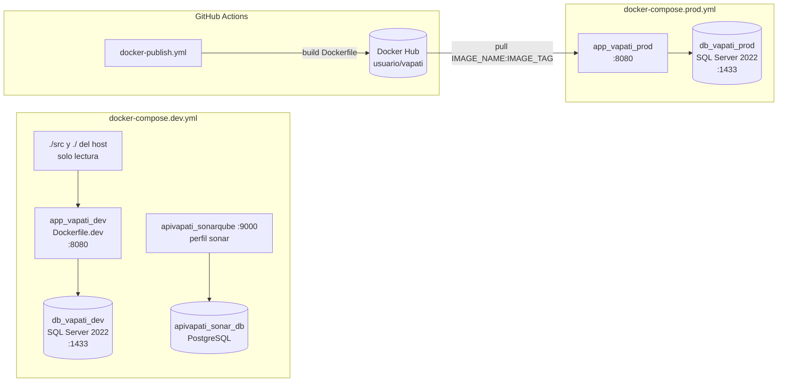
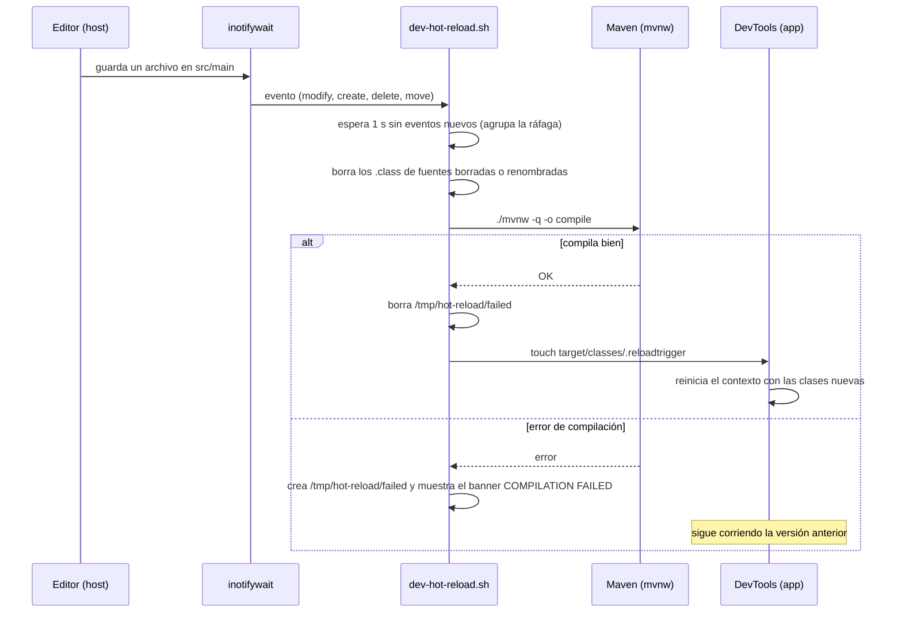
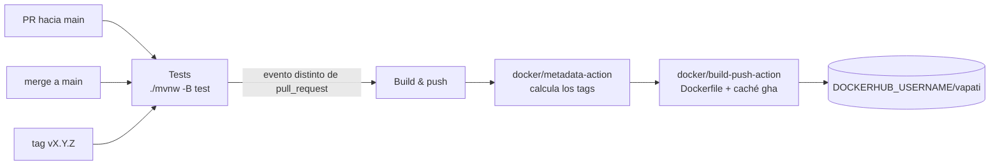

# Infraestructura

Cómo se configura, se levanta, se construye y se publica VaPaTi: perfiles de Spring, variables de entorno, imágenes Docker, los dos stacks de Compose, el hot reload de desarrollo, la inicialización de la base y el workflow de GitHub Actions.

## Panorama

Hay tres formas de correr la aplicación, y todas usan SQL Server:

| Forma | Perfil Spring | Base de datos | Código fuente |
|---|---|---|---|
| Local, `./mvnw spring-boot:run` | ninguno (`application.properties`) | SQL Server en `localhost:1433`, levantado aparte | el del disco |
| Stack de desarrollo, `docker-compose.dev.yml` | `docker,dev` | contenedor `db_vapati_dev` | montado de solo lectura, con hot reload |
| Stack de producción, `docker-compose.prod.yml` | `docker` | contenedor `db_vapati_prod` | ninguno: corre la imagen publicada |



## Perfiles de Spring

La configuración vive en `src/main/resources/`. Hay tres archivos:

- `application.properties`: sin perfil, para correr la aplicación fuera de Docker.
- `application-docker.properties`: el perfil `docker`, base compartida por los dos stacks de Compose.
- `application-dev.properties`: el perfil `dev`, solo con lo propio del desarrollo. Se activa **junto** con `docker` (`SPRING_PROFILES_ACTIVE: docker,dev`, en `docker-compose.dev.yml` y como valor por defecto de `Dockerfile.dev`). Producción activa solo `docker`.

| Propiedad | `application.properties` (sin perfil) | `application-docker.properties` (perfil `docker`) | `application-dev.properties` (perfil `dev`) |
|---|---|---|---|
| `spring.datasource.url` | `jdbc:sqlserver://localhost:1433;databaseName=ApiVaPaTiJava;trustServerCertificate=true` | igual, pero con host `sqlserver` (el nombre del servicio en Compose) | — |
| `spring.datasource.username` | `sa` | `${DB_USERNAME:vapati_app}` | — |
| `spring.datasource.password` | `${DB_PASSWORD:...}`, con un valor por defecto escrito en el archivo | `${DB_APP_PASSWORD}`, **sin valor por defecto**: si falta, la aplicación no arranca | — |
| `spring.jpa.hibernate.ddl-auto` | `update` | `update` | — |
| `spring.jpa.show-sql` | `true` | — | `true`, más `hibernate.format_sql=true` |
| `spring.sql.init.mode` + `spring.jpa.defer-datasource-initialization` | `always` + `true` | igual | — |
| `spring.datasource.hikari.maximum-pool-size` / `minimum-idle` | por defecto | `5` / `1` | — |
| `server.tomcat.threads.max` / `min-spare` | por defecto | `50` / `2` | — |
| `jwt.secret` | `${JWT_SECRET}` (sin valor por defecto) | igual | — |
| `jwt.expiration` / `jwt.refresh-expiration` | 1 hora / 7 días (en ms) | igual | — |
| `server.error.*` | sin stacktrace ni nombre de excepción; con mensaje y errores de binding | igual | — |
| `cors.allowed-origins` | `${CORS_ALLOWED_ORIGINS:http://localhost:3000}` | igual | — |
| `server.port` / `server.address` | por defecto (8080) | `8080` / `0.0.0.0` | — |
| DevTools | por defecto | — | `spring.devtools.restart.enabled` y `livereload.enabled` en `true` |
| Logging | por defecto | — | `com.vaPaTi.vaPaTi` y `org.hibernate.SQL` en `DEBUG`, `org.springframework.web` en `INFO` |
| `spring.test.database.replace` | — | `none` (es una propiedad de tests; en runtime no tiene efecto) | — |

Ningún archivo fija `hibernate.dialect`: Hibernate lo resuelve desde la conexión.

Consecuencias que conviene tener presentes:

- **El esquema lo genera Hibernate** (`ddl-auto=update`) en todos los entornos, incluido producción. No hay migraciones versionadas: una columna nueva aparece sola al arrancar, pero un renombre o un borrado no se aplican.
- **`data.sql` corre en cada arranque** (`spring.sql.init.mode=always`), después de que Hibernate crea o actualiza las tablas (`defer-datasource-initialization=true`). Por eso sus `INSERT` están protegidos con `IF NOT EXISTS`: siembran los roles `USER` y `ADMIN` y las seis categorías iniciales sin duplicarlos.
- **Producción (perfil `docker` solo) no imprime SQL ni logs de la aplicación en `DEBUG`**: eso es del perfil `dev`. Tampoco carga las propiedades de DevTools (que además no está en el JAR).
- **La aplicación conecta como `vapati_app`, no como `sa`**, en los dos stacks. Ese login lo crea el servicio `sqlserver` (ver [Servicio `sqlserver`](#servicio-sqlserver-db_vapati_dev)). El perfil sin nombre sigue con `sa`: fuera de Compose nadie crea el login.
- `SERVER_PORT` pisa a `server.port` aunque el perfil `docker` lo fije en `8080`, porque Spring da prioridad a las variables de entorno sobre los archivos de propiedades.

## Variables de entorno

El archivo de referencia es `.env.example`, versionado y con los valores vacíos. Los `.env` y `.env.*` reales están en `.gitignore` (salvo `.env.example`), y Compose los lee de la raíz del repo.

| Variable | Quién la usa | Obligatoria | Qué hace |
|---|---|---|---|
| `JWT_SECRET` | los dos compose → `jwt.secret` | **sí** | Clave HMAC para firmar los JWT. Los compose la declaran como `${JWT_SECRET:?JWT_SECRET is required}`, así que sin ella Compose ni crea el contenedor. Además, `service/auth/JwtService.java` valida al arrancar que no esté vacía, que no sea el placeholder público de ejemplo y que tenga al menos 32 bytes; si no, la aplicación no levanta. Se genera con `openssl rand -base64 64 \| tr -d '\n'`. |
| `DB_PASSWORD` | los dos compose, **solo el servicio `sqlserver`** → `MSSQL_SA_PASSWORD` y `DB_PASSWORD` del contenedor | en la práctica sí | Password del usuario `sa`. Se usa para inicializar la base y el login de la aplicación, y en los scripts manuales (`sqlcmd -U sa`); la aplicación ya no la usa. SQL Server exige una política mínima de complejidad. A diferencia de `JWT_SECRET`, los compose no la marcan como obligatoria (`${DB_PASSWORD}` sin `:?`). |
| `DB_APP_PASSWORD` | los dos compose, en `sqlserver` y en la aplicación → `spring.datasource.password` del perfil `docker` | **sí** | Password del login `vapati_app`. Los compose la declaran como `${DB_APP_PASSWORD:?DB_APP_PASSWORD is required}`: sin ella Compose no crea los contenedores, y el perfil `docker` no tiene valor por defecto. El servicio `sqlserver` crea el login o le actualiza la password en cada arranque. Mismo requisito de complejidad que `DB_PASSWORD`; no puede llevar comillas simples ni `$`, porque el `command` la interpola dentro de SQL. |
| `DB_USERNAME` | perfil `docker` → `spring.datasource.username` | no (`vapati_app`) | Los compose no la pasan. |
| `CORS_ALLOWED_ORIGINS` | `cors.allowed-origins` → `security/CorsConfig.java` | no | Orígenes permitidos separados por coma. Por defecto `http://localhost:3000`. |
| `SERVER_PORT` | los dos compose | no (8080) | Puerto en el que escucha Spring dentro del contenedor. |
| `APP_PORT` | los dos compose | no (8080) | Puerto del host mapeado a la aplicación. |
| `DB_PORT` | los dos compose | no (1433) | Puerto del host mapeado a SQL Server. |
| `IMAGE_NAME`, `IMAGE_TAG` | solo `docker-compose.prod.yml` | no (`app_vapati_prod:latest`) | Imagen a correr, normalmente `<usuario-dockerhub>/vapati` y una versión. |
| `MSSQL_MEMORY_LIMIT_MB` | servicio `sqlserver` de los dos compose | fija en el compose (`"1024"`) | Tope de memoria del proceso de SQL Server (ver [Memoria de SQL Server](#memoria-de-sql-server)). No sale del `.env`. |
| `JAVA_OPTS` | etapas `runtime` y de desarrollo (`ENV` de los Dockerfiles) | no | Flags de la JVM. Se pueden sobrescribir desde el `environment` del compose. |
| `MAVEN_OPTS` | `Dockerfile.dev` | no | Flags de la JVM de Maven (`-XX:+UseSerialGC -Xmx256m -XX:TieredStopAtLevel=1`). |

`docker-compose.dev.yml` agrega `SPRING_PROFILES_ACTIVE: docker,dev` y `SPRING_DEVTOOLS_RESTART_TRIGGER_FILE` (ver [Hot reload](#hot-reload-en-desarrollo)), que no salen del `.env`. DevTools ya no se activa por variables de entorno sino por el perfil `dev`, y `app-dev` ya no recibe `DOCKER_HOST` ni `TESTCONTAINERS_RYUK_DISABLED`: no usa el socket de Docker.

Para correr local sin Docker hay que exportar `JWT_SECRET` (y `DB_PASSWORD` si la base no usa la password por defecto) antes de `./mvnw spring-boot:run`. Esa corrida usa `application.properties` y conecta como `sa`.

## Imágenes: dos Dockerfiles

`Dockerfile` (producción, lo publica CI) y `Dockerfile.dev` (desarrollo, lo usa `docker-compose.dev.yml`) son archivos separados, cada uno con su responsabilidad. Los dos parten de Temurin 21 sobre Alpine, con Maven a través del wrapper del repo (`.mvn/wrapper/maven-wrapper.properties`, Maven 3.9.10): ninguno usa la imagen `maven:`, así que la versión de Maven está definida en un solo lugar.

Los dos declaran `ARG JAVA_VERSION` con **el mismo valor** (hoy `21.0.12.1_1`), para que la imagen de desarrollo compile y ejecute con el mismo update de Java que la de producción. Cambiarlo es parte de [Actualizar los tags fijados](#actualizar-los-tags-fijados).

## Imagen de producción: `Dockerfile`

Build multi-stage:

1. **Stage `build`** (`eclipse-temurin:${JAVA_VERSION}-jdk-alpine`): copia primero `.mvn/`, `mvnw` y `pom.xml`, corre `./mvnw -B dependency:go-offline` para que las dependencias queden en una capa cacheada, y recién después copia `src/` y empaqueta con `./mvnw -B package -DskipTests`. Así, un cambio de código no vuelve a descargar dependencias.
2. **Stage `runtime`** (`eclipse-temurin:${JAVA_VERSION}-jre-alpine`): crea el grupo y el usuario de sistema `app`, copia solo el JAR como `app.jar` y corre como `app` (`USER app`). El JAR queda de `root`: `app` lo lee pero no lo puede modificar. Expone el `8080` y arranca con `sh -c "exec java $JAVA_OPTS -jar app.jar"`.

- **`exec`.** `java` reemplaza al shell y es el PID 1, así que recibe el `SIGTERM` de `docker stop`.
- **`JAVA_OPTS`** por defecto: `-XX:+UseSerialGC -XX:MaxRAMPercentage=75 -Xss512k -XX:ReservedCodeCacheSize=64m -XX:MaxMetaspaceSize=192m`. El heap se calcula sobre el límite del contenedor (75 % de los 512M del compose de producción son 384M), y el resto de la memoria de la JVM (metaspace, code cache, hilos) está acotado. Se puede sobrescribir desde el `environment` del compose.

La imagen final no tiene Maven ni el código fuente. Los tests no corren en el build: en CI corren en un job previo (ver [CI](#ci-y-publicación-githubworkflowsdocker-publishyml)). `.dockerignore` deja fuera `target/`, los `.env` y `.env.*` (los secretos no viajan en el contexto de build), `docker-compose.prod.yml`, archivos de IDE, `.git/` y los Markdown.

DevTools no llega a la imagen: está declarado como `runtime` + `optional` en `pom.xml`, y el plugin de Spring Boot lo excluye del JAR empaquetado.

## Imagen de desarrollo: `Dockerfile.dev`

Parte de `eclipse-temurin:${JAVA_VERSION}-jdk-alpine` (con JDK, a diferencia de la de producción) y suma `bash` (corre el script del hot reload), `inotify-tools` (`inotifywait`) y `curl` (lo usa el healthcheck). Copia `.mvn/`, `mvnw` y `pom.xml`, descarga las dependencias en una capa cacheada y copia `scripts/dev-hot-reload.sh` como comando del contenedor. **No copia el código**: `docker-compose.dev.yml` lo monta. Fija `SPRING_PROFILES_ACTIVE=docker,dev` y expone `8080` (aplicación) y `35729` (LiveReload).

- **`JAVA_OPTS`** (la JVM de la aplicación): `-XX:TieredStopAtLevel=1 -XX:+UseSerialGC -Xss512k -XX:MaxRAMPercentage=50`.
- **`MAVEN_OPTS`** (las compilaciones): `-XX:+UseSerialGC -Xmx256m -XX:TieredStopAtLevel=1`.
- El volumen `maven-cache-dev` está montado en `/root/.m2` y **tapa** el `/root/.m2` que la imagen trae. Si el volumen ya existía de una versión anterior, el primer arranque puede volver a descargar Maven (la imagen no instala `unzip`, así que el wrapper baja el `.tar.gz` de la distribución) y las dependencias que falten.

## Stack de desarrollo: `docker-compose.dev.yml`

```bash
docker compose -f docker-compose.dev.yml up -d            # levantar (la primera vez, o si cambió Dockerfile.dev o el script, con --build)
docker compose -f docker-compose.dev.yml logs -f app-dev  # ver la aplicación y los errores de compilación
docker compose -f docker-compose.dev.yml restart app-dev  # aplicar un cambio de pom.xml
```

### Servicio `sqlserver` (`db_vapati_dev`)

- Imagen `mcr.microsoft.com/mssql/server:2022-CU27-GDR1-ubuntu-22.04` (tag fijado, el mismo en los dos compose y en `AbstractIntegrationTest`; ver [Actualizar los tags fijados](#actualizar-los-tags-fijados)), puerto `${DB_PORT:-1433}`.
- Datos en el volumen con nombre fijo `sql_data_apivapati_java`.
- Variables: `MSSQL_SA_PASSWORD` y `DB_PASSWORD` (la de `sa`), `DB_APP_PASSWORD` (obligatoria, `:?`) y `MSSQL_MEMORY_LIMIT_MB: "1024"`.
- **`command`.** Es un script de `bash` con cuatro pasos. Cada `sqlcmd` corre como `sa` con `-b`, que corta en el primer error de SQL:
  1. Arranca `sqlservr` en segundo plano y espera con un `until` a que responda `SELECT 1` (imprime `waiting for SQL Server...` cada 2 segundos). Reemplaza al `sleep 20s` fijo, que cortaba la inicialización si SQL Server tardaba más.
  2. Fija `max server memory (MB)` en 512 (`sp_configure`) y crea la base `ApiVaPaTiJava` si no existe. Es la única creación de la base: las tablas las crea Hibernate al arrancar la aplicación.
  3. Crea el login `vapati_app` con `DEFAULT_DATABASE = ApiVaPaTiJava`, o, si ya existe, le actualiza la password (`ALTER LOGIN`). Así la password siempre coincide con `DB_APP_PASSWORD` del `.env`.
  4. En `ApiVaPaTiJava`, crea el usuario `vapati_app` si no existe (`IF USER_ID(...) IS NULL`) y lo agrega al rol `db_owner`.

  Son tres invocaciones de `sqlcmd` separadas, porque un `-d` sobre una base creada en el mismo batch falla. Si alguna sentencia falla, `sqlservr` sigue corriendo (el `wait` final) y el healthcheck queda `unhealthy`.
- Monta `./init-db.sql` y `./init-db.sh`, pero el `command` no los ejecuta (ver [Inicialización de la base](#inicialización-de-la-base)).
- **Healthcheck:** un `SELECT 1` con `sqlcmd` **como `vapati_app`** y sobre `ApiVaPaTiJava`, cada 10 segundos (`start_period` de 30 segundos, 10 reintentos). Solo queda `healthy` cuando existen la base, el login y el usuario, así que la aplicación, que espera a que el servicio esté `healthy` (`depends_on: condition: service_healthy`), nunca arranca antes que el login.

#### Memoria de SQL Server

SQL Server no tiene tope por defecto y su buffer pool solo crece. Se limita con dos palancas que se complementan:

- `max server memory (MB) = 512` (`sp_configure` en el `command`) acota el buffer pool.
- `MSSQL_MEMORY_LIMIT_MB=1024` acota el resto del proceso.

No se le pone `mem_limit` al contenedor de la base: SQL Server en Linux no arranca con menos de 2 GB. Las mediciones de la implementación (`db_vapati_dev` de 1.06 GiB a entre 738 y 995 MiB) están en el spec 59.

### Servicio `app-dev` (`app_vapati_dev`)

- Se construye con `Dockerfile.dev`. Perfiles `docker,dev`.
- **Datasource:** recibe `DB_APP_PASSWORD` (obligatoria) y conecta como `vapati_app`. Ya no recibe `DB_PASSWORD`.
- **Montajes:** `./src` en `/app/src` y la raíz del repo en `/workspace`, los dos de solo lectura; `/dev/null` sobre `/workspace/.env`, de solo lectura; y el volumen `maven-cache-dev` en `/root/.m2`. `target/` vive dentro del contenedor, así que la compilación del contenedor no pisa la del host.
  - **Sin socket de Docker.** El contenedor no monta `/var/run/docker.sock` ni recibe variables de Testcontainers: los tests corren en su propio contenedor Maven (ver [Testing](07-testing.md#con-maven-en-docker-sin-jdk-local)).
  - **`.env` enmascarado.** El script solo lee `/workspace/pom.xml`; montar `/dev/null` encima de `/workspace/.env` evita que el contenedor lea las passwords del `.env` del host. El archivo tiene que existir en el host, porque enmascarar uno inexistente hace fallar el arranque del contenedor. Un `.env.production` en la raíz sigue visible dentro del contenedor.
- `init: true`: corre `tini` como PID 1, que reenvía `SIGTERM` al script y recoge procesos hijos.
- **Endurecimiento:** `security_opt: no-new-privileges:true` y `cap_drop: [ALL]`. Sigue corriendo como root (es dueño del volumen `maven-cache-dev`), pero sin capacidades ni escalada de privilegios.
- **Memoria:** límite de 1G y reserva de 512M. `restart: unless-stopped`.
- Healthcheck: `unhealthy` si existe `/tmp/hot-reload/failed` (la última compilación falló) o si la aplicación no responde HTTP en `/` (cualquier status, incluido `401`, cuenta como respuesta). Tiene `start_period` de 180 segundos porque el primer arranque compila todo.
- **Debug.** La JVM escucha el agente JDWP en el `5005` dentro del contenedor; el puerto no se publica en el host. Para comprobar que escucha, `docker exec app_vapati_dev nc -z 127.0.0.1 5005` (con `127.0.0.1` y no `localhost`: BusyBox resuelve `localhost` a `::1`).

### Perfil `sonar`

Con `docker compose -f docker-compose.dev.yml --profile sonar up -d` se suman `apivapati_sonarqube` (SonarQube 10.4 en el puerto `9000`) y su base `apivapati_sonar_db` (PostgreSQL 15). Las credenciales de esa base están escritas en el compose: es una herramienta local de análisis. La configuración del análisis está en las propiedades `sonar.*` de `pom.xml`, que excluyen de la cobertura los paquetes sin lógica de negocio (`controller`, `dtos`, `entity`, `exception`, `mapper`, `repository`, `security`, `utils`), las mismas exclusiones que usa JaCoCo (ver [Testing](07-testing.md#cobertura-jacoco)).

## Hot reload en desarrollo

El hot reload no usa `docker compose watch`. Lo implementa `scripts/dev-hot-reload.sh`, que es el `CMD` del contenedor y no se corre a mano. La aplicación corre como **una sola JVM de larga vida** lanzada con `java -cp`: no hay un proceso Maven residente. Maven solo existe mientras compila.



Cómo funciona, según el script:

- **Arranque.** Lanza los `inotifywait` antes de compilar, para no perder cambios hechos durante el arranque. Si el `pom.xml` del host difiere del de la imagen, lo copia. Borra el classpath de una corrida anterior (`/tmp` sobrevive a `docker compose restart`) y compila en modo online (descarga lo que falte), calculando el classpath en la misma invocación de Maven. Después arranca la aplicación con `java $JAVA_OPTS` más el agente de debug JDWP en el puerto `5005`, `-cp target/classes:<classpath>` y la clase `com.vaPaTi.vaPaTi.VaPaTiApplication`, en su propio grupo de procesos (`setsid`) para poder detenerla entera.
- **Classpath.** Maven lo escribe en `/tmp/hot-reload/classpath.txt` con `dependency:build-classpath -DincludeScope=runtime` (las dependencias de scope `test` y `provided` no entran), en la misma ejecución que `compile`. El script lo recalcula al arrancar, en cada cambio del `pom.xml`, y en una compilación por guardado solo si el archivo no existe o está vacío (porque falló la compilación inicial). Las demás compilaciones por guardado no lo tocan. `target/classes` va primero y como directorio, no como JAR: por eso DevTools reinicia al ver cambios en él.
- **Qué vigila.** `src/main` de forma recursiva, y `/workspace` sin recursión (solo le importa `pom.xml`; así no ve los cambios de `target/` del host). Ignora archivos ocultos, temporales de editores (`*~`, `*.swp`, `*___jb_tmp___`) y archivos que no son `.java` dentro de `src/main/java`.
- **Agrupar eventos.** Procesa el lote cuando pasa 1 segundo sin eventos nuevos, así un "guardar todo" produce una sola compilación.
- **Archivos borrados.** Una compilación incremental no borra los `.class` de fuentes que ya no existen; el script los borra (incluidas las clases internas `Clase$*.class`) para que DevTools no recargue clases fantasma.
- **Compilación.** `./mvnw -q -o compile` (offline, rápida). Si sale bien, toca `target/classes/.reloadtrigger`.
- **Reinicio.** DevTools está configurado con `SPRING_DEVTOOLS_RESTART_TRIGGER_FILE=.reloadtrigger`: solo reinicia cuando cambia ese archivo, es decir, después de una compilación completa y exitosa. Nunca recarga clases a medio compilar.
- **Errores.** Si la compilación falla, la versión anterior sigue corriendo, el log muestra un banner `COMPILATION FAILED` con las líneas `[ERROR]` de Maven, y se crea `/tmp/hot-reload/failed`, que pone el contenedor en `unhealthy` hasta la siguiente compilación exitosa.
- **Cambios de `pom.xml`.** El script los detecta, copia el pom, compila en modo online **recalculando el classpath** y reinicia el proceso Java completo (no alcanza con DevTools, porque cambia el classpath). Si falla, restaura el pom anterior y muestra `POM DEPENDENCIES FAILED`. Con el file sharing de Docker Desktop estos eventos no siempre llegan, sobre todo si el editor (o un `sed -i`) guarda el archivo renombrando uno temporal sobre el original; guardar en el mismo archivo o `restart app-dev` lo resuelve, porque al arrancar el script compara y copia el pom.
- **`Dockerfile.dev` o el script.** Requieren reconstruir la imagen (`up -d --build`).

## Stack de producción: `docker-compose.prod.yml`

Pensado para un servidor que solo tiene este archivo y un `.env`, sin el código:

```bash
docker volume create sql_data_apivapati_java   # solo la primera vez: el volumen es external
docker compose -f docker-compose.prod.yml pull
docker compose -f docker-compose.prod.yml up -d
```

Diferencias con el stack de desarrollo:

| Aspecto | Desarrollo | Producción |
|---|---|---|
| Aplicación | se construye con `Dockerfile.dev` | `image: ${IMAGE_NAME}:${IMAGE_TAG}` |
| Perfiles de Spring | `docker,dev` | `docker` |
| Código fuente | montado, con hot reload | ninguno |
| Volumen de la base | `sql_data_apivapati_java`, lo crea Compose | `sql_data_apivapati_java` declarado `external: true`: hay que crearlo antes |
| Montajes extra en SQL Server | `init-db.sql`, `init-db.sh` | ninguno |
| Usuario de la aplicación en el contenedor | root | `app` (sin privilegios) |
| Sistema de archivos | escribible (el script compila en `/app/target`) | `read_only: true`, con `tmpfs` en `/tmp` (`size=64m`, `mode=1777`) |
| `security_opt` / `cap_drop` | `no-new-privileges:true` / `ALL` | `no-new-privileges:true` / `ALL` |
| Healthcheck de la aplicación | compilación + HTTP (`curl`), cada 10 s | solo HTTP (`wget` de BusyBox), cada 15 s, `start_period` de 90 s |
| Límite de memoria | 1G (reserva 512M) | 512M |
| Socket de Docker, DevTools | no | no |
| Red | `vapati-network-dev` | `vapati-network` |
| SonarQube | perfil `sonar` | no |

En común: la misma imagen y el mismo `command` y healthcheck de SQL Server (con el login `vapati_app`), la misma memoria de SQL Server, y las variables `JWT_SECRET` (obligatoria), `DB_APP_PASSWORD` (obligatoria) y `CORS_ALLOWED_ORIGINS`. `DB_PASSWORD` solo llega al servicio `sqlserver`.

- **Healthcheck de la aplicación.** `wget -S -O /dev/null http://localhost:${SERVER_PORT:-8080}/ 2>&1 | grep -q 'HTTP/'`: cualquier respuesta HTTP, `401` incluido, cuenta como sana; si no hay respuesta, falla. Después de 3 fallos seguidos el contenedor queda `unhealthy`, **nada más**: Compose no reinicia contenedores por su salud, y la política `restart: unless-stopped` solo actúa si el proceso termina.
- **`/tmp` cuenta contra el límite.** El `tmpfs` de `/tmp` (hasta 64m) y la memoria de la JVM comparten los 512M del contenedor.
- **JVM.** Con el `JAVA_OPTS` de la imagen, el heap máximo es el 75 % del límite (384M).

## Inicialización de la base

| Pieza | Qué hace | Cuándo corre |
|---|---|---|
| `command` del servicio `sqlserver` (los dos compose) | Fija `max server memory`, crea la base `ApiVaPaTiJava` si no existe y crea o actualiza el login y el usuario `vapati_app` (ver [Servicio `sqlserver`](#servicio-sqlserver-db_vapati_dev)). | Cada vez que arranca el contenedor de SQL Server. |
| Hibernate (`ddl-auto=update`) | Crea y actualiza las tablas según las entidades de `entity/`. | Al arrancar la aplicación. |
| `src/main/resources/data.sql` | Siembra los roles `USER` y `ADMIN` y las categorías Technology, Health, Education, Environment, Arts y Sports, de forma idempotente. | Al arrancar la aplicación, después de Hibernate. |
| `scripts/create-admin-user.sql` | Inserta un usuario con rol `ADMIN` (filas en `[user]` y `user_info`). Es la única forma de crear un admin: `POST /api/users/create` siempre asigna `USER`. Exige que `data.sql` ya haya sembrado el rol. | A mano, con `sqlcmd` dentro del contenedor de SQL Server. |
| `scripts/migrate-donation-recipient.sql` | Agrega `donation.recipient_user_id` (rellenada con el dueño de la campaña, `NOT NULL`, con FK e índice) y vuelve nullable `donation.campaign_id`, para las donaciones directas. Es idempotente. Ver [Modelo de datos](04-modelo-de-datos.md#migración-manual-de-donation). | A mano, con la app **detenida** y antes de levantar la imagen nueva, en dev y en prod, con `sqlcmd -I -b` dentro del contenedor de SQL Server. En prod, los pasos están en `DOCKER-HUB-DEPLOY.md` § 7.2. |
| `scripts/update-report-entity-type-check.sql` | Reemplaza la `CHECK` que Hibernate generó sobre `report.reported_entity_type` por `CK_report_reported_entity_type`, con los cuatro valores (suma `COMMENT`). Es idempotente. Ver [Modelo de datos](04-modelo-de-datos.md#check-de-reportreported_entity_type). | A mano, antes de levantar la imagen nueva, en dev y en prod, con `sqlcmd -b` (sin `-I`) dentro del contenedor de SQL Server. No hace falta detener la app. En prod, los pasos están en `DOCKER-HUB-DEPLOY.md` § 7.2. |
| `utils/PasswordHashGenerator.java` | Utilidad de línea de comandos (no es un bean) que imprime el hash BCrypt de una password, para completar el script anterior. | A mano. En la imagen de desarrollo, con el classpath de `target/classes` y `/root/.m2`; en la de producción, con el `PropertiesLauncher` de Spring Boot sobre `app.jar`. |
| `init-db.sql` | Crea la base si no existe. Hace lo mismo que el `command` de Compose. | Nunca: está montado en el contenedor de desarrollo pero nadie lo ejecuta. |
| `init-db.sh/` | Es un directorio vacío. El compose de desarrollo lo monta como `/init-db.sh`. | Nunca. |
| `intit-db.sh` | Script que espera 15 segundos y ejecuta `init-db.sql` con `sqlcmd`. | Nunca: no lo referencia ningún compose ni Dockerfile. |

Para correr el script de la `CHECK` en desarrollo, es el mismo comando que el del admin, con `-b` y el script nuevo:

```bash
docker cp scripts/update-report-entity-type-check.sql db_vapati_dev:/tmp/update-report-entity-type-check.sql
docker exec db_vapati_dev /opt/mssql-tools18/bin/sqlcmd -S localhost -U sa -P '<DB_PASSWORD>' -C -b -d ApiVaPaTiJava -i /tmp/update-report-entity-type-check.sql
```

Para crear el admin en desarrollo, en resumen:

```bash
# 1. Hash de la password (imagen de desarrollo)
docker exec app_vapati_dev sh -c "cd /app && CP=target/classes:\$(find /root/.m2 -name '*.jar' | tr '\n' ':') && java -cp \"\$CP\" com.vaPaTi.vaPaTi.utils.PasswordHashGenerator '<password>'"

# 2. Editar scripts/create-admin-user.sql (hash, email, username) y ejecutarlo
docker cp scripts/create-admin-user.sql db_vapati_dev:/tmp/create-admin-user.sql
docker exec db_vapati_dev /opt/mssql-tools18/bin/sqlcmd -S localhost -U sa -P '<DB_PASSWORD>' -C -d ApiVaPaTiJava -i /tmp/create-admin-user.sql
```

En producción, el paso 1 cambia porque la imagen no tiene Maven:

```bash
docker exec app_vapati_prod sh -c "java -Dloader.main=com.vaPaTi.vaPaTi.utils.PasswordHashGenerator -cp app.jar org.springframework.boot.loader.launch.PropertiesLauncher '<password>'"
```

Mientras la aplicación corre, el paso 1 se puede hacer con el classpath que ya calculó el hot reload en lugar de listar todos los JAR de `/root/.m2`: `java -cp "target/classes:$(cat /tmp/hot-reload/classpath.txt)" com.vaPaTi.vaPaTi.utils.PasswordHashGenerator '<password>'`, desde `/app` dentro del contenedor.

El script no controla duplicados: correrlo dos veces con el mismo email, username o teléfono falla por clave única (el teléfono también es único, así que entra entre los campos a editar). Trae un hash ya escrito; hay que reemplazarlo siempre por uno propio.

> **Advertencia.** `scripts/create-admin-user.sql` está desactualizado: el `INSERT` en `[user]` incluye la columna `is_active`, que ninguna entidad declara y que una base creada por Hibernate no tiene. Hay que revisar el script antes de usarlo. La inconsistencia es de deuda técnica; no se corrige acá.

## Tags fijados, vulnerabilidades y restauración

Las imágenes base están fijadas por tag exacto, sin digest: `eclipse-temurin:${JAVA_VERSION}-*-alpine` y `mcr.microsoft.com/mssql/server:2022-CU27-GDR1-ubuntu-22.04`. Un tag flotante (`2022-latest`, `21-jre`) cambiaría la imagen sin que nadie lo decida, y la base se actualizaría en el lugar. El costo es que actualizar es manual.

### Actualizar los tags fijados

| Qué | Dónde (todos con el mismo valor) |
|---|---|
| `JAVA_VERSION` | `Dockerfile` y `Dockerfile.dev`, a la vez |
| Tag de SQL Server | `image` del servicio `sqlserver` en `docker-compose.dev.yml` y en `docker-compose.prod.yml`, y el contenedor de `src/test/java/com/vaPaTi/vaPaTi/AbstractIntegrationTest.java` |

1. **Elegir el tag.** Para Java, el tag exacto de Temurin 21 más nuevo que exista en las dos variantes, `-jdk-alpine` y `-jre-alpine`. Puede tener cuatro partes (hoy `21.0.12.1_1`), no solo `21.0.<u>_<b>`. Para SQL Server, la CU más nueva; nunca una más vieja que la que ya usa el volumen.
2. **Cambiarlo en todos los archivos de la tabla.** Un `grep -rn "2022-CU" docker-compose*.yml src` y un `grep -n "ARG JAVA_VERSION" Dockerfile*` tienen que mostrar un único valor cada uno.
3. **Reconstruir** las dos imágenes: `docker build -t vapati-runtime:check .` y `docker build -f Dockerfile.dev -t vapati-dev:check .`.
4. **Escanear con Trivy** (sección siguiente) y comparar con las excepciones aceptadas.
5. **Correr la suite completa** (ver [Testing](07-testing.md#con-maven-en-docker-sin-jdk-local)). Los tests de integración levantan el SQL Server del tag nuevo.

**SQL Server actualiza el volumen en el lugar.** Al arrancar con un tag más nuevo, SQL Server migra las bases de sistema de `sql_data_apivapati_java`. Una imagen más vieja ya no puede abrir ese volumen. Eso pasó al pasar de `2022-latest` a `2022-CU27-GDR1-ubuntu-22.04`. Volver a un tag anterior exige restaurar un respaldo del volumen hecho antes del cambio, así que conviene hacerlo antes de subir el tag en un servidor con datos.

### Escanear con Trivy

El escaneo es manual (CI no lo hace) y corre en un contenedor, con la versión de Trivy fijada (hoy `0.75.0`):

```bash
docker run --rm \
  -v /var/run/docker.sock:/var/run/docker.sock \
  -v trivy_cache:/root/.cache \
  aquasec/trivy:0.75.0 image --scanners vuln --severity HIGH,CRITICAL --ignore-unfixed <imagen>
```

`<imagen>` es la imagen de producción (`vapati-runtime:check`), la de desarrollo (`vapati-dev:check`) o la de SQL Server. `--ignore-unfixed` deja fuera lo que todavía no tiene fix.

**Criterio.** La imagen `runtime` tiene que tener 0 HIGH/CRITICAL con fix, en el SO y en el JAR; lo que quede se registra como excepción con CVE, paquete y motivo. La imagen de desarrollo y la de SQL Server solo se reportan.

Estado al 2026-10-22 (Spring Boot 3.5.16):

| Imagen | HIGH/CRITICAL con fix | Detalle |
|---|---|---|
| `runtime` | 3 (todas excepciones) | SO: 0. JAR: 3. Antes del cambio eran 56 (SO Ubuntu 5, binario Go `pebble` 4, JAR 47). |
| Desarrollo | 100 | SO: 0. Todos son JAR del caché de Maven (`/root/.m2`) que el contenedor nunca ejecuta. |
| SQL Server `2022-CU27-GDR1-ubuntu-22.04` | 24 HIGH, 0 CRITICAL | SO: 0. Todos están en la biblioteca estándar de Go de binarios del fabricante (`launchpad`, `launchpadd`, `setnetbr`). Solo se reporta. |

**Excepciones aceptadas en `runtime`:**

| CVE | Severidad | Paquete | Motivo |
|---|---|---|---|
| CVE-2026-47884 | CRITICAL | `spring-webmvc` 6.2.19 | El fix está solo en 7.0.9 (Spring 7 / Boot 4), fuera de la línea 3.5. 6.2.19 es la 6.2.x más nueva. |
| CVE-2026-47890 | CRITICAL | `spring-webmvc` 6.2.19 | Ídem. |
| CVE-2025-59250 | HIGH | `mssql-jdbc` 12.10.2 | Falso positivo: el JAR es `12.10.2.jre11`, que el propio Trivy lista como la versión corregida; el `pom.properties` del JAR informa `12.10.2`. |

Se revisan cuando Spring Boot 3.5 publique un `spring-webmvc` corregido, o al migrar a Boot 4.

**Overrides en `pom.xml`.** Para llegar a ese resultado, dos versiones gestionadas por el BOM de Boot 3.5.16 se pisan con propiedades: `tomcat.version` (`10.1.61`, el BOM trae `10.1.55`) y `jackson-bom.version` (`2.21.8`, el BOM trae `2.21.4`). Cada una se quita cuando Boot gestione una versión igual o mayor.

### Restaurar la base en otra instancia

El `command` de `sqlserver` crea el usuario `vapati_app` solo si no existe por **nombre** (`IF USER_ID('vapati_app') IS NULL`). Si se restaura un respaldo de `ApiVaPaTiJava` en otra instancia, el usuario viene en la base pero queda huérfano: el login `vapati_app` que creó la instancia nueva tiene otro SID, y el `IF` no lo vuelve a crear. La aplicación no logra entrar. Se vincula con:

```sql
ALTER USER vapati_app WITH LOGIN = vapati_app;
```

ejecutado como `sa` sobre `ApiVaPaTiJava`.

## CI y publicación: `.github/workflows/docker-publish.yml`

El workflow tiene dos jobs, `test` (nombre visible `Tests`) y `publish` (`Build & push`), y `publish` depende de `test`.

| Evento | `Tests` | `Build & push` | Tags que se publican |
|---|---|---|---|
| Pull request hacia `main` | sí | no | ninguno |
| Push (merge) a `main` | sí | sí | `latest` |
| Push de un tag de git `vX.Y.Z` | sí | sí | `X.Y.Z` y `X.Y` (sin la `v`) y, por la configuración por defecto de `docker/metadata-action`, también `latest` |
| `workflow_dispatch` (manual) | sí | sí | `latest` si se lanza sobre `main` |



Detalles:

- **Tests.** JDK 21 Temurin con caché de Maven. Corre `./mvnw -B test -Ddocker.remote.api.version="$(docker version --format '{{.Server.APIVersion}}')"`: incluye los tests de integración con Testcontainers, porque los runners de GitHub tienen Docker. La versión de la API de Docker se toma del daemon del runner en lugar de la fijada en `pom.xml` (ver [Testing](07-testing.md#configuración-de-surefire)).
- **Credenciales.** `vars.DOCKERHUB_USERNAME` (una *variable*, no un secret, así el nombre de la imagen se ve en los logs) y `secrets.DOCKERHUB_TOKEN`. El workflow tiene `permissions: contents: read`.
- **Tags de la imagen.** `type=raw,value=latest` solo cuando la ref es `refs/heads/main`; `type=semver` con `{{version}}` y `{{major}}.{{minor}}` para los tags de git. El paso no define `flavor`, así que rige `latest=auto` de `docker/metadata-action`, que también agrega `latest` cuando el tag de mayor prioridad es un semver. La línea `type=sha` (un tag `sha-<commit>` por imagen) está comentada.
- **Concurrencia.** `group: docker-publish-${{ github.ref }}` con `cancel-in-progress: false`: dos publicaciones de la misma ref no se pisan, la segunda espera.
- **Caché.** `cache-from` y `cache-to` de tipo `gha`, para reutilizar las capas del `Dockerfile` entre corridas.
- **Versión del JAR.** El `pom.xml` sigue en `0.0.1-SNAPSHOT`: la versión que identifica un release es el tag de la imagen, no la del artefacto Maven.

El flujo de ramas que se deduce del workflow: el trabajo diario va a `dev`, `main` recibe PRs desde `dev` (en el PR corre `Tests`), y cada merge publica `latest`. Los PRs hacia `dev` no disparan este workflow.

## Ver también

- [Testing](07-testing.md): cómo correr la suite, localmente o con Maven en Docker.
- [Seguridad](03-seguridad.md): uso de `JWT_SECRET` y de `CORS_ALLOWED_ORIGINS`, y [Contenedores y base de datos](03-seguridad.md#contenedores-y-base-de-datos).
- [Modelo de datos](04-modelo-de-datos.md): las tablas que crea Hibernate y el contenido de `data.sql`.
- [Deuda técnica](deuda-tecnica.md): las inconsistencias de infraestructura (archivos de inicialización sin uso, diferencias entre compose).
