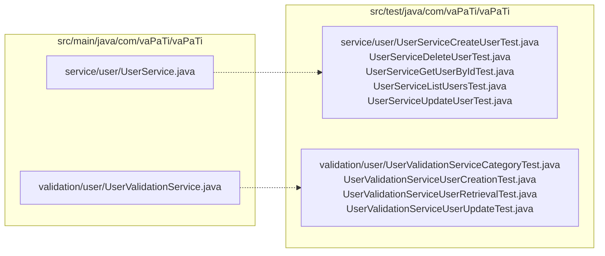

# Testing

Cómo se prueba VaPaTi: qué tipo de tests hay, cómo están organizados, qué configuración los rige y cómo correrlos. Es el único lugar donde se explica cómo correr los tests: el resto de la documentación enlaza a [Cómo correr los tests](#cómo-correr-los-tests).

## Estrategia

### Tests unitarios (la gran mayoría)

Los services y las validaciones se prueban aislados, con sus repositorios y colaboradores mockeados. No levantan Spring ni tocan una base:

- `@ExtendWith(MockitoExtension.class)`, `@Mock` para los repositorios y servicios colaboradores, y la clase bajo prueba construida en el `setUp` o con `@InjectMocks`.
- Los tests se agrupan con `@Nested` por operación o por caso, y se nombran con `@DisplayName`.
- Aserciones con AssertJ (`assertThat`, `assertThatThrownBy`) en la mayoría de las clases; algunas usan las de JUnit (`assertEquals`, `assertThrows`). Las dos conviven.
- Para las reglas de negocio se verifica tanto el resultado como lo que **no** debe pasar: por ejemplo, que ante una validación fallida no se llame a `save` (`verify(..., never())`) o que las llamadas ocurran en orden (`InOrder`).

Como la capa `validation/` concentra las reglas de negocio (ver [Arquitectura](02-arquitectura.md)), sus tests son los que documentan mejor qué permite y qué rechaza cada dominio: mensajes de error exactos, casos de `404` frente a `403`, transiciones de estado.

### Tests de DTOs

`dtos/<dominio>/*DtoValidationTest.java` validan las anotaciones de Bean Validation de los DTOs de entrada con un `Validator` de Hibernate Validator creado a mano, sin contexto de Spring. Los helpers de `dtos/DtoValidation.java` (`assertValid`, `assertSingleViolation`, `assertViolationsOn`) comprueban qué campo exacto viola cada restricción. Por ejemplo, `dtos/comment/CommentDtoValidationTest.java` cubre el `@Size(max = 280)` de `CreateCommentDTO`.

### Tests de mappers, excepciones y seguridad

- `mapper/<dominio>/*MapperTest.java`: conversiones entidad → DTO, incluidos los campos nulos (por ejemplo `mapper/comment/CommentMapperTest.java`).
- `exception/GlobalExceptionHandlerTest.java`: el status y la forma `{error, message, timestamp}` de cada tipo de excepción que maneja `exception/GlobalExceptionHandler.java`.
- `security/JwtAuthenticationFilterTest.java` y `security/AuthenticatedUserServiceTest.java`: el filtro JWT y la resolución del usuario autenticado, con el `SecurityContextHolder` y `JwtService` mockeados.

### Tests de integración con Testcontainers

Tres clases heredan de `AbstractIntegrationTest.java`, que declara un contenedor `mcr.microsoft.com/mssql/server:2022-CU27-GDR1-ubuntu-22.04` (el mismo tag que los dos compose; se actualizan juntos, ver [Infraestructura](06-infraestructura.md#actualizar-los-tags-fijados)) con `@Testcontainers` + `@Container` y lo conecta a Spring con `@ServiceConnection` (Spring Boot reemplaza la URL, el usuario y la password del datasource por los del contenedor). Activa el perfil `integration`.

| Clase | Qué levanta | Qué prueba |
|---|---|---|
| `VaPaTiApplicationTests.java` | `@SpringBootTest`, el contexto completo | que la aplicación arranca contra SQL Server |
| `repository/bankaccount/BankAccountRepositoryTest.java` | `@DataJpaTest` con `@AutoConfigureTestDatabase(replace = NONE)` | las queries de `repository/bankaccount/BankAccountRepository.java` contra SQL Server real |
| `service/campaign/CampaignServiceCloseAndSoftDeleteIntegrationTest.java` | `@DataJpaTest` con `CampaignService` y `CampaignStatusHistoryService` importados | que `closeAndSoftDelete` cierra, registra la transición y borra la campaña sin que falle el flush (2 tests); un test con mocks no lo detecta, ver [Modelo de datos](04-modelo-de-datos.md#borrado-lógico-soft-delete) |

Con el perfil `integration` (`src/test/resources/application-integration.properties`) Hibernate no genera el esquema (`ddl-auto=none`): lo crea `src/test/resources/schema.sql`, un script escrito a mano que borra y recrea todas las tablas, siembra roles y categorías y crea índices. Después corre también el `data.sql` de `src/main/resources/`. Como `schema.sql` no se deriva de las entidades, una columna nueva en `entity/` hay que agregarla también ahí para que estos tests la vean.

El contenedor es un campo `static` de la clase base, así que cada clase de integración arranca y destruye su propio SQL Server (unos 8 segundos cada uno). Estos contenedores son independientes del stack de Compose: el login `vapati_app` y el `max server memory` de los compose no se aplican en los tests. Testcontainers usa el contenedor `Ryuk` para limpiar los contenedores si la JVM muere. Estos tests necesitan acceso a un daemon de Docker; el resto de la suite no.

### Lo que no tiene tests

- **Controllers.** No hay tests con `MockMvc` ni `@WebMvcTest`. El mapeo de rutas, el `@Valid` de los bodies y los `@PreAuthorize` no se prueban.
- **Configuración de seguridad.** `security/SecurityConfig.java` (rutas públicas y reglas de acceso), `security/CorsConfig.java` y `security/OpenAPIConfig.java`.
- **Algunos mappers:** `mapper/bankaccount/BankAccountMapper.java`, `mapper/campaign/CampaignStatusHistoryMapper.java`, `mapper/category/CategoryMapper.java`, `mapper/follower/FollowerMapper.java`, `mapper/user/UserInfoMapper.java` y `mapper/verification/VerificationRequestMapper.java`.
- **Utilidades:** `utils/ValidationUtils.java`.
- **Repositorios** fuera de `bankaccount`: sus queries derivadas y JPQL solo se ejercitan mockeadas desde los tests de services y validaciones. Dentro de `bankaccount`, las dos queries nativas (`findByUserIdAndAccountNumberAndDeletedAtIsNotNull` y `findByAccountNumberIgnoreDeleted`) tampoco están en `BankAccountRepositoryTest`.

Todas las clases de `service/` y de `validation/` tienen al menos una clase de test, y todos sus métodos públicos se invocan desde algún test.

## Organización

Los tests espejan los paquetes de `src/main/java/com/vaPaTi/vaPaTi/`: un test vive en el mismo `<capa>/<dominio>/` que la clase que prueba. Las validaciones se prueban en `validation/<dominio>/`, no dentro de `service/`. Dos clases de `src/test/java/com/vaPaTi/vaPaTi/` son de apoyo y no son tests: `AbstractIntegrationTest.java`, con el contenedor de SQL Server de los tests de integración, y `dtos/DtoValidation.java`.



Los dominios con más lógica **dividen los tests por operación** en varios archivos del mismo paquete, en lugar de una sola clase gigante:

| Clase (en `src/main/`) | Tests (en `src/test/`) |
|---|---|
| `service/user/UserService.java` | `service/user/UserServiceCreateUserTest.java`<br>`service/user/UserServiceDeleteUserTest.java`<br>`service/user/UserServiceGetUserByIdTest.java`<br>`service/user/UserServiceListUsersTest.java`<br>`service/user/UserServiceUpdateUserTest.java` |
| `service/bankaccount/BankAccountService.java` | `service/bankaccount/BankAccountServiceTest.java` (alta)<br>`service/bankaccount/BankAccountServiceDeleteTest.java`<br>`service/bankaccount/BankAccountServiceListTest.java`<br>`service/bankaccount/BankAccountServiceUpdateTest.java` |
| `service/publication/PublicationService.java` | `service/publication/PublicationServiceCreateTest.java`<br>`service/publication/PublicationServiceDeleteTest.java`<br>`service/publication/PublicationServiceGetByCampaignTest.java` |
| `service/publication/PublicationLikeService.java` | `service/publication/PublicationLikeServiceLikeTest.java`<br>`service/publication/PublicationLikeServiceUnlikeTest.java` |
| `service/comment/CommentService.java` | `service/comment/CommentServiceCreateTest.java`<br>`service/comment/CommentServiceListTest.java`<br>`service/comment/CommentServiceDeleteTest.java` |
| `service/campaign/CampaignService.java` | `service/campaign/CampaignServiceTest.java`<br>`service/campaign/CampaignServiceStatusHistoryTest.java`<br>`service/campaign/CampaignServiceCloseAndSoftDeleteIntegrationTest.java` (integración) |
| `service/auth/AuthenticationService.java` | `service/auth/AuthenticationServiceTest.java` (login y logout)<br>`service/auth/RefreshTokenServiceTest.java` (refresh) |
| `validation/user/UserValidationService.java` | `validation/user/UserValidationServiceCategoryTest.java`<br>`validation/user/UserValidationServiceUserCreationTest.java`<br>`validation/user/UserValidationServiceUserRetrievalTest.java`<br>`validation/user/UserValidationServiceUserUpdateTest.java` |
| `validation/bankaccount/BankAccountValidationService.java` | `validation/bankaccount/BankAccountValidationServiceAccountValidationTest.java`<br>`validation/bankaccount/BankAccountValidationServiceEntityBuildingTest.java`<br>`validation/bankaccount/BankAccountValidationServiceInputValidationTest.java`<br>`validation/bankaccount/BankAccountValidationServiceUserVerificationTest.java` |
| `validation/publication/PublicationValidationService.java` | `validation/publication/PublicationValidationServiceCreateTest.java`<br>`validation/publication/PublicationValidationServiceDeleteTest.java`<br>`validation/publication/PublicationValidationServiceReadTest.java`<br>`validation/publication/PublicationValidationServiceVisibleTest.java` |
| `validation/comment/CommentValidationService.java` | `validation/comment/CommentValidationServiceTextTest.java`<br>`validation/comment/CommentValidationServiceVisibleTest.java`<br>`validation/comment/CommentValidationServiceDeleteTest.java` |
| `validation/common/SortValidationService.java` | `validation/common/SortValidationServiceUnsortedTest.java` (el overload sin orden) |
| `validation/report/ReportValidationService.java` | `validation/report/ReportValidationServiceCommentTest.java` (reportes de comentarios; el resto de las reglas está en los otros archivos de ese paquete) |
| `service/report/ReportActionService.java` | `service/report/ReportActionServiceCommentTest.java` (`CONTENT_REMOVED` sobre un comentario; el resto en `ReportActionServiceTest.java`) |

Al agregar tests a un dominio que ya está dividido, se sigue el mismo criterio: un archivo nuevo por operación.

## Configuración

### Configuración de Surefire

En `pom.xml`, `maven-surefire-plugin` 3.1.2:

| Parámetro | Valor | Efecto real |
|---|---|---|
| `forkCount` / `reuseForks` | `2` / `true` | Dos JVM corren clases de test a la vez, y se reutilizan entre clases. Es la única fuente de paralelismo. |
| `parallel` / `threadCount` / `perCoreThreadCount` | `classes` / `4` / `true` | Ninguno: son parámetros del proveedor de JUnit 4. Con JUnit 5 (proveedor JUnit Platform) se ignoran, y dentro de cada JVM las clases corren una tras otra en el hilo `main`. |
| `argLine` | `@{argLine} -Xmx2048m -XX:MaxMetaspaceSize=512m` | `@{argLine}` conserva el agente de JaCoCo que agrega `prepare-agent`. |
| `systemPropertyVariables.api.version` | `${docker.remote.api.version}` (`1.56` en `pom.xml`) | Versión de la API de Docker que usa el cliente de Testcontainers. Tiene que ser una que soporte el daemon; en CI se pisa con la del runner (`-Ddocker.remote.api.version=...`). |

Testcontainers está fijado en la versión `1.21.2` (propiedad `testcontainers.version` y BOM en `dependencyManagement`), fijada a mano en `pom.xml` en lugar de la que gestiona Spring Boot (3.5.16).

### Cobertura (JaCoCo)

`jacoco-maven-plugin` 0.8.10 instrumenta los tests (`prepare-agent`) y genera el reporte en la fase `test`, en `target/site/jacoco/` (`jacoco.xml` lo consume SonarQube). Excluye `controller`, `dtos`, `entity`, `exception`, `mapper`, `repository`, `security`, `utils` y la clase principal: la cobertura se mide sobre `service/` y `validation/`. La regla de `check` exige un mínimo de `0.0`, así que no hace fallar el build.

### Recursos de test

| Archivo | Uso |
|---|---|
| `src/test/resources/application-integration.properties` | Perfil `integration`, activado por `AbstractIntegrationTest.java`. La URL y las credenciales que trae son placeholders que `@ServiceConnection` reemplaza. |
| `src/test/resources/schema.sql` | Esquema de SQL Server para los tests de integración. |
| `src/test/resources/application-test.properties` | Perfil `test` con H2 en memoria. Ninguna clase lo activa y H2 no está entre las dependencias de `pom.xml`: no está en uso. |
| `src/test/resources/logback-test.xml` | Logging de la suite: consola asíncrona y archivo `target/test-logs/test.log`. Sus bloques `<springProfile>` no se aplican (Logback los ignora en un `logback-test.xml`, y lo avisa al arrancar). |

## Cómo correr los tests

### Con `./mvnw` (JDK 21 instalado)

El wrapper descarga Maven solo; hace falta un JDK 21. Los tests de integración (las tres clases de arriba) necesitan además un daemon de Docker accesible.

```bash
# Toda la suite (incluye Testcontainers)
./mvnw test

# Solo los unitarios, sin Docker
./mvnw test -Dtest='!BankAccountRepositoryTest,!VaPaTiApplicationTests,!CampaignServiceCloseAndSoftDeleteIntegrationTest,!*$*'

# Una clase (incluye sus clases @Nested)
./mvnw test -Dtest=CategoryServiceTest

# Un método de una clase sin @Nested
./mvnw test -Dtest='BankAccountServiceDeleteTest#deleteBankAccount_WhenAccountExistsAndIsActive_ShouldMarkAsDeleted'

# Un método dentro de una clase @Nested: Clase$Anidada#metodo, entre comillas simples
./mvnw test -Dtest='DonationServiceTest$CreateDonationTests#createDonation_WithValidData_ShouldCreateDonation'

# Todos los tests de un paquete
./mvnw test -Dtest='com/vaPaTi/vaPaTi/service/bankaccount/*'
```

Detalles de los filtros de `-Dtest` que importan en este proyecto, porque casi todas las clases usan `@Nested`:

- Un filtro por nombre de clase (`CategoryServiceTest`) corre también sus clases anidadas.
- `Clase#metodo` **no** encuentra un método que está dentro de una clase `@Nested`: corre 0 tests y termina en `BUILD SUCCESS`. Hay que nombrar la clase anidada con `$`. Lo mismo pasa con un nombre de método que no existe, así que conviene mirar el `Tests run:` del resultado.
- Cuando `-Dtest` lleva exclusiones (`!Clase`), Surefire deja de excluir las clases internas por defecto y corre cada clase `@Nested` dos veces (una por la clase externa y otra por sí misma). El `!*$*` del ejemplo evita ese doble conteo.
- Para un paquete, usar la forma con barras o terminar el patrón en `*Test` (`com.vaPaTi.vaPaTi.service.bankaccount.*Test`). La forma `com.vaPaTi.vaPaTi.service.bankaccount.*` no encuentra nada y falla con `No tests matching pattern`. Los nombres de paquete van en minúsculas (`bankaccount`, no `bankAccount`).

### Con Maven en Docker (sin JDK local)

Corre Maven dentro de un contenedor `maven:3.9-eclipse-temurin-21`, montando el repo y el socket de Docker para que Testcontainers pueda crear el contenedor de SQL Server. Desde la raíz del repo:

```bash
docker --context default run --rm \
  -v "$PWD":/app -w /app \
  -v /var/run/docker.sock:/var/run/docker.sock \
  -v maven_repo_cache:/root/.m2 \
  maven:3.9-eclipse-temurin-21 \
  mvn -B test
```

- `--context default` fuerza el daemon nativo del sistema. Testcontainers necesita hablar con el mismo daemon al que apunta el socket montado; con otro contexto (por ejemplo el de Docker Desktop) puede no encontrarlo o pedir una versión de API que el daemon no soporta.
- `-v maven_repo_cache:/root/.m2` guarda las dependencias en un volumen entre corridas; la primera tarda más.
- Se agregan los mismos `-Dtest=...` de arriba para filtrar, por ejemplo `mvn -B test -Dtest=CategoryServiceTest`. Para correr solo los unitarios no hace falta montar el socket de Docker.
- Con el volumen ya poblado se puede agregar `-o` (offline) para no consultar los repositorios remotos.
- Testcontainers crea y destruye sus propios contenedores: no toca el stack de desarrollo (`db_vapati_dev`, `app_vapati_dev`) ni el volumen `sql_data_apivapati_java`.
- Escribe en el `target/` del repo como lo haría `./mvnw`.

El contenedor `app_vapati_dev` del stack de desarrollo **no** corre tests: compila con `-Dmaven.test.skip=true` y arranca la aplicación con `java -cp`. Tampoco monta el socket de Docker.

### En CI

El job `Tests` de `.github/workflows/docker-publish.yml` corre la suite completa en cada PR hacia `main` y antes de cada publicación de imagen, pasando la versión de API del daemon del runner en lugar de la fijada en `pom.xml` (el porqué está en [Configuración de Surefire](#configuración-de-surefire); el job, en [Infraestructura](06-infraestructura.md#ci-y-publicación-githubworkflowsdocker-publishyml)):

```bash
./mvnw -B test -Ddocker.remote.api.version="$(docker version --format '{{.Server.APIVersion}}')"
```

## Ver también

- [Arquitectura](02-arquitectura.md): las capas que espejan los tests.
- [Errores y validación](05-errores-y-validacion.md): los mensajes que verifican los tests de validación.
- [Infraestructura](06-infraestructura.md): Docker, perfiles y CI.
