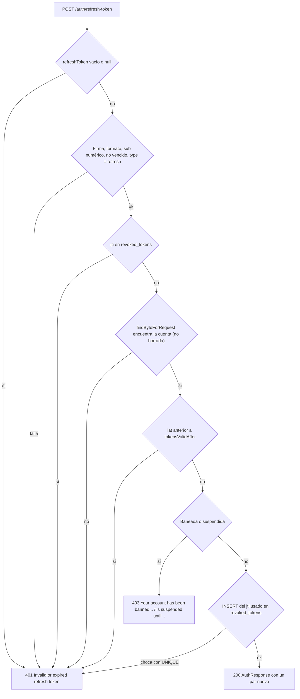
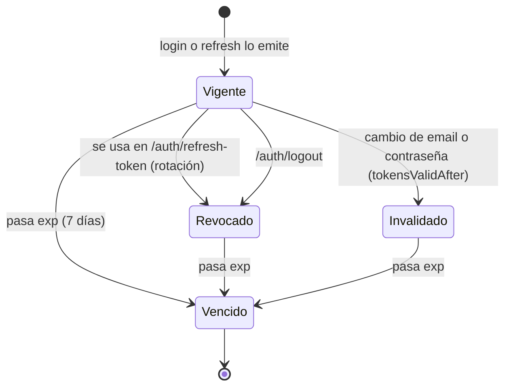

# Auth

## Para qué existe

El dominio `auth` emite y retira las credenciales con las que se llama al resto de la API. Tiene tres operaciones, todas bajo `/auth`:

- **Login:** cambia email y contraseña por un par de tokens JWT (access + refresh).
- **Refresh:** cambia un refresh token vigente por un par nuevo, y el usado deja de servir (rotación).
- **Logout:** revoca el refresh token y, si se manda, también el access token del mismo usuario.

La autenticación de cada request (el filtro JWT, `SecurityConfig`, `AuthenticatedUserService`) se explica en [Seguridad](../03-seguridad.md). Este archivo se concentra en lo que pasa dentro de los tres endpoints.

Las rutas de `/auth/**` son públicas y el filtro JWT no se ejecuta sobre ellas (`JwtAuthenticationFilter.shouldNotFilter`): cada endpoint lee sus propios tokens del body o del header. Por eso un access token vencido o revocado en el header `Authorization` no impide llamar a login, refresh o logout.

## Entidades y datos

### Entidad `RevokedToken` (`entity/auth/RevokedToken.java`)

Tabla `revoked_tokens`: la lista negra de tokens. No guarda el token entero, solo su `jti` (identificador único que `JwtService` agrega a cada token con un `UUID`).

| Campo | Columna | Notas |
|---|---|---|
| `id` | `id` | Identidad autogenerada. |
| `jti` | `jti` | `NOT NULL`, `UNIQUE`, largo 36 (un UUID). El `UNIQUE` es lo que resuelve las carreras entre dos refresh o dos logout simultáneos (ver "Reglas de negocio"). |
| `expirationDate` | `expiration_date` | `NOT NULL`. Vencimiento del token revocado (el `exp` del token pasado a `LocalDateTime` con la zona horaria de la JVM). Pasada esa fecha el token ya no sirve por sí solo, así que la fila se puede borrar. |
| `createdAt` | `created_at` | `NOT NULL`. Momento de la revocación, se completa en el constructor. |

`RevokedTokenRepository` (`repository/auth/RevokedTokenRepository.java`) expone `existsByJti` (la consulta que se hace en cada refresh, logout y request autenticado) y `deleteExpiredTokens(fecha)`, que usa `TokenBlackListService.cleanupExpiredTokens`. Ese método está anotado con `@Scheduled(cron = "0 0 2 * * ?")` (todos los días a las 2 AM), pero ninguna clase del proyecto tiene `@EnableScheduling`, así que Spring no lo programa: hoy la tabla solo crece.

### Campos de `User` que usa este dominio (`entity/user/User.java`)

El dominio no tiene una entidad de usuario propia; lee y escribe estos campos del usuario:

| Campo | Uso en `auth` |
|---|---|
| `deletedAt` | Borrado lógico. El login lo vuelve a `null` (restaura la cuenta); el refresh rechaza la cuenta borrada. |
| `banned`, `bannedReason` | Ban permanente. Login y refresh responden `403` con el motivo. |
| `suspendedUntil`, `bannedReason` | Suspensión temporal. Bloquea solo mientras `suspendedUntil` está en el futuro. |
| `tokensValidAfter` | Tokens emitidos antes de este instante se rechazan. Lo fija `service/user/UserService.java` al cambiar email o contraseña. `null` = sin restricción. |
| `role` | Su `name` (`USER` o `ADMIN`) va al claim `role` del access token y a `userInfo.role` de la respuesta. Las autoridades de Spring Security no salen del claim sino de la base: `CustomUserDetailsService` arma `ROLE_` + `name` en mayúsculas en cada login y en cada request. |
| `userInfo` (`entity/user/UserInfo.java`) | Email, contraseña (BCrypt), nombre, apellido y `userName`. `email` es `UNIQUE`. |

Quién pone `banned` y `suspendedUntil` está en [Reportes](report.md); el modelo completo de `User` está en [Modelo de datos](../04-modelo-de-datos.md).

### Los tokens (`service/auth/JwtService.java`)

Firmados con HS256 y la clave de `jwt.secret` (variable `JWT_SECRET`; la aplicación no arranca si está vacía, es el placeholder público o tiene menos de 32 bytes).

| | Access token | Refresh token |
|---|---|---|
| `sub` | id del usuario (como texto) | id del usuario (como texto) |
| `type` | `access` | `refresh` |
| `userId` | id del usuario | id del usuario |
| `role`, `email`, `firstName`, `lastName`, `userName` | sí | no |
| `jti` | UUID aleatorio | UUID aleatorio |
| `iat` / `exp` | emisión / emisión + `jwt.expiration` | emisión / emisión + `jwt.refresh-expiration` |
| Duración en `application.properties` | `3600000` ms (1 hora) | `604800000` ms (7 días) |

El claim `type` es lo que impide usar un token en el lugar del otro: el filtro solo acepta `access`, y refresh y logout solo aceptan `refresh`. Un token sin `type` no sirve para nada.

### DTOs (`dtos/auth/`)

- `AuthRequest`: `email`, `password`. Body del login.
- `RefreshTokenRequest`: `refreshToken`. Body de refresh y logout.
- `AuthResponse`: `accessToken`, `refreshToken` y `userInfo` (clase anidada `AuthResponse.UserInfo`, con campos públicos que Jackson serializa directamente). `UserInfo` tiene dos fábricas: `fromUser`, la que usan login y refresh, y `fromUserTokenData`, que hoy no se llama desde ningún lado.
- `UserTokenData`: los claims de un token leídos de una vez (`JwtService.extractUserData`). Es interno, no se expone en ningún endpoint. Fuera de este dominio, `security/AuthenticatedUserService.java` lo usa para leer el claim `userId` del token del request.

Ningún DTO de este dominio tiene anotaciones de Bean Validation y los controllers no usan `@Valid`: un campo faltante no da `400 Validation failed`, sino el `401` del caso correspondiente. El `@NotNull` de `UserTokenData.userId` es de `org.jetbrains.annotations`: es solo una marca para el IDE y no valida nada en ejecución.

## Reglas de negocio

| Regla | Por qué / consecuencia | Dónde |
|---|---|---|
| Email inexistente y contraseña incorrecta dan la misma respuesta: `401` `Invalid email or password`. | `DaoAuthenticationProvider` convierte el "usuario no encontrado" en `BadCredentialsException`, y el service traduce esa excepción a un único mensaje. Así el login no revela qué emails están registrados. | `service/auth/AuthenticationService.java`, `security/SecurityConfig.java` (`authenticationProvider`) |
| El estado de la cuenta (ban/suspensión) se valida **después** de la contraseña. | Solo quien conoce la contraseña se entera de que la cuenta está sancionada y por qué. | `service/auth/AuthenticationService.java` |
| Una cuenta baneada, o suspendida con `suspendedUntil` en el futuro, recibe `403` en login y refresh, con el motivo (`bannedReason` o `Violation of terms` si es `null`). | Es la misma comprobación que hace el filtro JWT en cada request, centralizada en una sola clase: login, refresh y requests autenticados responden igual. Una suspensión vencida no es una sanción y no hace falta "levantarla". | `validation/auth/AccountStatusValidationService.java` (`validateNotSanctioned`) |
| El login encuentra cuentas borradas lógicamente y las restaura (`deletedAt = null`). | La única forma de borrar una cuenta es que el propio usuario llame a `DELETE /api/users/delete`; volver a loguearse con su contraseña la reactiva. Las campañas que se cerraron al borrar la cuenta siguen cerradas. Una cuenta borrada **y** sancionada recibe `403` y sigue borrada. | `service/auth/AuthenticationService.java`, `service/auth/CustomUserDetailsService.java` (`loadUserByUsername` busca con `findByEmailIncludingDeleted` y nunca restaura por sí mismo) |
| El refresh **no** restaura cuentas borradas: responde `401`. | Usa `findByIdForRequest`, que respeta el `@SQLRestriction("deleted_at IS NULL")` de `User`. Restaurar requiere la contraseña, no basta con tener un refresh token. | `service/auth/AuthenticationService.java`, `repository/user/UserRepository.java` |
| El refresh solo acepta tokens de tipo `refresh`, vigentes, firmados con la clave actual, no revocados, de una cuenta existente y emitidos después de `tokensValidAfter`. Todo rechazo da el mismo `401` `Invalid or expired refresh token`. | No se distingue el motivo para no dar pistas a quien prueba tokens. Cualquier excepción inesperada al leer el token (firma, formato, `sub` no numérico de tokens viejos) termina en ese mismo `401`. | `service/auth/AuthenticationService.java` (`refreshToken`) |
| Rotación: el refresh token usado se revoca y se emite un par nuevo. | Un refresh token sirve una sola vez. Si dos refresh llegan a la vez con el mismo token, los dos pasan el `existsByJti`, pero el segundo `INSERT` viola el `UNIQUE` de `jti` y ese request recibe `401`. | `AuthenticationService.revokeUsedRefreshToken`, `entity/auth/RevokedToken.java` |
| Cambiar email o contraseña invalida **todos** los tokens anteriores, incluida la sesión actual. | `tokensValidAfter` se compara con el `iat` del token. Como `iat` tiene precisión de segundos, `tokensValidAfter` se trunca a segundos: un login hecho en el mismo segundo que el cambio sigue valiendo. | `service/user/UserService.java` (`updateUser`), `JwtService.isIssuedBefore` |
| El logout es idempotente: un refresh token ya revocado o ya vencido responde `204` sin hacer nada. | Un cliente puede reintentar el logout sin recibir errores. Un refresh token vencido ya no se puede usar, así que no hace falta guardarlo. | `AuthenticationService.logout` |
| El logout no es `@Transactional`: cada revocación se confirma por separado, y un `UNIQUE` violado por un logout concurrente se ignora. | Si el `INSERT` del access token chocara con otro logout, no deshace la revocación del refresh token. | `AuthenticationService.revokeIgnoringDuplicates` |
| El access token del header solo se revoca si es de tipo `access`, es válido y pertenece al mismo usuario que el refresh token. Cualquier otro caso se ignora en silencio. | Nadie puede revocar el access token de otro usuario mandándolo junto con su propio refresh token, y un header inválido no hace fallar el logout. | `AuthenticationService.revokeAccessTokenIfOwnedBy` |
| El refresh no revoca el access token anterior. | El access token viejo sigue sirviendo hasta su vencimiento (1 hora como máximo). Para cortarlo antes hay que pasar por logout. | `AuthenticationService.refreshToken` |
| Las filas de `revoked_tokens` vencidas se pueden borrar sin riesgo. | Un token vencido ya es rechazado por la validación de `exp`, así que su fila en la lista negra no aporta nada. Para eso existe `cleanupExpiredTokens` con `@Scheduled` a las 2 AM, pero sin `@EnableScheduling` en el proyecto nunca se ejecuta: las filas se acumulan. | `service/auth/TokenBlackListService.java` (`cleanupExpiredTokens`) |

Los mensajes de sanción son exactamente los del código:

- `Your account has been banned. Reason: <bannedReason>`
- `Your account is suspended until <suspendedUntil>. Reason: <bannedReason>` (`suspendedUntil` es un `LocalDateTime` impreso con su `toString()`, por ejemplo `2026-11-08T14:30:12.123456`; la cantidad de decimales depende de lo que guarde la base).

### Orden de validación del refresh

## Estados

Este dominio no tiene un enum de estado. Lo más parecido es el ciclo de vida de un refresh token, que se deduce de `revoked_tokens` y del claim `exp`:

Un refresh token también deja de servir mientras la cuenta esté baneada o suspendida (`403`) o borrada (`401`), pero eso depende del usuario, no del token: si la sanción vence o la cuenta se restaura con un login, el mismo token vuelve a funcionar mientras no haya vencido.

## Visibilidad y permisos

- **Los tres endpoints son públicos** (`/auth/**` en `SecurityConfig.PUBLIC_URLS`) y no tienen `@PreAuthorize`. La "autorización" es la posesión del secreto: la contraseña en el login, el refresh token en refresh y logout.
- **El filtro JWT no corre en `/auth/**`.** Un usuario baneado con un access token todavía vigente no recibe el `403` del filtro al llamar a estos endpoints; recibe el `403` del propio login o refresh, con el mismo mensaje.
- **Logout:** cualquiera que tenga un refresh token puede revocarlo; el access token del header solo se revoca si es del mismo usuario. No se valida el estado de la cuenta: un usuario sancionado o borrado puede cerrar su sesión.
- **`403` vs `404` vs `401`:**
  - Sanción (ban o suspensión vigente) → `403` con el motivo, en login y refresh. Acá sí se revela la sanción porque quien pregunta es el propio titular (en login, después de probar la contraseña). En otros dominios, un usuario sancionado se oculta a terceros con `404` (ver [Usuarios](user.md) y [Errores y validación](../05-errores-y-validacion.md)).
  - Email inexistente, contraseña incorrecta → `401`, mismo mensaje.
  - Cuenta borrada → login la restaura; refresh responde `401`.
  - Ningún endpoint de este dominio devuelve `404` en la práctica (ver la nota del login).

## Endpoints

Las tres rutas devuelven errores con la forma `{error, message, timestamp}` de `exception/GlobalExceptionHandler.java`. Errores comunes a los tres, además de los de cada tabla:

| Status | `error` / `message` | Cuándo |
|---|---|---|
| 400 | `Malformed request` / `Malformed request body` | El body no es JSON válido. |
| 405 | `Method not allowed` / `Method GET is not supported for this endpoint` | Se usa un método distinto de `POST`. |
| 415 | `Unsupported media type` / `Content type 'text/plain' is not supported. Use application/json` | El `Content-Type` no es JSON. |
| 500 | `Internal server error` / `An unexpected error occurred. Please try again later.` | Cualquier excepción no prevista. Por ejemplo, la base caída durante el logout, o al abrir la transacción de login y refresh: eso pasa antes de entrar al método, así que el `catch` del refresh no llega a convertirlo en `401`. Si la base falla ya dentro del refresh, la respuesta es `401`. |

### `POST /auth/login`

- **Acceso:** público (`/auth/**` en `PUBLIC_URLS`). El filtro JWT no se ejecuta; el header `Authorization` se ignora.
- **Parámetros:** ninguno.
- **Body:** `AuthRequest`, obligatorio.

  | Campo | Tipo | Obligatorio | Validación |
  |---|---|---|---|
  | `email` | string | sí (de hecho) | Sin Bean Validation. Si falta o no existe, `401`. Se busca tal como llega; la comparación sin distinguir mayúsculas depende de la collation de SQL Server. |
  | `password` | string | sí (de hecho) | Sin Bean Validation. Se compara con el hash BCrypt de `UserInfo.password`. Si falta o no coincide, `401`. |

- **Respuesta:** `200 OK` con `AuthResponse`.

  | Campo | Tipo | Descripción |
  |---|---|---|
  | `accessToken` | string | JWT de tipo `access`, 1 hora. Va en `Authorization: Bearer <token>` en el resto de la API. |
  | `refreshToken` | string | JWT de tipo `refresh`, 7 días. Solo sirve para `/auth/refresh-token` y `/auth/logout`. |
  | `userInfo.userId` | number | Id del usuario. |
  | `userInfo.email` | string | Email. |
  | `userInfo.role` | string | `USER` o `ADMIN`. |
  | `userInfo.firstName` | string | Nombre. |
  | `userInfo.lastName` | string | Apellido. |
  | `userInfo.userName` | string | Nombre de usuario. |
  | `userInfo.fullName` | string | `firstName + " " + lastName`. |

- **Errores:**

  | Status | `error` / `message` | Cuándo |
  |---|---|---|
  | 400 | `Malformed request` / `Request body is required` | No se manda body, o el body es el literal JSON `null`. |
  | 400 | `Business logic error` / `Authentication request cannot be null` | Inalcanzable: el service lo lanza si el request es `null`, pero Spring ya respondió el `400` anterior porque el body es obligatorio. |
  | 401 | `Invalid credentials` / `Invalid email or password` | Email inexistente, contraseña incorrecta, o falta alguno de los dos campos. |
  | 401 | `Authentication failed` / el mensaje de la excepción interna | Falla inesperada al cargar el usuario dentro de Spring Security (por ejemplo, error de base): `DaoAuthenticationProvider` la envuelve en `InternalAuthenticationServiceException` y la atrapa el handler de `AuthenticationException`. |
  | 403 | `Forbidden` / `Your account has been banned. Reason: <motivo>` | Contraseña correcta, cuenta con `banned = true`. |
  | 403 | `Forbidden` / `Your account is suspended until <fecha>. Reason: <motivo>` | Contraseña correcta, `suspendedUntil` en el futuro. |
  | 404 | `Resource not found` / `User not found` | La segunda búsqueda por email no encuentra al usuario. En la práctica es inalcanzable: Spring Security ya lo encontró con la misma consulta dentro de la autenticación. |

- **Qué hace** (`AuthenticationService.authenticate`, `@Transactional`):
  1. Llama a `AuthenticationManager.authenticate` con email y contraseña. El `DaoAuthenticationProvider` de `SecurityConfig` carga el usuario con `CustomUserDetailsService.loadUserByUsername` (que usa `findByEmailIncludingDeleted`, una query nativa que ve también las cuentas borradas) y compara la contraseña con BCrypt. Una `BadCredentialsException` se traduce a `InvalidCredentialsException("Invalid email or password")`.
  2. Vuelve a cargar el `User` con `findByEmailIncludingDeleted`.
  3. `AccountStatusValidationService.validateNotSanctioned`: ban → `403`; suspensión vigente → `403`.
  4. Si `deletedAt` no es `null`, lo pone en `null` y guarda: la cuenta queda restaurada.
  5. Genera el access token y el refresh token con `JwtService` y arma `AuthResponse.UserInfo.fromUser`.

### `POST /auth/refresh-token`

- **Acceso:** público (`/auth/**` en `PUBLIC_URLS`). El filtro JWT no se ejecuta; la credencial es el refresh token del body.
- **Parámetros:** ninguno.
- **Body:** `RefreshTokenRequest`, obligatorio.

  | Campo | Tipo | Obligatorio | Validación |
  |---|---|---|---|
  | `refreshToken` | string | sí | Sin Bean Validation. `null`, vacío o solo espacios → `401`. Tiene que ser un JWT de tipo `refresh` válido (ver "Orden de validación del refresh"). |

- **Respuesta:** `200 OK` con `AuthResponse` (mismos campos que el login), con un access token y un refresh token **nuevos**. El refresh token recibido queda revocado.
- **Errores:**

  | Status | `error` / `message` | Cuándo |
  |---|---|---|
  | 400 | `Malformed request` / `Request body is required` | No se manda body. |
  | 401 | `Invalid credentials` / `Invalid or expired refresh token` | `refreshToken` vacío o `null`; firma inválida o token mal formado; token vencido; token de tipo `access` o sin `type`; `sub` no numérico; `jti` ya revocado (incluye reusar un refresh token ya rotado); cuenta inexistente o borrada; token emitido antes de `tokensValidAfter`; otro refresh concurrente con el mismo token ganó la carrera. |
  | 403 | `Forbidden` / `Your account has been banned. Reason: <motivo>` | La cuenta está baneada. El refresh token no se revoca. |
  | 403 | `Forbidden` / `Your account is suspended until <fecha>. Reason: <motivo>` | La cuenta tiene una suspensión vigente. El refresh token no se revoca. |

- **Qué hace** (`AuthenticationService.refreshToken`, `@Transactional`):
  1. Rechaza un token `null` o en blanco.
  2. Lee el id del usuario del `sub` (`JwtService.extractSubjectUserId`); parsear el token ya verifica firma y vencimiento.
  3. Comprueba que el token sea válido y de tipo `refresh`.
  4. Busca el `jti` en `revoked_tokens` (`TokenBlackListService.isTokenRevoked`).
  5. Carga el usuario con `findByIdForRequest` (no ve cuentas borradas; trae `userInfo` y `role` en el mismo `SELECT`).
  6. Rechaza el token si su `iat` es anterior a `tokensValidAfter`.
  7. `AccountStatusValidationService.validateNotSanctioned`.
  8. Inserta el `jti` usado en `revoked_tokens` con su fecha de vencimiento (rotación). Un choque con el `UNIQUE` se traduce a `401`.
  9. Genera el par nuevo y la `AuthResponse`.

  Cualquier `RuntimeException` que no sea una `MessageException` durante los pasos 2 a 9 se convierte en `401 Invalid or expired refresh token`.

### `POST /auth/logout`

- **Acceso:** público (`/auth/**` en `PUBLIC_URLS`). El filtro JWT no se ejecuta; la credencial es el refresh token del body.
- **Parámetros:**

  | Nombre | Dónde | Tipo | Obligatorio | Descripción |
  |---|---|---|---|---|
  | `Authorization` | header | string | no | `Bearer <accessToken>`. Si viene y el access token es del mismo usuario que el refresh token, también se revoca. Sin el prefijo `Bearer ` se ignora. |

- **Body:** `RefreshTokenRequest`. El controller lo declara opcional (`@RequestBody(required = false)`), pero sin él el service no tiene refresh token y responde `401`: en la práctica es obligatorio.

  | Campo | Tipo | Obligatorio | Validación |
  |---|---|---|---|
  | `refreshToken` | string | sí | Sin Bean Validation. `null`, vacío o solo espacios → `401`. Tiene que ser un JWT de tipo `refresh` con firma válida. Si está vencido, el logout termina con `204` sin hacer nada, sin mirar el `type`: un access token vencido mandado como `refreshToken` también da `204`. |

- **Respuesta:** `204 No Content`, sin body. Se devuelve también cuando no había nada que revocar (token ya revocado o vencido), y cuando el access token del header se ignoró.
- **Errores:**

  | Status | `error` / `message` | Cuándo |
  |---|---|---|
  | 401 | `Invalid credentials` / `Invalid or expired refresh token` | Sin body, o `refreshToken` vacío o `null`; firma inválida o token mal formado; token vigente de tipo `access` o sin `type`. Pese al mensaje, un token vencido no da `401` sino `204`. |

  El access token del header nunca produce un error: si es inválido, está vencido, es de otro usuario o es un refresh token, se ignora.

- **Qué hace** (`AuthenticationService.logout`, sin `@Transactional`):
  1. Rechaza un refresh token `null` o en blanco.
  2. Comprueba que sea de tipo `refresh` y lee su `jti`, su vencimiento y el claim `userId`. Leer el `type` ya parsea el token, así que si está vencido (`ExpiredJwtException`) termina sin hacer nada antes de saber de qué tipo era.
  3. Si el `jti` ya está en `revoked_tokens`, termina sin hacer nada: tampoco revoca el access token del header, aunque sea del mismo usuario y siga vigente.
  4. Inserta el `jti` del refresh token en `revoked_tokens` (un `UNIQUE` violado por un logout concurrente se ignora).
  5. Si vino un access token en el header, lo revoca solo si es de tipo `access` y su claim `userId` coincide con el del refresh token. Cualquier error en este paso se ignora.

  No consulta la tabla de usuarios: no valida que la cuenta exista, esté borrada o sancionada, ni `tokensValidAfter`.

## Clases involucradas

| Capa | Clase | Rol |
|---|---|---|
| controller | `controller/auth/AuthController.java` | Los tres `POST`. En logout extrae el access token del header `Authorization` y el refresh token del body opcional. |
| service | `service/auth/AuthenticationService.java` | Login, refresh y logout: orden de validaciones, restauración de cuentas, rotación y revocación. |
| service | `service/auth/JwtService.java` | Genera y lee los tokens (claims, `type`, `jti`, `iat`, `exp`), valida `JWT_SECRET` al arrancar. |
| service | `service/auth/TokenBlackListService.java` | Consulta e inserta en `revoked_tokens`. Tiene la limpieza de vencidos con `@Scheduled`, que hoy no se ejecuta por falta de `@EnableScheduling`. |
| service | `service/auth/CustomUserDetailsService.java` | `loadUserByUsername` para el login (incluye cuentas borradas, sin restaurarlas) y `loadUserForRequest` para el filtro JWT. |
| validation | `validation/auth/AccountStatusValidationService.java` | `validateNotSanctioned` (lanza `403` con el motivo) e `isSanctioned` (la misma condición como booleano, que usan otros dominios para ocultar usuarios sancionados). |
| entity | `entity/auth/RevokedToken.java` | Fila de la lista negra (`jti`, vencimiento). |
| repository | `repository/auth/RevokedTokenRepository.java` | `existsByJti`, `deleteExpiredTokens`. |
| repository | `repository/user/UserRepository.java` | `findByEmailIncludingDeleted` (login), `findByIdForRequest` (refresh y filtro). |
| DTO | `dtos/auth/AuthRequest.java`, `dtos/auth/RefreshTokenRequest.java`, `dtos/auth/AuthResponse.java`, `dtos/auth/UserTokenData.java` | Bodies de entrada, respuesta de login/refresh y claims leídos de un token. |
| security | `security/SecurityConfig.java` | `/auth/**` en `PUBLIC_URLS`, `DaoAuthenticationProvider` con BCrypt, `AuthenticationManager`. Detalle en [Seguridad](../03-seguridad.md). |
| security | `security/JwtAuthenticationFilter.java` | Excluye `/auth/**`; en el resto valida el access token con las mismas piezas (`JwtService`, `TokenBlackListService`, `AccountStatusValidationService`). Detalle en [Seguridad](../03-seguridad.md). |
| exception | `exception/InvalidCredentialsException.java`, `exception/ForbiddenActionException.java`, `exception/ResourceNotFoundException.java`, `exception/GlobalExceptionHandler.java` | `401`, `403` y `404` del dominio y su traducción a JSON. Detalle en [Errores y validación](../05-errores-y-validacion.md). |
