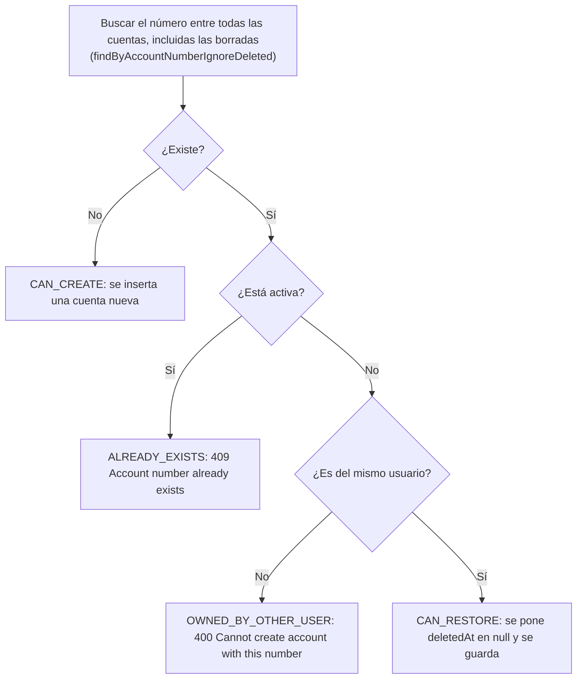

# Cuentas bancarias (`bankaccount`)

## Para qué existe

Una campaña recauda dinero, y el dinero tiene que llegar a algún lado. Este dominio guarda las cuentas bancarias de los usuarios: banco, número, tipo y titular. Un usuario puede tener varias, y solo puede registrarlas si ya pasó por la verificación de cuenta (ver [verification.md](verification.md)), que es lo que marca `User.verified` en `true`.

Las cuentas también aparecen dentro del perfil completo del usuario (`UserDTO.bankAccounts`), que solo ven el propio usuario y los `ADMIN` (ver [user.md](user.md)).

## Entidades y datos

**`BankAccount`** (`entity/bankaccount/BankAccount.java`), tabla `bank_accounts`:

| Campo | Columna | Tipo | Notas |
|---|---|---|---|
| `id` | `id` | `Long` | Identidad autoincremental. |
| `user` | `user_id` | `User` | `@ManyToOne(fetch = LAZY)`, obligatorio. El dueño de la cuenta. |
| `bankName` | `bank_name` | `String` | Obligatorio. |
| `accountNumber` | `account_number` | `String` | Obligatorio y **`unique = true`** en la base: la unicidad es global (entre todos los usuarios) e incluye las filas borradas, porque el borrado es lógico. |
| `accountType` | `account_type` | `String` | Obligatorio. Texto libre: no es un enum. |
| `accountHolder` | `account_holder` | `String` | Obligatorio. Titular tal como figura en el banco; no se compara con el nombre del usuario. |
| `isVerified` | `is_verified` | `boolean` | Arranca en `false`. Ningún código lo pone en `true` ni lo expone en la API. |
| `createdAt` / `updatedAt` | `created_at` / `updated_at` | `LocalDateTime` | Los completan `@PrePersist` y `@PreUpdate`. |
| `deletedAt` | `deleted_at` | `LocalDateTime` | Borrado lógico. |

**Borrado lógico.** La entidad tiene `@SQLRestriction("deleted_at is null")`, así que toda consulta JPA (incluidos `findById`, las queries JPQL y la colección `User.bankAccounts`) ignora las cuentas borradas. También declara `@SQLDelete(sql = "UPDATE bank_accounts SET deleted_at = now() WHERE id = ?")`, pero el service nunca llama a `delete` del repositorio: borra poniendo `deletedAt` a mano y guardando. Ver [04-modelo-de-datos.md](../04-modelo-de-datos.md) para el criterio general de soft delete.

**Relación con `User`.** `User.bankAccounts` es un `Set<BankAccount>` con `cascade = ALL` y `orphanRemoval = true` (`entity/user/User.java`). Como el usuario también se borra de forma lógica (se pone `deletedAt`, no se llama a `delete`), la cascada de borrado no se dispara: al borrar un usuario sus cuentas quedan con `deleted_at` en `null`, y sus números siguen ocupando el índice único.

**`AccountValidationResult`** (`validation/bankaccount/AccountValidationResult.java`) no es un estado de la entidad: es el resultado que devuelve la validación de alta según lo que ya hay en la base con ese número de cuenta (`CAN_CREATE`, `CAN_RESTORE`, `ALREADY_EXISTS`, `OWNED_BY_OTHER_USER`).

**DTOs** (`dtos/bankaccount/`):

- `CreateBankAccountDTO`: entrada del alta, incluye `userId`.
- `UpdateBankAccountDTO`: entrada de la edición, todos los campos opcionales.
- `BankAccountDTO`: salida. Es la respuesta de los cuatro endpoints y también el elemento de `UserDTO.bankAccounts`. No sigue el sufijo `*ResponseDTO` del resto del proyecto.

## Reglas de negocio

| Regla | Por qué / consecuencia | Dónde |
|---|---|---|
| Solo un usuario verificado puede dar de alta una cuenta. | Recibir dinero exige haber pasado la verificación de identidad. Un usuario no verificado recibe `403 User is not verified`. | `BankAccountValidationService.verifyUserIsVerified`, que lee `User.verified` con `BankAccountRepository.isUserVerified`. |
| El dueño de la cuenta nueva sale del body (`userId`), no del token. | La consecuencia observable es que el que llama puede dar de alta una cuenta a nombre de otro usuario verificado. El controller tiene un `TODO: implement user validation by auth token`. | `BankAccountService.createBankAccount`, `BankAccountValidationService.validateInput` (`User ID is required`). |
| El usuario debe existir y no estar borrado. | `UserRepository.findById` respeta el `@SQLRestriction` de `User`, así que un usuario borrado da el mismo `404 User not found` que uno inexistente. No se mira si está baneado o suspendido. | `UserValidationService.getUserById`. |
| Un usuario no puede tener dos cuentas activas con el mismo número. | `409 User already has a bank account with this account number`. | `BankAccountValidationService.checkIfUserHasDuplicateAccount`. |
| Un número de cuenta no puede estar en dos cuentas activas, de nadie. | Lo garantiza el índice único de `account_number`. Al crear, da `409 Account number already exists`; al editar, igual. | `BankAccountValidationService.validateAccountCreation`, `validateAccountNumberForUpdate`. |
| Si el número pertenece a una cuenta **borrada del mismo usuario**, el alta la restaura en vez de crear otra. | El índice único cuenta las filas borradas, así que insertar de nuevo fallaría; restaurar reaprovecha la fila. La cuenta restaurada conserva su banco, tipo y titular anteriores: los del body no se aplican. | `BankAccountService.createBankAccount` (rama `CAN_RESTORE`), `BankAccountRepository.findByUserIdAndAccountNumberAndDeletedAtIsNotNull`. |
| Si el número pertenece a una cuenta **borrada de otro usuario**, no se puede usar. | Al crear, `400 Cannot create account with this number`; al editar, `409 Cannot use account number owned by another user`. El número queda reservado para siempre a su primer dueño. | `validateAccountCreation` (`OWNED_BY_OTHER_USER`), `validateAccountNumberForUpdate`. |
| En la edición, cada campo es opcional, pero el que viene no puede estar vacío, y tiene que venir al menos uno. | Permite editar un solo campo sin reenviar el resto. Los valores se guardan sin espacios a los costados (`trim`). | `BankAccountValidationService.validateUpdateInput` con `ValidationUtils.validateAtLeastOneFieldPresent` y `validateIfPresent`; `BankAccountService.updateBankAccount`. |
| No hay validación de formato del número ni del tipo de cuenta. | Cualquier texto no vacío de hasta 50 caracteres es un número válido, y `accountType` es texto libre. En el alta el número se guarda tal cual llega (sin `trim`), en la edición se recorta. | `CreateBankAccountDTO`, `UpdateBankAccountDTO`. |

**Decisión del alta según el número de cuenta.** Antes de esta decisión ya corrió `checkIfUserHasDuplicateAccount`, así que el caso "activa del mismo usuario" corta antes con su propio `409`.

**Atención: las dos queries nativas apuntan a una tabla que no existe.** `findByAccountNumberIgnoreDeleted` y `findByUserIdAndAccountNumberAndDeletedAtIsNotNull` (`repository/bankaccount/BankAccountRepository.java`) son nativas para poder ver filas borradas (las nativas no aplican `@SQLRestriction`), pero consultan `bank_account`, en singular, mientras que la entidad mapea `bank_accounts`. Contra una base creada por Hibernate, la consulta falla y el `GlobalExceptionHandler` responde `500`. En la práctica: el alta que pasa todas las validaciones previas, y la edición que cambia el número por uno no usado por ninguna cuenta activa, terminan en `500`. Los tests unitarios mockean el repositorio y no lo detectan. Está registrado en [deuda-tecnica.md](../deuda-tecnica.md).

**Comprobaciones de "ya borrada" que no se alcanzan.** `deleteBankAccount` (`409 Bank account is already deleted`) y `updateBankAccount` (`400 Cannot update deleted bank account`) miran `deletedAt` después de `findById`, pero `findById` ya excluye las borradas por el `@SQLRestriction`. Una cuenta borrada da `404 Bank account not found with id: {id}`.

## Estados

Este dominio no tiene estados: no hay un enum de estado para `BankAccount`. Una cuenta solo está activa (`deletedAt` en `null`) o borrada de forma lógica, y puede volver a activa con un alta del mismo número por el mismo usuario (ver la decisión del alta arriba). `isVerified` existe en la entidad pero no tiene transiciones.

## Visibilidad y permisos

- **Todas las rutas exigen token.** `/api/bank-accounts/**` no está en `PUBLIC_URLS` ni en `PUBLIC_GET_URLS` de `security/SecurityConfig.java`, así que cae en `anyRequest().authenticated()`. Ningún método del controller tiene `@PreAuthorize`, y no hay distinción entre `USER` y `ADMIN`: los dos pueden hacer exactamente lo mismo. Ver [03-seguridad.md](../03-seguridad.md).
- **No se comprueba la propiedad.** Ningún endpoint llama a `AuthenticatedUserService`: el alta toma el dueño de `userId` en el body, el listado toma el usuario de la ruta, y la edición y el borrado actúan sobre el `id` de la ruta sin mirar de quién es la cuenta. La consecuencia observable es que cualquier usuario autenticado puede ver el número completo de las cuentas de otro usuario, dar de alta cuentas a su nombre, editarlas y borrarlas. Contrasta con `GET /api/users/{id}`, que solo muestra `bankAccounts` al propio usuario y a los `ADMIN` (ver [user.md](user.md)).
- **Usuarios bloqueados.** El que llama, si está baneado o suspendido, queda cortado por el filtro JWT con `403` (ver [03-seguridad.md](../03-seguridad.md)). En cambio, el usuario **consultado** no se filtra: `GET /api/bank-accounts/user/{userId}` devuelve las cuentas de un usuario baneado o suspendido, y el alta acepta un `userId` bloqueado. No se aplica el criterio de ocultarlo con `404` que usan otros dominios (ver [05-errores-y-validacion.md](../05-errores-y-validacion.md)).
- **Usuarios borrados.** Sí se ocultan: el listado usa `UserValidationService.existsById` y el alta `getUserById`, y los dos respetan el `@SQLRestriction` de `User`. Un usuario borrado da `404` igual que uno inexistente.
- **Cuentas borradas.** No se ven por ningún endpoint: `findById`, `findByUserId` y la colección del usuario las excluyen.
- **404 vs 403 en este dominio.** El único `403` propio es `User is not verified` (alta para un usuario no verificado). Cuenta inexistente o borrada, usuario inexistente o borrado y usuario sin cuentas son `404`. No existe un `403` por "la cuenta no es tuya".

## Endpoints

Errores comunes a todas las rutas del dominio (no se repiten en cada endpoint):

| Status | `error` / `message` | Cuándo |
|---|---|---|
| 401 | `Unauthorized` / `Full authentication is required to access this resource` | Sin header `Authorization: Bearer`, o el token es rechazado por el filtro (expirado, firma inválida, revocado, refresh token, emitido antes del último cambio de email o contraseña, usuario borrado o inexistente). Lo escribe el `authenticationEntryPoint` de `security/SecurityConfig.java`. |
| 403 | `Forbidden` / `Your account has been banned. Reason: {motivo}` | El que llama está baneado. Lo escribe `security/JwtAuthenticationFilter.java` con el mensaje de `validation/auth/AccountStatusValidationService.java`; si no hay motivo, `{motivo}` es `Violation of terms`. |
| 403 | `Forbidden` / `Your account is suspended until {fecha}. Reason: {motivo}` | El que llama tiene una suspensión vigente. |
| 400 | `Invalid parameter` / `Invalid value '{valor}' for parameter '{nombre}'` | Un path variable no es un número (`MethodArgumentTypeMismatchException`). |
| 405 | `Method not allowed` / `Method {método} is not supported for this endpoint` | Verbo no soportado en la ruta. |
| 500 | `Internal server error` / `An unexpected error occurred. Please try again later.` | Cualquier excepción no prevista, incluidas las de SQL de las queries nativas (ver "Atención" en Reglas de negocio). |

### `POST /api/bank-accounts`

- **Acceso:** cualquier usuario autenticado (`USER` o `ADMIN`). No se comprueba que `userId` sea el del que llama.
- **Parámetros:** ninguno.
- **Body:** `CreateBankAccountDTO`, con `@Valid`.

  | Campo | Tipo | Obligatorio | Validación |
  |---|---|---|---|
  | `userId` | `Long` | sí | Sin anotación; si falta, `User ID is required` desde `BankAccountValidationService.validateInput`. Debe ser un usuario existente, no borrado y verificado. |
  | `bankName` | `String` | sí | `@NotBlank`, `@Size(max = 100)`. |
  | `accountNumber` | `String` | sí | `@NotBlank`, `@Size(max = 50)`. Sin validación de formato. Se guarda sin recortar. |
  | `accountType` | `String` | sí | `@NotBlank`, `@Size(max = 50)`. Texto libre. |
  | `accountHolder` | `String` | sí | `@NotBlank`, `@Size(max = 100)`. |

- **Respuesta:** `200 OK` (no `201`) con `BankAccountDTO`, tanto si se creó como si se restauró una cuenta borrada.

  | Campo | Tipo | Descripción |
  |---|---|---|
  | `id` | `Long` | Id de la cuenta. |
  | `userId` | `Long` | Dueño. |
  | `bankName` | `String` | Banco. |
  | `accountNumber` | `String` | Número completo, sin enmascarar. |
  | `accountType` | `String` | Tipo. |
  | `accountHolder` | `String` | Titular. |

- **Errores:**

  | Status | Mensaje | Cuándo |
  |---|---|---|
  | 400 | `Validation failed` / `One or more fields are invalid`, con `fields` | Falla `@NotBlank` o `@Size` en algún campo. Los textos de `fields` son los mensajes por defecto de Bean Validation (las anotaciones no definen `message`). |
  | 400 | `Malformed request` / `Request body is required` | No hay body. |
  | 400 | `Malformed request` / `Malformed request body` | JSON inválido. |
  | 400 | `User ID is required` | `userId` ausente o `null`. |
  | 404 | `User not found` | El usuario no existe o está borrado. |
  | 403 | `User is not verified` | El usuario existe pero `verified` es `false`. |
  | 409 | `User already has a bank account with this account number` | Ese usuario ya tiene una cuenta activa con ese número. |
  | 409 | `Account number already exists` | Otro usuario tiene una cuenta activa con ese número (`ALREADY_EXISTS`). |
  | 400 | `Cannot create account with this number` | El número es de una cuenta borrada de otro usuario (`OWNED_BY_OTHER_USER`). |
  | 404 | `Account not found for restoration` | Rama `CAN_RESTORE` cuando no se encuentra la fila a restaurar. |
  | 409 | `Conflict` / `The request conflicts with existing data` | `DataIntegrityViolationException`: otro request guardó el mismo número entre la validación y el `save` (el método no es transaccional y el índice único es la última barrera). |
  | 500 | `An unexpected error occurred. Please try again later.` | La query nativa `findByAccountNumberIgnoreDeleted` consulta la tabla `bank_account`, que no existe (ver Reglas de negocio). Pasa con cualquier alta que supere las validaciones anteriores. |

  Los `400` de reglas de negocio van con `error` `Business logic error`, los `404` con `Resource not found`, los `403` con `Forbidden` y los `409` con `Conflict` (ver [05-errores-y-validacion.md](../05-errores-y-validacion.md)).

- **Qué hace** (`BankAccountService.createBankAccount`):
  1. `BankAccountValidationService.validateInput`: campos no vacíos y `userId` presente.
  2. `UserValidationService.getUserById(userId)`: carga el dueño o `404`.
  3. `BankAccountValidationService.verifyUserIsVerified(userId)`: `403` si no está verificado.
  4. `BankAccountValidationService.checkIfUserHasDuplicateAccount`: `409` si ese usuario ya tiene el número activo.
  5. `BankAccountValidationService.validateAccountCreation`: decide `CAN_CREATE`, `CAN_RESTORE`, `ALREADY_EXISTS` u `OWNED_BY_OTHER_USER` (diagrama en Reglas de negocio).
  6. `CAN_CREATE`: `BankAccountValidationService.buildBankAccountEntity` arma la entidad y se guarda con `BankAccountRepository.save`. `CAN_RESTORE`: se busca la fila borrada con `findByUserIdAndAccountNumberAndDeletedAtIsNotNull`, se pone `deletedAt` en `null` y se guarda, sin aplicar los demás campos del body.
  7. `BankAccountMapper.toDto`.

### `GET /api/bank-accounts/user/{userId}`

- **Acceso:** cualquier usuario autenticado (`USER` o `ADMIN`), para cualquier `userId`. No se comprueba que sea el propio.
- **Parámetros:**

  | Nombre | Dónde | Tipo | Obligatorio |
  |---|---|---|---|
  | `userId` | path | `Long` | sí |

- **Body:** sin body.
- **Respuesta:** `200 OK` con `List<BankAccountDTO>` (mismos campos que en el alta, con el número completo). Sin paginación ni orden explícito. Solo cuentas activas.
- **Errores:**

  | Status | Mensaje | Cuándo |
  |---|---|---|
  | 404 | `User not found with id: {userId}` | El usuario no existe o está borrado. Un usuario baneado o suspendido **no** da `404`. |
  | 404 | `No bank accounts found for user with id: {userId}` | El usuario existe pero no tiene cuentas activas: una lista vacía se responde como `404`, no como `[]`. |

- **Qué hace** (`BankAccountService.getBankAccountsByUserId`):
  1. `UserValidationService.existsById(userId)`: `404` si no existe (el chequeo vive en el service, no en la capa de validación).
  2. `BankAccountRepository.findByUserId(userId)`.
  3. Si la lista está vacía, `404`.
  4. `BankAccountMapper.toDto` por cada cuenta. El mapper solo lee el id del usuario del proxy lazy, así que no dispara una consulta por cuenta.

### `DELETE /api/bank-accounts/{id}`

- **Acceso:** cualquier usuario autenticado (`USER` o `ADMIN`), sobre cualquier cuenta. No se comprueba que sea del que llama.
- **Parámetros:**

  | Nombre | Dónde | Tipo | Obligatorio |
  |---|---|---|---|
  | `id` | path | `Long` | sí |

- **Body:** sin body.
- **Respuesta:** `200 OK` con un mapa fijo (no un DTO):

  | Campo | Tipo | Valor |
  |---|---|---|
  | `message` | `String` | `Bank account deleted successfully` |
  | `success` | `String` | `true` (como texto) |

- **Errores:**

  | Status | Mensaje | Cuándo |
  |---|---|---|
  | 404 | `Bank account not found with id: {id}` | La cuenta no existe o ya estaba borrada. |
  | 409 | `Bank account is already deleted` | Está en el código pero no se alcanza: `findById` ya excluye las borradas. |

- **Qué hace** (`BankAccountService.deleteBankAccount`, `@Transactional`):
  1. `BankAccountRepository.findById(id)`: `404` si no está.
  2. Comprueba `deletedAt` (inalcanzable, ver arriba).
  3. Pone `deletedAt = LocalDateTime.now()` y guarda. Es un borrado lógico: la fila y su número de cuenta siguen en la tabla, y el número queda reservado para ese usuario (puede restaurarla con un alta del mismo número).

### `PUT /api/bank-accounts/{id}`

- **Acceso:** cualquier usuario autenticado (`USER` o `ADMIN`), sobre cualquier cuenta. No se comprueba que sea del que llama (el controller tiene el `TODO: implement user validation by auth token` sobre este método).
- **Parámetros:**

  | Nombre | Dónde | Tipo | Obligatorio |
  |---|---|---|---|
  | `id` | path | `Long` | sí |

- **Body:** `UpdateBankAccountDTO`, con `@Valid`. Todos los campos son opcionales; tiene que venir al menos uno. El que viene no puede estar vacío ni ser solo espacios.

  | Campo | Tipo | Obligatorio | Validación |
  |---|---|---|---|
  | `bankName` | `String` | no | `@Size(max = 100, message = "Bank name cannot exceed 100 characters")`; si viene, no vacío. |
  | `accountNumber` | `String` | no | `@Size(max = 50, message = "Account number cannot exceed 50 characters")`; si viene, no vacío; no puede estar en otra cuenta activa ni en una borrada de otro usuario. |
  | `accountType` | `String` | no | `@Size(max = 50, message = "Account type cannot exceed 50 characters")`; si viene, no vacío. |
  | `accountHolder` | `String` | no | `@Size(max = 100, message = "Account holder cannot exceed 100 characters")`; si viene, no vacío. |

- **Respuesta:** `200 OK` con `BankAccountDTO` actualizado (mismos campos que en el alta).
- **Errores:**

  | Status | Mensaje | Cuándo |
  |---|---|---|
  | 400 | `Validation failed` / `One or more fields are invalid`, con `fields` | Algún campo supera su `@Size` (los mensajes de `fields` son los de la tabla del body). |
  | 400 | `Malformed request` / `Request body is required` | No hay body. |
  | 400 | `Malformed request` / `Malformed request body` | JSON inválido. |
  | 400 | `At least one field must be provided for update` | Todos los campos ausentes o `null` (por ejemplo `{}`). |
  | 400 | `Bank name cannot be empty` | `bankName` vacío o solo espacios. |
  | 400 | `Account number cannot be empty` | `accountNumber` vacío o solo espacios. |
  | 400 | `Account type cannot be empty` | `accountType` vacío o solo espacios. |
  | 400 | `Account holder cannot be empty` | `accountHolder` vacío o solo espacios. |
  | 404 | `Bank account not found with id: {id}` | La cuenta no existe o está borrada. |
  | 400 | `Cannot update deleted bank account` | Está en el código pero no se alcanza: `findById` ya excluye las borradas. |
  | 409 | `Account number already exists` | El número nuevo está en otra cuenta activa (de cualquier usuario). |
  | 409 | `Cannot use account number owned by another user` | El número nuevo está en una cuenta borrada de otro usuario. Hoy no se alcanza: la query nativa previa falla (fila siguiente). |
  | 500 | `An unexpected error occurred. Please try again later.` | El número nuevo es distinto del actual y no está en ninguna cuenta activa: `findByAccountNumberIgnoreDeleted` consulta la tabla `bank_account`, que no existe. |
  | 409 | `Conflict` / `The request conflicts with existing data` | Choque con el índice único al guardar (por ejemplo, el número está en una cuenta borrada del mismo usuario, que la validación deja pasar). |

- **Qué hace** (`BankAccountService.updateBankAccount`, `@Transactional`):
  1. `BankAccountValidationService.validateUpdateInput`: al menos un campo, y los presentes no vacíos.
  2. `BankAccountRepository.findById(id)`: `404` si no está.
  3. Comprueba `deletedAt` (inalcanzable).
  4. Por cada campo presente: vuelve a comprobar que no esté vacío (repite lo del paso 1) y lo asigna recortado con `trim`. Para `accountNumber`, antes llama a `BankAccountValidationService.validateAccountNumberForUpdate`, que no hace nada si el número no cambió, da `409` si está en otra cuenta activa y busca entre las borradas para impedir tomar el de otro usuario.
  5. Guarda (`@PreUpdate` completa `updatedAt`) y mapea con `BankAccountMapper.toDto`.

## Clases involucradas

| Capa | Clase |
|---|---|
| Controller | `controller/bankaccount/BankAccountController.java` |
| Service | `service/bankaccount/BankAccountService.java` |
| Validation | `validation/bankaccount/BankAccountValidationService.java`, `validation/bankaccount/AccountValidationResult.java`; usa `validation/user/UserValidationService.java` (`getUserById`, `existsById`) y `utils/ValidationUtils.java` |
| Mapper | `mapper/bankaccount/BankAccountMapper.java` (también lo usa `mapper/user/UserMapper.java` para `UserDTO.bankAccounts`) |
| Repository | `repository/bankaccount/BankAccountRepository.java` (incluye `isUserVerified`, una consulta sobre `User`) |
| DTOs | `dtos/bankaccount/CreateBankAccountDTO.java`, `dtos/bankaccount/UpdateBankAccountDTO.java`, `dtos/bankaccount/BankAccountDTO.java` |
| Entity | `entity/bankaccount/BankAccount.java`; relación inversa en `entity/user/User.java` |
| Transversales | `security/SecurityConfig.java`, `security/JwtAuthenticationFilter.java`, `exception/GlobalExceptionHandler.java`, `exception/ConflictException.java`, `exception/ForbiddenActionException.java`, `exception/ResourceNotFoundException.java`, `exception/MessageException.java` |
