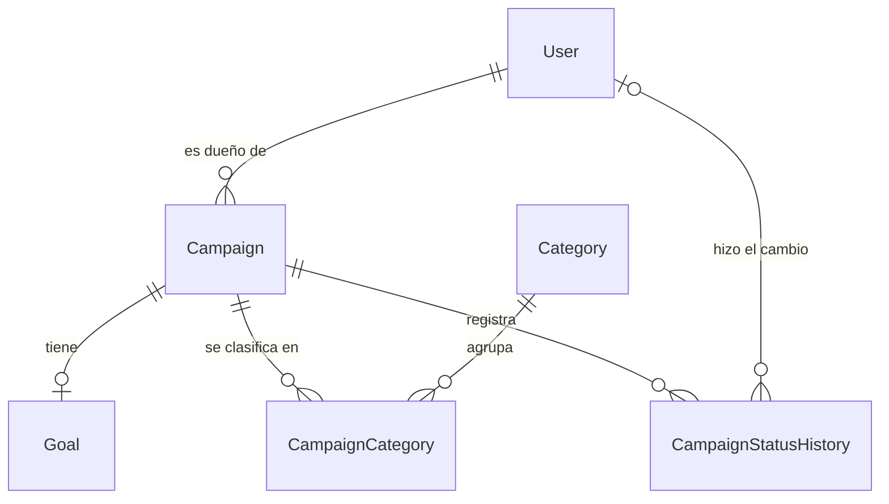
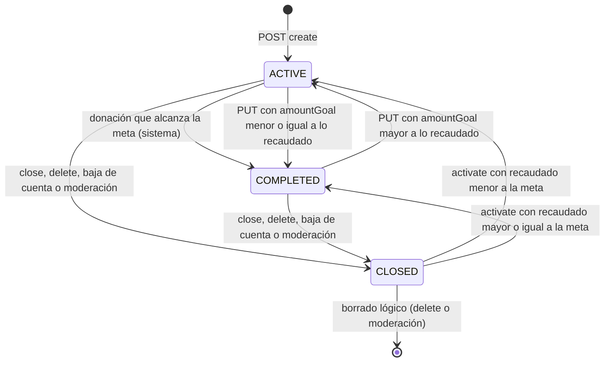

# Campaign

## Para qué existe

Una campaña es el pedido de fondos de un usuario: tiene nombre, descripción, de una a cinco categorías y una meta (`Goal`) con el monto buscado, el monto recaudado y el estado. Es el centro del sistema: las donaciones, las publicaciones y parte de los reportes cuelgan de una campaña, y todos esos dominios le preguntan a este si una campaña es visible para quien llama.

El dominio resuelve cuatro cosas:

- **Ciclo de vida:** crear, editar, cerrar, reactivar y borrar (borrado lógico) una campaña, con un historial de cada cambio de estado.
- **Meta y estado:** el estado vive en la meta y se recalcula con los montos (`ACTIVE` ↔ `COMPLETED`), salvo cuando alguien la cerró (`CLOSED`).
- **Visibilidad:** quién ve qué campaña. Una campaña `CLOSED` solo la ve su dueño o un ADMIN, y las campañas de un dueño bloqueado (baneado o suspendido) no las ve nadie salvo un ADMIN.
- **Listados públicos:** las campañas se pueden listar y consultar sin token.

## Entidades y datos

| Entidad / enum | Archivo | Qué guarda |
|---|---|---|
| `Campaign` | `entity/campaign/Campaign.java` | `name`, `description`, dueño (`user`), meta (`goal`), `createdAt`, `updatedAt`, `deletedAt`. Tabla `campaign`. |
| `Goal` | `entity/campaign/Goal.java` | `amountGoal`, `amountRaised` (ambos `BigDecimal`, `DECIMAL(15,2)`), `status` (`CampaignStatus`, por defecto `ACTIVE`), `targetDate`, `deletedAt`, fechas de auditoría. Tabla `goal`. |
| `CampaignCategory` | `entity/campaign/CampaignCategory.java` | Tabla intermedia `campaign_category` entre campaña y `Category` (del dominio [category](category.md)). |
| `CampaignStatusHistory` | `entity/campaign/CampaignStatusHistory.java` | Una fila por transición: `previousStatus` (nulo en la creación), `newStatus`, `changedBy` (nulo cuando el cambio lo hace el sistema) y `changedAt`. |
| `CampaignStatus` | `entity/campaign/CampaignStatus.java` | `ACTIVE`, `COMPLETED`, `CLOSED`. |

Detalles de mapeo que importan para entender el comportamiento:

- **El estado está en la meta, no en la campaña.** `Campaign.goal` es un `@OneToOne(cascade = CascadeType.ALL)`: la meta se crea, se guarda y se borra junto con la campaña. Por eso todas las queries de visibilidad filtran por `c.goal.status`.
- **`amountRaised` no es actualizable desde la entidad** (`updatable = false`). Solo lo cambia `GoalRepository.addToAmountRaised`, un `UPDATE` atómico en la base. Así, guardar una campaña (por ejemplo al editar el nombre) nunca pisa con el total que tenía en memoria las donaciones que entraron mientras tanto. El `INSERT` inicial sí escribe el `0`.
- **Borrado lógico.** `Campaign` y `Goal` tienen `@SQLDelete` (que pone `deleted_at = GETDATE()`) y `@SQLRestriction("deleted_at IS NULL")`. Un `delete` del repositorio no borra la fila: la marca, y desde ese momento ninguna query JPA la devuelve. El borrado de la campaña se propaga a la meta por la cascada.
- **Dueño borrado.** `Campaign.user` es `@NotFound(action = NotFoundAction.IGNORE)` y `updatable = false`: si el dueño borró su cuenta (también borrado lógico), la relación queda en `null` en lugar de hacer desaparecer la fila o fallar, y ningún `UPDATE` pisa la FK con ese `null`. Las queries del repositorio igual filtran `u.deletedAt IS NULL`, así que las campañas de un dueño borrado no aparecen por la API.
- **Categorías de una campaña borrada.** `CampaignCategory.campaign` usa el mismo patrón (`@NotFound`, no actualizable): la fila intermedia sobrevive al borrado lógico de la campaña.
- **Nombres de campañas borradas.** `CampaignRepository.findNamesByIdsIncludingDeleted` es una query nativa que saltea `@SQLRestriction`; la usa el dominio [donation](donation.md) para mostrar el nombre de una campaña borrada en el historial de donaciones de un usuario.
- **Montos.** La meta se valida con `@Positive` y `@Digits(integer = 13, fraction = 2)`, igual que el monto de una donación, y coincide con la columna `DECIMAL(15,2)`. No hay redondeo en el código: un valor con más de dos decimales se rechaza en la entrada. Las comparaciones usan `BigDecimal.compareTo`, sin conversión a `double`.
- `Goal.targetDate` existe como columna pero ningún DTO, mapper ni service la lee o escribe.

El modelo completo, con el resto de las entidades, está en [Modelo de datos](../04-modelo-de-datos.md).

## Reglas de negocio

| Regla | Por qué (según el código) | Dónde se aplica |
|---|---|---|
| Una campaña tiene entre 1 y 5 categorías, todas existentes. | Se valida en el DTO (`@NotEmpty`, `@Size(min = 1, max = 5)`) y de nuevo en el service, que además carga todas las categorías en un solo `SELECT` y responde con el primer id inexistente en el orden del request. Los ids repetidos se guardan una sola vez, porque se guardan las categorías que devuelve `findAllById`. | `validation/campaign/CampaignValidationService.java` (`validateAndGetCategories`) |
| Al editar, las categorías se reemplazan completas. | `categoryIds` es obligatorio también en `UpdateCampaignRequestDTO`; el service borra todas las filas de `campaign_category` con un `DELETE` masivo y vuelve a insertar las nuevas. | `service/campaign/CampaignService.java` (`updateCampaign`), `repository/campaign/CampaignCategoryRepository.java` (`deleteByCampaignId`) |
| Nombre, descripción y meta se editan parcialmente: un campo ausente (`null`) no cambia. | `updateCampaignFields` y `updateGoalFields` solo aplican los valores presentes. Un `name` presente no puede estar en blanco (`@Pattern`). | `validation/campaign/CampaignValidationService.java` |
| Solo el dueño o un ADMIN pueden editar, cerrar, reactivar, borrar o ver el historial. | El dueño se compara con el id del token; el rol ADMIN se lee del usuario cargado. | `validation/campaign/CampaignAuthorizationService.java` (`validateOwnershipOrAdmin`) |
| Una campaña nace `ACTIVE`, con `amountRaised = 0`, y la creación queda en el historial (`null → ACTIVE`). | El mapper arma la meta inicial; el service registra la transición con el creador como `changedBy`. | `mapper/campaign/CampaignMapper.java` (`toEntity`), `service/campaign/CampaignService.java` (`createCampaign`) |
| Una meta no cerrada tiene el estado que dicen sus montos: `COMPLETED` si lo recaudado alcanza o supera la meta, `ACTIVE` si no. | Es la única fuente del cálculo para editar y reactivar. | `validation/campaign/CampaignValidationService.java` (`statusForAmounts`) |
| Cambiar `amountGoal` recalcula el estado, salvo que la meta esté `CLOSED`. | Una meta cerrada sigue cerrada aunque se edite; el recálculo queda para `/activate`. Si el estado cambia, la transición se registra con quien editó (dueño o ADMIN). Antes de decidir, la fila de la meta se relee con bloqueo pesimista (`PESSIMISTIC_WRITE`, `UPDLOCK` en SQL Server) para usar el estado y el monto reales y no intercalarse con una donación. | `service/campaign/CampaignService.java` (`updateGoalAndRecalculateStatus`, `lockGoal`) |
| Una donación que alcanza la meta pasa la campaña de `ACTIVE` a `COMPLETED`. | Es un `UPDATE` condicional (`status = ACTIVE AND amountRaised >= amountGoal`) que devuelve 1 solo para la donación que provocó el cambio; esa registra la transición con `changedBy = null` (el sistema). Una campaña `COMPLETED` sigue aceptando donaciones: solo `CLOSED` las rechaza. | `repository/campaign/GoalRepository.java` (`completeIfGoalReached`, `addToAmountRaised`), `service/donation/DonationService.java` |
| Cerrar una campaña ya cerrada es un conflicto. | `ConflictException` (409). | `service/campaign/CampaignService.java` (`closeCampaign`) |
| Solo se reactiva una campaña `CLOSED`, y vuelve al estado que dicen sus montos. | Reactivar no fuerza `ACTIVE`: si mientras estaba cerrada se bajó la meta por debajo de lo recaudado, vuelve `COMPLETED`. | `service/campaign/CampaignService.java` (`activateCampaign`) |
| Borrar una campaña primero la cierra (si no lo estaba) y después hace el borrado lógico. | La transición a `CLOSED` queda en el historial. El `saveAndFlush` previo al `delete` es necesario porque Hibernate descarta el `UPDATE` pendiente de una entidad que va a ser borrada (la meta, por la cascada). | `service/campaign/CampaignService.java` (`closeAndSoftDelete`) |
| Cuando un usuario borra su cuenta, todas sus campañas se cierran, pero no se borran. | `closeAllByOwner` registra cada transición con el dueño como `changedBy`. Como las queries filtran dueños borrados, esas campañas dejan de verse igual. | `service/campaign/CampaignService.java` (`closeAllByOwner`), llamado desde `service/user/UserService.java` |
| Un ADMIN que resuelve un reporte de campaña con la acción `CONTENT_REMOVED` la cierra y la borra. | Usa el mismo `closeAndSoftDelete`, con el ADMIN como `changedBy`, y busca la campaña con `findById` (sin filtrar por dueño activo) para poder resolver el reporte aunque el dueño ya no exista. Si la campaña ya estaba borrada, no hace nada. | `service/report/ReportActionService.java`, ver [report](report.md) |
| Toda transición de estado queda registrada. | Creación, edición de meta, donación que completa, cierre, reactivación, borrado, baja de cuenta y moderación pasan por `CampaignStatusHistoryService.recordTransition`. | `service/campaign/CampaignStatusHistoryService.java` |

## Estados

El estado es `Goal.status` (`CampaignStatus`). El borrado lógico no es un estado: una campaña borrada queda `CLOSED` en la base y deja de existir para la API.

| Transición | Quién la dispara | `changedBy` en el historial |
|---|---|---|
| `null → ACTIVE` | El creador, con `POST /api/campaigns/create`. | El creador. |
| `ACTIVE → COMPLETED` por donación | El sistema, dentro de la donación que alcanza la meta. | `null`. |
| `ACTIVE ↔ COMPLETED` por edición | El dueño o un ADMIN, al cambiar `amountGoal` de una meta no cerrada. | Quien editó. |
| `ACTIVE/COMPLETED → CLOSED` | El dueño o un ADMIN (`close` o `delete`), el dueño al borrar su cuenta, o un ADMIN al resolver un reporte con `CONTENT_REMOVED`. | Quien lo hizo. |
| `CLOSED → ACTIVE/COMPLETED` | El dueño o un ADMIN, con `activate`. | Quien lo hizo. |

Transiciones que el código rechaza: cerrar una meta `CLOSED` (`409 Campaign goal is already closed`) y reactivar una que no está `CLOSED` (`400 Campaign is not closed`). Una donación a una meta `CLOSED` se rechaza en el dominio [donation](donation.md).

Casos que no generan transición: editar `amountGoal` de una meta `CLOSED` (cambia la meta pero el estado sigue `CLOSED` hasta `/activate`), editar `amountGoal` sin que cambie el estado calculado, y borrar o cerrar por baja de cuenta una campaña que ya estaba `CLOSED` (solo se registra el cierre si no lo estaba).

## Visibilidad y permisos

### Quién ve una campaña

Las lecturas resuelven al usuario que llama como opcional (`AuthenticatedUserService.findAuthenticatedUserId`): sin token es anónimo y el id es `null`. Después eligen la query según el rol:

| Quien llama | Ve |
|---|---|
| ADMIN | Todas las campañas cuyo dueño no borró su cuenta, en cualquier estado, también las de dueños baneados o suspendidos (`findAllWithActiveOwner`, `findByIdWithActiveOwner` y variantes). |
| Usuario autenticado no ADMIN | Las campañas `ACTIVE` y `COMPLETED` de dueños activos y no bloqueados, más sus propias campañas `CLOSED` (`*VisibleTo`). |
| Anónimo | Lo mismo, sin campañas `CLOSED`: un `callerId` nulo nunca coincide con `u.id`. |

Las queries `*VisibleTo` de `repository/campaign/CampaignRepository.java` combinan tres condiciones: dueño no borrado (`u.deletedAt IS NULL`), estado (`c.goal.status <> CLOSED OR u.id = :callerId`) y dueño no bloqueado (`UserRepository.NOT_BLOCKED`, que considera bloqueado a un usuario con `banned = true` o con `suspendedUntil` en el futuro; el `now` lo pasa el service desde la JVM). Las sanciones están explicadas en [Seguridad](../03-seguridad.md).

Esta misma decisión la reutilizan otros dominios a través de `CampaignValidationService.findVisibleCampaignById` y `findVisibleCampaignByIdOrThrow`: las donaciones ([donation](donation.md)), las publicaciones de una campaña ([publication](publication.md)) y los reportes ([report](report.md)). Así, una campaña oculta responde igual en todos los endpoints que la leen.

### Cuándo responde 404 y cuándo 403

El criterio es que un tercero no pueda distinguir una campaña oculta de una inexistente:

- **Lecturas** (`GET /api/campaigns/{campaignId}` y los dominios que reutilizan la visibilidad): una campaña `CLOSED` ajena, una campaña de un dueño bloqueado, una de un dueño borrado, una borrada y una inexistente responden todas `404 Campaign not found with id: {id}`.
- **Operaciones de dueño o ADMIN** (`PUT`, `DELETE`, `close`, `activate` y la lectura de `status-history`): `validateOwnershipOrAdmin` busca la campaña con `findByIdWithActiveOwner` (solo filtra dueño borrado) y, si quien llama no es dueño ni ADMIN, responde `404` cuando la campaña está `CLOSED` y `403 You are not authorized to perform this action` en cualquier otro caso. El comentario del código lo explica: un tercero no tiene que poder distinguir una campaña `CLOSED` de una que no existe.

Este segundo grupo no aplica el filtro de dueño bloqueado: un tercero que intenta editar una campaña `ACTIVE` de un dueño baneado recibe `403`, mientras que la lectura de esa misma campaña da `404`.

### Quién puede modificar

| Acción | Dueño | ADMIN | Otro usuario |
|---|---|---|---|
| Crear | Cualquier usuario autenticado crea campañas propias. | Igual. | No aplica. |
| Editar, borrar, cerrar, reactivar, ver historial | Sí. | Sí, sobre campañas de cualquiera cuyo dueño no esté borrado. | `403`, o `404` si la campaña está `CLOSED`. |

No hay `@PreAuthorize` en `controller/campaign/CampaignController.java`: la autorización es la de `security/SecurityConfig.java` (rutas públicas de solo lectura y el resto autenticado) más la de `validation/campaign/CampaignAuthorizationService.java`. El ADMIN se detecta de dos maneras dentro de esa clase: `isAdmin(Long)` consulta `UserRepository.existsByIdAndRole_Name(id, "ADMIN")` (usado en lecturas y listados) y `validateOwnershipOrAdmin` compara el nombre del rol del usuario cargado con `findByIdForRequest`.

## Endpoints

Prefijo de todos los endpoints: `@RequestMapping("/api/campaigns")`. Los errores con forma `{error, message, timestamp}` salen de `exception/GlobalExceptionHandler.java`; los del filtro JWT y de Spring Security agregan `path`. Los detalles de esas respuestas están en [Errores y validación](../05-errores-y-validacion.md) y en [Seguridad](../03-seguridad.md).

Errores comunes a todos los endpoints de este controller cuando llega un header `Authorization: Bearer ...`:

| Status | Mensaje | Cuándo |
|---|---|---|
| 401 | `Full authentication is required to access this resource` | Endpoint autenticado sin token, o con un token inválido, vencido, revocado, de refresh, de una cuenta borrada o emitido antes del último cambio de email o contraseña. En los endpoints públicos un token así no falla: se atiende como anónimo. |
| 403 | `Your account has been banned. Reason: {motivo}` | El token es de una cuenta baneada. Lo corta `security/JwtAuthenticationFilter.java`, también en los endpoints públicos. |
| 403 | `Your account is suspended until {fecha}. Reason: {motivo}` | El token es de una cuenta con suspensión vigente. |

El motivo es `bannedReason` o `Violation of terms` si no tiene.

### `POST /api/campaigns/create`

- **Acceso:** usuario autenticado (`USER` o `ADMIN`). La campaña queda a nombre de quien llama, tomado del token.
- **Parámetros:** ninguno.
- **Body:** `CreateCampaignRequestDTO`

  | Campo | Tipo | Obligatorio | Validación |
  |---|---|---|---|
  | `name` | `String` | sí | `@NotBlank`, `@Size(max = 255)` |
  | `description` | `String` | sí | `@NotNull`, `@Size(max = 255)` (se acepta vacío) |
  | `amountGoal` | `BigDecimal` | sí | `@NotNull`, `@Positive`, `@Digits(integer = 13, fraction = 2)` |
  | `categoryIds` | `List<Long>` | sí | `@NotEmpty`, `@Size(min = 1, max = 5)`; cada id tiene que existir |

- **Respuesta:** `200 OK` con un mapa, no con el DTO:

  | Campo | Valor |
  |---|---|
  | `message` | `"Campaign created successfully"` |
  | `campaignId` | id de la campaña creada |
  | `status` | `"CREATED"` (texto fijo; no es un `CampaignStatus`, la campaña queda `ACTIVE`) |

- **Errores:**

  | Status | Mensaje | Cuándo |
  |---|---|---|
  | 400 | `One or more fields are invalid` (con `fields`, mensajes por defecto de Bean Validation: `must not be blank`, `must not be null`, `must be greater than 0`, `numeric value out of bounds (<13 digits>.<2 digits> expected)`, `must not be empty`, `size must be between 1 and 5`, `size must be between 0 and 255`) | Falla alguna validación del body. |
  | 400 | `Request body is required` / `Malformed request body` / `Invalid value '{valor}' for field '{campo}'` | Body ausente, JSON inválido o un valor que no se puede convertir (por ejemplo `amountGoal: "abc"`). |
  | 404 | `Category not found with id: {id}` | Algún id de `categoryIds` no existe. Se informa el primero en el orden del request. |
  | 400 | `At least one category must be provided` / `A campaign can have at most 5 categories` | Repiten en el service lo que ya valida el DTO; con `@Valid` no se alcanzan desde este endpoint. |
  | 415 | `Content type '{tipo}' is not supported. Use application/json` | El body no es JSON. |
  | 500 | `An unexpected error occurred. Please try again later.` | El usuario del token no existe (`RuntimeException` en el service). En la práctica no ocurre: el filtro JWT ya rechaza con 401 las cuentas inexistentes o borradas. |

- **Qué hace:**
  1. Obtiene el id del usuario desde el token (`getAuthenticatedUserId`) y lo carga.
  2. `validateAndGetCategories`: valida cantidad y existencia de las categorías con un solo `SELECT`.
  3. `CampaignMapper.toEntity` arma la campaña con una meta `ACTIVE`, `amountRaised = 0`.
  4. Guarda la campaña (la meta se guarda por cascada) y las filas de `campaign_category`.
  5. Registra la transición `null → ACTIVE` con el creador.
  6. Devuelve el id en el mapa de respuesta.

### `GET /api/campaigns/list`

- **Acceso:** público (`PUBLIC_GET_URLS`). Con token válido, quien llama se usa para decidir la visibilidad.
- **Parámetros:**

  | Parámetro | Tipo | Obligatorio | Descripción |
  |---|---|---|---|
  | `status` | query, `String` | no | `ACTIVE`, `COMPLETED` o `CLOSED`, sin distinguir mayúsculas. |
  | `categoryId` | query, `Long` | no | Id de categoría. Un id inexistente devuelve una lista vacía. |

  Si llegan los dos, gana `status` y `categoryId` se ignora. No hay paginación (no usa `validation/common/SortValidationService.java`, que es el validador de `page`, `size` y orden de los endpoints paginados) ni orden definido: las queries no tienen `ORDER BY`.

- **Body:** sin body.
- **Respuesta:** `200 OK` con un array de `CampaignResponseDTO` (sin envoltorio):

  | Campo | Tipo | Descripción |
  |---|---|---|
  | `id` | `Long` | Id de la campaña. |
  | `name` | `String` | Nombre. |
  | `description` | `String` | Descripción. |
  | `amountGoal` | `BigDecimal` | Meta (0 si la campaña no tiene meta). |
  | `amountRaised` | `BigDecimal` | Recaudado (0 si no tiene meta). |
  | `userId` | `Long` | Id del dueño. |
  | `categories` | `List<CategoryDTO>` | `id`, `name`, `description` de cada categoría. |
  | `status` | `CampaignStatus` | Estado de la meta (`null` si no tiene meta). |
  | `userName` | `String` | `userName` del dueño. |

- **Errores:**

  | Status | Mensaje | Cuándo |
  |---|---|---|
  | 400 | `Invalid campaign status: {status}` | `status` no es un valor de `CampaignStatus`. |
  | 400 | `Invalid value '{valor}' for parameter 'categoryId'` | `categoryId` no es numérico. |
  | 403 | mensajes de baneo o suspensión | Token de una cuenta bloqueada (ver tabla común). |

- **Qué hace:**
  1. Si hay `status`, lo convierte con `parseStatus`; si no, y hay `categoryId`, filtra por categoría; si no, lista todo.
  2. Resuelve a quien llama como opcional y, si es ADMIN, usa las queries `*WithActiveOwner`; si no, las `*VisibleTo` (ver "Visibilidad y permisos").
  3. Las queries traen en el mismo `SELECT` el dueño, su `userInfo`, su `verificationRequest` y la meta.
  4. Carga las categorías de todas las campañas del listado en una query por bloque de 1000 ids (`findByCampaignIdIn`), porque SQL Server acepta hasta 2100 parámetros por query y rechaza `IN ()` vacío.
  5. Mapea con `CampaignMapper.toResponseDTO` manteniendo el orden de la query.

### `GET /api/campaigns/{campaignId}`

- **Acceso:** público (`/api/campaigns/*` en `PUBLIC_GET_URLS`). Con token válido, quien llama se usa para decidir la visibilidad.
- **Parámetros:** `campaignId` (path, `Long`, obligatorio).
- **Body:** sin body.
- **Respuesta:** `200 OK` con un `CampaignResponseDTO` (mismos campos que en `GET /api/campaigns/list`).
- **Errores:**

  | Status | Mensaje | Cuándo |
  |---|---|---|
  | 404 | `Campaign not found with id: {campaignId}` | No existe, está borrada, su dueño borró la cuenta, su dueño está bloqueado (salvo para ADMIN) o está `CLOSED` y quien llama no es el dueño ni ADMIN. |
  | 400 | `Invalid value '{valor}' for parameter 'campaignId'` | `campaignId` no es numérico. |
  | 403 | mensajes de baneo o suspensión | Token de una cuenta bloqueada. |

- **Qué hace:**
  1. Resuelve a quien llama como opcional.
  2. `findVisibleCampaignByIdOrThrow`: ADMIN usa `findByIdWithActiveOwner`; el resto, `findByIdVisibleTo`.
  3. Carga las categorías de la campaña y mapea.

### `GET /api/campaigns/my-campaigns`

- **Acceso:** usuario autenticado. `security/SecurityConfig.java` lo declara autenticado antes de la regla pública de `/api/campaigns/*`, que si no lo abarcaría.
- **Parámetros:** ninguno.
- **Body:** sin body.
- **Respuesta:** `200 OK` con un mapa:

  | Campo | Valor |
  |---|---|
  | `message` | `"Campaigns retrieved successfully"` |
  | `campaigns` | lista de `CampaignResponseDTO` del usuario, en todos los estados (incluidas las `CLOSED`) |
  | `total` | cantidad de campañas |

- **Errores:** solo los comunes del filtro (401 sin token, 403 por cuenta bloqueada).
- **Qué hace:**
  1. Obtiene el id del usuario desde el token.
  2. `findByUserIdWithDetails` trae todas sus campañas no borradas, con los mismos `JOIN FETCH` que los listados.
  3. Carga las categorías por bloques y mapea.

### `PUT /api/campaigns/{campaignId}`

- **Acceso:** usuario autenticado que sea dueño de la campaña, o ADMIN.
- **Parámetros:** `campaignId` (path, `Long`, obligatorio).
- **Body:** `UpdateCampaignRequestDTO`

  | Campo | Tipo | Obligatorio | Validación |
  |---|---|---|---|
  | `name` | `String` | no | `@Size(max = 255)`, `@Pattern(".*\\S.*")` con mensaje `must not be blank` |
  | `description` | `String` | no | `@Size(max = 255)` |
  | `amountGoal` | `BigDecimal` | no | `@Positive`, `@Digits(integer = 13, fraction = 2)` |
  | `categoryIds` | `List<Long>` | sí | `@NotEmpty`, `@Size(min = 1, max = 5)`; cada id tiene que existir. Reemplaza las categorías actuales. |

- **Respuesta:** `200 OK` con el `CampaignResponseDTO` actualizado. El `status` puede haber cambiado si se editó `amountGoal`.
- **Errores:**

  | Status | Mensaje | Cuándo |
  |---|---|---|
  | 400 | `One or more fields are invalid` (con `fields`) | Falla alguna validación del body (por ejemplo, falta `categoryIds`). |
  | 400 | `Request body is required` / `Malformed request body` / `Invalid value '{valor}' for field '{campo}'` | Body ausente, JSON inválido o valor no convertible. |
  | 404 | `Campaign not found with id: {campaignId}` | No existe, está borrada, su dueño borró la cuenta, o está `CLOSED` y quien llama no es dueño ni ADMIN. |
  | 403 | `You are not authorized to perform this action` | Quien llama no es dueño ni ADMIN y la campaña no está `CLOSED`. |
  | 404 | `Category not found with id: {id}` | Algún id de `categoryIds` no existe. |
  | 415 | `Content type '{tipo}' is not supported. Use application/json` | El body no es JSON. |
  | 400 | `Invalid value '{valor}' for parameter 'campaignId'` | `campaignId` no es numérico. |

- **Qué hace:**
  1. Antes de entrar al service, Spring valida el body (`@Valid`): un body inválido responde `400` aunque quien llama no sea dueño o la campaña no exista.
  2. Obtiene el id del usuario desde el token.
  3. `validateOwnershipOrAdmin` (404/403 según la tabla).
  4. `findCampaignByIdOrThrow` vuelve a cargar la campaña.
  5. `validateAndGetCategories`.
  6. Aplica `name` y `description` presentes.
  7. Si llegó `amountGoal` y hay meta: bloquea y relee la meta, aplica la nueva meta y, si no está `CLOSED`, recalcula el estado con `statusForAmounts` y registra la transición si cambió.
  8. Guarda, borra las categorías actuales con un `DELETE` masivo e inserta las nuevas.
  9. Mapea la campaña actualizada.

### `DELETE /api/campaigns/{campaignId}`

- **Acceso:** usuario autenticado que sea dueño de la campaña, o ADMIN.
- **Parámetros:** `campaignId` (path, `Long`, obligatorio).
- **Body:** sin body.
- **Respuesta:** `200 OK` con un mapa:

  | Campo | Valor |
  |---|---|
  | `message` | `"Campaign deleted successfully"` |
  | `campaignId` | id recibido |

- **Errores:**

  | Status | Mensaje | Cuándo |
  |---|---|---|
  | 404 | `Campaign not found with id: {campaignId}` | No existe, ya está borrada, su dueño borró la cuenta, o está `CLOSED` y quien llama no es dueño ni ADMIN. |
  | 403 | `You are not authorized to perform this action` | Quien llama no es dueño ni ADMIN y la campaña no está `CLOSED`. |
  | 400 | `Invalid value '{valor}' for parameter 'campaignId'` | `campaignId` no es numérico. |

- **Qué hace:**
  1. Obtiene el id del usuario desde el token.
  2. `validateOwnershipOrAdmin` y `findCampaignByIdOrThrow`.
  3. `closeAndSoftDelete`: si la meta no está `CLOSED`, la bloquea, la cierra, registra la transición, hace `saveAndFlush` y desacopla (`entityManager.detach`) la fila de historial recién escrita: con Hibernate 6.6, una entidad administrada que apunta a la campaña que se va a borrar hace fallar el flush del commit (ver [Modelo de datos](../04-modelo-de-datos.md#borrado-lógico-soft-delete)).
  4. `campaignRepository.delete`: borrado lógico de la campaña y, por cascada, de la meta. Las donaciones, publicaciones y filas de `campaign_category` quedan en la base apuntando a la campaña borrada.

### `PUT /api/campaigns/{campaignId}/close`

- **Acceso:** usuario autenticado que sea dueño de la campaña, o ADMIN.
- **Parámetros:** `campaignId` (path, `Long`, obligatorio).
- **Body:** sin body.
- **Respuesta:** `200 OK` con un mapa:

  | Campo | Valor |
  |---|---|
  | `message` | `"Campaign closed successfully"` |
  | `campaign` | `CampaignResponseDTO` con `status: CLOSED` |

- **Errores:**

  | Status | Mensaje | Cuándo |
  |---|---|---|
  | 404 | `Campaign not found with id: {campaignId}` | No existe, está borrada, su dueño borró la cuenta, o está `CLOSED` y quien llama no es dueño ni ADMIN. |
  | 403 | `You are not authorized to perform this action` | Quien llama no es dueño ni ADMIN y la campaña no está `CLOSED`. |
  | 400 | `Campaign does not have a goal` | La campaña no tiene meta. |
  | 409 | `Campaign goal is already closed` | La meta ya está `CLOSED` (solo lo ve el dueño o un ADMIN). |
  | 400 | `Invalid value '{valor}' for parameter 'campaignId'` | `campaignId` no es numérico. |

- **Qué hace:**
  1. Obtiene el id del usuario desde el token.
  2. `getCampaignIfAuthorized`: `validateOwnershipOrAdmin` y una segunda carga de la campaña.
  3. Bloquea y relee la meta; rechaza si no hay meta o si ya está cerrada.
  4. Pone `CLOSED`, guarda y registra la transición.
  5. Devuelve la campaña mapeada dentro del mapa. Desde este momento, las donaciones a la campaña se rechazan (el `UPDATE` atómico de `GoalRepository.addToAmountRaised` excluye las metas `CLOSED`, aunque la donación se haya validado antes del cierre).

### `PUT /api/campaigns/{campaignId}/activate`

- **Acceso:** usuario autenticado que sea dueño de la campaña, o ADMIN.
- **Parámetros:** `campaignId` (path, `Long`, obligatorio).
- **Body:** sin body.
- **Respuesta:** `200 OK` con un mapa:

  | Campo | Valor |
  |---|---|
  | `message` | `"Campaign activated successfully"` |
  | `campaign` | `CampaignResponseDTO` con `status` `ACTIVE` o `COMPLETED` |

- **Errores:**

  | Status | Mensaje | Cuándo |
  |---|---|---|
  | 404 | `Campaign not found with id: {campaignId}` | No existe, está borrada, su dueño borró la cuenta, o está `CLOSED` y quien llama no es dueño ni ADMIN. |
  | 403 | `You are not authorized to perform this action` | Quien llama no es dueño ni ADMIN y la campaña no está `CLOSED`. |
  | 400 | `Campaign does not have a goal` | La campaña no tiene meta. |
  | 400 | `Campaign is not closed` | La meta no está `CLOSED`. |
  | 400 | `Invalid value '{valor}' for parameter 'campaignId'` | `campaignId` no es numérico. |

- **Qué hace:**
  1. Obtiene el id del usuario desde el token.
  2. `getCampaignIfAuthorized`.
  3. Bloquea y relee la meta; rechaza si no hay meta o si no está cerrada.
  4. Calcula el estado con `statusForAmounts` (`COMPLETED` si lo recaudado alcanza la meta, `ACTIVE` si no), guarda y registra `CLOSED → nuevo estado`.
  5. Devuelve la campaña mapeada dentro del mapa.

### `GET /api/campaigns/{campaignId}/status-history`

- **Acceso:** usuario autenticado que sea dueño de la campaña, o ADMIN. No está en `PUBLIC_GET_URLS` (`/api/campaigns/*` solo abarca un segmento).
- **Parámetros:** `campaignId` (path, `Long`, obligatorio).
- **Body:** sin body.
- **Respuesta:** `200 OK` con un array de `CampaignStatusHistoryResponseDTO`, ordenado por `changedAt` ascendente:

  | Campo | Tipo | Descripción |
  |---|---|---|
  | `previousStatus` | `CampaignStatus` | Estado anterior; `null` en la fila de creación. |
  | `newStatus` | `CampaignStatus` | Estado nuevo. |
  | `changedByUserId` | `Long` | Quién hizo el cambio; `null` si lo hizo el sistema (la donación que completa la meta). |
  | `changedAt` | `LocalDateTime` | Momento del cambio. |

- **Errores:**

  | Status | Mensaje | Cuándo |
  |---|---|---|
  | 404 | `Campaign not found with id: {campaignId}` | No existe, está borrada, su dueño borró la cuenta, o está `CLOSED` y quien llama no es dueño ni ADMIN. |
  | 403 | `You are not authorized to perform this action` | Quien llama no es dueño ni ADMIN y la campaña no está `CLOSED`. |
  | 400 | `Invalid value '{valor}' for parameter 'campaignId'` | `campaignId` no es numérico. |

- **Qué hace:**
  1. Obtiene el id del usuario desde el token.
  2. `validateOwnershipOrAdmin` y `findCampaignByIdOrThrow`.
  3. `findByCampaignIdOrderByChangedAtAsc` y mapeo con `CampaignStatusHistoryMapper`.

Las publicaciones de una campaña (`/api/campaigns/{campaignId}/publications`) están en otro controller y se documentan en [publication](publication.md). Las donaciones y estadísticas por campaña (`/api/donations/campaign/{campaignId}`) están en [donation](donation.md).

## Clases involucradas

| Capa | Clase | Rol |
|---|---|---|
| Controller | `controller/campaign/CampaignController.java` | Los 9 endpoints; arma los mapas de respuesta y elige el listado según los parámetros. |
| Service | `service/campaign/CampaignService.java` | Casos de uso, recálculo de estado, bloqueo de la meta, cierre y borrado lógico (también para baja de cuenta y moderación), carga de categorías por bloques. |
| Service | `service/campaign/CampaignStatusHistoryService.java` | `recordTransition`: guarda cada transición (la usan también donaciones y moderación). |
| Validation | `validation/campaign/CampaignValidationService.java` | Existencia, visibilidad (`findVisibleCampaignById*`), categorías, cálculo de estado por montos, parseo del estado, aplicación de cambios parciales. |
| Validation | `validation/campaign/CampaignAuthorizationService.java` | Dueño o ADMIN (`validateOwnershipOrAdmin`, `getCampaignIfAuthorized`) e `isAdmin`. |
| Mapper | `mapper/campaign/CampaignMapper.java` | DTO de creación → entidad con meta inicial; entidad + categorías → `CampaignResponseDTO`. |
| Mapper | `mapper/campaign/CampaignStatusHistoryMapper.java` | Historial → `CampaignStatusHistoryResponseDTO`. |
| DTO | `dtos/campaign/CreateCampaignRequestDTO.java`, `dtos/campaign/UpdateCampaignRequestDTO.java` | Entrada, con Bean Validation. |
| DTO | `dtos/campaign/CampaignResponseDTO.java`, `dtos/campaign/CampaignStatusHistoryResponseDTO.java` | Salida. |
| Entity | `entity/campaign/Campaign.java`, `entity/campaign/Goal.java`, `entity/campaign/CampaignCategory.java`, `entity/campaign/CampaignStatusHistory.java`, `entity/campaign/CampaignStatus.java` | Modelo del dominio. |
| Repository | `repository/campaign/CampaignRepository.java` | Queries de visibilidad (`*WithActiveOwner`, `*VisibleTo`) con `JOIN FETCH`, y nombres de campañas borradas. |
| Repository | `repository/campaign/GoalRepository.java` | `UPDATE` atómicos de las donaciones: sumar al recaudado y completar la meta. |
| Repository | `repository/campaign/CampaignCategoryRepository.java` | Categorías por campaña o por bloque de campañas; borrados masivos. |
| Repository | `repository/campaign/CampaignStatusHistoryRepository.java` | Historial ordenado por fecha. |
| Otros paquetes | `security/AuthenticatedUserService.java`, `repository/user/UserRepository.java` (`NOT_BLOCKED`, `existsByIdAndRole_Name`, `findByIdForRequest`), `repository/category/CategoryRepository.java`, `exception/ResourceNotFoundException.java`, `exception/ForbiddenActionException.java`, `exception/ConflictException.java`, `exception/MessageException.java` | Quién llama, criterio de bloqueo y de admin, categorías y errores. |
| Usan este dominio | `service/donation/DonationService.java`, `validation/donation/DonationValidationService.java`, `validation/publication/PublicationValidationService.java`, `validation/report/ReportValidationService.java`, `service/report/ReportActionService.java`, `service/user/UserService.java`, `service/category/CategoryService.java` | Visibilidad (donaciones, publicaciones y reportes), `UPDATE` atómicos de la meta e `isAdmin` para mostrar los `transactionId` (donaciones), cierre y borrado (moderación), cierre por baja de cuenta (usuarios) y borrado de las filas de `campaign_category` al borrar una categoría. |
