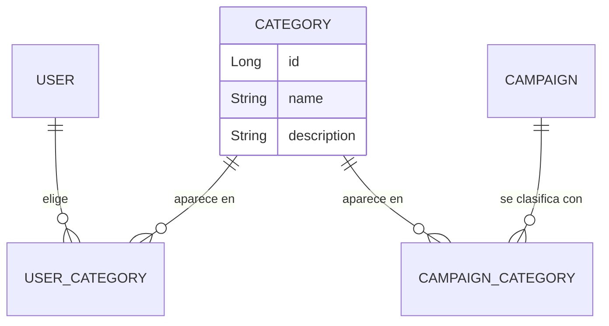
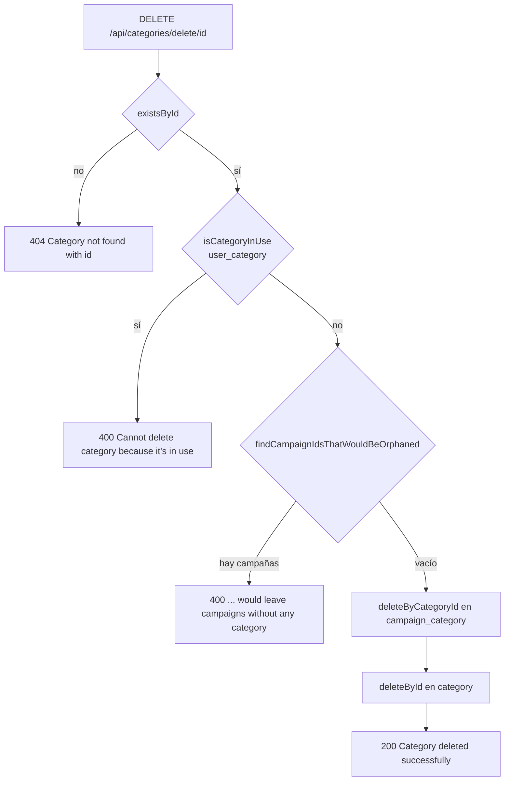

# Category

## Para qué existe

Las categorías son el catálogo temático de la plataforma ("Technology", "Health", "Education", etc). Se usan en dos lugares:

- **Usuarios:** cada usuario elige entre 1 y 6 categorías de interés al registrarse y puede cambiarlas después (ver [user](user.md)).
- **Campañas:** cada campaña se clasifica con entre 1 y 5 categorías (ver [campaign](campaign.md)).

Este dominio solo administra el catálogo: cualquiera puede listarlo (lo necesita el formulario de registro, antes de tener cuenta) y solo un `ADMIN` puede crear, editar o borrar categorías. La asignación de categorías a usuarios y campañas la hacen los dominios `user` y `campaign`, que validan los ids contra este catálogo.

## Entidades y datos

| Entidad | Archivo | Tabla | Campos |
|---|---|---|---|
| `Category` | `entity/category/Category.java` | `category` | `id` (identity), `name`, `description` |
| `UserCategory` | `entity/user/UserCategory.java` | `user_category` | `id`, `user` (`@ManyToOne` a `User`), `category` (`@ManyToOne` a `Category`) |
| `CampaignCategory` | `entity/campaign/CampaignCategory.java` | `campaign_category` | `id`, `campaign` (`@ManyToOne` a `Campaign`), `category` (`@ManyToOne` obligatorio a `Category`) |

Detalles que conviene saber:

- **`Category` no tiene `@Table`**, así que la tabla se llama `category` en singular. `src/main/resources/data.sql` lo aclara en un comentario y siembra seis categorías (`Technology`, `Health`, `Education`, `Environment`, `Arts`, `Sports`) con `IF NOT EXISTS` por nombre, para que el seed sea idempotente en cada arranque (`spring.sql.init.mode=always`).
- **`Category` no tiene soft delete** ni restricciones de columna: `name` no es `unique` ni `nullable = false` en la entidad. La unicidad del nombre la controla `service/category/CategoryService.java` antes de guardar.
- **Las tablas intermedias son entidades propias** (con `id`), no `@ManyToMany`. `User` las administra con `@OneToMany(mappedBy = "user", cascade = CascadeType.ALL, orphanRemoval = true)` sobre `userCategories`; `Campaign` no tiene colección: las filas de `campaign_category` se leen y escriben solo con `repository/campaign/CampaignCategoryRepository.java`.
- **`CampaignCategory.campaign` es opcional en el mapeo** (`@NotFound(action = NotFoundAction.IGNORE)`, `updatable = false`) aunque la columna sea `NOT NULL`. Según el comentario de la entidad, así una campaña borrada con soft delete queda como `null` en lugar de descartar la fila por un inner join, y un `UPDATE` nunca pisa la FK con ese `null`. El detalle del soft delete está en [04-modelo-de-datos.md](../04-modelo-de-datos.md).
- **Cómo se exponen en otros dominios:** las respuestas de campañas (`CampaignResponseDTO`) incluyen la lista de `CategoryDTO` completos (`id`, `name`, `description`); las de usuario (`UserDTO`, `PublicUserProfileDTO`) incluyen solo los nombres (`List<String>`), armados en `mapper/user/UserMapper.java`.

## Reglas de negocio

Este dominio no tiene clase en `validation/`: las reglas viven directamente en `service/category/CategoryService.java`.

| Regla | Dónde | Por qué / consecuencia |
|---|---|---|
| El nombre es obligatorio al crear y no puede ser blanco; nombre y descripción admiten hasta 255 caracteres. | `dtos/category/CreateCategoryDTO.java` | Bean Validation corta antes de llegar al service. 255 coincide con el largo por defecto de las columnas `String` que genera Hibernate. |
| La edición es parcial: un campo `null` conserva el valor actual, pero un `name` enviado no puede ser vacío ni blanco. | `dtos/category/UpdateCategoryDTO.java` (`@Pattern(regexp = ".*\\S.*")`), `mapper/category/CategoryMapper.java` (`updateFromDto`) | Permite cambiar solo la descripción sin reenviar el nombre. La descripción sí se puede vaciar mandando `""`. |
| No puede haber dos categorías con el mismo nombre. | `CategoryService.createCategory` y `updateCategory` (`existsByName`) | Responde `409`. Al editar, si el nombre enviado es igual (con `equals`) al actual, no se consulta. La comparación en la base usa la collation de SQL Server de la base, mientras que la comparación previa en Java distingue mayúsculas (ver [deuda técnica](../deuda-tecnica.md)). |
| No se puede borrar una categoría que tenga algún usuario asociado. | `CategoryService.deleteCategory` → `CategoryRepository.isCategoryInUse` | Cuenta cualquier fila de `user_category` con esa categoría, sin mirar si el usuario sigue activo. Se rechaza con `400` aunque el usuario tenga otras categorías. |
| No se puede borrar una categoría si alguna campaña quedaría sin categorías. | `CategoryService.deleteCategory` → `CategoryRepository.findCampaignIdsThatWouldBeOrphaned` | Una campaña siempre tiene al menos una categoría (regla de `validation/campaign/CampaignValidationService.java`); borrar su única categoría la dejaría inválida. |
| Si se puede borrar, primero se desasocia de las campañas y después se borra la fila. | `CampaignCategoryRepository.deleteByCategoryId`, `CategoryRepository.deleteById` | `deleteByCategoryId` es un `DELETE` JPQL masivo: según el comentario del repositorio, uno derivado cargaría cada fila (con su `category` `EAGER`) y las borraría de a una. Borra también las filas de campañas con soft delete. Todo corre en una transacción (`@Transactional`). |

Fíjate en la asimetría del borrado: para campañas la categoría se puede quitar si cada campaña conserva otra; para usuarios cualquier uso la bloquea.

### Cómo validan categorías los otros dominios

Los dos dominios que reciben `categoryIds` validan contra este catálogo con reglas parecidas pero no iguales:

| | Usuario (`validation/user/UserValidationService.java`) | Campaña (`validation/campaign/CampaignValidationService.java`) |
|---|---|---|
| Mínimo / máximo | 1 / 6 (`MAX_CATEGORIES_PER_USER`) | 1 / 5 (además `@NotEmpty @Size(min = 1, max = 5)` en los DTOs) |
| Lista vacía | `400` `User must have at least 1 category` | `400` de Bean Validation (`Validation failed`); si llega al service, `At least one category must be provided` |
| Demasiadas | `400` `User cannot have more than 6 categories` | `400` de Bean Validation; en el service, `A campaign can have at most 5 categories` |
| Id inexistente | `404` `Categories not found: [ids]` (todos los que faltan) | `404` `Category not found with id: <id>` (el primero que falta, en el orden del request) |
| Consulta | Un `findAllById` | Un `findAllById` |

## Estados

Este dominio no tiene estados.

## Visibilidad y permisos

- **Lectura:** el listado es público y devuelve todo el catálogo. No hay nada oculto: las categorías no tienen dueño, soft delete ni estado.
- **Escritura:** crear, editar y borrar requieren rol `ADMIN` con `@PreAuthorize("hasRole('ADMIN')")` en `controller/category/CategoryController.java`. El rol sale de la base en cada request (el filtro JWT carga el usuario y `service/auth/CustomUserDetailsService.java` arma la autoridad `ROLE_<rol>`), no de un claim del token. El service no consulta quién llama.
- **403 vs 404:** no hay ocultamiento. Un usuario sin rol `ADMIN` recibe `403` y una categoría inexistente responde `404` con su id; como el catálogo es público, no hay nada que esconder.
- **Usuarios bloqueados:** el filtro JWT corta con `403` a un usuario baneado o suspendido que manda su token, incluso en el listado público. Sin token, el mismo listado responde `200`. Ver [03-seguridad.md](../03-seguridad.md).

## Endpoints

Todas las rutas cuelgan de `@RequestMapping("/api/categories")`. Los errores comunes del filtro JWT y de `exception/GlobalExceptionHandler.java` se explican en [03-seguridad.md](../03-seguridad.md) y [05-errores-y-validacion.md](../05-errores-y-validacion.md); acá se listan los que aplican a cada endpoint.

### `GET /api/categories/list`

- **Acceso:** público, en `SecurityConfig.PUBLIC_URLS` (`security/SecurityConfig.java`). No requiere token. Si se manda un token de un usuario baneado o suspendido, el filtro JWT responde `403`. Un token inválido o vencido se ignora y la respuesta es la normal.
- **Parámetros:** ninguno.
- **Body:** sin body.
- **Respuesta:** `200 OK` con una lista de `CategoryDTO` (sin paginar ni ordenar explícitamente):

  | Campo | Tipo | Descripción |
  |---|---|---|
  | `id` | `Long` | Id de la categoría. |
  | `name` | `String` | Nombre. |
  | `description` | `String` | Descripción, puede ser `null`. |

- **Errores:**

  | Status | Mensaje | Cuándo |
  |---|---|---|
  | 403 | `Your account has been banned. Reason: <motivo>` | Se manda el token de un usuario baneado (motivo por defecto: `Violation of terms`). |
  | 403 | `Your account is suspended until <fecha>. Reason: <motivo>` | Se manda el token de un usuario con suspensión vigente. |
  | 405 | `Method <método> is not supported for this endpoint` | Se usa otro verbo HTTP. |

- **Qué hace:** `CategoryService.listCategories` hace `findAll` sobre `CategoryRepository` y mapea cada entidad con `CategoryMapper.toCategoryDTO`.

### `POST /api/categories/create`

- **Acceso:** `ADMIN` (`@PreAuthorize("hasRole('ADMIN')")`). Sin token o con token inválido → `401`; con token de `USER` → `403`.
- **Parámetros:** ninguno.
- **Body:** `CreateCategoryDTO` (JSON).

  | Campo | Tipo | Obligatorio | Validación |
  |---|---|---|---|
  | `name` | `String` | sí | `@NotBlank`, `@Size(max = 255)`; único entre categorías. |
  | `description` | `String` | no | `@Size(max = 255)`. |

- **Respuesta:** `200 OK` con el `CategoryDTO` creado (`id`, `name`, `description`).
- **Errores:**

  | Status | Mensaje | Cuándo |
  |---|---|---|
  | 400 | `One or more fields are invalid` (con `fields`, p. ej. `name: must not be blank`) | Falla Bean Validation. Se evalúa antes del `@PreAuthorize`, así que un `USER` con body inválido también recibe `400`. |
  | 400 | `Request body is required` | No se manda body. |
  | 400 | `Malformed request body` | El JSON no se puede leer. |
  | 401 | `Full authentication is required to access this resource` | Sin token o token inválido, vencido, revocado o emitido antes del último cambio de credenciales. |
  | 403 | `You don't have permission to access this resource` | El usuario autenticado no es `ADMIN`. |
  | 403 | `Your account has been banned. Reason: <motivo>` / `Your account is suspended until <fecha>. Reason: <motivo>` | El token es de un usuario bloqueado (corte del filtro JWT). |
  | 409 | `Category with name '<name>' already exists` | Ya existe una categoría con ese nombre. |
  | 415 | `Content type '<tipo>' is not supported. Use application/json` | El `Content-Type` no es JSON. |

- **Qué hace:**
  1. `CategoryService.createCategory` consulta `CategoryRepository.existsByName(name)`; si existe, lanza `ConflictException`.
  2. `CategoryMapper.toEntity` arma la entidad con `name` y `description`.
  3. Guarda con `categoryRepository.save` y devuelve `CategoryMapper.toCategoryDTO` del resultado.

### `PUT /api/categories/update/{id}`

- **Acceso:** `ADMIN` (`@PreAuthorize("hasRole('ADMIN')")`). Sin token o con token inválido → `401`; con token de `USER` → `403`.
- **Parámetros:**

  | Nombre | En | Tipo | Obligatorio |
  |---|---|---|---|
  | `id` | path | `Long` | sí |

- **Body:** `UpdateCategoryDTO` (JSON, actualización parcial: `{}` es válido y no cambia nada).

  | Campo | Tipo | Obligatorio | Validación |
  |---|---|---|---|
  | `name` | `String` | no | `@Size(max = 255)`; si se envía, `@Pattern(regexp = ".*\\S.*", message = "must not be blank")`; único entre categorías. `null` conserva el nombre actual. |
  | `description` | `String` | no | `@Size(max = 255)`. `null` conserva la descripción actual. |

- **Respuesta:** `200 OK` con el `CategoryDTO` actualizado (`id`, `name`, `description`).
- **Errores:**

  | Status | Mensaje | Cuándo |
  |---|---|---|
  | 400 | `One or more fields are invalid` (con `fields`, p. ej. `name: must not be blank`) | Falla Bean Validation (se evalúa antes del `@PreAuthorize`). |
  | 400 | `Invalid value '<valor>' for parameter 'id'` | El `id` de la ruta no es numérico. |
  | 400 | `Request body is required` / `Malformed request body` | Falta el body o el JSON es inválido. |
  | 401 | `Full authentication is required to access this resource` | Sin token o token rechazado por el filtro. |
  | 403 | `You don't have permission to access this resource` | El usuario no es `ADMIN`. |
  | 403 | `Your account has been banned. Reason: <motivo>` / `Your account is suspended until <fecha>. Reason: <motivo>` | El token es de un usuario bloqueado. |
  | 404 | `Category not found with id: <id>` | No existe la categoría. |
  | 409 | `Another category already has the name: <name>` | El nombre enviado es distinto del actual y ya existe en la base. |
  | 415 | `Content type '<tipo>' is not supported. Use application/json` | El `Content-Type` no es JSON. |

- **Qué hace:**
  1. `CategoryService.updateCategory` carga la categoría con `findById`; si no existe, lanza `ResourceNotFoundException`.
  2. Si viene `name`, es distinto del actual (`equals`) y `existsByName` da `true`, lanza `ConflictException`.
  3. `CategoryMapper.updateFromDto` copia solo los campos no nulos.
  4. Guarda y devuelve el `CategoryDTO`.

### `DELETE /api/categories/delete/{id}`

- **Acceso:** `ADMIN` (`@PreAuthorize("hasRole('ADMIN')")`). Sin token o con token inválido → `401`; con token de `USER` → `403`.
- **Parámetros:**

  | Nombre | En | Tipo | Obligatorio |
  |---|---|---|---|
  | `id` | path | `Long` | sí |

- **Body:** sin body.
- **Respuesta:** `200 OK` con un mapa armado en el controller:

  | Campo | Tipo | Valor |
  |---|---|---|
  | `message` | `String` | `Category deleted successfully` |
  | `categoryId` | `Long` | El id borrado. |

- **Errores:**

  | Status | Mensaje | Cuándo |
  |---|---|---|
  | 400 | `Invalid value '<valor>' for parameter 'id'` | El `id` de la ruta no es numérico. |
  | 400 | `Cannot delete category because it's in use` | Algún usuario (incluidos los borrados con soft delete) tiene la categoría. |
  | 400 | `Cannot delete category because it would leave campaigns without any category` | Alguna campaña tiene esta como única categoría. |
  | 401 | `Full authentication is required to access this resource` | Sin token o token rechazado por el filtro. |
  | 403 | `You don't have permission to access this resource` | El usuario no es `ADMIN`. |
  | 403 | `Your account has been banned. Reason: <motivo>` / `Your account is suspended until <fecha>. Reason: <motivo>` | El token es de un usuario bloqueado. |
  | 404 | `Category not found with id: <id>` | No existe la categoría. |

- **Qué hace:** todo dentro de una transacción (`@Transactional` en `CategoryService.deleteCategory`).
  1. `existsById`; si no existe, `ResourceNotFoundException`.
  2. `CategoryRepository.isCategoryInUse(id)`: si hay filas en `user_category`, `MessageException`.
  3. `CategoryRepository.findCampaignIdsThatWouldBeOrphaned(id)`: campañas cuya única categoría es esta. Si hay alguna, `MessageException`.
  4. `CampaignCategoryRepository.deleteByCategoryId(id)`: `DELETE` masivo de las asociaciones con campañas.
  5. `categoryRepository.deleteById(id)` (borrado físico).

## Clases involucradas

| Capa | Clases |
|---|---|
| Controller | `controller/category/CategoryController.java` |
| Service | `service/category/CategoryService.java` |
| Validation | No tiene; las reglas están en el service. Las validaciones de `categoryIds` de otros dominios están en `validation/user/UserValidationService.java` y `validation/campaign/CampaignValidationService.java`. |
| Mapper | `mapper/category/CategoryMapper.java` (además, `mapper/campaign/CampaignMapper.java` arma `CategoryDTO` por su cuenta y `mapper/user/UserMapper.java` expone solo los nombres) |
| Repository | `repository/category/CategoryRepository.java`, `repository/campaign/CampaignCategoryRepository.java`, `repository/user/UserCategoryRepository.java` (sin uso en el código) |
| DTOs | `dtos/category/CategoryDTO.java`, `dtos/category/CreateCategoryDTO.java`, `dtos/category/UpdateCategoryDTO.java` |
| Entidades | `entity/category/Category.java`, `entity/campaign/CampaignCategory.java`, `entity/user/UserCategory.java` |
| Seed | `src/main/resources/data.sql` |
