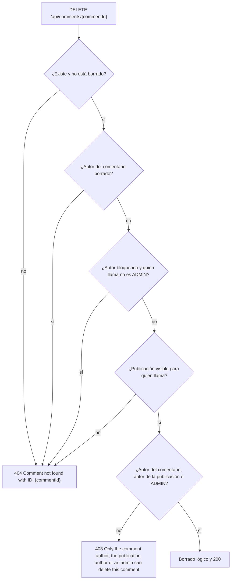

# Comentarios en publicaciones (`comment`)

## Para qué existe

Un comentario es un texto corto que cualquier usuario autenticado escribe en una publicación que puede ver. Es el espacio de conversación alrededor de lo que cuenta el creador de una campaña (ver [Publicaciones](publication.md)).

El dominio es chico: se puede **comentar**, **listar los comentarios de una publicación** (público y paginado) y **borrar** un comentario. No hay edición, ni respuestas o hilos, ni likes en comentarios. También se puede **reportar** un comentario (ver [Reportes](report.md)).

El código vive en su propio dominio aunque la ruta de dos de sus endpoints cuelgue de la publicación (ver [Decisiones de diseño](../08-decisiones-de-diseno.md#la-ruta-no-decide-el-dominio-del-código)). Las dependencias van en una sola dirección: `comment` usa a `publication` (para saber si una publicación es visible) y `report` usa a `comment`; ningún archivo de `publication` importa nada de `comment`.

## Entidades y datos

**`Comment`** (`entity/comment/Comment.java`, tabla `comment`):

| Campo | Columna | Notas |
|---|---|---|
| `id` | `id` | Identidad autogenerada. |
| `text` | `text` | `NOT NULL`, hasta 280 caracteres (`length = 280`). |
| `createdAt` | `created_at` | No actualizable. Lo fija `@PrePersist`. |
| `deletedAt` | `deleted_at` | Borrado lógico (ver abajo). |
| `user` | `user_id` | `@ManyToOne` al autor (`User`), con `@NotFound(IGNORE)` y `updatable = false`. |
| `publication` | `publication_id` | `@ManyToOne` LAZY, `optional = false`, `updatable = false`. |
| `publicationId` | `publication_id` | Copia de solo lectura de la misma FK (`insertable = false, updatable = false`). |

No tiene enums propios.

- **`user` lleva `@NotFound(IGNORE)` y `updatable = false`; `publication` no.** `user` sigue el patrón de `Publication.user`: si el autor está borrado, Hibernate dejaría fuera la fila del comentario con un `INNER JOIN`; con `@NotFound(IGNORE)` el comentario se carga con `user` en `null` y la validación lo trata como inexistente. `updatable = false` evita que el `UPDATE` del borrado lógico pise la FK con ese `null` (la columna sigue `NOT NULL`). `@NotFound` además vuelve EAGER la relación y hace que Hibernate no exporte la FK a `[user]`. `publication` en cambio es LAZY, como `PublicationLike.publication`, sin `@NotFound` y con la FK exportada: solo se navega cuando la publicación ya resultó visible, así que no hay chequeo de fila borrada que tolerar.
- **La copia `publicationId`** conserva el id aunque la publicación esté borrada y permite que las queries filtren sin unir `publication`. Es el mismo recurso que `Publication.campaignId`. Como solo se llena al leer desde la base, justo después de un `save` vale `null`: `CommentMapper.toDTO` cae entonces al id de `publication`.
- **Índice `idx_comment_publication_created (publication_id, created_at)`**, declarado con `@Index` en `@Table`. Sirve para el filtro y el orden del listado paginado. Es el primer `@Index` declarado en una entidad; `ddl-auto` lo crea junto con la tabla.
- **Sin `updatedAt`.** Un comentario no se edita. Para cambiarlo se borra y se vuelve a escribir.
- **Sin cascada.** Borrar una publicación, una campaña o una cuenta no borra sus comentarios. Las filas quedan, y la visibilidad las oculta al leer.
- **`@ToString.Exclude` y `@EqualsAndHashCode.Exclude`** en las dos relaciones.
- **Quién crea la tabla.** La crea `ddl-auto=update` al arrancar, sin script SQL (ver [Modelo de datos](../04-modelo-de-datos.md#quién-crea-las-tablas)). Los tests de integración usan `src/test/resources/schema.sql`, que también la declara.

**Borrado lógico.** `@SQLDelete` convierte el `delete` de JPA en `UPDATE comment SET deleted_at = GETDATE()`, y `@SQLRestriction("deleted_at IS NULL")` hace que toda consulta JPA ignore las filas borradas.

**Consultas del listado** (`repository/comment/CommentRepository.java`): un par, como en [Queries en pares](../08-decisiones-de-diseno.md#queries-en-pares-la-del-admin-y-la-del-resto).

- `findAllByPublicationId`: para un ADMIN. Todos los comentarios de la publicación cuyo autor no está borrado.
- `findVisibleByPublicationId`: para el resto. Lo mismo, sin autores baneados ni con suspensión vigente (`UserRepository.NOT_BLOCKED`, con el `:now` de la JVM).

Las dos traen el autor con `userInfo` y `verificationRequest` en el mismo `SELECT` (`JOIN FETCH`, todos a uno), así que Hibernate pagina en SQL y la página no crece en consultas con su tamaño. El orden está escrito en la query (`createdAt` y después `id`, ambos ascendentes) y cada una lleva su `countQuery`. Son JPQL: Hibernate las valida al arrancar, pero los tests unitarios mockean el repositorio y no las ejecutan.

## Reglas de negocio

| Regla | Por qué | Dónde |
|---|---|---|
| El texto se recorta con `trim`, no puede quedar vacío y tiene hasta 280 caracteres. | El blanco es una regla de negocio y no una anotación del DTO; el largo se mide después del `trim`. | `CommentValidationService.validateAndNormalizeText` → `TextValidationService.normalizeRequiredText` |
| Se comenta en toda publicación que quien llama ve: también la propia, la de un ADMIN y la de una campaña `CLOSED` que ve. No hay regla de estado ni de dueño. | Un comentario no tiene efecto económico. Quien ve la publicación participa; el ADMIN usa la visibilidad de ADMIN, como en likes y reportes. | `PublicationValidationService.validateAndGetVisiblePublication` desde `CommentService.createComment` |
| La visibilidad de la publicación se mira antes que el texto. | Una publicación oculta responde `404` aunque el texto venga en blanco: no se revela nada por el orden de los chequeos. | `CommentService.createComment` |
| Un comentario se ve si su autor está activo (o bloqueado, si quien llama es ADMIN) y su publicación es visible. | Un autor borrado no existe para nadie; uno baneado o con suspensión vigente se oculta a quien no es ADMIN, que sí lo ve para moderar. | `CommentValidationService.validateAndGetVisibleComment` (borrar, reportar), `CommentRepository` (listar) |
| Todo lo oculto responde el mismo `404 Comment not found with ID: {id}` que un comentario inexistente, nunca el de la publicación. | Responder el `404` de la publicación revelaría que el comentario existe. | `CommentValidationService.validateAndGetVisibleComment` |
| `isBlocked` se consulta antes que el rol. | El rol de quien llama solo se busca en la base si el autor está bloqueado. | `CommentValidationService.validateAndGetVisibleComment` |
| Borran el autor del comentario, el autor de la publicación o un ADMIN, y primero se mira la visibilidad y después el permiso. | El comentario se escribe en el espacio del creador, que puede limpiarlo; el ADMIN modera. Con la visibilidad primero, quien no ve un comentario recibe `404` y no se entera de que existe. | `CommentValidationService.validateAndGetDeletableComment` |
| Un comentario visible que quien llama no puede borrar responde `403`. | Ya lo ve, así que no hay nada que ocultar. | `CommentValidationService.validateAndGetDeletableComment` |
| El listado tiene orden fijo (`createdAt` y `id` ascendentes) y no admite `sortBy`. | El orden cronológico es el de una conversación. Va escrito en la query, y el controller solo valida `page` y `size`. Un `sortBy` en la URL se ignora: no es un parámetro del endpoint. | `CommentRepository`, `SortValidationService.validateAndGetPageable(int, int)` |
| Los comentarios de autores sancionados no se ven en el listado, salvo para un ADMIN. | Es la regla de lectura de los usuarios bloqueados. Las filas se conservan y vuelven a verse cuando se restaura la cuenta o termina la sanción. | `CommentService.getCommentsByPublicationId`, `CommentValidationService.canSeeBlockedAuthors` |
| Borrar una publicación, una campaña o una cuenta no borra sus comentarios. | No hay cascada; la visibilidad de la publicación los oculta. | `Comment` (sin cascada) |

Orden de los chequeos al borrar:

## Estados

Este dominio no tiene estados. Un comentario existe o está borrado (`deletedAt`).

## Visibilidad y permisos

Los criterios de "sancionado" (baneado, o suspendido con `suspendedUntil` en el futuro) están en [Seguridad](../03-seguridad.md). Para saber si quien llama es ADMIN, el dominio usa `CampaignAuthorizationService.isAdmin`, que consulta la base.

**Quién ve qué.**

| Quien llama | Comentar | Leer | Borrar |
|---|---|---|---|
| Anónimo | `401` | Comentarios de autores activos y no sancionados, en publicaciones visibles | `401` |
| `USER` | En toda publicación que ve, incluida la propia | Igual que el anónimo, más las publicaciones de sus campañas `CLOSED` | Sus comentarios y los de sus publicaciones, si los ve. Otro comentario visible: `403` |
| Autor de la publicación (dueño de la campaña) | También en su campaña `CLOSED` | Igual | Cualquier comentario visible de su publicación |
| `ADMIN` | En toda publicación que ve: también `CLOSED` ajenas y de dueños sancionados | También los comentarios de autores sancionados | Cualquier comentario visible para él |
| Token de una cuenta sancionada | `403` del filtro JWT | `403` del filtro JWT | `403` del filtro JWT |

| Comentario de… | Anónimo / `USER` | `ADMIN` |
|---|---|---|
| Un autor activo | Se ve | Se ve |
| Un autor baneado o con suspensión vigente | No se ve: `404` al reportarlo o borrarlo | Se ve, se reporta y se borra |
| Un autor borrado | No se ve | No se ve |
| Una publicación oculta, o en una campaña que quien llama no ve | `404` de la publicación en el `GET`; `404` del comentario al borrarlo o reportarlo | Igual, con la visibilidad de ADMIN |

**`404` vs `403`.**

| Caso | Respuesta |
|---|---|
| Comentar o listar en una publicación inexistente, borrada, de autor borrado o de campaña no visible para quien llama | `404` `Publication not found with ID: {publicationId}` |
| Borrar (o reportar) un comentario inexistente, borrado, de autor borrado, de autor sancionado (para quien no es ADMIN) o de una publicación que quien llama no ve | `404` `Comment not found with ID: {commentId}` |
| Borrar un comentario visible que no es propio, ni de una publicación propia, y quien llama no es ADMIN | `403` `Only the comment author, the publication author or an admin can delete this comment` |

**Riesgo conocido.** Un ADMIN puede comentar en publicaciones de dueños sancionados y en campañas `CLOSED` ajenas. Es la misma visibilidad que ya usan dar like y reportar una publicación, y se acepta así.

## Endpoints

Los tres endpoints están en `controller/comment/CommentController.java`, con `@RequestMapping("/api")`. Ninguno usa `@PreAuthorize`: el permiso de borrar lo decide `CommentValidationService`. Las respuestas de error del `GlobalExceptionHandler` tienen la forma `{error, message, timestamp}`; las del filtro JWT y el entry point de seguridad agregan `path`. El detalle de cada excepción está en [Errores y validación](../05-errores-y-validacion.md).

### `POST /api/publications/{publicationId}/comments`

- **Acceso:** usuario autenticado (`USER` o `ADMIN`). La ruta no está en `PUBLIC_GET_URLS` (que solo cubre `GET`), así que cae en `anyRequest().authenticated()`. Sin token válido → `401`.
- **Parámetros:**

  | Nombre | En | Tipo | Obligatorio |
  |---|---|---|---|
  | `publicationId` | path | `Long` | sí |

- **Body:** `CreateCommentDTO` (`dtos/comment/CreateCommentDTO.java`).

  | Campo | Tipo | Obligatorio | Validación |
  |---|---|---|---|
  | `text` | `String` | sí | `@Size(max = 280)`, sin `@NotBlank`: el blanco lo rechaza el service |

- **Respuesta:** `200 OK` con `CommentResponseDTO` (`dtos/comment/CommentResponseDTO.java`).

  | Campo | Tipo | Contenido |
  |---|---|---|
  | `id` | `Long` | Id del comentario. |
  | `publicationId` | `Long` | Publicación comentada. |
  | `text` | `String` | Texto, ya recortado. |
  | `createdAt` | `LocalDateTime` | Fecha de creación. |
  | `userId` | `Long` | Autor del comentario. |
  | `firstName` | `String` | Nombre del autor (`UserInfo`). |
  | `lastName` | `String` | Apellido del autor. |
  | `userName` | `String` | Nombre de usuario del autor. |

- **Errores:**

  | Status | Mensaje | Cuándo |
  |---|---|---|
  | `401` | `Full authentication is required to access this resource` | Sin header `Authorization`, o con un token rechazado por el filtro. |
  | `403` | `Your account has been banned. Reason: {motivo}` | El usuario del token está baneado (corte del filtro JWT). |
  | `403` | `Your account is suspended until {fecha}. Reason: {motivo}` | El usuario del token tiene una suspensión vigente (corte del filtro JWT). |
  | `400` | `Invalid value '{valor}' for parameter 'publicationId'` | `publicationId` no es numérico. |
  | `400` | `Request body is required` / `Malformed request body` | Falta el body / no es JSON válido. |
  | `400` | `One or more fields are invalid`, con `fields.text` = `Text must be at most 280 characters` | `text` supera los 280 caracteres contando los espacios de los extremos. |
  | `404` | `Publication not found with ID: {publicationId}` | La publicación está oculta para quien llama: inexistente, borrada, de autor borrado o de campaña no visible. |
  | `400` | `Text cannot be blank` | `text` falta, es `null`, está vacío o solo tiene espacios (con la publicación visible). |

  La validación del body ocurre antes de entrar al service, y `@Size` mide con los espacios de los extremos; por eso el chequeo de largo del service (sobre el texto ya recortado) no se alcanza por la API con un texto que `@Size` ya aceptó.

- **Qué hace** (`service/comment/CommentService.java`, `createComment`, que no es `@Transactional`: hace una sola escritura):
  1. Toma el id de quien llama del token con `AuthenticatedUserService.getAuthenticatedUserId()`.
  2. `PublicationValidationService.validateAndGetVisiblePublication(publicationId, callerId)`: `404` si está oculta. Va antes que el texto.
  3. `CommentValidationService.validateAndNormalizeText(dto.getText())`: `400` si queda vacío; devuelve el texto con `trim`.
  4. `CommentMapper.toEntity(text, publication, UserRepository.getReferenceById(callerId))` y `CommentRepository.save`. `getReferenceById` devuelve un proxy: no hay `SELECT` de quien llama solo para enlazarlo.
  5. `CommentMapper.toDTO(comment)`.

### `GET /api/publications/{publicationId}/comments`

- **Acceso:** público. La ruta está en `PUBLIC_GET_URLS` de `security/SecurityConfig.java` (`/api/publications/*/comments`). Con token válido, quien llama se identifica y, si es ADMIN, ve también los comentarios de autores sancionados. Un token inválido o expirado no da `401`: se responde como a un anónimo. La excepción es un token válido de un usuario sancionado, que el filtro corta con `403` aun en rutas públicas.
- **Parámetros:**

  | Nombre | En | Tipo | Obligatorio | Notas |
  |---|---|---|---|---|
  | `publicationId` | path | `Long` | sí | |
  | `page` | query | `int` | no | Por defecto `0`. |
  | `size` | query | `int` | no | Por defecto `10`; entre 1 y 100. |

  No hay `sortBy` ni `sortDirection`.

- **Body:** sin body.
- **Respuesta:** `200 OK` con `Page<CommentResponseDTO>` (mismos campos que en el `POST`), del más viejo al más nuevo.
- **Errores:**

  | Status | Mensaje | Cuándo |
  |---|---|---|
  | `403` | `Your account has been banned. Reason: {motivo}` / `Your account is suspended until {fecha}. Reason: {motivo}` | Se envió un token válido de un usuario sancionado. |
  | `400` | `Invalid value '{valor}' for parameter 'publicationId'` | `publicationId` no es numérico. |
  | `400` | `Invalid value '{valor}' for parameter 'page'` (o `'size'`) | `page` o `size` no son numéricos. |
  | `400` | `Page must be greater than or equal to 0` | `page < 0`. |
  | `400` | `Size must be between 1 and 100` | `size < 1` o `size > 100`. |
  | `404` | `Publication not found with ID: {publicationId}` | La publicación está oculta para quien llama (mismos casos que en el `POST`). |

- **Qué hace:**
  1. El controller valida la paginación con `SortValidationService.validateAndGetPageable(page, size)`, que devuelve un `Pageable` sin orden.
  2. `CommentService.getCommentsByPublicationId` obtiene el id de quien llama con `AuthenticatedUserService.findAuthenticatedUserId()`, que devuelve vacío para un anónimo; en ese caso usa `null`.
  3. `PublicationValidationService.validateAndGetVisiblePublication(publicationId, callerId)`: `404` si está oculta.
  4. Elige la query según quién llama: si `CommentValidationService.canSeeBlockedAuthors(callerId)` (hay id y es ADMIN), `findAllByPublicationId`; si no, `findVisibleByPublicationId` con `LocalDateTime.now()`.
  5. Mapea cada comentario con `CommentMapper.toDTO`.

  Cada página hace dos consultas fijas (la de la página y la de conteo), más las de visibilidad de la publicación.

### `DELETE /api/comments/{commentId}`

- **Acceso:** usuario autenticado (`USER` o `ADMIN`). Cae en `anyRequest().authenticated()`. Sin token válido → `401`.
- **Parámetros:**

  | Nombre | En | Tipo | Obligatorio |
  |---|---|---|---|
  | `commentId` | path | `Long` | sí |

- **Body:** sin body.
- **Respuesta:** `200 OK` con un mapa armado en el controller:

  | Campo | Tipo | Contenido |
  |---|---|---|
  | `message` | `String` | `Comment deleted successfully` |
  | `commentId` | `Long` | El id borrado. |

- **Errores:**

  | Status | Mensaje | Cuándo |
  |---|---|---|
  | `401` | `Full authentication is required to access this resource` | Sin token o con un token rechazado por el filtro. |
  | `403` | `Your account has been banned. Reason: {motivo}` / `Your account is suspended until {fecha}. Reason: {motivo}` | El usuario del token está sancionado (corte del filtro JWT). |
  | `400` | `Invalid value '{valor}' for parameter 'commentId'` | `commentId` no es numérico. |
  | `404` | `Comment not found with ID: {commentId}` | Inexistente o ya borrado; autor borrado; autor sancionado y quien llama no es ADMIN; o publicación oculta para quien llama (también una campaña `CLOSED` ajena). |
  | `403` | `Only the comment author, the publication author or an admin can delete this comment` | El comentario es visible, pero quien llama no es su autor, ni el autor de la publicación, ni ADMIN. |

- **Qué hace** (`CommentService.deleteComment`):
  1. Toma el id de quien llama del token.
  2. `CommentValidationService.validateAndGetDeletableComment(commentId, callerId)`: primero `validateAndGetVisibleComment` (existe, autor no borrado, autor no bloqueado salvo para un ADMIN, publicación visible), después el permiso: autor del comentario, autor de la publicación (`comment.getPublication().getUser()`, que se carga por open-in-view como proxy LAZY) o ADMIN (`403` si no).
  3. `CommentRepository.delete`, que por `@SQLDelete` marca `deleted_at` en lugar de borrar la fila.

## Clases involucradas

| Capa | Clase |
|---|---|
| Controller | `controller/comment/CommentController.java` |
| Service | `service/comment/CommentService.java` |
| Validation | `validation/comment/CommentValidationService.java` |
| Validation (de otros dominios) | `validation/publication/PublicationValidationService.java` (visibilidad de la publicación), `validation/campaign/CampaignAuthorizationService.java` (`isAdmin`), `validation/auth/AccountStatusValidationService.java` (`isBlocked`), `validation/common/TextValidationService.java` (texto) |
| Validation (común) | `validation/common/SortValidationService.java` (`validateAndGetPageable(int, int)`, sin orden) |
| Mapper | `mapper/comment/CommentMapper.java` |
| Repository | `repository/comment/CommentRepository.java`, `repository/user/UserRepository.java` (`getReferenceById`, `NOT_BLOCKED`) |
| DTOs | `dtos/comment/CreateCommentDTO.java`, `dtos/comment/CommentResponseDTO.java` |
| Entity | `entity/comment/Comment.java`; usa `entity/publication/Publication.java`, `entity/user/User.java` |
| Seguridad | `security/SecurityConfig.java` (`PUBLIC_GET_URLS`), `security/AuthenticatedUserService.java`, `security/JwtAuthenticationFilter.java` |
| Otros dominios que tocan comentarios | `validation/report/ReportValidationService.java` (reportar un comentario), `service/report/ReportActionService.java` (borrado por moderación) |
