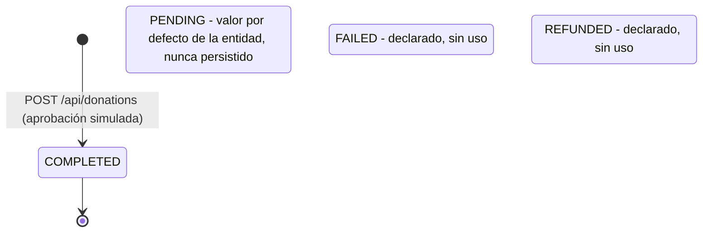
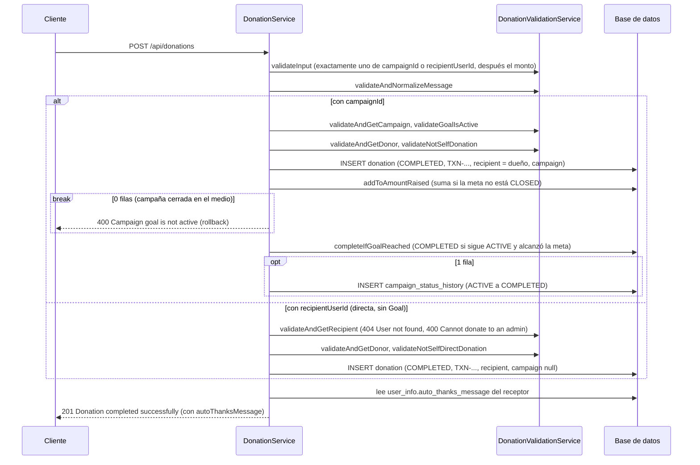
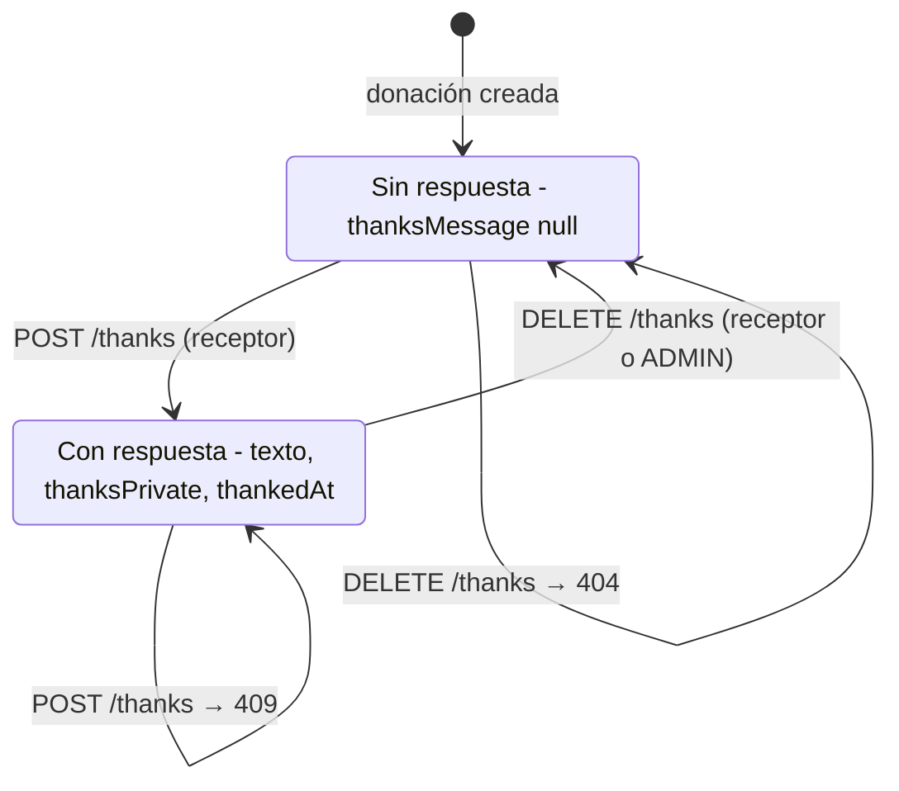
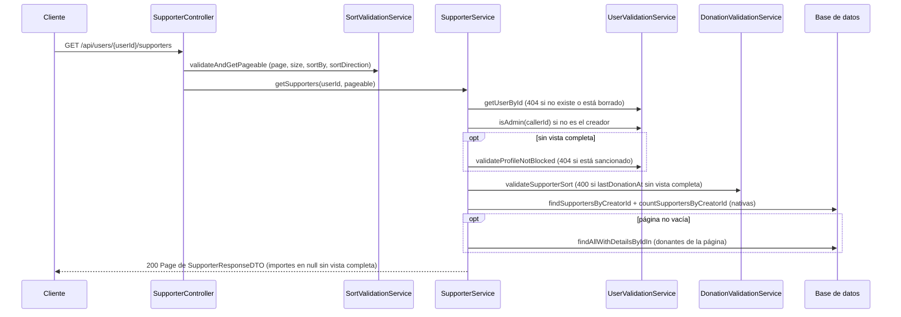

# Donation

## Para qué existe

Una donación es un aporte de dinero de un usuario autenticado, a la campaña de otro usuario o directo a un usuario (**donación directa**, sin campaña). Las dos salen del mismo `POST /api/donations`: el body lleva `campaignId` o `recipientUserId`, exactamente uno. Toda donación tiene un **receptor** (`recipient`): el dueño de la campaña en una donación a campaña, el usuario elegido en una directa.

- **A una campaña.** Suma su monto al recaudado de la meta (`Goal`) de la campaña y, si con eso se alcanza la meta, pasa la campaña de `ACTIVE` a `COMPLETED`.
- **Directa.** No toca ninguna campaña: ni la meta, ni el recaudado, ni el historial de estados. La fila queda con `campaign` y `campaignId` en `null`.

El donante puede acompañar la donación con un mensaje opcional, público o privado, en los dos tipos. Un mensaje privado lo ven solo el donante, el receptor (en una donación a campaña, el dueño) y un ADMIN en el listado de la campaña; el receptor lo ve siempre en `GET /api/donations/received`.

El receptor agradece de dos formas:

- **Mensaje predeterminado.** Un texto por usuario, el mismo para todas sus campañas y para las donaciones directas, que el donante recibe en la respuesta de `POST /api/donations`. Se guarda en `UserInfo.autoThanksMessage` y se configura con `/api/users/me/auto-thanks` (ver [User](user.md)). No se copia en la donación.
- **Respuesta personalizada.** Una por donación, pública o privada, que el receptor escribe después. No se edita: se borra y se vuelve a escribir. La puede borrar también un ADMIN. No es un chat: el donante no contesta.

No hay pasarela de pago: el sistema **simula la aprobación**. Toda donación que pasa las validaciones se guarda directamente en `COMPLETED` con un identificador de transacción generado en el momento. El propio service lo marca como el punto donde, en producción, se integraría una pasarela.

Además de crear donaciones y responderlas, el dominio ofrece cinco lecturas: el historial del usuario que llama, las **donaciones recibidas** por el usuario que llama (paginadas, directas y de sus campañas), el listado de donaciones de una campaña, las estadísticas de recaudación de una campaña y los **supporters de un creador**, un ranking paginado con una fila por donante que suma todas sus donaciones a ese usuario, a sus campañas y directas. El listado y las estadísticas de una campaña y los supporters son públicos. En los supporters, cualquiera ve quiénes son, pero los importes los ven solo el propio creador y un ADMIN. Las donaciones directas no tienen ninguna lectura pública ni de terceros: solo las ven el donante y el receptor, y cuentan como agregado en los supporters.

## Entidades y datos

### Entidad `Donation` (`entity/donation/Donation.java`, tabla `donation`)

| Campo | Tipo | Columna | Notas |
|---|---|---|---|
| `id` | `Long` | `id` | Identidad generada por la base. |
| `donor` | `User` | `donor_user_id` | `@ManyToOne` con `@NotFound(IGNORE)`, `updatable = false`. |
| `campaign` | `Campaign` | `campaign_id` | `@ManyToOne` con `@NotFound(IGNORE)`, `updatable = false`. `null` en una donación directa (y también si la campaña está borrada). |
| `recipient` | `User` | `recipient_user_id` | `@ManyToOne` con `@NotFound(IGNORE)`, `updatable = false`, sin `nullable = false`. Quién recibe el dinero: el dueño de la campaña en una donación a campaña, el usuario elegido en una directa. |
| `campaignId` | `Long` | `campaign_id` | Copia de solo lectura de la FK (`insertable = false, updatable = false`). `null` en una donación directa; con una campaña borrada conserva el id. |
| `donorUserId` | `Long` | `donor_user_id` | Copia de solo lectura de la FK. |
| `recipientUserId` | `Long` | `recipient_user_id` | Copia de solo lectura de la FK. Es la que usan `/thanks`, `/received` y los supporters. |
| `amount` | `BigDecimal` | `amount` | `precision = 15, scale = 2`, no nulo. |
| `status` | `DonationStatus` | `status` | Guardado como texto (`EnumType.STRING`), por defecto `PENDING`. |
| `transactionId` | `String` | `transaction_id` | Único, hasta 100 caracteres. Formato `TXN-XXXXXXXX`. |
| `message` | `String` | `message` | Mensaje opcional del donante, ya sin espacios en los extremos. `varchar(280)`, nulo. `null` si la donación no tiene mensaje. |
| `messagePrivate` | `boolean` | `message_private` | `true` si el mensaje es privado. `bit NOT NULL` con `@ColumnDefault("0")` y `@Builder.Default` en `false`. Nunca es `true` sin mensaje. |
| `thanksMessage` | `String` | `thanks_message` | Respuesta del receptor, ya sin espacios en los extremos. `varchar(280)`, nulo. `null` si no hay respuesta. |
| `thanksPrivate` | `boolean` | `thanks_private` | `true` si la respuesta es privada. `bit NOT NULL` con `@ColumnDefault("0")` y `@Builder.Default` en `false`. Es independiente de `messagePrivate`. |
| `thankedAt` | `LocalDateTime` | `thanked_at` | Cuándo se escribió la respuesta. `datetime2(6)`, nulo. |
| `createdAt` / `updatedAt` | `LocalDateTime` | `created_at` / `updated_at` | Marcas de tiempo de Hibernate más `@PrePersist`/`@PreUpdate`. |

**Por qué cada FK está mapeada dos veces.** Las campañas y los usuarios tienen borrado lógico (`@SQLRestriction("deleted_at IS NULL")`). Si la relación fuera obligatoria, Hibernate haría un inner join contra la tabla filtrada y la donación desaparecería al borrar su campaña, su donante o su receptor. Por eso:

- `donor`, `recipient` y `campaign` son opcionales en el mapeo y llevan `@NotFound(action = NotFoundAction.IGNORE)`: si el destino está borrado, la relación queda en `null` en lugar de perder la fila. En la base:
  - `donor_user_id` es `NOT NULL`;
  - `recipient_user_id` es `NOT NULL` por el script `scripts/migrate-donation-recipient.sql`, no por el mapeo. La entidad no lleva `nullable = false` porque `ddl-auto=update` intentaría `ALTER TABLE donation ADD recipient_user_id bigint not null`, que falla sobre una tabla con filas. Con `@NotFound`, Hibernate tampoco exporta la FK: la crea el script;
  - `campaign_id` pasó a ser **nullable**, porque una donación directa no tiene campaña. `ddl-auto=update` agrega columnas pero nunca modifica las existentes, así que también lo cambia el script. Sin él, una donación directa responde `409` (ver [Modelo de datos](../04-modelo-de-datos.md#migración-manual-de-donation)).
- Son `updatable = false`, así un `UPDATE` de la donación nunca escribe ese `null` sobre la FK.
- `campaignId`, `donorUserId` y `recipientUserId` son copias de solo lectura de las mismas columnas: conservan el valor aunque la relación sea `null` y permiten filtrar por FK sin hacer join contra la tabla con borrado lógico (las consultas de estadísticas, el historial, las donaciones recibidas y los supporters filtran por estas columnas). Con `campaignId` se distingue una campaña borrada (relación `null`, id presente) de una donación directa (los dos `null`).

**Invariante del receptor.** Toda donación tiene `recipient_user_id`. En una donación a campaña es el dueño de la campaña, y no se desactualiza porque `Campaign.user` es `updatable = false`; las filas anteriores a la columna se rellenaron con el dueño de su campaña (también si la campaña o el dueño están borrados). Una base creada desde cero por Hibernate deja la columna nullable y sin FK, igual que `donor_user_id`: la garantía real es que `createDonation` siempre asigna `recipient`.

El detalle general del borrado lógico está en [Modelo de datos](../04-modelo-de-datos.md).

**Por qué `message_private` y `thanks_private` llevan default en la base.** Las columnas las crea `ddl-auto=update`. Sin `@ColumnDefault("0")`, el `ALTER TABLE donation ADD ... bit NOT NULL` falla en SQL Server si la tabla ya tiene filas. Con el default, las donaciones anteriores al mensaje quedaron con `message = NULL` y `message_private = 0`, y las anteriores a la respuesta con `thanks_message = NULL`, `thanks_private = 0` y `thanked_at = NULL`.

**Invariante de la respuesta.** `thanksMessage == null` si y solo si `thankedAt == null`, y sin respuesta `thanksPrivate` es `false`. Responder y borrar escriben los tres campos juntos. La respuesta es la única parte de una donación que cambia después de crearla.

**`message` y `thanks_message` son `varchar`, no `nvarchar`.** Siguen la convención del resto de los textos del proyecto, como `publication.description`. Las tildes, la `ñ` y los signos `¡` y `¿` se guardan bien. Los emojis y los caracteres fuera de la página de códigos de SQL Server llegan como `?`. Lo mismo vale para `user_info.auto_thanks_message`.

### Enum `DonationStatus` (`entity/donation/DonationStatus.java`)

`PENDING`, `COMPLETED`, `FAILED`, `REFUNDED`. Hoy el código solo asigna `COMPLETED` (ver [Estados](#estados)).

### Datos de otros dominios que se usan

- `Campaign` y `Goal` (`entity/campaign/`): una donación a campaña apunta a la campaña (una directa no), y el monto se suma en `Goal.amountRaised`. `Goal.amountRaised` es `updatable = false` en el mapeo: solo lo modifica `GoalRepository.addToAmountRaised` con un `UPDATE` atómico, para que guardar una campaña con datos viejos nunca pise donaciones sumadas en el medio. Ver [Campaign](campaign.md).
- `CampaignStatus` (`entity/campaign/CampaignStatus.java`): el estado de la meta (`ACTIVE`, `COMPLETED`, `CLOSED`) decide si se puede donar.
- `CampaignStatusHistory`: la donación que completa la meta registra la transición `ACTIVE → COMPLETED` con `changedBy = null` (la hizo el sistema, no un usuario).
- `User` (`entity/user/User.java`): el donante y el receptor. Su nombre visible sale de `userInfo.userName`. En una donación directa el receptor se valida con `UserValidationService` (existencia, sanciones) y con su rol (`Role`). En los supporters es también el creador (`userId`), y su visibilidad la deciden las reglas del dominio [User](user.md).
- `UserInfo.autoThanksMessage` (`entity/user/UserInfo.java`): el mensaje predeterminado del receptor, que `createDonation` lee de `recipient.getUserInfo()` (el dueño de la campaña, o el usuario de la donación directa). Lo administra el dominio [User](user.md).

### DTOs

- `dtos/donation/CreateDonationDTO.java`: entrada de `POST /api/donations`. `campaignId` y `recipientUserId` no llevan anotaciones: que llegue exactamente uno lo valida `DonationValidationService.validateInput`, porque las reglas de negocio viven en `validation/`.
- `dtos/donation/DonationCreatedResponseDTO.java`: lo que devuelve `DonationService.createDonation`, la donación (`donation`) más el mensaje predeterminado del receptor (`autoThanksMessage`). El controller lo reparte en el cuerpo de la respuesta.
- `dtos/donation/CreateDonationThanksDTO.java`: entrada de `POST /api/donations/{donationId}/thanks`.
- `dtos/donation/DonationResponseDTO.java`: una donación en las respuestas, con `recipientUserId` y `recipientUserName` en todas.
- `dtos/donation/CampaignStatisticsDTO.java`: estadísticas de una campaña. Vive en `dtos/donation/` aunque describe una campaña, porque lo calcula este dominio a partir de las donaciones.
- `dtos/donation/SupporterResponseDTO.java`: una fila del ranking de supporters (`donorUserId`, `donorUserName`, `totalAmount`, `donationsCount`, `lastDonationAt`). No es una donación: es el agregado de las donaciones de un donante a un creador.

**Proyección `DonationRepository.SupporterProjection`.** Interfaz anidada en el repositorio, con `getDonorUserId()`, `getTotalAmount()`, `getDonationsCount()` y `getLastDonationAt()`. Es lo que devuelve la query nativa de supporters, y `DonationMapper.toSupporterDTO` la recibe directamente: es el único mapper que recibe un tipo de `repository/`, pero es solo un tipo de datos, sin acceso a la base.

## Reglas de negocio

Todas las aplica `validation/donation/DonationValidationService.java`, salvo donde se indica otra clase. El orden es el de `DonationService.createDonation`. Los pasos 1 a 3 y 9 y 12 son comunes; los marcados "con `campaignId`" son la rama de campaña (pasos 4 a 7, 10 y 11) y el 8 es la rama directa.

1. **El donante sale del token.** `AuthenticatedUserService.getAuthenticatedUserId()`; el body no lleva id de usuario. Así nadie puede donar en nombre de otro. `recipientUserId` es el destino, no quien llama.
2. **Entrada válida.** Primero Bean Validation en `CreateDonationDTO`: `amount` obligatorio, `> 0`, con hasta 13 enteros y 2 decimales (`@NotNull`, `@Positive`, `@Digits`), y `message` de hasta 280. Después `validateInput`, que corre en este orden:
   - sin `campaignId` ni `recipientUserId` → `400 Campaign ID or recipient user ID is required`;
   - con los dos → `400 Only one of campaignId or recipientUserId can be set`;
   - los dos chequeos de `amount`, que repiten lo que ya cortó Bean Validation (con `amount: 0` responde antes el `400 Validation failed` de Bean Validation, con el texto en `fields.amount`).

   El destino se valida antes que el monto. El límite de dígitos coincide con la columna (`precision = 15, scale = 2`), así que un monto aceptado siempre entra en la base sin redondeo.
3. **Mensaje opcional** (`validateAndNormalizeMessage`, que delega el texto en `validation/common/TextValidationService.normalizeRequiredText`). Sin `message`, o con `message: null`, la donación no tiene mensaje. Con texto, se guarda con `trim`. `""` o solo espacios (incluidos saltos de línea y tabulaciones) responden `400 Message cannot be blank`: el mensaje es opcional, pero si llega tiene que tener texto. El largo máximo es 280 caracteres (`MAX_MESSAGE_LENGTH`): lo corta `@Size(max = 280)` en `CreateDonationDTO`, y `validateAndNormalizeMessage` lo repite sobre el texto ya recortado. `messagePrivate` ausente o `null` cuenta como `false`, y `messagePrivate: true` sin mensaje se guarda como `false`, porque no hay nada que ocultar.
4. **Con `campaignId`: la campaña tiene que ser visible para el donante.** (`createDonation` elige la rama con `dto.getCampaignId() != null`; los pasos 4 a 7 son la rama de campaña y el 8 la directa.) `validateAndGetCampaign` delega en `CampaignValidationService.findVisibleCampaignByIdOrThrow`: una campaña inexistente, borrada, `CLOSED` de otro usuario, de un dueño borrado o de un dueño baneado o suspendido responde lo mismo, `404 Campaign not found with id: {id}`. Así, donar no sirve para descubrir campañas que el usuario no puede ver. Un ADMIN ve toda campaña de un dueño no borrado (también las `CLOSED` y las de dueños sancionados). Como la regla es la misma que para leer, un ADMIN puede donar a la campaña de un dueño baneado o suspendido; a una `CLOSED` no, porque la corta la regla siguiente. El criterio completo de visibilidad está en [Campaign](campaign.md).
5. **Con `campaignId`: la meta tiene que existir y no estar `CLOSED`** (`validateGoalIsActive`). Una campaña `COMPLETED` **sí** acepta donaciones: la meta alcanzada no corta la recaudación, y el recaudado puede superar la meta. Solo el cierre la corta. El caso "sin meta" (`Campaign does not have a goal`) no aparece con datos creados por la API: `CampaignMapper` crea cada campaña con su `Goal` en `0` recaudado.
6. **Con `campaignId`: el donante existe** (`validateAndGetDonor`, `UserRepository.findById`). En la práctica siempre se cumple, porque el filtro JWT ya cargó al usuario.
7. **Con `campaignId`: no se puede donar a la campaña propia** (`validateNotSelfDonation`, `400 Cannot donate to your own campaign`), comparando el id del token con el dueño de la campaña. Evita que un usuario infle su propia recaudación. El receptor es `campaign.getUser()`, que nunca es `null`: la visibilidad excluye las campañas de dueños borrados.
8. **Con `recipientUserId` (donación directa), en este orden y responde la primera que falla:**
   1. `validateAndGetRecipient`, que a su vez corre:
      - el receptor existe y no está borrado (`UserValidationService.getUserById`) → `404 User not found`;
      - no está baneado ni suspendido (`UserValidationService.validateProfileNotBlocked`) → `404 User not found`, el mismo literal, también si quien dona es ADMIN. Así no se revelan sanciones, y a diferencia de la donación a la campaña de un dueño sancionado, el ADMIN no se salta la regla;
      - su rol es `USER` → si no, `400 Cannot donate to an admin`. El rol es LAZY y se lee dentro del `@Transactional` de `createDonation`. Un ADMIN dueño de una campaña sí recibe donaciones a esa campaña; lo que no recibe son donaciones directas.
   2. El donante existe (`validateAndGetDonor`).
   3. No es auto-donación (`validateNotSelfDirectDonation`) → `400 Cannot donate to yourself`. El literal de la campaña (`Cannot donate to your own campaign`) engañaría sin campaña.

   No se exige que el receptor esté verificado. Después, una donación directa salta los pasos 10 y 11: no hay meta que sumar ni historial de estados que escribir.
9. **Aprobación simulada.** Se construye la `Donation` con `status = COMPLETED`, el `recipient` y la `campaign` (`null` en una directa) y un `transactionId` `"TXN-"` + los primeros 8 caracteres de un UUID aleatorio en mayúsculas, más el mensaje normalizado y su `messagePrivate`, y se guarda.
10. **Con `campaignId`: suma atómica del recaudado** (`GoalRepository.addToAmountRaised`): un `UPDATE goal SET amount_raised = amount_raised + :amount ... WHERE id = :goalId AND status <> CLOSED`. La suma la hace la base, así dos donaciones simultáneas no se pisan (no hay lectura-modificación-escritura en Java). Si devuelve `0` filas, la campaña se cerró entre la validación y la suma: se lanza `400 Campaign goal is not active` y, como el método es `@Transactional`, se revierte también el `INSERT` de la donación.
11. **Con `campaignId`: paso automático a `COMPLETED`** (`GoalRepository.completeIfGoalReached`): un segundo `UPDATE` que solo cambia la meta si sigue `ACTIVE` y `amount_raised >= amount_goal`. Devuelve `1` únicamente para la donación que produjo el cambio, así la transición se registra una sola vez en el historial aunque varias donaciones crucen la meta a la vez.
12. **Mensaje predeterminado del receptor.** Lee el `autoThanksMessage` vigente del receptor (el dueño de la campaña o el usuario de la donación directa), o `null` si no configuró ninguno (o si el receptor o su `userInfo` no están). Viaja solo en la respuesta: no se guarda en la donación, así que cambiarlo o borrarlo después no afecta a las donaciones ya hechas, y no aparece en ninguna otra lectura.

### Responder a una donación

Las aplica `DonationValidationService`, en el orden de `DonationService.thankDonation` y `deleteDonationThanks`.

1. **Quien llama sale del token**, como al donar.
2. **Texto obligatorio** (`validateAndNormalizeThanksMessage`, solo al responder). Ausente, `null`, `""` o solo espacios → `400 Thanks message cannot be blank`. Se guarda con `trim`. El largo máximo es 280: lo corta `@Size(max = 280)` en `CreateDonationThanksDTO` (`400 Validation failed`) y la validación lo repite sobre el texto recortado, igual que el mensaje del donante. Se valida antes de cargar la donación, así que un texto en blanco responde `400` aunque la donación no exista.
3. **La donación existe** (`validateAndGetDonation`) → si no, `404 Donation not found with id: {id}`.
4. **La campaña no está borrada** (`validateDonationCampaignNotDeleted`). Una campaña con soft delete deja la relación `campaign` en `null` (`@NotFound`) mientras `campaignId` conserva el id: en sus donaciones no se puede responder ni borrar la respuesta, `400 Cannot reply to a donation of a deleted campaign`, tampoco un ADMIN. El estado del donante (borrado o sancionado) no importa, y una campaña `CLOSED` o `COMPLETED` sí acepta respuestas: la única restricción de campaña es el borrado. Una donación directa (`campaignId == null`) pasa siempre este chequeo.
5. **Quién puede.** Es el **receptor** (`donation.recipientUserId`), en los dos tipos. En una donación a campaña es el dueño de la campaña, así que nada cambia. El literal depende de si la donación tiene campaña (`campaignId != null`):

   | Operación | Quién pasa | Donación a campaña | Donación directa |
   |---|---|---|---|
   | Responder (`validateIsRecipient`) | Solo el receptor. Un ADMIN **no**: el chequeo no consulta el rol. El ADMIN modera borrando. | `403 Only the campaign owner can reply to this donation` | `403 Only the recipient can reply to this donation` |
   | Borrar (`validateIsRecipientOrAdmin`) | El receptor o un ADMIN. El rol se lee de la base con `CampaignAuthorizationService.isAdmin`, y solo si quien llama no es el receptor. | `403 Only the campaign owner or an admin can delete this reply` | `403 Only the recipient or an admin can delete this reply` |
6. **Solo donaciones `COMPLETED`** (`validateDonationCompleted`, solo al responder) → `400 Only completed donations can be replied to`. Hoy toda donación es `COMPLETED`, así que no se alcanza por la API.
7. **Una respuesta por donación.**
   - Responder con una respuesta ya escrita → `409 Donation already has a thanks message` (`validateHasNoThanks`). No se edita.
   - Borrar sin respuesta → `404 Donation has no thanks message` (`validateHasThanks`).
8. **Privacidad propia.** `thanksPrivate` ausente o `null` cuenta como `false`. Es independiente de `messagePrivate`: se puede responder en público a un mensaje privado, y al revés. Se puede responder a cualquier donación, tenga o no mensaje del donante.
9. **Guardado.** Responder fija `thanksMessage`, `thanksPrivate` y `thankedAt = now`. Borrar pone `null`, `false` y `null`. Después de borrar, el receptor puede responder de nuevo.

**Concurrencia.** El chequeo de `409` es una lectura seguida de una escritura, sin lock ni `UPDATE` condicional: dos respuestas simultáneas del receptor a la misma donación pasan las dos el chequeo y gana la última. Como solo escribe el receptor, el caso es un doble clic, y el frontend deshabilita el botón al enviar.

**Concurrencia.** No hay locks explícitos en este dominio: la protección son los dos `UPDATE` condicionales. El primero bloquea la fila de la meta hasta el commit, que llega enseguida porque son las últimas escrituras de la transacción. Del otro lado, las operaciones de campaña que deciden un estado (cerrar, reabrir, editar el monto de la meta, borrar, cerrar todas al borrar la cuenta) releen la meta con `PESSIMISTIC_WRITE` (`CampaignService.lockGoal`), así que nunca se intercalan con una suma a medio hacer. Borrar una campaña primero la pasa a `CLOSED`, por lo que una donación en curso contra una campaña que se está borrando también cae en el caso de 0 filas y se revierte. La meta cargada en memoria queda desactualizada después de los `UPDATE` y el service no la vuelve a usar.

**Montos.** Todo es `BigDecimal`. Las estadísticas redondean a 2 decimales con `RoundingMode.HALF_UP`.

**Identificador de transacción.** Los 8 caracteres son hexadecimales (32 bits de un UUID). La columna es única, así que si sale un valor repetido el `INSERT` falla y la donación responde `409` sin reintentar.

**Validación duplicada y código inalcanzable.** `validateInput` repite lo que ya cortó Bean Validation antes de entrar al controller. `validateAndGetCampaign` (solo se usa con `campaignId`) también controla `campaign.getDeletedAt() != null` (`400 Cannot donate to a deleted campaign`), pero una campaña borrada nunca llega ahí: `@SQLRestriction` la excluye de la consulta y la respuesta es el `404`. El mismo método lo usan los dos endpoints de lectura, no solo el de donar. El chequeo de largo de `validateAndNormalizeMessage` tampoco se alcanza por la API: `@Size` mide el texto con los espacios de los extremos, así que todo lo que pasa el DTO entra en 280 después del `trim`. Al revés, `@Size` sí puede rechazar un texto que recortado entraría (278 caracteres con 3 espacios alrededor). Es un caso raro, y el cliente debería mandar el texto ya recortado.

El mensaje en blanco se rechaza en la validación (`400 Business logic error`) y no con un `@Pattern` en el DTO, porque las reglas de negocio viven en `validation/`. El largo se corta en el DTO (`400 Validation failed`), igual que el monto.

### Supporters de un creador

Las aplica `service/donation/SupporterService.java` (`getSupporters`), con ayuda de `UserValidationService` y `DonationValidationService`. **Vista completa** (`fullView`) es la de quien llama siendo el propio creador (`callerId == userId`) o un ADMIN. Cualquier otro, con o sin token, tiene la **vista pública**.

1. **Qué se agrega.** Todas las donaciones `COMPLETED` cuyo receptor es `userId` (`WHERE d.recipient_user_id = :creatorId AND d.status = 'COMPLETED'`, sin `JOIN` con `campaign`), agrupadas por donante:
   - las **donaciones directas** al creador y las de sus campañas, juntas: como `recipient_user_id` de una donación a campaña es el dueño, el filtro cubre las dos;
   - en cualquier estado de campaña (`ACTIVE`, `CLOSED`, `COMPLETED`);
   - también de campañas borradas: el dinero se recibió igual. Por eso las dos queries son nativas y no pasan por el `@SQLRestriction` de `Campaign` ni de `[user]` (ver [Modelo de datos](../04-modelo-de-datos.md#leer-a-través-del-borrado));
   - `PENDING` y `FAILED` no cuentan.

   Cada fila trae `totalAmount` (`SUM(amount)`), `donationsCount` (`COUNT_BIG(*)`) y `lastDonationAt` (`MAX(created_at)`).
2. **El creador tiene que ser visible.** Mismas reglas que `UserService.getUserById` (ver [User](user.md)):
   - `userId <= 0` → `400 ID must be a positive number`. El chequeo está copiado en el servicio, no en `UserValidationService`.
   - Usuario inexistente o borrado → `404 User not found` (`UserValidationService.getUserById`).
   - Usuario baneado o suspendido → `404 User not found` para la vista pública (`validateProfileNotBlocked`). Con vista completa el servicio responde `200`, pero por la API el propio creador sancionado no llega: el filtro JWT corta antes con `403` (ver [Seguridad](../03-seguridad.md#jwtauthenticationfilter)).
3. **Quien llama es opcional** (`AuthenticatedUserService.findAuthenticatedUserId`). El rol se lee de la base con `UserValidationService.isAdmin`, como en `UserService.getUserById`, y no con `CampaignAuthorizationService.isAdmin`, que usa el resto del dominio. Los dos consultan la base, no el token.
4. **Importes solo con vista completa.** El servicio, no el mapper, pone en `null` `totalAmount`, `donationsCount` y `lastDonationAt` para la vista pública. `donorUserId` y `donorUserName` los ve cualquiera. Es la misma regla de "lo decide el service" que el `transactionId` y el mensaje privado.
5. **Orden** (`DonationValidationService.validateSupporterSort`). `sortBy` acepta `totalAmount` y `lastDonationAt`, y el desempate es siempre `donorUserId` ascendente. `sortBy=lastDonationAt` solo se permite con vista completa: ordenar por fecha revelaría quién donó más recientemente, que es justo el dato que la vista pública recibe en `null`. Si no, `400 Only the creator or an admin can sort supporters by lastDonationAt`. Esta regla depende de quién llama, por eso está en el dominio y no en la lista blanca del controller.
6. **El orden de los chequeos.** Primero valida el controller (`page`, `size`, `sortBy` en la lista blanca, `sortDirection`). En el servicio, el `userId`, la existencia y el bloqueo del creador van antes que `validateSupporterSort`: un creador oculto da `404` y no el `400` del orden, que no revela nada de un perfil oculto. Si alguna validación falla, no se corren las queries de supporters.
7. **Donantes inactivos.** Es un historial: sus donaciones siguen sumando y su fila sigue en el ranking. No hay código nuevo para representarlos:
   - **Donante borrado:** `UserRepository.findAllWithDetailsByIdIn` no lo devuelve (`@SQLRestriction`), y `DonationMapper.toSupporterDTO` arma la fila con `donorUserId: null` y `donorUserName: null`, para todos, también para el ADMIN. Es la convención de `DonationMapper.toDTO`. Sus importes cuentan igual. Dos donantes borrados salen como dos filas anónimas, cada una en su posición.
   - **Donante baneado o suspendido:** aparece normal, con su id y su `userName`. `findAllWithDetailsByIdIn` no filtra sanciones. Es el mismo criterio que el listado de donaciones de una campaña.
   - Un donante sin `userInfo` sale con `donorUserName: null`, igual que en `toDTO`.

**Riesgo del orden.** Aunque la vista pública no ve importes, el orden por defecto (`totalAmount` descendente) revela quién donó más. Es lo que hace Ko-fi con "Top supporters" y se aceptó así. El orden por fecha sí se restringe (regla 5).

**"Top supporters".** No hay un endpoint aparte: es `page=0&size=3&sortBy=totalAmount&sortDirection=desc`.

## Estados

`DonationStatus` declara cuatro valores, pero con la aprobación simulada solo uno se alcanza:



- `PENDING` es el valor por defecto del builder y de `@PrePersist`, pero `createDonation` siempre asigna `COMPLETED` antes de guardar.
- `FAILED` y `REFUNDED` no se asignan en ningún lugar. No hay endpoint para cambiar el estado de una donación ni para reembolsarla: el estado, el monto y el mensaje del donante no cambian una vez creada. Lo único que cambia es la respuesta del receptor (`thanksMessage`, `thanksPrivate`, `thankedAt`).
- Las estadísticas y los supporters cuentan solo donaciones `COMPLETED`; los listados (`my-donations`, `received` y el de una campaña) devuelven todas sin filtrar por estado (hoy es lo mismo).

La donación además dispara una transición de **otra** máquina de estados: la meta de la campaña pasa de `ACTIVE` a `COMPLETED` cuando el recaudado alcanza la meta. Ese diagrama está en [Campaign](campaign.md).



La respuesta del receptor no tiene un enum: su estado se deduce de `thanksMessage`.



## Visibilidad y permisos

- **Crear:** cualquier usuario autenticado (USER o ADMIN), no sancionado. A una campaña, sobre una que pueda ver y que no sea suya. Directo, a un usuario activo con rol USER que no sea él mismo (ver la tabla de receptores más abajo).
- **Responder y borrar la respuesta:** ver [Responder a una donación](#responder-a-una-donación). Solo el receptor responde (en una donación a campaña, el dueño); el receptor o un ADMIN borran.
- **Historial propio** (`/my-donations`): solo las donaciones del que llama, con el mensaje completo de cada una y la respuesta del receptor, también los privados. Cada donación trae `recipientUserId` y `recipientUserName`; un receptor con la cuenta borrada sale con los dos en `null`, como un donante borrado. Incluye donaciones a campañas que después se cerraron, se borraron o cuyo dueño fue sancionado o borrado: la consulta filtra solo por el donante y no aplica la visibilidad de la campaña. En consecuencia, el historial puede mostrar el id y el nombre de una campaña que, pedida por `/api/campaigns/{campaignId}`, responde `404`; solo la borrada se distingue, con `campaignDeleted = true`. Una campaña borrada aparece con `campaignDeleted = true`, su id y su nombre, que se recupera con una consulta nativa (`CampaignRepository.findNamesByIdsIncludingDeleted`) que saltea el borrado lógico. Una donación directa sale con `campaignId: null`, `campaignName: null` y `campaignDeleted = false`.
- **Donaciones recibidas** (`/received`): solo las del que llama como receptor, USER o ADMIN: las directas y las de sus campañas, también las de campañas borradas (con su nombre). **No oculta nada:** el receptor ve el `transactionId`, el mensaje privado y la respuesta privada de cada donación. Un donante borrado sale anónimo; uno baneado o suspendido sale normal, como en el listado de una campaña. No filtra por rol: un ADMIN recibe lo que tenga como receptor (por ejemplo, donaciones a sus campañas).
- **Las donaciones directas no se leen de forma pública ni por terceros.** Solo las ven el donante (`POST` y `my-donations`) y el receptor (`/received` y la respuesta del `thanks`), y cuentan como agregado en los supporters. No aparecen en el listado ni en las estadísticas de ninguna campaña, porque estos filtran por campaña.
- **Donaciones y estadísticas de una campaña:** públicas (también sin token), pero con el mismo criterio de visibilidad de la campaña que al donar. Una campaña que el que llama no puede ver responde `404 Campaign not found with id: {id}`, sea porque no existe, está borrada, es `CLOSED` ajena o su dueño está sancionado.
- **Quién es el donante es público.** El listado de una campaña muestra `donorUserId` y `donorUserName` a cualquiera. Un donante con la cuenta borrada aparece anónimo (`donorUserId` y `donorUserName` en `null`), porque la relación queda en `null`. El listado no filtra donantes baneados o suspendidos: aparecen con su id y su nombre, para cualquiera (a diferencia de los perfiles y los listados de seguidores, que los ocultan a quien no es ADMIN). Las estadísticas también los cuentan.
- **El `transactionId` no es público.** Es la referencia de pago. En `GET /api/donations/campaign/{campaignId}`:
  - el dueño de la campaña y los ADMIN ven todos;
  - un donante ve solo los de sus propias donaciones;
  - cualquier otro, incluido el anónimo, no ve ninguno (`transactionId = null`).
- **Un mensaje privado no es público.** Sigue la misma regla que el `transactionId`, y la decide el mismo chequeo (`DonationService.canSeePrivateDonationData`). En `GET /api/donations/campaign/{campaignId}`, una donación con mensaje privado se ve así:

  | Quién llama | `message` | `messagePrivate` |
  |---|---|---|
  | Dueño de la campaña | El texto | `true` |
  | ADMIN | El texto | `true` |
  | El donante de esa donación | El texto | `true` |
  | Otro USER o un anónimo | `null` | `false` |

  Para quien no puede leerlo, la donación se ve como una sin mensaje: `messagePrivate: true` con `message: null` revelaría que hay un mensaje oculto. Un mensaje público lo ve cualquiera, con `messagePrivate: false`. La privacidad es solo del mensaje: el donante sigue siendo público. `POST /api/donations` y `/my-donations` devuelven siempre el mensaje completo, porque solo los ve el donante, y `/received` también, porque solo lo ve el receptor. Toda ruta nueva que exponga donaciones tiene que ocultar el mensaje privado con `canSeePrivateDonationData`. El mapper no decide la visibilidad, porque no conoce a quien llama.
- **Una respuesta privada no es pública.** Mismo criterio y mismo chequeo que el mensaje privado, y es independiente de él. En `GET /api/donations/campaign/{campaignId}`, una donación con respuesta privada se ve así:

  | Quién llama | `thanksMessage` | `thanksPrivate` | `thankedAt` |
  |---|---|---|---|
  | Dueño de la campaña | El texto | `true` | La fecha |
  | ADMIN | El texto | `true` | La fecha |
  | El donante de esa donación | El texto | `true` | La fecha |
  | Otro USER o un anónimo | `null` | `false` | `null` |

  Para el resto la donación se ve como una sin respuesta, también sin `thankedAt`: una fecha con el texto vacío revelaría que hay algo oculto. Una respuesta pública la ve cualquiera. `/my-donations`, `/received` y las respuestas de `POST` y `DELETE /thanks` la devuelven completa, porque solo las piden el donante, el receptor o un ADMIN. Toda ruta nueva que exponga donaciones sueltas (por ejemplo un feed de apoyos) tiene que ocultarla con `canSeePrivateDonationData`, igual que el mensaje. Los supporters de un creador no usan ese chequeo: cada fila es un agregado por donante, sin mensajes, respuestas ni `transactionId`, y lo que ocultan son los importes (ver el punto siguiente).
- **Supporters de un creador** (`GET /api/users/{userId}/supporters`): público, también sin token. La identidad del donante es pública y los agregados son del creador y del ADMIN:

  | Quién llama | `donorUserId` / `donorUserName` | `totalAmount` / `donationsCount` / `lastDonationAt` | `sortBy=lastDonationAt` | Creador baneado o suspendido |
  |---|---|---|---|---|
  | El creador (`userId`), no sancionado | Sí | Sí | Sí | No aplica: si está sancionado, cae en la última fila |
  | ADMIN | Sí | Sí | Sí | `200` |
  | Otro USER | Sí | `null` | `400` | `404` |
  | Anónimo (o token inválido) | Sí | `null` | `400` | `404` |
  | Cualquiera con el token de una cuenta sancionada | — | — | — | `403` del filtro JWT, no llega al servicio |

  | Donante | Fila |
  |---|---|
  | Activo | Normal. |
  | Baneado o suspendido | Normal, con su id y su `userName`. |
  | Borrado | `donorUserId: null`, `donorUserName: null` para todos, también para el ADMIN. Sus importes cuentan igual. |

  Un creador inexistente, borrado u oculto responde `404 User not found` con el mismo mensaje, así que la ruta no revela sanciones. Sí distingue un id de usuario existente (`200`) de uno inexistente (`404`) sin token, lo que ninguna otra ruta anónima hacía (ver [User](user.md#visibilidad-y-permisos)).
- **Quién ve qué.** Resumen por lectura:

  | Lectura | Donaciones directas | `recipientUserId` / `recipientUserName` | `transactionId`, mensaje y respuesta privados |
  |---|---|---|---|
  | `POST /api/donations` (el donante) | La recién creada | Sí | Completos |
  | `GET /api/donations/my-donations` (el donante) | Las suyas | Sí. Receptor borrado → `null` | Completos |
  | `GET /api/donations/received` (el receptor, USER o ADMIN) | Las que recibió, más las de sus campañas (también las borradas, con nombre) | Él mismo | Completos |
  | `GET /api/donations/campaign/{campaignId}` | Nunca aparecen | El dueño de la campaña | Como se describe arriba (`canSeePrivateDonationData`) |
  | `GET /api/donations/campaign/{campaignId}/statistics` | No cuentan | — | — |
  | `GET /api/users/{userId}/supporters` | Suman en el agregado | — | Importes como arriba (creador y ADMIN) |
  | `POST /api/donations/{id}/thanks` | Responde solo el receptor (un ADMIN no) | — | La donación vuelve completa |
  | `DELETE /api/donations/{id}/thanks` | Borra el receptor o un ADMIN | — | Completa |

  Receptor de una donación directa:

  | Receptor | Respuesta |
  |---|---|
  | USER activo | `201` |
  | Inexistente o borrado | `404 User not found` |
  | Baneado o suspendido (también si dona un ADMIN) | `404 User not found` |
  | ADMIN | `400 Cannot donate to an admin` |
  | El propio donante | `400 Cannot donate to yourself` |
- **ADMIN.** Se decide con `CampaignAuthorizationService.isAdmin` (consulta `existsByIdAndRole_Name(id, "ADMIN")` contra la base, no el rol del token), tanto para la visibilidad de la campaña como para ver todos los `transactionId` y los mensajes privados. Los supporters son la excepción: usan `UserValidationService.isAdmin`, que también lee el rol de la base. Un ADMIN puede donar como cualquier usuario, también a campañas de dueños sancionados (ver [Reglas de negocio](#reglas-de-negocio)). Lo que un ADMIN no puede es recibir una donación **directa** (`400 Cannot donate to an admin`); sí recibe las donaciones a las campañas de las que es dueño.
- **404 vs 403.** Al donar y en las lecturas, toda campaña que no se puede ver da `404`, con el mismo mensaje que una inexistente. En los supporters pasa lo mismo con el creador: oculto o inexistente, `404 User not found`. Una donación directa a un usuario oculto (inexistente, borrado, baneado o suspendido) da el mismo `404 User not found`, sin revelar la sanción. Los dos endpoints de `/thanks` son la excepción: responden `403` a quien no es el receptor (o ADMIN, al borrar) sin aplicar la visibilidad de la campaña, y vale también para las donaciones directas. Un tercero que prueba ids recibe `404` si la donación no existe y `403` si existe, también cuando es de una campaña `CLOSED` ajena o de un dueño sancionado, que en el resto de la API darían `404`. El `400` de campaña borrada también confirma que la donación existe. Además está el `403` del filtro JWT para cuentas baneadas o suspendidas (ver [Seguridad](../03-seguridad.md)), que corta también las rutas públicas si el usuario sancionado manda su token.

## Endpoints

Las respuestas de error tienen la forma `{error, message, timestamp}` descripta en [Errores y validación](../05-errores-y-validacion.md); las de Spring Security (`401`/`403` del filtro) agregan `path`.

### `POST /api/donations`

- **Acceso:** usuario autenticado, USER o ADMIN (`anyRequest().authenticated()` en `SecurityConfig`; no hay `@PreAuthorize`). Sin token, o con un token inválido, expirado, revocado, de refresh, emitido antes del último cambio de credenciales o de una cuenta borrada → `401`. Cuenta baneada o suspendida → `403` desde el filtro: un donante sancionado con un token todavía válido no llega al service.
- **Parámetros:** ninguno.
- **Body:** `CreateDonationDTO`, JSON. Lleva `campaignId` **o** `recipientUserId`, exactamente uno:

  ```json
  { "campaignId": 20002, "amount": 10 }
  { "recipientUserId": 20004, "amount": 10 }
  ```

  | Campo | Tipo | Obligatorio | Validación |
  |---|---|---|---|
  | `campaignId` | `Long` | uno de los dos | Sin anotaciones. Con `campaignId` la donación va a la campaña. |
  | `recipientUserId` | `Long` | uno de los dos | Sin anotaciones. Con `recipientUserId` la donación es directa al usuario, sin campaña. |
  | `amount` | `BigDecimal` | sí | `@NotNull`, `@Positive`, `@Digits(integer = 13, fraction = 2)` |
  | `message` | `String` | no | `@Size(max = 280, message = "Message must be at most 280 characters")`. Si llega, no puede estar en blanco (regla de negocio). |
  | `messagePrivate` | `Boolean` | no | Ausente o `null` cuenta como `false`. Sin `message`, se guarda `false`. |

- **Respuesta:** `201 Created`.

  ```json
  {
    "message": "Donation completed successfully",
    "donation": { "...": "DonationResponseDTO" },
    "status": "COMPLETED",
    "autoThanksMessage": "¡Gracias por tu apoyo!"
  }
  ```

  `autoThanksMessage` es el mensaje predeterminado vigente del receptor (el dueño de la campaña, o el usuario de una donación directa), o `null` si no configuró ninguno. La clave siempre está. El frontend lo muestra como confirmación al donante. El cuerpo se arma con un `LinkedHashMap`, porque `Map.of` no acepta valores `null`.

  `DonationResponseDTO`:

  | Campo | Tipo | Descripción |
  |---|---|---|
  | `id` | `Long` | Id de la donación. |
  | `donorUserId` | `Long` | Id del donante; `null` si su cuenta está borrada. |
  | `donorUserName` | `String` | Nombre de usuario del donante; `null` si su cuenta está borrada. |
  | `recipientUserId` | `Long` | Id del receptor: el dueño de la campaña, o el usuario de una donación directa. `null` si su cuenta está borrada. |
  | `recipientUserName` | `String` | Nombre de usuario del receptor; `null` si su cuenta está borrada. |
  | `campaignId` | `Long` | Id de la campaña (se conserva aunque esté borrada). `null` en una donación directa. |
  | `campaignName` | `String` | Nombre de la campaña. `null` en una donación directa. |
  | `campaignDeleted` | `Boolean` | `true` si la campaña está borrada. `false` en una donación directa. |
  | `amount` | `BigDecimal` | Monto donado. |
  | `status` | `DonationStatus` | Siempre `COMPLETED` hoy. |
  | `transactionId` | `String` | `TXN-` + 8 caracteres hexadecimales en mayúsculas. |
  | `message` | `String` | Mensaje del donante, sin espacios en los extremos; `null` si no tiene, o si es privado y el que llama no puede verlo. |
  | `messagePrivate` | `Boolean` | `true` si el mensaje es privado; `false` si es público, si no hay mensaje, o si es privado y el que llama no puede verlo. |
  | `thanksMessage` | `String` | Respuesta del receptor, sin espacios en los extremos; `null` si no hay, o si es privada y el que llama no puede verla. Al crear la donación siempre es `null`. |
  | `thanksPrivate` | `Boolean` | `true` si la respuesta es privada; `false` si es pública, si no hay respuesta, o si es privada y el que llama no puede verla. |
  | `thankedAt` | `LocalDateTime` | Cuándo se respondió; `null` si no hay respuesta, o si es privada y el que llama no puede verla. |
  | `createdAt` / `updatedAt` | `LocalDateTime` | Marcas de tiempo. |

  El `status` del primer nivel de la respuesta es un literal del controller, no se lee de la donación.

- **Errores:**

  | Status | Mensaje | Cuándo |
  |---|---|---|
  | 401 | `Full authentication is required to access this resource` | Sin token o con un token que el filtro rechaza (ver Acceso). |
  | 403 | `Your account has been banned. Reason: {motivo}` | El que llama está baneado (filtro JWT). |
  | 403 | `Your account is suspended until {fecha}. Reason: {motivo}` | El que llama tiene una suspensión vigente (filtro JWT). |
  | 400 | `Campaign ID or recipient user ID is required` (con `error: "Business logic error"`) | Faltan los dos. Antes era un `Validation failed` con `fields.campaignId`. |
  | 400 | `Only one of campaignId or recipientUserId can be set` (con `error: "Business logic error"`) | Llegan los dos. |
  | 400 | `One or more fields are invalid`, con `fields.amount = "Amount is required"` | Falta `amount`. |
  | 400 | `One or more fields are invalid`, con `fields.amount = "Amount must be greater than zero"` | `amount` es 0 o negativo. |
  | 400 | `One or more fields are invalid`, con `fields.amount = "numeric value out of bounds (<13 digits>.<2 digits> expected)"` (mensaje por defecto de Hibernate Validator, el DTO no define uno propio) | Más de 13 enteros o más de 2 decimales. |
  | 400 | `One or more fields are invalid`, con `fields.message = "Message must be at most 280 characters"` | `message` de más de 280 caracteres, contando los espacios de los extremos. |
  | 400 | `Request body is required` | Body ausente. |
  | 400 | `Invalid value '{valor}' for field '{campo}'` | Un campo con un valor que no se puede convertir (por ejemplo `"amount": "abc"` o `"recipientUserId": "abc"`). |
  | 400 | `Malformed request body` | JSON mal formado. |
  | 415 | `Content type '{tipo}' is not supported. Use application/json` | `Content-Type` distinto de JSON. |
  | 400 | `Message cannot be blank` (con `error: "Business logic error"`) | `message` es `""` o solo espacios. No se guarda la donación ni se suma al recaudado. |
  | 404 | `Campaign not found with id: {id}` | La campaña no existe, está borrada, es `CLOSED` de otro usuario, o su dueño está borrado, baneado o suspendido. Para un ADMIN, solo si no existe, está borrada o su dueño está borrado. |
  | 400 | `Campaign does not have a goal` | La campaña no tiene meta. Solo con datos cargados por fuera de la API: toda campaña nace con meta. |
  | 400 | `Campaign goal is not active` | La meta está `CLOSED` (campaña propia cerrada, o cualquier campaña cerrada si llama un ADMIN), o se cerró entre la validación y la suma; en ese caso la donación se revierte. |
  | 404 | `Donor user not found with id: {id}` | El usuario del token no existe. No ocurre en la práctica: el filtro ya lo cargó. |
  | 400 | `Cannot donate to your own campaign` | El que llama es el dueño de la campaña. |
  | 404 | `User not found` | Donación directa: el receptor no existe o está borrado. |
  | 404 | `User not found` | Donación directa: el receptor está baneado o suspendido, también si quien dona es ADMIN. |
  | 400 | `Cannot donate to an admin` | Donación directa: el receptor tiene rol ADMIN. |
  | 400 | `Cannot donate to yourself` | Donación directa: el receptor es el propio donante. |
  | 409 | `The request conflicts with existing data` | Violación de una restricción de la base al guardar, por ejemplo un `transactionId` repetido. |

  Los errores de Bean Validation se juntan en `fields`, uno por campo: si `amount` rompe varias reglas a la vez (por ejemplo `-0.001`), se ve solo uno de los mensajes. Las reglas de negocio corren en el orden de la tabla y responde la primera que falla: el dueño que dona a su propia campaña `CLOSED` recibe `Campaign goal is not active`, no `Cannot donate to your own campaign`. En la donación directa el orden es: existe → no sancionado → rol USER → donante → no auto-donación. El orden general es Bean Validation → `validateInput` (primero el destino, después el monto) → mensaje en blanco → rama del destino. Con `amount: 0`, por ejemplo, responde antes el `400 Validation failed` de Bean Validation, con el texto en `fields.amount`.

- **Qué hace:**
  1. Obtiene el id del donante del token (`AuthenticatedUserService.getAuthenticatedUserId`).
  2. `validateInput(dto)`.
  3. `validateAndNormalizeMessage(dto.message)`: el mensaje con `trim`, `null` si no hay, o `400`. `messagePrivate` queda en `true` solo si hay mensaje y el request trae `messagePrivate: true`.
  4. Según el destino:
     - **con `campaignId`:** `validateAndGetCampaign(campaignId, donorId)` (la campaña visible para el donante o `404`) → `validateGoalIsActive(campaign.getGoal())` → `validateAndGetDonor(donorId)` → `validateNotSelfDonation(donorId, ownerId)`. El receptor es el dueño de la campaña;
     - **con `recipientUserId`:** `validateAndGetRecipient(recipientUserId)` → `validateAndGetDonor(donorId)` → `validateNotSelfDirectDonation(donorId, recipientId)`.
  5. Construye la donación en `COMPLETED` con el `recipient`, la `campaign` (`null` en una directa), un `transactionId` nuevo, el mensaje y `messagePrivate`, y la guarda.
  6. Solo con campaña: `GoalRepository.addToAmountRaised`; si actualiza 0 filas, lanza `400 Campaign goal is not active` y la transacción se revierte.
  7. Solo con campaña: `GoalRepository.completeIfGoalReached`; si actualiza 1 fila, `CampaignStatusHistoryService.recordTransition(campaign, ACTIVE, COMPLETED, null)`.
  8. Mapea con `DonationMapper.toDTO`, lee el `autoThanksMessage` del receptor y devuelve un `DonationCreatedResponseDTO`. El controller arma la respuesta con un `LinkedHashMap`. El mensaje vuelve completo, aunque sea privado.

### `POST /api/donations/{donationId}/thanks`

- **Acceso:** usuario autenticado (`anyRequest().authenticated()`, sin `@PreAuthorize`). Solo tiene éxito el receptor (el dueño en una donación a campaña): un ADMIN recibe `403`. Sin token o con token rechazado → `401`; cuenta sancionada → `403` del filtro.
- **Parámetros:**

  | Nombre | Ubicación | Tipo | Obligatorio |
  |---|---|---|---|
  | `donationId` | path | `Long` | sí |

- **Body:** `CreateDonationThanksDTO`, JSON.

  | Campo | Tipo | Obligatorio | Validación |
  |---|---|---|---|
  | `thanksMessage` | `String` | sí | `@Size(max = 280, message = "Thanks message must be at most 280 characters")`. Ausente o en blanco → `400` (regla de negocio). |
  | `thanksPrivate` | `Boolean` | no | Ausente o `null` cuenta como `false`. |

- **Respuesta:** `200 OK`.

  ```json
  {
    "message": "Thanks sent successfully",
    "donation": { "...": "DonationResponseDTO" }
  }
  ```

  La donación vuelve completa, con `transactionId`, el mensaje del donante y la respuesta recién guardada. El `updatedAt` de la respuesta es el anterior: el DTO se arma antes del flush que dispara `@UpdateTimestamp`, aunque en la base queda actualizado.

- **Errores:**

  | Status | Mensaje | Cuándo |
  |---|---|---|
  | 401 | `Full authentication is required to access this resource` | Sin token o con un token que el filtro rechaza. |
  | 403 | `Your account has been banned. Reason: {motivo}` / `Your account is suspended until {fecha}. Reason: {motivo}` | El que llama está sancionado (filtro JWT). |
  | 400 | `Invalid value '{valor}' for parameter 'donationId'` | `donationId` no es un número. |
  | 400 | `Request body is required` / `Malformed request body` | Sin body o JSON inválido. |
  | 400 | `One or more fields are invalid`, con `fields.thanksMessage = "Thanks message must be at most 280 characters"` | Más de 280 caracteres, contando los espacios de los extremos. |
  | 400 | `Thanks message cannot be blank` (con `error: "Business logic error"`) | `thanksMessage` ausente, `null`, `""` o solo espacios. |
  | 404 | `Donation not found with id: {id}` | La donación no existe. |
  | 400 | `Cannot reply to a donation of a deleted campaign` | La campaña está borrada. Una donación directa nunca da este error. |
  | 403 | `Only the campaign owner can reply to this donation` | Donación a campaña: el que llama no es el dueño, incluido un ADMIN. |
  | 403 | `Only the recipient can reply to this donation` | Donación directa: el que llama no es el receptor, incluido un ADMIN. |
  | 400 | `Only completed donations can be replied to` | La donación no es `COMPLETED`. No ocurre hoy. |
  | 409 | `Donation already has a thanks message` | La donación ya tiene respuesta. El texto no cambia. |

  Responde la primera regla que falla, en el orden de la tabla.

- **Qué hace** (`DonationService.thankDonation`, `@Transactional`):
  1. Obtiene el id del que llama del token.
  2. `validateAndNormalizeThanksMessage(dto.thanksMessage)`.
  3. `validateAndGetDonation` → `validateDonationCampaignNotDeleted` → `validateIsRecipient` → `validateDonationCompleted` → `validateHasNoThanks`.
  4. Fija `thanksMessage`, `thanksPrivate` (`Boolean.TRUE.equals(dto.thanksPrivate)`) y `thankedAt = now`, guarda y mapea con `DonationMapper.toDTO`.

### `DELETE /api/donations/{donationId}/thanks`

- **Acceso:** usuario autenticado. Tienen éxito el receptor (el dueño en una donación a campaña) y un ADMIN. Sin token o con token rechazado → `401`; cuenta sancionada → `403` del filtro.
- **Parámetros:** `donationId` (path, `Long`, obligatorio).
- **Body:** sin body.
- **Respuesta:** `200 OK`, con `{message: "Thanks deleted successfully", donation}`. La donación vuelve con `thanksMessage: null`, `thanksPrivate: false` y `thankedAt: null`, y con el mismo `updatedAt` desactualizado que al responder. Después, el receptor puede responder otra vez.
- **Errores:**

  | Status | Mensaje | Cuándo |
  |---|---|---|
  | 401 | `Full authentication is required to access this resource` | Sin token o con un token que el filtro rechaza. |
  | 403 | `Your account has been banned. Reason: {motivo}` / `Your account is suspended until {fecha}. Reason: {motivo}` | El que llama está sancionado (filtro JWT). |
  | 400 | `Invalid value '{valor}' for parameter 'donationId'` | `donationId` no es un número. |
  | 404 | `Donation not found with id: {id}` | La donación no existe. |
  | 400 | `Cannot reply to a donation of a deleted campaign` | La campaña está borrada, también para un ADMIN. Una donación directa nunca da este error. |
  | 403 | `Only the campaign owner or an admin can delete this reply` | Donación a campaña: el que llama no es el dueño ni ADMIN. |
  | 403 | `Only the recipient or an admin can delete this reply` | Donación directa: el que llama no es el receptor ni ADMIN. |
  | 404 | `Donation has no thanks message` | La donación no tiene respuesta. |

- **Qué hace** (`DonationService.deleteDonationThanks`, `@Transactional`):
  1. Obtiene el id del que llama del token.
  2. `validateAndGetDonation` → `validateDonationCampaignNotDeleted` → `validateIsRecipientOrAdmin` → `validateHasThanks`.
  3. Pone `thanksMessage = null`, `thanksPrivate = false` y `thankedAt = null`, guarda y mapea.

### `GET /api/donations/my-donations`

- **Acceso:** usuario autenticado, USER o ADMIN (`anyRequest().authenticated()`). Sin token o con token rechazado → `401`; cuenta sancionada → `403` del filtro.
- **Parámetros:** ninguno.
- **Body:** sin body.
- **Respuesta:** `200 OK`.

  ```json
  {
    "message": "Donations retrieved successfully",
    "donations": [ { "...": "DonationResponseDTO" } ],
    "total": 3
  }
  ```

  Ordenadas por `createdAt` descendente, sin paginar. `total` es el tamaño de la lista. Cada donación incluye su `transactionId`, su mensaje completo y la respuesta del receptor, también los privados. Una respuesta en una campaña que después se borró sigue apareciendo, pero ya no se puede borrar. Las donaciones a campañas borradas traen `campaignDeleted = true` y el nombre que tenía la campaña. Las directas traen `campaignId`, `campaignName` en `null` y `campaignDeleted = false`. Todas traen el receptor (`recipientUserId`, `recipientUserName`), que es `null` en los dos campos si su cuenta fue borrada. La respuesta es el mapa `{donations, message, total}`, no una página.

- **Errores:**

  | Status | Mensaje | Cuándo |
  |---|---|---|
  | 401 | `Full authentication is required to access this resource` | Sin token o con un token que el filtro rechaza. |
  | 403 | `Your account has been banned. Reason: {motivo}` | El que llama está baneado. |
  | 403 | `Your account is suspended until {fecha}. Reason: {motivo}` | El que llama tiene una suspensión vigente. |

- **Qué hace:**
  1. Obtiene el id del que llama del token.
  2. `DonationRepository.findByDonorIdOrderByCreatedAtDesc`: una sola consulta que filtra por la columna `donor_user_id` y trae con `LEFT JOIN FETCH` el donante, el receptor y la campaña con su meta y su dueño (son relaciones `EAGER`; sin el fetch, Hibernate haría una consulta extra por cada una). Al ser `LEFT`, una campaña, un donante o un receptor borrados quedan en `null` en lugar de sacar la fila.
  3. Junta los ids de las campañas borradas (`campaignId != null` con la relación `null`; una donación directa no cuenta) y busca sus nombres en una sola consulta nativa (`CampaignRepository.findNamesByIdsIncludingDeleted`).
  4. Mapea con `DonationMapper.toDTOList(donations, deletedCampaignNames)`.

### `GET /api/donations/received`

Las donaciones que recibió el usuario que llama: las directas y las de sus campañas.

- **Acceso:** usuario autenticado, USER o ADMIN. No coincide con `PUBLIC_GET_URLS` (que solo tiene `/api/donations/campaign/*`), así que cae en `anyRequest().authenticated()`; no hay `@PreAuthorize`. Sin token o con token rechazado → `401`; cuenta sancionada → `403` del filtro.
- **Parámetros** (validados por `validation/common/SortValidationService.java` con la lista `RECEIVED_SORT_FIELDS` del controller):

  | Nombre | Ubicación | Tipo | Default | Validación |
  |---|---|---|---|---|
  | `page` | query | `int` | `0` | Mayor o igual a 0. |
  | `size` | query | `int` | `10` | Entre 1 y 100. |
  | `sortBy` | query | `String` | `createdAt` | `createdAt` o `amount`. |
  | `sortDirection` | query | `String` | `desc` | `asc` o `desc`, sin distinguir mayúsculas. |

  El desempate es siempre `id` descendente, en las dos direcciones, para que la paginación sea estable.

- **Body:** sin body.
- **Respuesta:** `200 OK` con un `Page<DonationResponseDTO>` de Spring (`content`, `totalElements`, `totalPages`, `number`, `size`, etc.), a diferencia de `my-donations` y del listado de una campaña, que devuelven `{donations, message, total}`. Sin donaciones recibidas: `content: []` y `totalElements: 0`. Trae todos los estados, y no oculta nada: el receptor ve el `transactionId`, el mensaje privado y la respuesta privada de cada donación (ver [Visibilidad y permisos](#visibilidad-y-permisos)). Cada donación trae `recipientUserId` y `recipientUserName` del propio usuario.
- **Errores:**

  | Status | Mensaje | Cuándo |
  |---|---|---|
  | 401 | `Full authentication is required to access this resource` | Sin token o con un token que el filtro rechaza. |
  | 403 | `Your account has been banned. Reason: {motivo}` / `Your account is suspended until {fecha}. Reason: {motivo}` | El que llama está sancionado (filtro JWT). |
  | 400 | `Invalid value '{valor}' for parameter 'page'` (con `error: "Invalid parameter"`) | `page` o `size` no numéricos. |
  | 400 | `Page must be greater than or equal to 0` | `page` negativo. |
  | 400 | `Size must be between 1 and 100` | `size` fuera de rango. |
  | 400 | `Invalid sortBy '{valor}'. Allowed: createdAt, amount` | `sortBy` fuera de la lista. |
  | 400 | `Invalid sortDirection '{valor}'. Allowed: asc, desc` | Dirección inválida. |

- **Qué hace** (`DonationService.getDonationsReceived`, `@Transactional`):
  1. Obtiene el id del que llama del token.
  2. Arma un `PageRequest` con el orden pedido más `id` descendente como desempate.
  3. `DonationRepository.findByRecipientId`: una consulta paginada que filtra por la columna `recipient_user_id` y trae con `LEFT JOIN FETCH` el donante, el receptor y la campaña con su meta. Solo trae relaciones a uno, así que la paginación sigue en SQL, y lleva un `countQuery` explícito porque la query tiene `FETCH`. El dueño de cada campaña es el propio receptor, que ya está en el contexto de persistencia.
  4. Junta los nombres de las campañas borradas en una sola consulta nativa, y no consulta si no hay ninguna.
  5. Mapea cada fila con `DonationMapper.toDTO`.

### `GET /api/donations/campaign/{campaignId}`

- **Acceso:** público (`PUBLIC_GET_URLS` en `SecurityConfig`, solo `GET`). El service resuelve al que llama como opcional (`AuthenticatedUserService.findAuthenticatedUserId`): un token inválido no da `401`, se trata como anónimo. Un usuario sancionado que manda su token recibe el `403` del filtro.
- **Parámetros:**

  | Nombre | Ubicación | Tipo | Obligatorio |
  |---|---|---|---|
  | `campaignId` | path | `Long` | sí |

- **Body:** sin body.
- **Respuesta:** `200 OK`.

  ```json
  {
    "message": "Campaign donations retrieved successfully",
    "donations": [ { "...": "DonationResponseDTO" } ],
    "total": 5
  }
  ```

  Ordenadas por `createdAt` descendente, sin paginar. Para quien no es el dueño, ADMIN ni el donante, `transactionId` va en `null`, un mensaje privado se ve como una donación sin mensaje (`message: null`, `messagePrivate: false`) y una respuesta privada como una donación sin respuesta (`thanksMessage: null`, `thanksPrivate: false`, `thankedAt: null`), según las reglas de [Visibilidad y permisos](#visibilidad-y-permisos). Un donante borrado aparece con `donorUserId` y `donorUserName` en `null`.

- **Errores:**

  | Status | Mensaje | Cuándo |
  |---|---|---|
  | 400 | `Invalid value '{valor}' for parameter 'campaignId'` | `campaignId` no es un número. |
  | 403 | `Your account has been banned. Reason: {motivo}` / `Your account is suspended until {fecha}. Reason: {motivo}` | El que llama manda el token de una cuenta sancionada. |
  | 404 | `Campaign not found with id: {id}` | La campaña no existe, está borrada, es `CLOSED` de otro usuario, o su dueño está borrado o sancionado (para ADMIN, solo si no existe, está borrada o su dueño está borrado). |

- **Qué hace:**
  1. Obtiene el id del que llama si hay token válido, o `null`.
  2. `validateAndGetCampaign(campaignId, callerId)`: la campaña visible para el que llama o `404`.
  3. `DonationRepository.findByCampaignOrderByCreatedAtDesc(campaign)`: una consulta con los donantes (y su `userInfo` y `verificationRequest`) traídos con `LEFT JOIN FETCH`.
  4. Mapea con `DonationMapper.toDTOList`.
  5. Si el que llama no es el dueño ni ADMIN (`canSeePrivateDonationData`), en todas las donaciones que no son suyas pone `transactionId = null`; si el mensaje es privado, `message = null` y `messagePrivate = false`; y si la respuesta es privada, `thanksMessage = null`, `thanksPrivate = false` y `thankedAt = null`. Los mensajes y las respuestas públicos no se tocan.

### `GET /api/donations/campaign/{campaignId}/statistics`

- **Acceso:** público (`PUBLIC_GET_URLS`, solo `GET`), con el que llama resuelto como opcional, igual que el endpoint anterior.
- **Parámetros:**

  | Nombre | Ubicación | Tipo | Obligatorio |
  |---|---|---|---|
  | `campaignId` | path | `Long` | sí |

- **Body:** sin body.
- **Respuesta:** `200 OK`.

  ```json
  {
    "message": "Statistics retrieved successfully",
    "statistics": { "...": "CampaignStatisticsDTO" }
  }
  ```

  `CampaignStatisticsDTO`:

  | Campo | Tipo | Cómo se calcula |
  |---|---|---|
  | `campaignId` | `Long` | El de la ruta. |
  | `campaignName` | `String` | Nombre de la campaña. |
  | `amountGoal` | `BigDecimal` | `goal.amountGoal`; `0` si no hay meta. |
  | `amountRaised` | `BigDecimal` | `goal.amountRaised`, el mismo total que devuelve la campaña; `0` si no hay meta. |
  | `percentageReached` | `BigDecimal` | `amountRaised * 100 / amountGoal`, 2 decimales, `HALF_UP`. `0` si la meta es `<= 0` (evita dividir por cero). Puede superar 100, y por el redondeo puede marcar `100.00` con la meta todavía sin alcanzar (por ejemplo, `99999.99` de `100000.00`). |
  | `isGoalReached` | `Boolean` | `amountRaised >= amountGoal`. Se calcula con los montos, no con el estado: una campaña `CLOSED` que había alcanzado la meta da `true`. Sin meta da `true` (`0 >= 0`). |
  | `status` | `CampaignStatus` | Estado de la meta; `null` si no hay meta. |
  | `totalDonors` | `Long` | Donantes distintos (`COUNT(DISTINCT donorUserId)`) entre las donaciones `COMPLETED`. |
  | `averageDonation` | `BigDecimal` | `amountRaised / totalDonations`, 2 decimales, `HALF_UP`; `0` si no hay donaciones. |
  | `totalDonations` | `Long` | Cantidad de donaciones `COMPLETED`. |

  Los conteos filtran por la columna `campaign_id`, así que incluyen las donaciones de donantes borrados, baneados o suspendidos, y no cuentan las donaciones directas (no tienen campaña).

- **Errores:**

  | Status | Mensaje | Cuándo |
  |---|---|---|
  | 400 | `Invalid value '{valor}' for parameter 'campaignId'` | `campaignId` no es un número. |
  | 403 | `Your account has been banned. Reason: {motivo}` / `Your account is suspended until {fecha}. Reason: {motivo}` | El que llama manda el token de una cuenta sancionada. |
  | 404 | `Campaign not found with id: {id}` | Mismos casos que en `GET /api/donations/campaign/{campaignId}`. |

- **Qué hace:**
  1. Obtiene el id del que llama si hay token válido, o `null`.
  2. `validateAndGetCampaign(campaignId, callerId)`.
  3. `countCompletedDonationsByCampaignId` y `countUniqueDonorsByCampaignId` (un `null` se toma como `0`).
  4. Lee meta y recaudado de la meta de la campaña y calcula porcentaje y promedio.
  5. Arma el `CampaignStatisticsDTO` con el builder (no hay mapper: el DTO es un cálculo, no una entidad).

### `GET /api/users/{userId}/supporters`

Vive en `controller/donation/SupporterController.java`, con `@RequestMapping("/api/users/{userId}")` como `FollowerController`: la ruta cuelga del usuario, pero el código es de este dominio. `UserController` no participa.

- **Acceso:** público (`/api/users/*/supporters` en `PUBLIC_GET_URLS`, solo `GET`). Sin token responde igual que con el token de un tercero. El service resuelve al que llama como opcional (`findAuthenticatedUserId`): un token inválido se trata como anónimo. Un usuario sancionado que manda su token recibe el `403` del filtro, también el propio creador. `GET /api/users/{id}` y las rutas de seguidores siguen pidiendo token: el patrón termina en el literal `/supporters`, así que no coinciden. El `*` cubre un solo segmento, lo que además deja fuera rutas como `/api/users/a/b/supporters`.
- **Parámetros** (validados por `validation/common/SortValidationService.java` con la lista `SUPPORTER_SORT_FIELDS` del controller):

  | Nombre | Ubicación | Tipo | Default | Validación |
  |---|---|---|---|---|
  | `userId` | path | `Long` | — | Mayor que 0. Tiene que ser un usuario visible (ver [Supporters de un creador](#supporters-de-un-creador)). |
  | `page` | query | `int` | `0` | Mayor o igual a 0. |
  | `size` | query | `int` | `10` | Entre 1 y 100. |
  | `sortBy` | query | `String` | `totalAmount` | `totalAmount` o `lastDonationAt`. `lastDonationAt` solo con vista completa. |
  | `sortDirection` | query | `String` | `desc` | `asc` o `desc`, sin distinguir mayúsculas. |

  El desempate es siempre `donorUserId` ascendente, en las dos direcciones.

- **Body:** sin body.
- **Respuesta:** `200 OK` con un `Page<SupporterResponseDTO>` de Spring (`content`, `totalElements`, `totalPages`, `number`, `size`, etc.), una fila por donante. `totalElements` es la cantidad de donantes distintos con al menos una donación `COMPLETED` al creador, a sus campañas o directa. Un creador sin donaciones devuelve `content: []` y `totalElements: 0`.

  Vista completa (el creador o un ADMIN):

  ```json
  {
    "content": [
      { "donorUserId": 20003, "donorUserName": "ana", "totalAmount": 150.00, "donationsCount": 3, "lastDonationAt": "2026-10-14T18:02:11.123456" },
      { "donorUserId": null, "donorUserName": null, "totalAmount": 40.00, "donationsCount": 1, "lastDonationAt": "2026-09-30T10:15:00" }
    ],
    "totalElements": 2,
    "totalPages": 1,
    "number": 0,
    "size": 10
  }
  ```

  Vista pública (otro USER o un anónimo), la misma página:

  ```json
  {
    "content": [
      { "donorUserId": 20003, "donorUserName": "ana", "totalAmount": null, "donationsCount": null, "lastDonationAt": null },
      { "donorUserId": null, "donorUserName": null, "totalAmount": null, "donationsCount": null, "lastDonationAt": null }
    ],
    "totalElements": 2,
    "totalPages": 1,
    "number": 0,
    "size": 10
  }
  ```

  `SupporterResponseDTO`:

  | Campo | Tipo | Descripción |
  |---|---|---|
  | `donorUserId` | `Long` | Id del donante; `null` si su cuenta está borrada. |
  | `donorUserName` | `String` | Nombre de usuario del donante; `null` si su cuenta está borrada. |
  | `totalAmount` | `BigDecimal` | Suma de sus donaciones `COMPLETED` al creador: las de sus campañas (incluidas las borradas) y las directas. `null` sin vista completa. |
  | `donationsCount` | `Long` | Cantidad de esas donaciones. `null` sin vista completa. |
  | `lastDonationAt` | `LocalDateTime` | Fecha de la última. `null` sin vista completa. |

- **Errores:**

  | Status | Mensaje | Cuándo |
  |---|---|---|
  | 403 | `Your account has been banned. Reason: {motivo}` / `Your account is suspended until {fecha}. Reason: {motivo}` | El que llama manda el token de una cuenta sancionada (filtro JWT). |
  | 400 | `Invalid value '{valor}' for parameter 'userId'` (con `error: "Invalid parameter"`) | `userId` no es un número. Lo mismo con `page` o `size`. |
  | 400 | `Page must be greater than or equal to 0` | `page` negativo. |
  | 400 | `Size must be between 1 and 100` | `size` fuera de rango. |
  | 400 | `Invalid sortBy '{valor}'. Allowed: totalAmount, lastDonationAt` | `sortBy` fuera de la lista. |
  | 400 | `Invalid sortDirection '{valor}'. Allowed: asc, desc` | Dirección inválida. |
  | 400 | `ID must be a positive number` (con `error: "Business logic error"`) | `userId <= 0`. |
  | 404 | `User not found` | El usuario no existe o está borrado. |
  | 404 | `User not found` | El usuario está baneado o suspendido y el que llama no es él mismo ni ADMIN. |
  | 400 | `Only the creator or an admin can sort supporters by lastDonationAt` (con `error: "Business logic error"`) | `sortBy=lastDonationAt` sin vista completa. |

  Responde la primera regla que falla, en el orden de la tabla: los parámetros de paginación los valida el controller antes de llamar al service. Para un creador oculto, `sortBy=lastDonationAt` da `404`, no `400`.

- **Qué hace** (`SupporterService.getSupporters`, `@Transactional`):
  1. `userId <= 0` → `400`.
  2. `UserValidationService.getUserById(userId)`: el creador o `404`.
  3. Obtiene el id del que llama si hay token válido, o `null`. `fullView = userId.equals(callerId) || isAdmin(callerId)`. Sin vista completa, `validateProfileNotBlocked(creator)`.
  4. Toma `sortBy` y la dirección del `Sort` del `Pageable` (si llega sin orden, `totalAmount` y `desc`) y llama a `validateSupporterSort(sortBy, fullView)`.
  5. `DonationRepository.findSupportersByCreatorId(userId, sortBy, descending, offset, size)` y `countSupportersByCreatorId(userId)`: dos queries nativas, con el `ORDER BY` y el `OFFSET/FETCH` escritos en la query (ver [Modelo de datos](../04-modelo-de-datos.md#leer-a-través-del-borrado)). Si la página está vacía, devuelve `PageImpl` vacío con el total.
  6. Carga los donantes de la página con `UserRepository.findAllWithDetailsByIdIn(ids)`, una sola query. Un id que no vuelve es un donante borrado.
  7. Mapea cada fila con `DonationMapper.toSupporterDTO(row, donor)`. Sin vista completa, pone en `null` `totalAmount`, `donationsCount` y `lastDonationAt`.
  8. Devuelve `new PageImpl<>(rows, pageable, total)`.



## Clases involucradas

| Capa | Clase |
|---|---|
| Controller | `controller/donation/DonationController.java`, `controller/donation/SupporterController.java` (supporters, bajo `/api/users/{userId}`) |
| Service | `service/donation/DonationService.java`, `service/donation/SupporterService.java` |
| Validation | `validation/donation/DonationValidationService.java`, `validation/common/TextValidationService.java` (texto obligatorio del mensaje y la respuesta), `validation/common/SortValidationService.java` (paginación de supporters y de `/received`) |
| Validation (de campaign) | `validation/campaign/CampaignValidationService.java` (visibilidad), `validation/campaign/CampaignAuthorizationService.java` (`isAdmin`) |
| Validation (de user) | `validation/user/UserValidationService.java` (`getUserById` y `validateProfileNotBlocked`, al validar el receptor de una donación directa y en supporters; `isAdmin`, en supporters) |
| Service (de campaign) | `service/campaign/CampaignStatusHistoryService.java` |
| Mapper | `mapper/donation/DonationMapper.java` (y `mapper/campaign/CampaignMapper.java`, que crea la meta de cada campaña) |
| Repository | `repository/donation/DonationRepository.java`, `repository/campaign/GoalRepository.java`, `repository/campaign/CampaignRepository.java`, `repository/user/UserRepository.java` |
| Entity | `entity/donation/Donation.java`, `entity/donation/DonationStatus.java`, `entity/campaign/Goal.java`, `entity/campaign/Campaign.java`, `entity/user/UserInfo.java` (`autoThanksMessage`) |
| DTOs | `dtos/donation/CreateDonationDTO.java`, `dtos/donation/DonationCreatedResponseDTO.java`, `dtos/donation/CreateDonationThanksDTO.java`, `dtos/donation/DonationResponseDTO.java`, `dtos/donation/CampaignStatisticsDTO.java`, `dtos/donation/SupporterResponseDTO.java` |
| Seguridad | `security/AuthenticatedUserService.java`, `security/SecurityConfig.java`, `security/JwtAuthenticationFilter.java`, `validation/auth/AccountStatusValidationService.java` (mensajes del `403`) |
| Errores | `exception/GlobalExceptionHandler.java`, `exception/MessageException.java`, `exception/ResourceNotFoundException.java`, `exception/ForbiddenActionException.java`, `exception/ConflictException.java` |

`DonationRepository` declara además consultas que hoy no usa ninguna clase: `findByDonor`, `findByDonorOrderByCreatedAtDesc`, `findByCampaign`, `findByStatus` y `findByCampaignIdOrderByCreatedAtDesc`.
