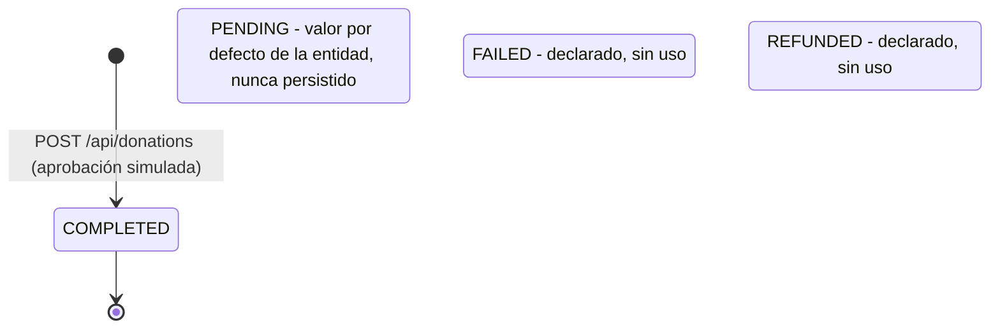
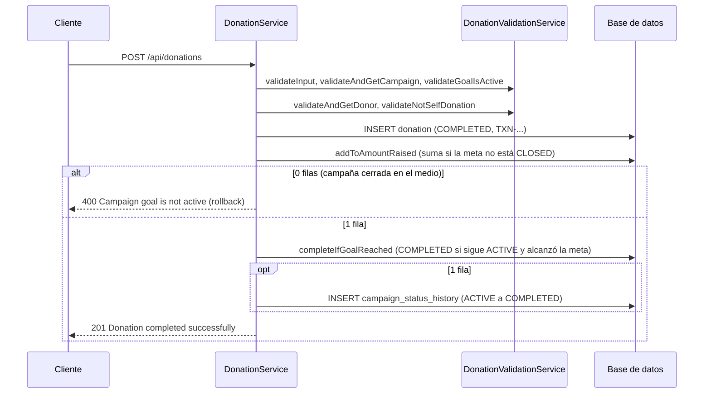

# Donation

## Para qué existe

Una donación es un aporte de dinero de un usuario autenticado a la campaña de otro usuario. Cada donación suma su monto al recaudado de la meta (`Goal`) de la campaña y, si con eso se alcanza la meta, pasa la campaña de `ACTIVE` a `COMPLETED`.

No hay pasarela de pago: el sistema **simula la aprobación**. Toda donación que pasa las validaciones se guarda directamente en `COMPLETED` con un identificador de transacción generado en el momento. El propio service lo marca como el punto donde, en producción, se integraría una pasarela.

Además de crear donaciones, el dominio ofrece tres lecturas: el historial del usuario que llama, el listado de donaciones de una campaña y las estadísticas de recaudación de una campaña. Las dos últimas son públicas.

## Entidades y datos

### Entidad `Donation` (`entity/donation/Donation.java`, tabla `donation`)

| Campo | Tipo | Columna | Notas |
|---|---|---|---|
| `id` | `Long` | `id` | Identidad generada por la base. |
| `donor` | `User` | `donor_user_id` | `@ManyToOne` con `@NotFound(IGNORE)`, `updatable = false`. |
| `campaign` | `Campaign` | `campaign_id` | `@ManyToOne` con `@NotFound(IGNORE)`, `updatable = false`. |
| `campaignId` | `Long` | `campaign_id` | Copia de solo lectura de la FK (`insertable = false, updatable = false`). |
| `donorUserId` | `Long` | `donor_user_id` | Copia de solo lectura de la FK. |
| `amount` | `BigDecimal` | `amount` | `precision = 15, scale = 2`, no nulo. |
| `status` | `DonationStatus` | `status` | Guardado como texto (`EnumType.STRING`), por defecto `PENDING`. |
| `transactionId` | `String` | `transaction_id` | Único, hasta 100 caracteres. Formato `TXN-XXXXXXXX`. |
| `createdAt` / `updatedAt` | `LocalDateTime` | `created_at` / `updated_at` | Marcas de tiempo de Hibernate más `@PrePersist`/`@PreUpdate`. |

**Por qué cada FK está mapeada dos veces.** Las campañas y los usuarios tienen borrado lógico (`@SQLRestriction("deleted_at IS NULL")`). Si la relación fuera obligatoria, Hibernate haría un inner join contra la tabla filtrada y la donación desaparecería al borrar su campaña o su donante. Por eso:

- `donor` y `campaign` son opcionales en el mapeo (la columna sigue siendo `NOT NULL` en la base) y llevan `@NotFound(action = NotFoundAction.IGNORE)`: si el destino está borrado, la relación queda en `null` en lugar de perder la fila.
- Son `updatable = false`, así un `UPDATE` de la donación nunca escribe ese `null` sobre la FK.
- `campaignId` y `donorUserId` son copias de solo lectura de las mismas columnas: conservan el valor aunque la relación sea `null` y permiten filtrar por FK sin hacer join contra la tabla con borrado lógico (las consultas de estadísticas y el historial filtran por estas columnas).

El detalle general del borrado lógico está en [Modelo de datos](../04-modelo-de-datos.md).

### Enum `DonationStatus` (`entity/donation/DonationStatus.java`)

`PENDING`, `COMPLETED`, `FAILED`, `REFUNDED`. Hoy el código solo asigna `COMPLETED` (ver [Estados](#estados)).

### Datos de otros dominios que se usan

- `Campaign` y `Goal` (`entity/campaign/`): la donación apunta a la campaña, y el monto se suma en `Goal.amountRaised`. `Goal.amountRaised` es `updatable = false` en el mapeo: solo lo modifica `GoalRepository.addToAmountRaised` con un `UPDATE` atómico, para que guardar una campaña con datos viejos nunca pise donaciones sumadas en el medio. Ver [Campaign](campaign.md).
- `CampaignStatus` (`entity/campaign/CampaignStatus.java`): el estado de la meta (`ACTIVE`, `COMPLETED`, `CLOSED`) decide si se puede donar.
- `CampaignStatusHistory`: la donación que completa la meta registra la transición `ACTIVE → COMPLETED` con `changedBy = null` (la hizo el sistema, no un usuario).
- `User` (`entity/user/User.java`): el donante. Su nombre visible sale de `userInfo.userName`.

### DTOs

- `dtos/donation/CreateDonationDTO.java`: entrada de `POST /api/donations`.
- `dtos/donation/DonationResponseDTO.java`: una donación en las respuestas.
- `dtos/donation/CampaignStatisticsDTO.java`: estadísticas de una campaña. Vive en `dtos/donation/` aunque describe una campaña, porque lo calcula este dominio a partir de las donaciones.

## Reglas de negocio

Todas las aplica `validation/donation/DonationValidationService.java`, salvo donde se indica otra clase. El orden es el de `DonationService.createDonation`.

1. **El donante sale del token.** `AuthenticatedUserService.getAuthenticatedUserId()`; el body no lleva id de usuario. Así nadie puede donar en nombre de otro.
2. **Entrada válida.** `campaignId` y `amount` obligatorios, `amount > 0`, con hasta 13 enteros y 2 decimales. Lo valida Bean Validation en `CreateDonationDTO` (`@NotNull`, `@Positive`, `@Digits`) y lo repite `validateInput` con los mismos mensajes. El límite de dígitos coincide con la columna (`precision = 15, scale = 2`), así que un monto aceptado siempre entra en la base sin redondeo.
3. **La campaña tiene que ser visible para el donante.** `validateAndGetCampaign` delega en `CampaignValidationService.findVisibleCampaignByIdOrThrow`: una campaña inexistente, borrada, `CLOSED` de otro usuario, de un dueño borrado o de un dueño baneado o suspendido responde lo mismo, `404 Campaign not found with id: {id}`. Así, donar no sirve para descubrir campañas que el usuario no puede ver. Un ADMIN ve toda campaña de un dueño no borrado (también las `CLOSED` y las de dueños sancionados). Como la regla es la misma que para leer, un ADMIN puede donar a la campaña de un dueño baneado o suspendido; a una `CLOSED` no, porque la corta la regla siguiente. El criterio completo de visibilidad está en [Campaign](campaign.md).
4. **La meta tiene que existir y no estar `CLOSED`** (`validateGoalIsActive`). Una campaña `COMPLETED` **sí** acepta donaciones: la meta alcanzada no corta la recaudación, y el recaudado puede superar la meta. Solo el cierre la corta. El caso "sin meta" (`Campaign does not have a goal`) no aparece con datos creados por la API: `CampaignMapper` crea cada campaña con su `Goal` en `0` recaudado.
5. **El donante existe** (`validateAndGetDonor`, `UserRepository.findById`). En la práctica siempre se cumple, porque el filtro JWT ya cargó al usuario.
6. **No se puede donar a la campaña propia** (`validateNotSelfDonation`), comparando el id del token con el dueño de la campaña. Evita que un usuario infle su propia recaudación.
7. **Aprobación simulada.** Se construye la `Donation` con `status = COMPLETED` y un `transactionId` `"TXN-"` + los primeros 8 caracteres de un UUID aleatorio en mayúsculas, y se guarda.
8. **Suma atómica del recaudado** (`GoalRepository.addToAmountRaised`): un `UPDATE goal SET amount_raised = amount_raised + :amount ... WHERE id = :goalId AND status <> CLOSED`. La suma la hace la base, así dos donaciones simultáneas no se pisan (no hay lectura-modificación-escritura en Java). Si devuelve `0` filas, la campaña se cerró entre la validación y la suma: se lanza `400 Campaign goal is not active` y, como el método es `@Transactional`, se revierte también el `INSERT` de la donación.
9. **Paso automático a `COMPLETED`** (`GoalRepository.completeIfGoalReached`): un segundo `UPDATE` que solo cambia la meta si sigue `ACTIVE` y `amount_raised >= amount_goal`. Devuelve `1` únicamente para la donación que produjo el cambio, así la transición se registra una sola vez en el historial aunque varias donaciones crucen la meta a la vez.

**Concurrencia.** No hay locks explícitos en este dominio: la protección son los dos `UPDATE` condicionales. El primero bloquea la fila de la meta hasta el commit, que llega enseguida porque son las últimas escrituras de la transacción. Del otro lado, las operaciones de campaña que deciden un estado (cerrar, reabrir, editar el monto de la meta, borrar, cerrar todas al borrar la cuenta) releen la meta con `PESSIMISTIC_WRITE` (`CampaignService.lockGoal`), así que nunca se intercalan con una suma a medio hacer. Borrar una campaña primero la pasa a `CLOSED`, por lo que una donación en curso contra una campaña que se está borrando también cae en el caso de 0 filas y se revierte. La meta cargada en memoria queda desactualizada después de los `UPDATE` y el service no la vuelve a usar.

**Montos.** Todo es `BigDecimal`. Las estadísticas redondean a 2 decimales con `RoundingMode.HALF_UP`.

**Identificador de transacción.** Los 8 caracteres son hexadecimales (32 bits de un UUID). La columna es única, así que si sale un valor repetido el `INSERT` falla y la donación responde `409` sin reintentar.

**Validación duplicada y código inalcanzable.** `validateInput` repite lo que ya cortó Bean Validation antes de entrar al controller. `validateAndGetCampaign` también controla `campaign.getDeletedAt() != null` (`400 Cannot donate to a deleted campaign`), pero una campaña borrada nunca llega ahí: `@SQLRestriction` la excluye de la consulta y la respuesta es el `404`. El mismo método lo usan los dos endpoints de lectura, no solo el de donar.

## Estados

`DonationStatus` declara cuatro valores, pero con la aprobación simulada solo uno se alcanza:



- `PENDING` es el valor por defecto del builder y de `@PrePersist`, pero `createDonation` siempre asigna `COMPLETED` antes de guardar.
- `FAILED` y `REFUNDED` no se asignan en ningún lugar. No hay endpoint para cambiar el estado de una donación ni para reembolsarla: una donación es inmutable una vez creada.
- Las estadísticas cuentan solo donaciones `COMPLETED`; los listados devuelven todas sin filtrar por estado (hoy es lo mismo).

La donación además dispara una transición de **otra** máquina de estados: la meta de la campaña pasa de `ACTIVE` a `COMPLETED` cuando el recaudado alcanza la meta. Ese diagrama está en [Campaign](campaign.md).



## Visibilidad y permisos

- **Crear:** cualquier usuario autenticado (USER o ADMIN), no sancionado, sobre una campaña que pueda ver y que no sea suya.
- **Historial propio** (`/my-donations`): solo las donaciones del que llama. Incluye donaciones a campañas que después se cerraron, se borraron o cuyo dueño fue sancionado o borrado: la consulta filtra solo por el donante y no aplica la visibilidad de la campaña. En consecuencia, el historial puede mostrar el id y el nombre de una campaña que, pedida por `/api/campaigns/{campaignId}`, responde `404`; solo la borrada se distingue, con `campaignDeleted = true`. Una campaña borrada aparece con `campaignDeleted = true`, su id y su nombre, que se recupera con una consulta nativa (`CampaignRepository.findNamesByIdsIncludingDeleted`) que saltea el borrado lógico.
- **Donaciones y estadísticas de una campaña:** públicas (también sin token), pero con el mismo criterio de visibilidad de la campaña que al donar. Una campaña que el que llama no puede ver responde `404 Campaign not found with id: {id}`, sea porque no existe, está borrada, es `CLOSED` ajena o su dueño está sancionado.
- **Quién es el donante es público.** El listado de una campaña muestra `donorUserId` y `donorUserName` a cualquiera. Un donante con la cuenta borrada aparece anónimo (`donorUserId` y `donorUserName` en `null`), porque la relación queda en `null`. El listado no filtra donantes baneados o suspendidos: aparecen con su id y su nombre, para cualquiera (a diferencia de los perfiles y los listados de seguidores, que los ocultan a quien no es ADMIN). Las estadísticas también los cuentan.
- **El `transactionId` no es público.** Es la referencia de pago. En `GET /api/donations/campaign/{campaignId}`:
  - el dueño de la campaña y los ADMIN ven todos;
  - un donante ve solo los de sus propias donaciones;
  - cualquier otro, incluido el anónimo, no ve ninguno (`transactionId = null`).
- **ADMIN.** Se decide con `CampaignAuthorizationService.isAdmin` (consulta `existsByIdAndRole_Name(id, "ADMIN")` contra la base, no el rol del token), tanto para la visibilidad de la campaña como para ver todos los `transactionId`. Un ADMIN puede donar como cualquier usuario, también a campañas de dueños sancionados (ver [Reglas de negocio](#reglas-de-negocio)).
- **404 vs 403.** Este dominio nunca responde `403` por su cuenta: toda campaña que no se puede ver da `404`, con el mismo mensaje que una inexistente. El único `403` posible es el del filtro JWT para cuentas baneadas o suspendidas (ver [Seguridad](../03-seguridad.md)), que corta también las rutas públicas si el usuario sancionado manda su token.

## Endpoints

Las respuestas de error tienen la forma `{error, message, timestamp}` descripta en [Errores y validación](../05-errores-y-validacion.md); las de Spring Security (`401`/`403` del filtro) agregan `path`.

### `POST /api/donations`

- **Acceso:** usuario autenticado, USER o ADMIN (`anyRequest().authenticated()` en `SecurityConfig`; no hay `@PreAuthorize`). Sin token, o con un token inválido, expirado, revocado, de refresh, emitido antes del último cambio de credenciales o de una cuenta borrada → `401`. Cuenta baneada o suspendida → `403` desde el filtro.
- **Parámetros:** ninguno.
- **Body:** `CreateDonationDTO`, JSON.

  | Campo | Tipo | Obligatorio | Validación |
  |---|---|---|---|
  | `campaignId` | `Long` | sí | `@NotNull` |
  | `amount` | `BigDecimal` | sí | `@NotNull`, `@Positive`, `@Digits(integer = 13, fraction = 2)` |

- **Respuesta:** `201 Created`.

  ```json
  {
    "message": "Donation completed successfully",
    "donation": { "...": "DonationResponseDTO" },
    "status": "COMPLETED"
  }
  ```

  `DonationResponseDTO`:

  | Campo | Tipo | Descripción |
  |---|---|---|
  | `id` | `Long` | Id de la donación. |
  | `donorUserId` | `Long` | Id del donante; `null` si su cuenta está borrada. |
  | `donorUserName` | `String` | Nombre de usuario del donante; `null` si su cuenta está borrada. |
  | `campaignId` | `Long` | Id de la campaña (se conserva aunque esté borrada). |
  | `campaignName` | `String` | Nombre de la campaña. |
  | `campaignDeleted` | `Boolean` | `true` si la campaña está borrada. |
  | `amount` | `BigDecimal` | Monto donado. |
  | `status` | `DonationStatus` | Siempre `COMPLETED` hoy. |
  | `transactionId` | `String` | `TXN-` + 8 caracteres hexadecimales en mayúsculas. |
  | `createdAt` / `updatedAt` | `LocalDateTime` | Marcas de tiempo. |

  El `status` del primer nivel de la respuesta es un literal del controller, no se lee de la donación.

- **Errores:**

  | Status | Mensaje | Cuándo |
  |---|---|---|
  | 401 | `Full authentication is required to access this resource` | Sin token o con un token que el filtro rechaza (ver Acceso). |
  | 403 | `Your account has been banned. Reason: {motivo}` | El que llama está baneado (filtro JWT). |
  | 403 | `Your account is suspended until {fecha}. Reason: {motivo}` | El que llama tiene una suspensión vigente (filtro JWT). |
  | 400 | `One or more fields are invalid`, con `fields.campaignId = "Campaign ID is required"` | Falta `campaignId`. |
  | 400 | `One or more fields are invalid`, con `fields.amount = "Amount is required"` | Falta `amount`. |
  | 400 | `One or more fields are invalid`, con `fields.amount = "Amount must be greater than zero"` | `amount` es 0 o negativo. |
  | 400 | `One or more fields are invalid`, con `fields.amount = "numeric value out of bounds (<13 digits>.<2 digits> expected)"` (mensaje por defecto de Hibernate Validator, el DTO no define uno propio) | Más de 13 enteros o más de 2 decimales. |
  | 400 | `Request body is required` | Body ausente. |
  | 400 | `Invalid value '{valor}' for field '{campo}'` | Un campo con un valor que no se puede convertir (por ejemplo `"amount": "abc"`). |
  | 400 | `Malformed request body` | JSON mal formado. |
  | 415 | `Content type '{tipo}' is not supported. Use application/json` | `Content-Type` distinto de JSON. |
  | 404 | `Campaign not found with id: {id}` | La campaña no existe, está borrada, es `CLOSED` de otro usuario, o su dueño está borrado, baneado o suspendido. Para un ADMIN, solo si no existe, está borrada o su dueño está borrado. |
  | 400 | `Campaign does not have a goal` | La campaña no tiene meta. Solo con datos cargados por fuera de la API: toda campaña nace con meta. |
  | 400 | `Campaign goal is not active` | La meta está `CLOSED` (campaña propia cerrada, o cualquier campaña cerrada si llama un ADMIN), o se cerró entre la validación y la suma; en ese caso la donación se revierte. |
  | 404 | `Donor user not found with id: {id}` | El usuario del token no existe. No ocurre en la práctica: el filtro ya lo cargó. |
  | 400 | `Cannot donate to your own campaign` | El que llama es el dueño de la campaña. |
  | 409 | `The request conflicts with existing data` | Violación de una restricción de la base al guardar, por ejemplo un `transactionId` repetido. |

  Los errores de Bean Validation se juntan en `fields`, uno por campo: si `amount` rompe varias reglas a la vez (por ejemplo `-0.001`), se ve solo uno de los mensajes. Las reglas de negocio corren en el orden de la tabla y responde la primera que falla: el dueño que dona a su propia campaña `CLOSED` recibe `Campaign goal is not active`, no `Cannot donate to your own campaign`.

- **Qué hace:**
  1. Obtiene el id del donante del token (`AuthenticatedUserService.getAuthenticatedUserId`).
  2. `validateInput(dto)`.
  3. `validateAndGetCampaign(campaignId, donorId)`: carga la campaña visible para el donante o `404`.
  4. `validateGoalIsActive(campaign.getGoal())`.
  5. `validateAndGetDonor(donorId)`.
  6. `validateNotSelfDonation(donorId, ownerId)`.
  7. Construye la donación en `COMPLETED` con un `transactionId` nuevo y la guarda.
  8. `GoalRepository.addToAmountRaised`; si actualiza 0 filas, lanza `400 Campaign goal is not active` y la transacción se revierte.
  9. `GoalRepository.completeIfGoalReached`; si actualiza 1 fila, `CampaignStatusHistoryService.recordTransition(campaign, ACTIVE, COMPLETED, null)`.
  10. Mapea con `DonationMapper.toDTO` y el controller arma la respuesta.

### `GET /api/donations/my-donations`

- **Acceso:** usuario autenticado, USER o ADMIN (`anyRequest().authenticated()`). Sin token o con token rechazado → `401`; cuenta sancionada → `403` del filtro.
- **Parámetros:** ninguno.
- **Body:** sin body.
- **Respuesta:** `200 OK`.

  ```json
  {
    "message": "Donations retrieved successfully",
    "donations": [ { "...": "DonationResponseDTO" } ],
    "total": 3
  }
  ```

  Ordenadas por `createdAt` descendente, sin paginar. `total` es el tamaño de la lista. Cada donación incluye su `transactionId`. Las donaciones a campañas borradas traen `campaignDeleted = true` y el nombre que tenía la campaña.

- **Errores:**

  | Status | Mensaje | Cuándo |
  |---|---|---|
  | 401 | `Full authentication is required to access this resource` | Sin token o con un token que el filtro rechaza. |
  | 403 | `Your account has been banned. Reason: {motivo}` | El que llama está baneado. |
  | 403 | `Your account is suspended until {fecha}. Reason: {motivo}` | El que llama tiene una suspensión vigente. |

- **Qué hace:**
  1. Obtiene el id del que llama del token.
  2. `DonationRepository.findByDonorIdOrderByCreatedAtDesc`: una sola consulta que filtra por la columna `donor_user_id` y trae con `LEFT JOIN FETCH` el donante y la campaña con su meta y su dueño (son relaciones `EAGER`; sin el fetch, Hibernate haría una consulta extra por cada una). Al ser `LEFT`, una campaña borrada queda en `null` en lugar de sacar la fila.
  3. Junta los ids de las campañas borradas y busca sus nombres en una sola consulta nativa (`CampaignRepository.findNamesByIdsIncludingDeleted`).
  4. Mapea con `DonationMapper.toDTOList(donations, deletedCampaignNames)`.

### `GET /api/donations/campaign/{campaignId}`

- **Acceso:** público (`PUBLIC_GET_URLS` en `SecurityConfig`, solo `GET`). El service resuelve al que llama como opcional (`AuthenticatedUserService.findAuthenticatedUserId`): un token inválido no da `401`, se trata como anónimo. Un usuario sancionado que manda su token recibe el `403` del filtro.
- **Parámetros:**

  | Nombre | Ubicación | Tipo | Obligatorio |
  |---|---|---|---|
  | `campaignId` | path | `Long` | sí |

- **Body:** sin body.
- **Respuesta:** `200 OK`.

  ```json
  {
    "message": "Campaign donations retrieved successfully",
    "donations": [ { "...": "DonationResponseDTO" } ],
    "total": 5
  }
  ```

  Ordenadas por `createdAt` descendente, sin paginar. `transactionId` va en `null` según las reglas de [Visibilidad y permisos](#visibilidad-y-permisos). Un donante borrado aparece con `donorUserId` y `donorUserName` en `null`.

- **Errores:**

  | Status | Mensaje | Cuándo |
  |---|---|---|
  | 400 | `Invalid value '{valor}' for parameter 'campaignId'` | `campaignId` no es un número. |
  | 403 | `Your account has been banned. Reason: {motivo}` / `Your account is suspended until {fecha}. Reason: {motivo}` | El que llama manda el token de una cuenta sancionada. |
  | 404 | `Campaign not found with id: {id}` | La campaña no existe, está borrada, es `CLOSED` de otro usuario, o su dueño está borrado o sancionado (para ADMIN, solo si no existe, está borrada o su dueño está borrado). |

- **Qué hace:**
  1. Obtiene el id del que llama si hay token válido, o `null`.
  2. `validateAndGetCampaign(campaignId, callerId)`: la campaña visible para el que llama o `404`.
  3. `DonationRepository.findByCampaignOrderByCreatedAtDesc(campaign)`: una consulta con los donantes (y su `userInfo` y `verificationRequest`) traídos con `LEFT JOIN FETCH`.
  4. Mapea con `DonationMapper.toDTOList`.
  5. Si el que llama no es el dueño ni ADMIN, pone `transactionId = null` en todas las donaciones que no son suyas.

### `GET /api/donations/campaign/{campaignId}/statistics`

- **Acceso:** público (`PUBLIC_GET_URLS`, solo `GET`), con el que llama resuelto como opcional, igual que el endpoint anterior.
- **Parámetros:**

  | Nombre | Ubicación | Tipo | Obligatorio |
  |---|---|---|---|
  | `campaignId` | path | `Long` | sí |

- **Body:** sin body.
- **Respuesta:** `200 OK`.

  ```json
  {
    "message": "Statistics retrieved successfully",
    "statistics": { "...": "CampaignStatisticsDTO" }
  }
  ```

  `CampaignStatisticsDTO`:

  | Campo | Tipo | Cómo se calcula |
  |---|---|---|
  | `campaignId` | `Long` | El de la ruta. |
  | `campaignName` | `String` | Nombre de la campaña. |
  | `amountGoal` | `BigDecimal` | `goal.amountGoal`; `0` si no hay meta. |
  | `amountRaised` | `BigDecimal` | `goal.amountRaised`, el mismo total que devuelve la campaña; `0` si no hay meta. |
  | `percentageReached` | `BigDecimal` | `amountRaised * 100 / amountGoal`, 2 decimales, `HALF_UP`. `0` si la meta es `<= 0` (evita dividir por cero). Puede superar 100, y por el redondeo puede marcar `100.00` con la meta todavía sin alcanzar (por ejemplo, `99999.99` de `100000.00`). |
  | `isGoalReached` | `Boolean` | `amountRaised >= amountGoal`. Se calcula con los montos, no con el estado: una campaña `CLOSED` que había alcanzado la meta da `true`. Sin meta da `true` (`0 >= 0`). |
  | `status` | `CampaignStatus` | Estado de la meta; `null` si no hay meta. |
  | `totalDonors` | `Long` | Donantes distintos (`COUNT(DISTINCT donorUserId)`) entre las donaciones `COMPLETED`. |
  | `averageDonation` | `BigDecimal` | `amountRaised / totalDonations`, 2 decimales, `HALF_UP`; `0` si no hay donaciones. |
  | `totalDonations` | `Long` | Cantidad de donaciones `COMPLETED`. |

  Los conteos filtran por la columna `campaign_id`, así que incluyen las donaciones de donantes borrados, baneados o suspendidos.

- **Errores:**

  | Status | Mensaje | Cuándo |
  |---|---|---|
  | 400 | `Invalid value '{valor}' for parameter 'campaignId'` | `campaignId` no es un número. |
  | 403 | `Your account has been banned. Reason: {motivo}` / `Your account is suspended until {fecha}. Reason: {motivo}` | El que llama manda el token de una cuenta sancionada. |
  | 404 | `Campaign not found with id: {id}` | Mismos casos que en `GET /api/donations/campaign/{campaignId}`. |

- **Qué hace:**
  1. Obtiene el id del que llama si hay token válido, o `null`.
  2. `validateAndGetCampaign(campaignId, callerId)`.
  3. `countCompletedDonationsByCampaignId` y `countUniqueDonorsByCampaignId` (un `null` se toma como `0`).
  4. Lee meta y recaudado de la meta de la campaña y calcula porcentaje y promedio.
  5. Arma el `CampaignStatisticsDTO` con el builder (no hay mapper: el DTO es un cálculo, no una entidad).

## Clases involucradas

| Capa | Clase |
|---|---|
| Controller | `controller/donation/DonationController.java` |
| Service | `service/donation/DonationService.java` |
| Validation | `validation/donation/DonationValidationService.java` |
| Validation (de campaign) | `validation/campaign/CampaignValidationService.java` (visibilidad), `validation/campaign/CampaignAuthorizationService.java` (`isAdmin`) |
| Service (de campaign) | `service/campaign/CampaignStatusHistoryService.java` |
| Mapper | `mapper/donation/DonationMapper.java` (y `mapper/campaign/CampaignMapper.java`, que crea la meta de cada campaña) |
| Repository | `repository/donation/DonationRepository.java`, `repository/campaign/GoalRepository.java`, `repository/campaign/CampaignRepository.java`, `repository/user/UserRepository.java` |
| Entity | `entity/donation/Donation.java`, `entity/donation/DonationStatus.java`, `entity/campaign/Goal.java`, `entity/campaign/Campaign.java` |
| DTOs | `dtos/donation/CreateDonationDTO.java`, `dtos/donation/DonationResponseDTO.java`, `dtos/donation/CampaignStatisticsDTO.java` |
| Seguridad | `security/AuthenticatedUserService.java`, `security/SecurityConfig.java`, `security/JwtAuthenticationFilter.java`, `validation/auth/AccountStatusValidationService.java` (mensajes del `403`) |
| Errores | `exception/GlobalExceptionHandler.java`, `exception/MessageException.java`, `exception/ResourceNotFoundException.java` |

`DonationRepository` declara además consultas que hoy no usa ninguna clase: `findByDonor`, `findByDonorOrderByCreatedAtDesc`, `findByCampaign`, `findByStatus` y `findByCampaignIdOrderByCreatedAtDesc`.
