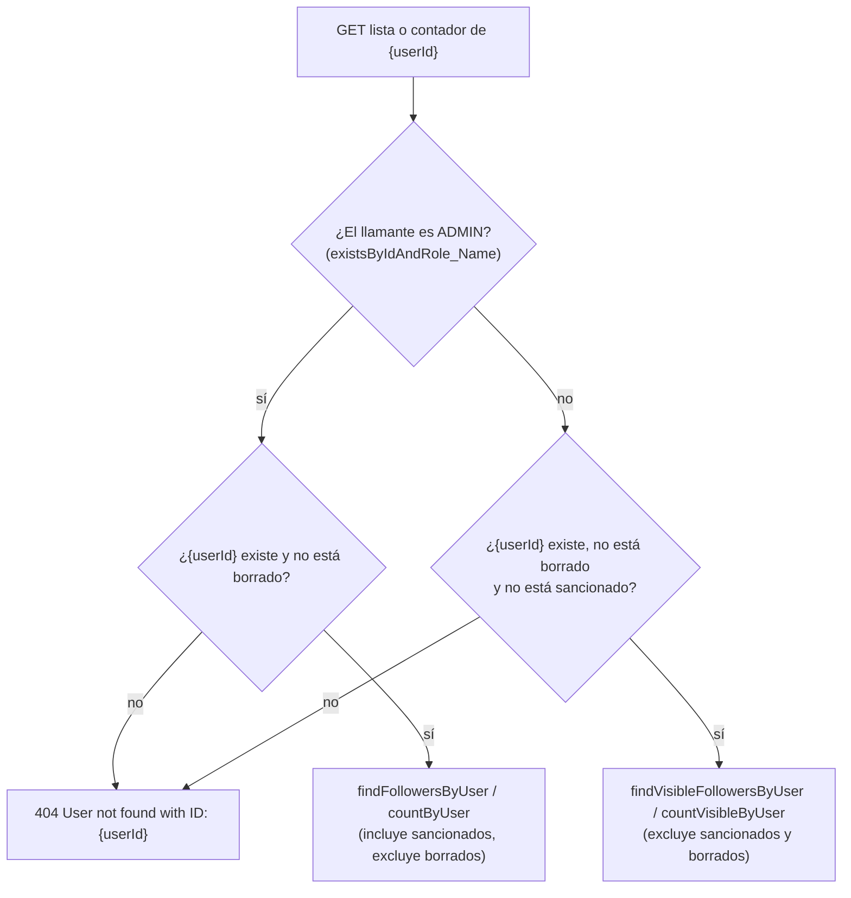

# Follower (seguidores)

## Para qué existe

Permite que un usuario siga a otro, deje de seguirlo y que cualquier usuario autenticado consulte a quién sigue y quién sigue a un usuario dado, con listas, contadores y una consulta puntual "¿A sigue a B?".

Es un dominio chico y autocontenido: ningún otro dominio lee la tabla `followers`. Lo interesante está en cómo interactúa con dos reglas transversales: el **soft delete** de usuarios y el **ocultamiento de usuarios sancionados** (baneados o con suspensión vigente), que acá se aplica distinto según quién llama sea o no `ADMIN`.

Todas las rutas cuelgan de `/api/users/{userId}`, porque el recurso es siempre "los seguidores de un usuario".

## Entidades y datos

### Entidad `Follower` (`entity/follower/Follower.java`)

Tabla `followers`. Cada fila es una relación dirigida "`follower` sigue a `user`".

| Campo | Columna | Tipo | Notas |
|---|---|---|---|
| `id` | `id` | `Long` | Identidad autogenerada. |
| `user` | `user_id` | `User` (`@ManyToOne`, EAGER por defecto) | El usuario **seguido**. `NOT NULL`. |
| `follower` | `follower_id` | `User` (`@ManyToOne`, EAGER por defecto) | El usuario **que sigue**. `NOT NULL`. |
| `createdAt` | `created_at` | `LocalDateTime` | Momento en que empezó a seguir. `NOT NULL`, no actualizable. Lo completa `FollowerService.followUser` a mano. |
| `updatedAt` | `updated_at` | `LocalDateTime` | Queda siempre en `null` (ver nota abajo). |

- **Restricción única** sobre `(user_id, follower_id)`: la base impide que la misma relación exista dos veces, aunque la validación del service falle por una carrera. La entidad no declara otros índices ni un `CHECK` contra seguirse a sí mismo: el esquema lo genera Hibernate (`spring.jpa.hibernate.ddl-auto=update`), y esa regla solo la aplica el service.
- **Sin soft delete propio:** dejar de seguir es un `DELETE` real de la fila. `Follower` no tiene `deletedAt`.
- **Relación con usuarios borrados:** `User` sí tiene soft delete (`@SQLRestriction("deleted_at IS NULL")`), pero borrar un usuario no toca sus filas de `followers`. Quedan en la base y se excluyen al leer (ver "Visibilidad y permisos"). Si la cuenta se restaura al volver a iniciar sesión (`service/auth/AuthenticationService.java`), sus relaciones reaparecen tal cual estaban.
- **`@CreatedDate` y `@LastModifiedDate`** están anotados en la entidad, pero el proyecto no habilita la auditoría de Spring Data JPA (no hay `@EnableJpaAuditing` ni `@EntityListeners`). Por eso `createdAt` lo asigna el service y `updatedAt` nunca se escribe. En la práctica no importa: una relación nunca se modifica, solo se crea o se borra.

`User` no tiene una colección inversa hacia `Follower`: la relación solo se navega desde `FollowerRepository`. El diagrama ER completo está en [Modelo de datos](../04-modelo-de-datos.md).

### DTOs (`dtos/follower/`)

| DTO | Campos | Uso |
|---|---|---|
| `FollowerUserDTO` | `id`, `firstName`, `lastName`, `userName`, `profilePicture`, `followedAt` | Datos básicos de un usuario dentro de una relación. `followedAt` es el `createdAt` de la relación. |
| `FollowResponseDTO` | `message`, `success`, `followedUser` (`FollowerUserDTO`) | Respuesta de seguir. |
| `UnfollowResponseDTO` | `message`, `success`, `unfollowedUserId` | Respuesta de dejar de seguir. |
| `FollowersListResponseDTO` | `userId`, `totalFollowers`, `followers` (lista de `FollowerUserDTO`) | Respuesta de **las dos** listas: seguidores y seguidos. En la lista de seguidos, `followers` contiene a los seguidos y `totalFollowers` es la cantidad de seguidos. |

Ningún endpoint del dominio recibe body, así que no hay `Create*DTO` ni `Update*DTO`. `success` vale siempre `true`: los fallos no llegan a construir estos DTOs, salen por `GlobalExceptionHandler`.

## Reglas de negocio

Todas las reglas viven en `validation/follower/FollowerValidationService.java`; `service/follower/FollowerService.java` solo las encadena.

1. **Quien sigue sale del token.** `followUser` y `unfollowUser` toman al usuario actual con `AuthenticatedUserService.getAuthenticatedUserId()`; la ruta solo indica a quién se sigue. Así nadie puede crear o borrar relaciones en nombre de otro.
2. **Nadie se sigue a sí mismo** (`validateNotSelfFollow`): si el id del token coincide con `{userId}`, `400` con `Users cannot follow themselves`. Es la primera validación, así que responde `400` aunque el id no exista.
3. **Nadie se deja de seguir a sí mismo** (`validateNotSelfUnfollow`): mismo chequeo, mensaje `Users cannot unfollow themselves`.
4. **No se sigue dos veces** (`validateNotAlreadyFollowing`): si la relación ya existe, `409` con `User is already being followed`. Si dos requests simultáneos pasan esta validación a la vez, la restricción única de la tabla hace fallar el segundo `INSERT` y `GlobalExceptionHandler` lo convierte en `409` con `The request conflicts with existing data`.
5. **Solo se deja de seguir a quien se sigue** (`validateAndGetFollowRelation`): si no hay relación, `404` con `Follow relationship not found`.
6. **No se puede seguir ni dejar de seguir a un usuario borrado o sancionado** (`validateAndGetUserToFollow`, `validateAndGetUserToUnfollow`): responden `404` como si no existiera. Esta regla no tiene excepción para `ADMIN`. Consecuencia observable: si A sigue a B y B es sancionado, A no puede dejar de seguirlo mientras dure la sanción; la relación queda oculta (no aparece en listas ni contadores para un no-admin) y vuelve a aparecer cuando la suspensión vence o el ban se levanta.
7. **El usuario actual debe existir** (`validateAndGetCurrentUser`): `404` con `Current user not found with ID: {id}`. En la práctica no se alcanza, porque el filtro JWT ya rechaza con `401` a un usuario borrado o inexistente; queda como defensa.
8. **Ocultamiento de sancionados en lecturas, salvo para `ADMIN`** (`validateAndGetVisibleUser`, `isFollowing` y las queries `*Visible*` de `repository/follower/FollowerRepository.java`): ver la sección siguiente.
9. **"¿Es admin?" se lee de la base, no del token** (`RoleValidationService.isAdmin`, con `UserRepository.existsByIdAndRole_Name(id, "ADMIN")`): una sola consulta, que además devuelve `false` para un admin borrado. Si el rol cambia, la regla se aplica sin esperar a que expire el token.

## Estados

Este dominio no tiene estados: una relación existe o no existe.

## Visibilidad y permisos

### Quién puede llamar

Ninguna ruta del dominio está en `PUBLIC_URLS` ni en `PUBLIC_GET_URLS` de `security/SecurityConfig.java` (las únicas rutas públicas bajo `/api/users` son `/api/users/create` y `GET /api/users/*/supporters`, del dominio [Donation](donation.md#get-apiusersuseridsupporters)), y `FollowerController` no usa `@PreAuthorize`. Por eso los 7 endpoints caen en `anyRequest().authenticated()`: cualquier usuario autenticado, `USER` o `ADMIN`, puede llamarlos. Las listas y contadores de **cualquier** usuario son visibles para cualquier usuario autenticado; no hay perfiles privados. El detalle del filtro JWT está en [Seguridad](../03-seguridad.md).

### Usuarios borrados

Se excluyen siempre, también para `ADMIN`:

- Las búsquedas por id (`findById`, `findByIdForRequest`) no ven usuarios borrados por el `@SQLRestriction` de `User`, así que un usuario borrado responde `404`.
- Las listas hacen `JOIN FETCH` interno hacia el otro usuario; el `@SQLRestriction` de `User` se aplica en esa unión y las filas que apuntan a un usuario borrado quedan afuera.
- Los contadores lo dicen explícitamente con `u.deletedAt IS NULL`, para dar el mismo número que las listas.

### Usuarios sancionados (baneados o con suspensión vigente)

El criterio de "sancionado" es el mismo en Java y en SQL: `AccountStatusValidationService.isSanctioned` (`banned = true` o `suspendedUntil` posterior a ahora) y la constante `UserRepository.NOT_SANCTIONED`, que repite esa condición en JPQL con el `:now` de la JVM.

| Operación | Llamante no-admin | Llamante `ADMIN` |
|---|---|---|
| Seguir / dejar de seguir a un sancionado | `404` (`User to follow not found…` / `User to unfollow not found…`) | `404`, igual que un no-admin |
| Listar o contar seguidores/seguidos **de** un sancionado | `404` `User not found with ID: {id}` | Responde normalmente |
| Sancionados **dentro** de una lista o contador | Se omiten (queries `findVisible*` y `countVisible*`) | Aparecen y cuentan (queries sin `NOT_SANCTIONED`) |
| `is-following` con alguno de los dos ids sancionado | `404` (`Current user not found…` / `Other user not found…`) | Responde `true`/`false` |

El porqué está en los comentarios del código: el usuario sancionado "is not found, so the sanction is not revealed". El efecto es que, para un no-admin, un usuario sancionado no se distingue de uno inexistente: mismo status y mismo mensaje dentro de cada endpoint. Las lecturas exceptúan al `ADMIN`, que ve el grafo completo con los sancionados incluidos; las escrituras (seguir y dejar de seguir) no lo exceptúan.

El propio usuario sancionado no llega a ninguno de estos endpoints: el filtro JWT corta su request con `403` (ver [Seguridad](../03-seguridad.md)).

### Cuándo `404` y cuándo `403`

El dominio no responde `403` por reglas propias. El único `403` posible es el del filtro JWT para un llamante sancionado. Todo lo que no se puede ver o no existe responde `404`, siguiendo el criterio general descripto en [Errores y validación](../05-errores-y-validacion.md).

### Paginación y orden

Las listas no están paginadas: devuelven todas las relaciones del usuario en una sola respuesta. Tampoco tienen `ORDER BY`, así que el orden es el que devuelva la base.

### Cantidad de consultas

Las queries de listas traen en un solo `SELECT` la relación, el otro usuario, su `UserInfo` y su `VerificationRequest` (con `LEFT JOIN FETCH`, porque es un `@OneToOne` inverso y si no Hibernate haría un `SELECT` por fila). El usuario de la ruta se carga con `findByIdForRequest`, que trae `userInfo`, `role` y `verificationRequest` con un `@EntityGraph`. El otro extremo de cada relación (el `@ManyToOne` EAGER que no está en el `JOIN FETCH`) es siempre ese mismo usuario: como `spring.jpa.open-in-view` no está configurado en `src/main/resources/application.properties` y Spring Boot lo deja activo por defecto, el contexto de persistencia dura todo el request y Hibernate lo resuelve desde ahí, sin otra consulta. Así, armar una lista no genera consultas por cada fila.

Las operaciones de un solo par (seguir, dejar de seguir, `is-following`) cargan los usuarios con `findById`, sin `@EntityGraph`. `userInfo` y `verificationRequest` son `@OneToOne` inversos y Hibernate los trae con un `SELECT` aparte cada uno, así que esas operaciones hacen unas pocas consultas más, en cantidad fija.

## Endpoints

Base: `/api/users/{userId}` (`@RequestMapping` de `controller/follower/FollowerController.java`). Ningún endpoint recibe body ni parámetros de query.

### Errores comunes a todos los endpoints

Además de los propios de cada endpoint, cualquiera de los 7 puede responder:

| Status | `error` | Mensaje | Cuándo |
|---|---|---|---|
| `401` | `Unauthorized` | `Full authentication is required to access this resource` | Sin token, token inválido, vencido, revocado, de tipo refresh, emitido antes del último cambio de email o contraseña, o de un usuario borrado o inexistente. |
| `403` | `Forbidden` | `Your account has been banned. Reason: {motivo}` | El llamante está baneado (lo corta el filtro JWT). Si no hay motivo, `{motivo}` es `Violation of terms`. |
| `403` | `Forbidden` | `Your account is suspended until {fecha}. Reason: {motivo}` | El llamante tiene una suspensión vigente. |
| `400` | `Invalid parameter` | `Invalid value '{valor}' for parameter 'userId'` (o `'otherUserId'`) | Un id de la ruta no es un número. |
| `405` | `Method not allowed` | `Method {MÉTODO} is not supported for this endpoint` | Verbo no soportado en una ruta existente (por ejemplo `PUT .../follow`). |
| `500` | `Internal server error` | `An unexpected error occurred. Please try again later.` | Cualquier excepción no prevista. |

Los cuerpos de error tienen la forma `{error, message, timestamp}` (más `path` en los que genera la capa de seguridad); ver [Errores y validación](../05-errores-y-validacion.md).

### `POST /api/users/{userId}/follow`

- **Acceso:** cualquier usuario autenticado (`USER` o `ADMIN`). Sin token → `401`.
- **Parámetros:**

  | Nombre | En | Tipo | Obligatorio | Descripción |
  |---|---|---|---|---|
  | `userId` | path | `Long` | sí | Usuario a seguir. |

- **Body:** sin body.
- **Respuesta:** `200 OK` con `FollowResponseDTO`.

  | Campo | Tipo | Descripción |
  |---|---|---|
  | `message` | `String` | `Successfully started following {userName}` |
  | `success` | `boolean` | Siempre `true`. |
  | `followedUser` | `FollowerUserDTO` | Datos del usuario seguido: `id`, `firstName`, `lastName`, `userName`, `profilePicture`, `followedAt` (momento de la relación). |

- **Errores:**

  | Status | `error` | Mensaje | Cuándo |
  |---|---|---|---|
  | `400` | `Business logic error` | `Users cannot follow themselves` | `{userId}` es el id del token. Se chequea antes que la existencia. |
  | `404` | `Resource not found` | `Current user not found with ID: {id}` | El usuario del token no existe o está borrado (en la práctica el filtro ya respondió `401`). |
  | `404` | `Resource not found` | `User to follow not found with ID: {userId}` | El usuario a seguir no existe, está borrado o está sancionado. También para `ADMIN`. |
  | `409` | `Conflict` | `User is already being followed` | Ya lo sigue. |
  | `409` | `Conflict` | `The request conflicts with existing data` | Dos requests simultáneos crean la misma relación: la restricción única de `followers` rechaza el segundo. |

  Más los [errores comunes](#errores-comunes-a-todos-los-endpoints).
- **Qué hace:** en una transacción:
  1. Obtiene el id del llamante desde el token (`AuthenticatedUserService`).
  2. `validateNotSelfFollow(idToken, userId)`.
  3. `validateAndGetCurrentUser(idToken)`.
  4. `validateAndGetUserToFollow(userId)`: lo busca y lo descarta si está sancionado.
  5. `validateNotAlreadyFollowing(seguido, actual)`.
  6. Crea un `Follower` con `user` = seguido, `follower` = actual y `createdAt` = ahora, y lo guarda.
  7. Mapea con `FollowerMapper.toFollowResponseDto`, que usa los datos del seguido.

### `DELETE /api/users/{userId}/follow`

- **Acceso:** cualquier usuario autenticado (`USER` o `ADMIN`). Sin token → `401`.
- **Parámetros:**

  | Nombre | En | Tipo | Obligatorio | Descripción |
  |---|---|---|---|---|
  | `userId` | path | `Long` | sí | Usuario a dejar de seguir. |

- **Body:** sin body.
- **Respuesta:** `200 OK` con `UnfollowResponseDTO`.

  | Campo | Tipo | Descripción |
  |---|---|---|
  | `message` | `String` | `Successfully unfollowed {userName}` |
  | `success` | `boolean` | Siempre `true`. |
  | `unfollowedUserId` | `Long` | El `{userId}` de la ruta. |

- **Errores:**

  | Status | `error` | Mensaje | Cuándo |
  |---|---|---|---|
  | `400` | `Business logic error` | `Users cannot unfollow themselves` | `{userId}` es el id del token. |
  | `404` | `Resource not found` | `Current user not found with ID: {id}` | El usuario del token no existe o está borrado (en la práctica el filtro ya respondió `401`). |
  | `404` | `Resource not found` | `User to unfollow not found with ID: {userId}` | El usuario no existe, está borrado o está sancionado. También para `ADMIN`. |
  | `404` | `Resource not found` | `Follow relationship not found` | El llamante no sigue a ese usuario. |

  Más los [errores comunes](#errores-comunes-a-todos-los-endpoints).
- **Qué hace:** en una transacción:
  1. Obtiene el id del llamante desde el token.
  2. `validateNotSelfUnfollow(idToken, userId)`.
  3. `validateAndGetCurrentUser(idToken)`.
  4. `validateAndGetUserToUnfollow(userId)`: lo busca y lo descarta si está sancionado.
  5. `validateAndGetFollowRelation(seguido, actual)`.
  6. Borra la fila de `followers` (borrado físico).
  7. Mapea con `FollowerMapper.toUnfollowResponseDto`.

### `GET /api/users/{userId}/followers`

- **Acceso:** cualquier usuario autenticado (`USER` o `ADMIN`). Sin token → `401`. El resultado cambia si el llamante es `ADMIN`.
- **Parámetros:**

  | Nombre | En | Tipo | Obligatorio | Descripción |
  |---|---|---|---|---|
  | `userId` | path | `Long` | sí | Usuario cuyos seguidores se listan. |

- **Body:** sin body.
- **Respuesta:** `200 OK` con `FollowersListResponseDTO`. Sin paginación ni orden definido.

  | Campo | Tipo | Descripción |
  |---|---|---|
  | `userId` | `Long` | El `{userId}` de la ruta. |
  | `totalFollowers` | `int` | Cantidad de elementos de `followers`. |
  | `followers` | lista de `FollowerUserDTO` | Cada seguidor: `id`, `firstName`, `lastName`, `userName`, `profilePicture`, `followedAt`. Sin borrados; sin sancionados salvo para `ADMIN`. |

- **Errores:**

  | Status | `error` | Mensaje | Cuándo |
  |---|---|---|---|
  | `404` | `Resource not found` | `User not found with ID: {userId}` | El usuario no existe o está borrado; o está sancionado y el llamante no es `ADMIN`. |

  Más los [errores comunes](#errores-comunes-a-todos-los-endpoints).
- **Qué hace:**
  1. Decide si el llamante es `ADMIN` (`RoleValidationService.isAdmin` contra la base, con el id del token).
  2. `validateAndGetVisibleUser(userId, esAdmin)`: carga el usuario con `findByIdForRequest` y, si no es admin, lo descarta si está sancionado.
  3. Si es `ADMIN`, `findFollowersByUser`; si no, `findVisibleFollowersByUser` con la hora actual.
  4. Mapea con `FollowerMapper.toFollowersListResponseDto`, tomando los datos del lado `follower` de cada relación.

### `GET /api/users/{userId}/followers/following`

- **Acceso:** cualquier usuario autenticado (`USER` o `ADMIN`). Sin token → `401`. El resultado cambia si el llamante es `ADMIN`.
- **Parámetros:**

  | Nombre | En | Tipo | Obligatorio | Descripción |
  |---|---|---|---|---|
  | `userId` | path | `Long` | sí | Usuario cuyos seguidos se listan. |

- **Body:** sin body.
- **Respuesta:** `200 OK` con `FollowersListResponseDTO` (el mismo DTO que la lista de seguidores). Sin paginación ni orden definido.

  | Campo | Tipo | Descripción |
  |---|---|---|
  | `userId` | `Long` | El `{userId}` de la ruta. |
  | `totalFollowers` | `int` | Cantidad de **seguidos** (el nombre del campo es compartido con la otra lista). |
  | `followers` | lista de `FollowerUserDTO` | Cada usuario **seguido**: `id`, `firstName`, `lastName`, `userName`, `profilePicture`, `followedAt`. Sin borrados; sin sancionados salvo para `ADMIN`. |

- **Errores:**

  | Status | `error` | Mensaje | Cuándo |
  |---|---|---|---|
  | `404` | `Resource not found` | `User not found with ID: {userId}` | El usuario no existe o está borrado; o está sancionado y el llamante no es `ADMIN`. |

  Más los [errores comunes](#errores-comunes-a-todos-los-endpoints).
- **Qué hace:**
  1. Decide si el llamante es `ADMIN`.
  2. `validateAndGetVisibleUser(userId, esAdmin)`.
  3. Si es `ADMIN`, `findFollowingsByFollower`; si no, `findVisibleFollowingsByFollower` con la hora actual.
  4. Mapea con `FollowerMapper.toFollowingListResponseDto`, tomando los datos del lado `user` (el seguido) de cada relación.

### `GET /api/users/{userId}/followers/is-following/{otherUserId}`

- **Acceso:** cualquier usuario autenticado (`USER` o `ADMIN`). Sin token → `401`. El resultado cambia si el llamante es `ADMIN`.
- **Parámetros:**

  | Nombre | En | Tipo | Obligatorio | Descripción |
  |---|---|---|---|---|
  | `userId` | path | `Long` | sí | Usuario que sigue (o no). |
  | `otherUserId` | path | `Long` | sí | Usuario seguido (o no). |

  Los dos ids salen de la ruta, no del token: el endpoint responde si `userId` sigue a `otherUserId` para cualquier par, no solo si el llamante sigue a alguien. Para saber si "yo sigo a X", el cliente pasa su propio id como `userId`. Dentro del código, `userId` se llama `currentUserId` y los mensajes de error hablan de "Current user", aunque no sea el del token.
- **Body:** sin body.
- **Respuesta:** `200 OK` con un booleano JSON plano (`true` o `false`), sin envoltorio.
- **Errores:**

  | Status | `error` | Mensaje | Cuándo |
  |---|---|---|---|
  | `404` | `Resource not found` | `Current user not found with ID: {userId}` | `userId` no existe o está borrado; o está sancionado y el llamante no es `ADMIN`. |
  | `404` | `Resource not found` | `Other user not found with ID: {otherUserId}` | Lo mismo para `otherUserId`. |

  Más los [errores comunes](#errores-comunes-a-todos-los-endpoints).
- **Qué hace:**
  1. Decide si el llamante es `ADMIN`.
  2. `FollowerValidationService.isFollowing(userId, otherUserId, esAdmin)`:
     1. Si los dos ids son iguales, devuelve `false` sin consultar la base (nadie se sigue a sí mismo). Por eso un id repetido inexistente también da `200 false`.
     2. Busca `userId` y `otherUserId` con `findById`; si no es admin, descarta los sancionados.
     3. Devuelve `existsByUserAndFollower(otherUser, user)`.

### `GET /api/users/{userId}/followers/count`

- **Acceso:** cualquier usuario autenticado (`USER` o `ADMIN`). Sin token → `401`. El resultado cambia si el llamante es `ADMIN`.
- **Parámetros:**

  | Nombre | En | Tipo | Obligatorio | Descripción |
  |---|---|---|---|---|
  | `userId` | path | `Long` | sí | Usuario cuyos seguidores se cuentan. |

- **Body:** sin body.
- **Respuesta:** `200 OK` con un número JSON plano (`long`), sin envoltorio. Coincide con `totalFollowers` de `GET /api/users/{userId}/followers` para el mismo llamante: excluye seguidores borrados y, salvo para `ADMIN`, sancionados.
- **Errores:**

  | Status | `error` | Mensaje | Cuándo |
  |---|---|---|---|
  | `404` | `Resource not found` | `User not found with ID: {userId}` | El usuario no existe o está borrado; o está sancionado y el llamante no es `ADMIN`. |

  Más los [errores comunes](#errores-comunes-a-todos-los-endpoints).
- **Qué hace:**
  1. Decide si el llamante es `ADMIN`.
  2. `validateAndGetVisibleUser(userId, esAdmin)`.
  3. Si es `ADMIN`, `countByUser`; si no, `countVisibleByUser` con la hora actual. Ambas son un `SELECT COUNT` sin cargar filas.

### `GET /api/users/{userId}/followers/following/count`

- **Acceso:** cualquier usuario autenticado (`USER` o `ADMIN`). Sin token → `401`. El resultado cambia si el llamante es `ADMIN`.
- **Parámetros:**

  | Nombre | En | Tipo | Obligatorio | Descripción |
  |---|---|---|---|---|
  | `userId` | path | `Long` | sí | Usuario cuyos seguidos se cuentan. |

- **Body:** sin body.
- **Respuesta:** `200 OK` con un número JSON plano (`long`), sin envoltorio. Coincide con `totalFollowers` de `GET /api/users/{userId}/followers/following` para el mismo llamante.
- **Errores:**

  | Status | `error` | Mensaje | Cuándo |
  |---|---|---|---|
  | `404` | `Resource not found` | `User not found with ID: {userId}` | El usuario no existe o está borrado; o está sancionado y el llamante no es `ADMIN`. |

  Más los [errores comunes](#errores-comunes-a-todos-los-endpoints).
- **Qué hace:**
  1. Decide si el llamante es `ADMIN`.
  2. `validateAndGetVisibleUser(userId, esAdmin)`.
  3. Si es `ADMIN`, `countByFollower`; si no, `countVisibleByFollower` con la hora actual.

## Clases involucradas

| Capa | Clase | Rol |
|---|---|---|
| controller | `controller/follower/FollowerController.java` | Los 7 endpoints bajo `/api/users/{userId}`. Delega directo en el service. |
| service | `service/follower/FollowerService.java` | Obtiene el llamante del token, decide si es admin, encadena validaciones, elige la query (completa o `*Visible*`) y mapea. |
| validation | `validation/follower/FollowerValidationService.java` | Auto-seguimiento, existencia y visibilidad de usuarios, relación duplicada o inexistente, `isFollowing`. |
| validation | `validation/common/RoleValidationService.java` | `isAdmin`: el rol de quien llama, leído de la base. |
| validation | `validation/auth/AccountStatusValidationService.java` | `isSanctioned`: criterio de ban o suspensión vigente. |
| mapper | `mapper/follower/FollowerMapper.java` | `Follower` → `FollowerUserDTO` desde el lado seguidor o el lado seguido, y armado de las respuestas. |
| repository | `repository/follower/FollowerRepository.java` | Existencia y búsqueda de una relación, listas y contadores completos y `*Visible*`. |
| repository | `repository/user/UserRepository.java` | `findById`, `findByIdForRequest`, `existsByIdAndRole_Name` y la constante `NOT_SANCTIONED`. |
| security | `security/AuthenticatedUserService.java` | `getAuthenticatedUserId()`: id del llamante a partir del JWT. |
| entity | `entity/follower/Follower.java` | La relación. |
| entity | `entity/user/User.java` | Ambos extremos de la relación; soft delete y campos de sanción. |
| DTOs | `dtos/follower/FollowerUserDTO.java`, `dtos/follower/FollowResponseDTO.java`, `dtos/follower/UnfollowResponseDTO.java`, `dtos/follower/FollowersListResponseDTO.java` | Respuestas. |

Los perfiles de usuario, que aplican el mismo ocultamiento de sancionados, están en [User](user.md).
