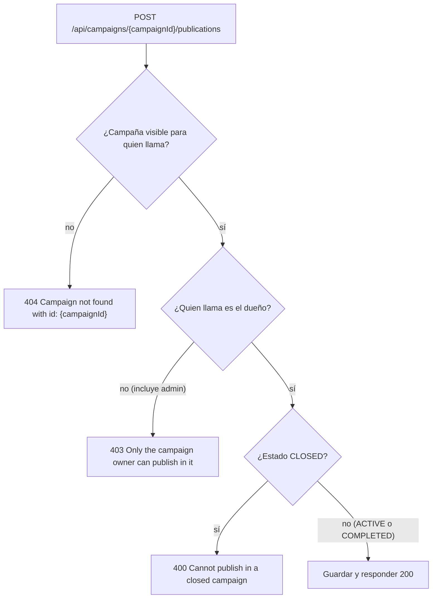

# Publicaciones (`publication`)

## Para qué existe

Una publicación es una novedad que el dueño de una campaña escribe dentro de ella: un texto corto que cuenta avances, agradece donaciones o anuncia cambios. Es el canal de comunicación del creador con quienes siguen la campaña.

El dominio es chico: se puede **publicar**, **listar las publicaciones de una campaña** y **borrar una publicación propia**. No hay edición. Casi todas sus reglas se apoyan en la campaña: quién puede publicar depende de quién es su dueño y en qué estado está, y quién puede leer depende de si la campaña es visible para quien llama.

## Entidades y datos

**`Publication`** (`entity/publication/Publication.java`, tabla `publication`):

| Campo | Columna | Notas |
|---|---|---|
| `id` | `id` | Identidad autogenerada. |
| `description` | `description` | Texto de la publicación. La columna no declara largo, así que queda en el valor por defecto de Hibernate (255), el mismo máximo que valida el DTO. |
| `createdAt` | `created_at` | No actualizable. Lo fija `@PrePersist`. |
| `updatedAt` | `updated_at` | Lo actualiza `@PreUpdate`, pero como no hay endpoint de edición y el borrado es un `UPDATE` nativo, en la práctica queda igual a la fecha de creación. |
| `deletedAt` | `deleted_at` | Borrado lógico (ver abajo). |
| `user` | `user_id` | `@ManyToOne` al autor (`User`). Siempre es el dueño de la campaña. |
| `campaign` | `campaign_id` | `@ManyToOne` a la campaña (`Campaign`). |
| `campaignId` | `campaign_id` | Copia de solo lectura de la misma FK. |

No tiene enums propios. Usa `CampaignStatus` (`entity/campaign/CampaignStatus.java`) para decidir si se puede publicar.

**Borrado lógico.** `@SQLDelete` convierte el `delete` de JPA en `UPDATE publication SET deleted_at = GETDATE()`, y `@SQLRestriction("deleted_at IS NULL")` hace que toda consulta JPA ignore las filas borradas. Para el código, una publicación borrada no existe: `findById` devuelve vacío.

**Relaciones hacia filas que pueden estar borradas.** El autor (`User`) y la campaña (`Campaign`) también tienen borrado lógico. Si la relación fuera obligatoria, Hibernate haría un `INNER JOIN` contra una fila que su propio `@SQLRestriction` filtra y la publicación entera desaparecería al cargarla. Por eso las dos relaciones:

- llevan `@NotFound(action = NotFoundAction.IGNORE)`: si el autor o la campaña están borrados, el campo queda en `null` en lugar de perder la fila;
- son `updatable = false`: un `UPDATE` de la publicación nunca pisa la FK con ese `null` cargado (las columnas siguen siendo `NOT NULL` en la base).

El campo `campaignId` mapea la misma columna `campaign_id` como `insertable = false, updatable = false`. Conserva el id aunque la campaña esté borrada (y `campaign` sea `null`) y permite filtrar por campaña sin unir la tabla. Lo usan la consulta del listado y la validación de reportes (`validation/report/ReportValidationService.java`). Como solo se llena al leer desde la base, justo después de un `save` vale `null`; por eso `PublicationMapper.toDTO` toma el id de `campaign` cuando está cargada y cae a `campaignId` si no.

El detalle general de borrado lógico y de `@NotFound` está en [Modelo de datos](../04-modelo-de-datos.md).

**Consulta del listado** (`repository/publication/PublicationRepository.java`, `findAllByCampaignId`): trae en un solo `SELECT` la publicación, su autor con `userInfo` y `verificationRequest`, y la campaña con su `goal`, filtrando por `p.campaignId`, autores no borrados y ordenando por `createdAt` descendente. `verificationRequest` es un `@OneToOne` inverso de `User` que Hibernate no puede cargar de forma diferida; si no viniera en el `JOIN FETCH`, se dispararía una consulta extra por publicación. La campaña no necesita traer a su dueño aparte porque es el mismo usuario que el autor, que ya está en el contexto de persistencia.

## Reglas de negocio

| Regla | Por qué | Dónde |
|---|---|---|
| Solo el dueño de la campaña publica en ella. Un admin tampoco puede. | Las publicaciones son la voz del creador de la campaña; nadie más habla en su nombre. | `PublicationValidationService.validateAndGetPublishableCampaign` |
| El autor de la publicación es el dueño de la campaña, no un id del body. | El mapper asigna `publication.setUser(campaign.getUser())`. Como antes se verificó que quien llama es el dueño, autor y usuario autenticado coinciden. | `mapper/publication/PublicationMapper.java` |
| Se puede publicar con la campaña `ACTIVE` o `COMPLETED`, no `CLOSED`. | Una campaña cerrada no admite novedades. Una `COMPLETED` (meta alcanzada) sigue abierta a publicaciones, por ejemplo para agradecer. | `PublicationValidationService.validateAndGetPublishableCampaign` |
| El orden de los chequeos al publicar es: visibilidad, dueño, estado. | Visibilidad primero: un tercero recibe el mismo `404` para una campaña `CLOSED` ajena que para una inexistente. El estado al final: solo el dueño llega a enterarse de que su campaña está `CLOSED`. | `PublicationValidationService.validateAndGetPublishableCampaign` |
| Leer las publicaciones de una campaña exige que la campaña sea visible para quien llama. | Las publicaciones no tienen visibilidad propia: heredan la de su campaña. Si la campaña no se ve, tampoco sus publicaciones, y la respuesta es la misma que para una campaña inexistente. | `PublicationValidationService.validateAndGetReadableCampaign` → `validation/campaign/CampaignValidationService.java` (`findVisibleCampaignByIdOrThrow`) |
| Solo el autor borra su publicación. | No hay borrado por admin desde este endpoint. La moderación de publicaciones pasa por los reportes (ver [Reportes](report.md)). | `PublicationValidationService.validateAndGetOwnedPublication` |
| Una publicación cuyo autor fue borrado se trata como inexistente. | Con el autor borrado, `user` llega en `null` por `@NotFound`; se responde `404`, igual que si la publicación no existiera. | `PublicationValidationService.validateAndGetOwnedPublication` |
| Borrar la campaña no borra sus publicaciones. | `CampaignService.closeAndSoftDelete` solo cierra y borra la campaña. Las publicaciones quedan en la base sin `deleted_at`, pero dejan de verse porque su campaña ya no es visible para nadie. Su autor todavía puede borrarlas. | `service/campaign/CampaignService.java` |

Orden de los chequeos al publicar:

## Estados

Este dominio no tiene estados. Lo que importa es el estado de la campaña (`CampaignStatus`, ver [Campañas](campaign.md)): solo se publica en campañas `ACTIVE` o `COMPLETED`.

## Visibilidad y permisos

**Quién ve las publicaciones de una campaña.** Exactamente quien ve la campaña, según `CampaignValidationService.findVisibleCampaignById`:

| Quien llama | Ve las publicaciones de… |
|---|---|
| Anónimo (sin token o con token inválido) | Campañas no `CLOSED` de dueños activos y no sancionados. |
| `USER` | Lo mismo, más sus propias campañas `CLOSED`. |
| `ADMIN` | Toda campaña no borrada de un dueño no borrado, incluidas las `CLOSED` y las de dueños baneados o suspendidos. |

Nadie ve publicaciones de una campaña borrada ni de un dueño borrado. Los criterios de "sancionado" (baneado, o suspendido con `suspendedUntil` en el futuro) están en [Seguridad](../03-seguridad.md).

Para saber si quien llama es admin, el dominio usa `CampaignAuthorizationService.isAdmin`, que consulta la base (`UserRepository.existsByIdAndRole_Name(userId, "ADMIN")`) en lugar de mirar las autoridades del token.

**Quién modifica.** Publicar: solo el dueño de la campaña. Borrar: solo el autor de la publicación (que es el dueño de la campaña). El admin no puede hacer ninguna de las dos cosas desde estos endpoints.

**`404` vs `403`.**

| Caso | Respuesta |
|---|---|
| Publicar o listar en una campaña inexistente, borrada, de dueño borrado, `CLOSED` ajena o de dueño sancionado (para quien no es admin) | `404` `Campaign not found with id: {campaignId}`: no se distingue de una campaña que no existe. |
| Publicar en una campaña visible que no es propia (incluido el admin) | `403` `Only the campaign owner can publish in it` |
| Publicar en la propia campaña `CLOSED` | `400` `Cannot publish in a closed campaign` |
| Borrar una publicación inexistente, ya borrada o de un autor borrado | `404` `Publication not found with ID: {publicationId}` |
| Borrar una publicación ajena | `403` `You don't have permission to delete this publication` |

El borrado no mira la visibilidad de la campaña: un tercero que intenta borrar una publicación de una campaña que no ve (`CLOSED` ajena, borrada o de dueño sancionado) recibe el `403`, no el `404`.

## Endpoints

Los tres endpoints están en `controller/publication/PublicationController.java`, con `@RequestMapping("/api")`. Ninguno usa `@PreAuthorize`. Las respuestas de error del `GlobalExceptionHandler` tienen la forma `{error, message, timestamp}`; las del filtro JWT y el entry point de seguridad agregan `path`. El detalle de cada excepción está en [Errores y validación](../05-errores-y-validacion.md).

### `POST /api/campaigns/{campaignId}/publications`

- **Acceso:** usuario autenticado (`USER` o `ADMIN`), aunque en la práctica solo el dueño de la campaña tiene éxito. La ruta no está en `PUBLIC_URLS` ni en `PUBLIC_GET_URLS` (que solo cubre `GET`), así que cae en `anyRequest().authenticated()`. Sin token válido → `401`.
- **Parámetros:**

  | Nombre | En | Tipo | Obligatorio |
  |---|---|---|---|
  | `campaignId` | path | `Long` | sí |

- **Body:** `CreatePublicationDTO` (`dtos/publication/CreatePublicationDTO.java`).

  | Campo | Tipo | Obligatorio | Validación |
  |---|---|---|---|
  | `description` | `String` | sí | `@NotBlank`, `@Size(max = 255)` |

- **Respuesta:** `200 OK` con `PublicationResponseDTO` (`dtos/publication/PublicationResponseDTO.java`).

  | Campo | Tipo | Contenido |
  |---|---|---|
  | `id` | `Long` | Id de la publicación. |
  | `description` | `String` | Texto. |
  | `createdAt` | `LocalDateTime` | Fecha de creación. |
  | `updatedAt` | `LocalDateTime` | Igual a la de creación (no hay edición). |
  | `campaignId` | `Long` | Campaña a la que pertenece. |
  | `userId` | `Long` | Autor (dueño de la campaña). |
  | `firstName` | `String` | Nombre del autor (`UserInfo`). |
  | `lastName` | `String` | Apellido del autor. |
  | `userName` | `String` | Nombre de usuario del autor. |

- **Errores:**

  | Status | Mensaje | Cuándo |
  |---|---|---|
  | `401` | `Full authentication is required to access this resource` | Sin header `Authorization`, o con un token rechazado por el filtro: firma inválida, expirado, refresh token en lugar de access token, revocado por logout, emitido antes del último cambio de email o contraseña, o de un usuario inexistente o borrado. |
  | `403` | `Your account has been banned. Reason: {motivo}` | El usuario del token está baneado (corte del filtro JWT). |
  | `403` | `Your account is suspended until {fecha}. Reason: {motivo}` | El usuario del token tiene una suspensión vigente (corte del filtro JWT). |
  | `400` | `Invalid value '{valor}' for parameter 'campaignId'` | `campaignId` no es numérico. |
  | `400` | `Request body is required` | Falta el body. |
  | `400` | `Malformed request body` | El body no es JSON válido. |
  | `415` | `Content type '{tipo}' is not supported. Use application/json` | El `Content-Type` no es JSON. |
  | `400` | `One or more fields are invalid`, con `fields.description` = `must not be blank` | `description` falta, es `null` o solo tiene espacios. |
  | `400` | `One or more fields are invalid`, con `fields.description` = `size must be between 0 and 255` | `description` supera los 255 caracteres. |
  | `404` | `Campaign not found with id: {campaignId}` | La campaña no existe, está borrada o su dueño está borrado; o, para quien no es admin, es una campaña `CLOSED` ajena o de un dueño sancionado. |
  | `403` | `Only the campaign owner can publish in it` | La campaña es visible pero quien llama no es su dueño (incluye al admin). |
  | `400` | `Cannot publish in a closed campaign` | Quien llama es el dueño y la campaña está `CLOSED`. |

  Los mensajes de `fields` son los de Bean Validation por defecto (el DTO no define mensajes propios), así que dependen del locale de la JVM. La validación del body ocurre antes de entrar al service: un body inválido da `400` aunque la campaña no exista o sea ajena.

- **Qué hace** (`service/publication/PublicationService.java`, `createPublication`):
  1. Toma el id de quien llama del token con `AuthenticatedUserService.getAuthenticatedUserId()`.
  2. `PublicationValidationService.validateAndGetPublishableCampaign(campaignId, callerId)`: carga la campaña visible para quien llama (`404` si no), verifica que sea el dueño (`403`) y que la campaña no esté `CLOSED` (`400`). Devuelve la campaña.
  3. `PublicationMapper.toEntity` arma la publicación con la descripción, la campaña y como autor al dueño de la campaña.
  4. `PublicationRepository.save` la inserta.
  5. `PublicationMapper.toDTO` la convierte en la respuesta.

### `GET /api/campaigns/{campaignId}/publications`

- **Acceso:** público. La ruta está en `PUBLIC_GET_URLS` de `security/SecurityConfig.java` (`/api/campaigns/*/publications`). Con token válido, quien llama se identifica y puede ver más (sus campañas `CLOSED`, o todo si es admin). Un token inválido o expirado no da `401`: el filtro deja el request sin autenticar y se responde como a un anónimo. La excepción es un token válido de un usuario sancionado, que el filtro corta con `403` aun en rutas públicas.
- **Parámetros:**

  | Nombre | En | Tipo | Obligatorio |
  |---|---|---|---|
  | `campaignId` | path | `Long` | sí |

- **Body:** sin body.
- **Respuesta:** `200 OK` con una lista de `PublicationResponseDTO` (mismos campos que en el `POST`), de la más nueva a la más vieja. Lista vacía si la campaña no tiene publicaciones. Sin paginación.
- **Errores:**

  | Status | Mensaje | Cuándo |
  |---|---|---|
  | `403` | `Your account has been banned. Reason: {motivo}` | Se envió un token válido de un usuario baneado. |
  | `403` | `Your account is suspended until {fecha}. Reason: {motivo}` | Se envió un token válido de un usuario con suspensión vigente. |
  | `400` | `Invalid value '{valor}' for parameter 'campaignId'` | `campaignId` no es numérico. |
  | `404` | `Campaign not found with id: {campaignId}` | La campaña no es visible para quien llama: inexistente, borrada, de dueño borrado, o (para quien no es admin) `CLOSED` ajena o de dueño sancionado. |

- **Qué hace** (`PublicationService.getPublicationsByCampaignId`):
  1. Obtiene el id de quien llama con `AuthenticatedUserService.findAuthenticatedUserId()`, que devuelve vacío para un anónimo; en ese caso usa `null`.
  2. `PublicationValidationService.validateAndGetReadableCampaign(campaignId, callerId)`: delega en `CampaignValidationService.findVisibleCampaignByIdOrThrow`, que para un admin usa `CampaignRepository.findByIdWithActiveOwner` y para el resto `findByIdVisibleTo` (`404` si no la encuentra).
  3. `PublicationRepository.findAllByCampaignId(campaignId)`: una sola consulta con autor, datos del autor y campaña, ordenada por `createdAt` descendente.
  4. Mapea cada publicación con `PublicationMapper.toDTO`.

### `DELETE /api/publications/{publicationId}`

- **Acceso:** usuario autenticado (`USER` o `ADMIN`); solo el autor de la publicación tiene éxito. Cae en `anyRequest().authenticated()`. Sin token válido → `401`.
- **Parámetros:**

  | Nombre | En | Tipo | Obligatorio |
  |---|---|---|---|
  | `publicationId` | path | `Long` | sí |

- **Body:** sin body.
- **Respuesta:** `200 OK` con un mapa armado en el controller:

  | Campo | Tipo | Contenido |
  |---|---|---|
  | `message` | `String` | `Publication deleted successfully` |
  | `publicationId` | `Long` | El id borrado. |

- **Errores:**

  | Status | Mensaje | Cuándo |
  |---|---|---|
  | `401` | `Full authentication is required to access this resource` | Sin token o con un token rechazado por el filtro (mismos casos que en el `POST`). |
  | `403` | `Your account has been banned. Reason: {motivo}` | El usuario del token está baneado. |
  | `403` | `Your account is suspended until {fecha}. Reason: {motivo}` | El usuario del token tiene una suspensión vigente. |
  | `400` | `Invalid value '{valor}' for parameter 'publicationId'` | `publicationId` no es numérico. |
  | `404` | `Publication not found with ID: {publicationId}` | La publicación no existe, ya fue borrada o su autor está borrado. |
  | `403` | `You don't have permission to delete this publication` | Quien llama no es el autor (incluye al admin), sin importar si la campaña es visible. |

- **Qué hace** (`PublicationService.deletePublication`):
  1. Toma el id de quien llama del token con `AuthenticatedUserService.getAuthenticatedUserId()`.
  2. `PublicationValidationService.validateAndGetOwnedPublication(publicationId, callerId)`: busca la publicación con `findById` (`404` si no está), trata como inexistente la de un autor borrado (`404`) y verifica que quien llama sea el autor (`403`). No consulta el estado ni la visibilidad de la campaña: el autor puede borrar publicaciones de su campaña `CLOSED` o ya borrada.
  3. `PublicationRepository.delete`, que por `@SQLDelete` marca `deleted_at` en lugar de borrar la fila.

## Clases involucradas

| Capa | Clase |
|---|---|
| Controller | `controller/publication/PublicationController.java` |
| Service | `service/publication/PublicationService.java` |
| Validation | `validation/publication/PublicationValidationService.java` |
| Validation (de otro dominio) | `validation/campaign/CampaignValidationService.java` (visibilidad), `validation/campaign/CampaignAuthorizationService.java` (`isAdmin`) |
| Mapper | `mapper/publication/PublicationMapper.java` |
| Repository | `repository/publication/PublicationRepository.java`, `repository/campaign/CampaignRepository.java` (`findByIdWithActiveOwner`, `findByIdVisibleTo`) |
| DTOs | `dtos/publication/CreatePublicationDTO.java`, `dtos/publication/PublicationResponseDTO.java` |
| Entity | `entity/publication/Publication.java`; usa `entity/campaign/Campaign.java`, `entity/campaign/CampaignStatus.java`, `entity/user/User.java` |
| Seguridad | `security/SecurityConfig.java` (`PUBLIC_GET_URLS`), `security/AuthenticatedUserService.java`, `security/JwtAuthenticationFilter.java` |
| Otros dominios que tocan publicaciones | `validation/report/ReportValidationService.java` (reportar una publicación), `service/report/ReportActionService.java` (borrado por moderación) |
