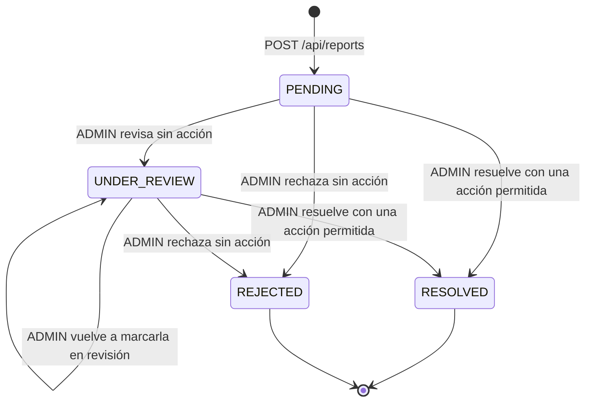

# Report

## Para qué existe

Es el canal de moderación de la plataforma. Cualquier usuario autenticado puede denunciar a otro usuario, una publicación o una campaña indicando un motivo. Un `ADMIN` revisa las denuncias y, al resolverlas, puede aplicar una acción: sancionar al usuario denunciado (ban o suspensión de 30 días) o quitar el contenido (borrado lógico de la publicación, o cierre y borrado lógico de la campaña).

Es el único lugar del código que escribe las sanciones de un usuario (`User.banned`, `bannedAt`, `suspendedUntil`, `bannedReason`). Esas columnas las leen después el login, el refresh y el filtro JWT para cortar el acceso (ver [auth](auth.md) y [03-seguridad.md](../03-seguridad.md)), y los demás dominios para ocultar al usuario sancionado y su contenido (ver [user](user.md) y [campaign](campaign.md)). También es el único camino por el que un `ADMIN` borra una publicación ajena (ver [publication](publication.md)). No existe ningún endpoint que levante una sanción: la suspensión vence sola a los 30 días y el ban es permanente.

Un reporte no es una relación JPA hacia la entidad denunciada: guarda el par `reportedEntityType` + `reportedEntityId`. Por eso puede apuntar a usuarios, publicaciones y campañas con una sola tabla, y sigue existiendo aunque la entidad se borre después.

## Entidades y datos

**`Report`** (`entity/report/Report.java`, tabla `report`):

| Campo | Columna | Tipo | Notas |
|---|---|---|---|
| `id` | `id` | `Long` | Identidad autogenerada. |
| `reporter` | `reporter_id` | `User` | `@ManyToOne` con `@NotFound(action = IGNORE)` y `updatable = false`. Quien denuncia; sale del token, nunca del body. |
| `reportedEntityType` | `reported_entity_type` | `ReportedEntityType` | `@Enumerated(STRING)`, no nulo. |
| `reportedEntityId` | `reported_entity_id` | `Long` | No nulo. Id de la entidad denunciada; sin FK. |
| `reason` | `reason` | `ReportReason` | `@Enumerated(STRING)`, no nulo. |
| `description` | `description` | `String` | `TEXT`. Opcional, hasta 1000 caracteres según el DTO. |
| `status` | `status` | `ReportStatus` | `@Enumerated(STRING)`, no nulo, `PENDING` por defecto (en el builder y en `@PrePersist`). |
| `reviewedBy` | `reviewed_by` | `User` | `@ManyToOne` con `@NotFound(action = IGNORE)`. El último `ADMIN` que cambió el estado. |
| `reviewedAt` | `reviewed_at` | `LocalDateTime` | Momento del último cambio de estado. |
| `adminNotes` | `admin_notes` | `String` | `TEXT`. Notas del `ADMIN`; también se usan como motivo de la sanción. |
| `actionTaken` | `action_taken` | `ActionTaken` | `@Enumerated(STRING)`, nulo hasta la revisión. |
| `createdAt` | `created_at` | `LocalDateTime` | No actualizable; lo pone `@PrePersist`. |
| `updatedAt` | `updated_at` | `LocalDateTime` | Lo pone `@PreUpdate`. |

Restricción `UNIQUE (reporter_id, reported_entity_type, reported_entity_id)`: un usuario puede denunciar una misma entidad una sola vez en toda la vida de la cuenta, sin importar cómo terminó la denuncia anterior.

`Report` no tiene soft delete: ningún endpoint borra reportes.

**Relaciones con `User` y borrado lógico.** `User` tiene `@SQLRestriction("deleted_at IS NULL")`, así que un usuario borrado es invisible para Hibernate. Con `@NotFound(IGNORE)`, un `reporter` o `reviewedBy` borrado se carga como `null` en lugar de descartar la fila del reporte (`@NotFound` además fuerza la carga `EAGER`, como explica el comentario de la entidad). `reporter` es `updatable = false` para que un `UPDATE` del reporte no pise la FK con ese `null`. Consecuencia observable: en el `ReportDTO` de un reporte cuyo denunciante borró la cuenta, `reporterId`, `reporterUsername` y `reporterEmail` vienen en `null`, aunque la FK sigue en la base.

**Enums** (todos en `entity/report/`):

| Enum | Valores | Uso |
|---|---|---|
| `ReportStatus` | `PENDING`, `UNDER_REVIEW`, `RESOLVED`, `REJECTED` | Estado de la denuncia. Ver "Estados". |
| `ReportedEntityType` | `USER`, `PUBLICATION`, `CAMPAIGN`, `COMMENT` | Qué se denuncia. La columna tiene una `CHECK` con los valores del enum, de nombre fijo (`CK_report_reported_entity_type`), que sumar un valor obliga a recrear con un script (ver [Modelo de datos](../04-modelo-de-datos.md#check-de-reportreported_entity_type)). |
| `ReportReason` | `SPAM`, `INAPPROPRIATE_CONTENT`, `HARASSMENT`, `FRAUD`, `MISINFORMATION`, `IMPERSONATION`, `OTHER` | Motivo elegido por el denunciante. Solo se guarda y se cuenta en las estadísticas; no cambia ninguna regla. |
| `ActionTaken` | `NO_ACTION`, `WARNING_SENT`, `CONTENT_REMOVED`, `USER_SUSPENDED`, `USER_BANNED`, `OTHER` | Decisión del `ADMIN` al revisar. Ver "Acciones de moderación". |

**Columnas de `User` que escribe este dominio** (`entity/user/User.java`): `banned`, `bannedAt`, `suspendedUntil` y `bannedReason`. `bannedReason` guarda el motivo tanto del ban como de la suspensión: es el texto que aparece en el `403` del filtro JWT y del login (`validation/auth/AccountStatusValidationService.java`).

## Reglas de negocio

### Al crear un reporte

| Regla | Por qué / consecuencia | Dónde |
|---|---|---|
| El denunciante es el usuario del token. | `ReportService.createReport` toma el id con `AuthenticatedUserService.getAuthenticatedUserId()`; el body no tiene campo de denunciante. | `service/report/ReportService.java` |
| Un usuario denunciado tiene que existir y no estar borrado. | `UserRepository.findById` respeta `@SQLRestriction`, así que un usuario borrado responde igual que uno inexistente: `404 "User not found"`. | `validation/report/ReportValidationService.java` (`validateEntityExists`) |
| Un usuario sancionado se oculta como uno inexistente, salvo para un `ADMIN`. | Si `AccountStatusValidationService.isBlocked` da `true` (ban, o suspensión vigente) y el denunciante no es `ADMIN`, responde el mismo `404 "User not found"`. Así no se puede usar el endpoint para averiguar si alguien está sancionado. `isBlocked` va primero para consultar el rol solo cuando el usuario está sancionado. | `ReportValidationService.validateEntityExists` |
| Una publicación se puede denunciar solo si quien denuncia puede ver su campaña. | Carga la publicación con `findById` (que no ve las borradas) y luego pide la campaña con `CampaignValidationService.findVisibleCampaignById` usando `Publication.campaignId`. Si la campaña no es visible (`CLOSED` de otro, borrada, de dueño borrado o de dueño sancionado), responde `404 "Publication not found"`, sin revelar nada de la campaña. | `ReportValidationService.validateEntityExists` |
| Un comentario se puede denunciar solo si es visible para quien denuncia. | Delega en `CommentValidationService.validateAndGetVisibleComment`: un comentario inexistente, borrado, de autor borrado, de autor sancionado (si el denunciante no es `ADMIN`) o de una publicación que el denunciante no ve da `404 "Comment not found with ID: <id>"`. Un `ADMIN` puede denunciar el comentario de un autor sancionado. | `ReportValidationService.validateEntityExists`, `validation/comment/CommentValidationService.java` |
| Una campaña se puede denunciar solo si es visible para quien denuncia. | Usa `CampaignValidationService.findVisibleCampaignByIdOrThrow`, la misma regla que los demás dominios: una campaña `CLOSED` ajena o de un dueño sancionado da `404 "Campaign not found with id: <id>"`, igual que una inexistente. Un `ADMIN` ve también las `CLOSED` y las de dueños sancionados. | `ReportValidationService.validateEntityExists`, `validation/campaign/CampaignValidationService.java` |
| No se puede denunciar a uno mismo ni el contenido propio. | `validateEntityExists` devuelve el id del dueño (el propio usuario, el autor de la publicación o del comentario, o el dueño de la campaña) y `validateNotSelfReport` lo compara con el denunciante. Responde `400` con un mensaje por tipo. Un dueño `null` (autor borrado) nunca cuenta como autodenuncia. | `ReportValidationService.validateNotSelfReport` |
| Una sola denuncia por denunciante y entidad. | `validateNoDuplicateReport` consulta `existsByReporterIdAndReportedEntityTypeAndReportedEntityId` y responde `409 "You have already reported this <tipo>"`. La restricción `UNIQUE` de la tabla cubre la carrera de dos altas simultáneas, que termina en el `409` genérico del handler. Como no mira el estado, una denuncia `REJECTED` tampoco se puede repetir. | `ReportValidationService.validateNoDuplicateReport`, `entity/report/Report.java` |
| Hasta 10 denuncias por usuario en 24 horas. | Cuenta las denuncias del denunciante con `createdAt` en las últimas 24 horas (ventana móvil, con la hora de la JVM). Al llegar a `MAX_REPORTS_PER_DAY = 10` responde `400`. Limita el abuso del canal. | `ReportValidationService.validateDailyReportLimit`, `repository/report/ReportRepository.java` (`countReportsByReporterIdSince`) |
| Toda denuncia nace `PENDING`. | El service la arma con `status = PENDING` y `@PrePersist` lo repite si llegara nulo. | `ReportService.createReport`, `Report.onCreate` |

El orden de las validaciones es: existencia y visibilidad → autodenuncia → duplicado → límite diario. Un usuario que ya llegó al límite recibe igual el `404` o el `409` si corresponde, antes que el `400` del límite.

### Al revisar un reporte

| Regla | Por qué / consecuencia | Dónde |
|---|---|---|
| Solo un `ADMIN` revisa, lista, consulta y ve estadísticas. | `@PreAuthorize("hasRole('ADMIN')")` en los cuatro endpoints. El `ADMIN` que revisa sale del token. | `controller/report/ReportController.java`, `ReportService.reviewReport` |
| `RESOLVED` y `REJECTED` son finales. | `validateReportIsReviewable` responde `409 "Report already reviewed with status: <estado>"` antes de mirar el body. Evita aplicar dos veces una sanción o revertir una decisión. | `ReportValidationService.validateReportIsReviewable` |
| No se puede volver a `PENDING`. | `400 "Cannot set status back to PENDING"`. | `ReportValidationService.validateReviewInput` |
| Resolver exige una acción real. | Con `RESOLVED`, `actionTaken` nulo o `NO_ACTION` da `400 "Action taken must be specified when resolving a report"`. Una denuncia que no amerita acción se rechaza (`REJECTED`). | `ReportValidationService.validateReviewInput` |
| Solo resolver ejecuta acciones. | Con `UNDER_REVIEW` o `REJECTED`, cualquier acción distinta de `NO_ACTION` da `400 "Action taken can only be set when resolving a report"`. `NO_ACTION` o `null` se aceptan y se guardan tal cual. | `ReportValidationService.validateReviewInput` |
| La acción tiene que corresponder al tipo de entidad. | `ALLOWED_ACTIONS`: `USER` admite `WARNING_SENT`, `USER_SUSPENDED`, `USER_BANNED`, `OTHER`; `PUBLICATION`, `CAMPAIGN` y `COMMENT` admiten `WARNING_SENT`, `CONTENT_REMOVED`, `OTHER`. Otra combinación da `400 "Action <ACCIÓN> does not apply to a <tipo>"`. Así no queda registrada una acción que el sistema no puede ejecutar. | `ReportValidationService.validateReviewInput` |
| Cada revisión sobrescribe los datos de revisión. | `status`, `adminNotes`, `actionTaken`, `reviewedBy` y `reviewedAt` se reemplazan con lo del body y el `ADMIN` actual. Pasar a `UNDER_REVIEW` ya completa `reviewedBy` y `reviewedAt`, y la resolución posterior los pisa; si el body de la resolución no trae `adminNotes`, las notas anteriores quedan en `null`. | `ReportService.reviewReport` |
| La acción se ejecuta en la misma transacción que la revisión. | `ReportService.reviewReport` y `ReportActionService.executeAction` son `@Transactional`: si la acción falla, el cambio de estado también se revierte. | `service/report/ReportService.java`, `service/report/ReportActionService.java` |
| Resolver una denuncia no toca las demás sobre la misma entidad. | Las otras denuncias del mismo usuario, publicación, campaña o comentario siguen en su estado y hay que revisarlas una por una. | `ReportService.reviewReport` |

### Acciones de moderación

Las ejecuta `ReportActionService.executeAction` después de guardar el reporte, solo cuando la acción es distinta de `NO_ACTION`:

| Acción | Sobre | Qué hace | Casos borde |
|---|---|---|---|
| `USER_BANNED` | `USER` | `banned = true`, `bannedAt = ahora`, `bannedReason = adminNotes` o `"Banned by admin"`. | Busca al usuario con `UserRepository.findByIdIncludingDeleted` (consulta nativa que saltea `@SQLRestriction`): alcanza también a una cuenta borrada después de la denuncia, para que volver a loguearse (que restaura cuentas borradas) no la libere. Un usuario ya baneado se deja como está, con su motivo original. No mira el rol: un `ADMIN` también puede ser baneado. |
| `USER_SUSPENDED` | `USER` | `suspendedUntil = ahora + 30 días`, `bannedReason = adminNotes` o `"Suspended by admin"`. | También alcanza cuentas borradas. Si el usuario está baneado o ya tiene una suspensión vigente, no se modifica (no se extiende ni se acorta), aunque el reporte queda `RESOLVED` con `USER_SUSPENDED`. |
| `CONTENT_REMOVED` | `PUBLICATION` | `publicationRepository.delete`, que por `@SQLDelete` es un borrado lógico. | Si la publicación ya no se encuentra (borrada después de la denuncia), no hace nada. |
| `CONTENT_REMOVED` | `CAMPAIGN` | `CampaignService.closeAndSoftDelete(campaign, adminId)`: cierra la meta registrando la transición con el `ADMIN` como autor y borra la campaña lógicamente. | Busca con `findById` y no con la consulta de dueño activo, para poder resolver aunque el dueño haya borrado su cuenta. Si la campaña ya no está, no hace nada. Ver [campaign](campaign.md). |
| `CONTENT_REMOVED` | `COMMENT` | `commentRepository.delete`, que por `@SQLDelete` es un borrado lógico. | Busca con `findById`; si el comentario ya no se encuentra (lo borró su autor, el autor de la publicación o un ADMIN después de la denuncia), no hace nada. También borra el comentario de un autor borrado (`user` en `null`). |
| `WARNING_SENT` | cualquiera | Nada. | El método `executeWarning` está vacío: el aviso queda registrado solo en el reporte (`actionTaken` y `adminNotes`). El comentario lo prepara para un envío de email futuro. |
| `OTHER` | cualquiera | Nada. | Queda como registro de una acción tomada fuera del sistema. |

Las sanciones tienen efecto en el request siguiente del usuario sancionado: el filtro JWT recarga al usuario en cada request y responde `403` si está bloqueado, sin necesidad de revocar sus tokens.

## Estados

- `PENDING` es el estado inicial y no se puede volver a él.
- `UNDER_REVIEW` es opcional: un `ADMIN` puede resolver o rechazar directamente desde `PENDING`. Se puede repetir (`UNDER_REVIEW → UNDER_REVIEW`), lo que reemplaza `reviewedBy`, `reviewedAt` y `adminNotes`.
- `RESOLVED` y `REJECTED` son finales: cualquier revisión posterior responde `409`, sea cual sea el body.
- Solo la transición a `RESOLVED` ejecuta una acción de moderación.

## Visibilidad y permisos

| Acción | Quién | Cómo se aplica |
|---|---|---|
| Crear una denuncia | Cualquier usuario autenticado y no sancionado (`USER` o `ADMIN`) | `anyRequest().authenticated()` en `security/SecurityConfig.java`; `/api/reports` no está en `PUBLIC_URLS`. El comentario de `SecurityConfig` remite a los `@PreAuthorize` del controller. |
| Listar, consultar una, revisar, ver estadísticas | Solo `ADMIN` | `@PreAuthorize("hasRole('ADMIN')")`. El rol sale de la base: el filtro JWT carga al usuario en cada request y arma la autoridad `ROLE_<rol>` (ver [03-seguridad.md](../03-seguridad.md)). |
| Ver qué entidades se pueden denunciar | Lo que el denunciante puede ver | `USER`: no borrado y, para no `ADMIN`, no sancionado. `PUBLICATION`: no borrada y con campaña visible. `CAMPAIGN`: visible según `CampaignValidationService.findVisibleCampaignById`. `COMMENT`: visible según `CommentValidationService.validateAndGetVisibleComment`. |

Un `ADMIN` ve todas las denuncias, incluidas las que apuntan a entidades borradas o sancionadas, y las de denunciantes borrados (con los datos del denunciante en `null`). Un usuario común no tiene ningún endpoint para ver sus propias denuncias.

**`404` vs `403` en este dominio:**

- Los únicos `403` son el de `@PreAuthorize` (`You don't have permission to access this resource`) en los endpoints de `ADMIN` y los del filtro JWT (cuenta baneada o suspendida).
- La autodenuncia no es `403` sino `400`, con un mensaje por tipo de entidad.
- Todo lo que el denunciante no puede ver responde `404` con el mismo mensaje que la entidad inexistente: `"User not found"` (inexistente, borrado o sancionado), `"Publication not found"` (inexistente, borrada o de una campaña no visible) y `"Campaign not found with id: <id>"` (inexistente, borrada, `CLOSED` ajena o de dueño borrado o sancionado). El mensaje de publicación de este dominio no incluye el id, a diferencia del que usa el dominio de publicaciones.
- Los mensajes `400` `"Cannot report a deleted user"` y `"Cannot report a deleted publication"` existen en `ReportValidationService` pero no se alcanzan: `findById` ya no devuelve entidades borradas, así que esos casos responden `404`.

## Endpoints

Errores comunes a los cinco endpoints (todos requieren token; ver [03-seguridad.md](../03-seguridad.md) y [05-errores-y-validacion.md](../05-errores-y-validacion.md)):

| Status | Mensaje | Cuándo |
|---|---|---|
| 401 | `Full authentication is required to access this resource` | Sin header `Authorization: Bearer`, o con un token rechazado por el filtro (inválido, vencido, revocado, refresh token en lugar de access token, emitido antes del último cambio de email o contraseña, usuario borrado). |
| 403 | `Your account has been banned. Reason: <motivo>` | El usuario del token está baneado (`<motivo>` es `bannedReason` o `Violation of terms`). |
| 403 | `Your account is suspended until <fecha>. Reason: <motivo>` | El usuario del token tiene una suspensión vigente. |
| 405 | `Method <MÉTODO> is not supported for this endpoint` | Método HTTP equivocado sobre una ruta existente. |
| 500 | `An unexpected error occurred. Please try again later.` | Excepción no prevista. |

En los endpoints de `ADMIN`, la conversión de parámetros de ruta y query y la validación del body (`@Valid`) ocurren antes que `@PreAuthorize`: un usuario que no es `ADMIN` con un parámetro mal tipado o un body inválido recibe `400`, no `403`.

### `POST /api/reports`

- **Acceso:** usuario autenticado (`USER` o `ADMIN`), no sancionado.
- **Parámetros:** ninguno.
- **Body:** `CreateReportDTO` (`dtos/report/CreateReportDTO.java`)

  | Campo | Tipo | Obligatorio | Validación |
  |---|---|---|---|
  | `reportedEntityType` | `ReportedEntityType` | sí | `@NotNull`; uno de `USER`, `PUBLICATION`, `CAMPAIGN`, `COMMENT` |
  | `reportedEntityId` | `Long` | sí | `@NotNull`, `@Positive` |
  | `reason` | `ReportReason` | sí | `@NotNull`; uno de `SPAM`, `INAPPROPRIATE_CONTENT`, `HARASSMENT`, `FRAUD`, `MISINFORMATION`, `IMPERSONATION`, `OTHER` |
  | `description` | `String` | no | `@Size(max = 1000)` |

- **Respuesta:** `200 OK`, `ReportResponseDTO` (`dtos/report/ReportResponseDTO.java`). No devuelve el reporte creado ni su id:

  | Campo | Tipo | Valor |
  |---|---|---|
  | `message` | `String` | `Report submitted successfully` |
  | `success` | `boolean` | `true` |

- **Errores:**

  | Status | Mensaje | Cuándo |
  |---|---|---|
  | 400 | `One or more fields are invalid` (con `fields`: `must not be null`, `must be greater than 0`, `size must be between 0 and 1000`) | Falta un campo obligatorio, `reportedEntityId <= 0` o `description` de más de 1000 caracteres. |
  | 400 | `Invalid value '<valor>' for field 'reportedEntityType'. Allowed: USER, PUBLICATION, CAMPAIGN, COMMENT` | Tipo fuera del enum (análogo para `reason`, con sus siete valores). |
  | 400 | `Invalid value '<valor>' for field 'reportedEntityId'` | Id no numérico. |
  | 400 | `Request body is required` / `Malformed request body` | Sin body, o JSON mal formado. |
  | 400 | `You cannot report yourself` | `USER` con el id del propio denunciante. |
  | 400 | `You cannot report your own publication` | La publicación es del denunciante. |
  | 400 | `You cannot report your own campaign` | La campaña es del denunciante. |
  | 400 | `You cannot report your own comment` | El comentario es del denunciante. |
  | 400 | `You have reached the maximum number of reports allowed per day (10)` | El denunciante ya creó 10 denuncias en las últimas 24 horas. |
  | 404 | `User not found` | Usuario inexistente, borrado, o sancionado (si el denunciante no es `ADMIN`). |
  | 404 | `Publication not found` | Publicación inexistente o borrada, o cuya campaña el denunciante no puede ver. |
  | 404 | `Campaign not found with id: <id>` | Campaña inexistente, borrada, de dueño borrado, o (si el denunciante no es `ADMIN`) `CLOSED` ajena o de dueño sancionado. |
  | 404 | `Comment not found with ID: <id>` | Comentario inexistente o borrado, de autor borrado o (si el denunciante no es `ADMIN`) sancionado, o de una publicación que el denunciante no ve. |
  | 409 | `You have already reported this user` / `... this publication` / `... this campaign` / `... this comment` | El denunciante ya tiene una denuncia (en cualquier estado) sobre esa entidad. |
  | 409 | `The request conflicts with existing data` | Dos altas simultáneas de la misma denuncia: la segunda choca con la restricción `UNIQUE`. También, si no se corrió `scripts/update-report-entity-type-check.sql`, cualquier denuncia de un `COMMENT`: la `CHECK` vieja de la columna rechaza el valor. Es un error de despliegue, no del contrato. |
  | 415 | `Content type '<tipo>' is not supported. Use application/json` | Body que no es JSON. |

- **Swagger:** el `@Operation` de `ReportController.createReport` dice `Create a new report for a user, publication, campaign or comment`.
- **Qué hace** (`ReportService.createReport`):
  1. Toma el id del denunciante del token (`AuthenticatedUserService.getAuthenticatedUserId`).
  2. `validateInput(dto)`: repite a mano los chequeos de Bean Validation (con `@Valid` ya aplicado, no rechaza nada nuevo).
  3. `validateEntityExists(tipo, id, denunciante)`: carga la entidad según el tipo, aplica las reglas de visibilidad y devuelve el id del dueño.
  4. `validateNotSelfReport(denunciante, tipo, dueño)`.
  5. `validateNoDuplicateReport(denunciante, tipo, id)`.
  6. `validateDailyReportLimit(denunciante)`.
  7. `getReporter(denunciante)`: carga el `User` del denunciante.
  8. Construye el `Report` en `PENDING` y lo guarda.
  9. Devuelve el `ReportResponseDTO` fijo.

### `GET /api/reports`

- **Acceso:** solo `ADMIN` (`@PreAuthorize("hasRole('ADMIN')")`).
- **Parámetros:**

  | Parámetro | Ubicación | Tipo | Default | Validación |
  |---|---|---|---|---|
  | `page` | query | `int` | `0` | `>= 0` |
  | `size` | query | `int` | `10` | Entre 1 y 100. |
  | `sortBy` | query | `String` | `createdAt` | Solo `createdAt` o `status` (lista `REPORT_SORT_FIELDS` del controller). |
  | `sortDirection` | query | `String` | `desc` | `asc` o `desc`, sin distinguir mayúsculas. |

- **Body:** sin body.
- **Respuesta:** `200 OK`, un `Page<ReportDTO>` de Spring (`content`, `totalElements`, `totalPages`, `number`, `size`, etc.). Cada elemento es un `ReportDTO` (`dtos/report/ReportDTO.java`):

  | Campo | Tipo | Valor |
  |---|---|---|
  | `id` | `Long` | Id del reporte. |
  | `reporterId` | `Long` | Id del denunciante; `null` si borró su cuenta. |
  | `reporterUsername` | `String` | `UserInfo.userName` del denunciante, o `null`. |
  | `reporterEmail` | `String` | `UserInfo.email` del denunciante, o `null`. |
  | `reportedEntityType` | `ReportedEntityType` | Tipo denunciado. |
  | `reportedEntityId` | `Long` | Id denunciado. |
  | `reason` | `ReportReason` | Motivo. |
  | `description` | `String` | Descripción del denunciante. |
  | `status` | `ReportStatus` | Estado actual. |
  | `reviewedById` | `Long` | Id del último `ADMIN` que la revisó, o `null`. |
  | `reviewedByUsername` | `String` | Nombre de ese `ADMIN`, o `null`. |
  | `reviewedAt` | `LocalDateTime` | Momento de la última revisión. |
  | `adminNotes` | `String` | Notas de la última revisión. |
  | `actionTaken` | `ActionTaken` | Acción de la última revisión. |
  | `createdAt` | `LocalDateTime` | Alta. |
  | `updatedAt` | `LocalDateTime` | Última modificación. |

  Incluye todos los reportes, en cualquier estado. No hay filtro por estado, tipo ni entidad.

- **Errores:**

  | Status | Mensaje | Cuándo |
  |---|---|---|
  | 400 | `Invalid value '<valor>' for parameter '<nombre>'` | `page` o `size` no numéricos (se evalúa antes que el rol). |
  | 400 | `Page must be greater than or equal to 0` | `page < 0`. |
  | 400 | `Size must be between 1 and 100` | `size` fuera de rango. |
  | 400 | `Invalid sortBy '<valor>'. Allowed: createdAt, status` | `sortBy` no permitido. |
  | 400 | `Invalid sortDirection '<valor>'. Allowed: asc, desc` | `sortDirection` inválido. |
  | 403 | `You don't have permission to access this resource` | El usuario autenticado no es `ADMIN`. |

- **Qué hace:**
  1. El controller arma el `Pageable` con `SortValidationService.validateAndGetPageable` (dentro del método, así que después de `@PreAuthorize`).
  2. `ReportService.getAllReports` llama a `ReportRepository.findAllWithUsers`: un `SELECT` paginado en SQL con `LEFT JOIN FETCH` del denunciante y del revisor (cada uno con su `userInfo` y `verificationRequest`, los `@OneToOne` inversos que Hibernate cargaría con consultas aparte). Los joins son `LEFT` para que un usuario borrado quede en `null` sin eliminar la fila. El `count` va en una consulta explícita porque no se puede derivar de una con `FETCH`.
  3. Mapea cada reporte con `ReportMapper.toDTO`.

### `GET /api/reports/{id}`

- **Acceso:** solo `ADMIN` (`@PreAuthorize("hasRole('ADMIN')")`).
- **Parámetros:**

  | Parámetro | Ubicación | Tipo | Obligatorio |
  |---|---|---|---|
  | `id` | path | `Long` | sí |

- **Body:** sin body.
- **Respuesta:** `200 OK`, `ReportDTO` (mismos campos que en `GET /api/reports`).
- **Errores:**

  | Status | Mensaje | Cuándo |
  |---|---|---|
  | 400 | `Invalid value '<valor>' for parameter 'id'` | `id` no numérico (se evalúa antes que el rol). |
  | 403 | `You don't have permission to access this resource` | El usuario autenticado no es `ADMIN`. |
  | 404 | `Report not found with id: <id>` | No existe un reporte con ese id. |

- **Qué hace** (`ReportService.getReportById`):
  1. `validateReportExists(id)`: `ReportRepository.findById` o `404`.
  2. Mapea con `ReportMapper.toDTO`.

`/api/reports/stats` no cae en esta ruta: Spring prefiere el patrón literal sobre `{id}`.

### `PUT /api/reports/{id}/review`

- **Acceso:** solo `ADMIN` (`@PreAuthorize("hasRole('ADMIN')")`). El body se valida antes que el rol.
- **Parámetros:**

  | Parámetro | Ubicación | Tipo | Obligatorio |
  |---|---|---|---|
  | `id` | path | `Long` | sí |

- **Body:** `ReviewReportDTO` (`dtos/report/ReviewReportDTO.java`)

  | Campo | Tipo | Obligatorio | Validación |
  |---|---|---|---|
  | `status` | `ReportStatus` | sí | `@NotNull`; `UNDER_REVIEW`, `RESOLVED` o `REJECTED` (`PENDING` se rechaza en la validación de negocio) |
  | `adminNotes` | `String` | no | Sin límite. Reemplaza las notas anteriores; también es el motivo de la sanción. |
  | `actionTaken` | `ActionTaken` | solo con `RESOLVED` | Con `RESOLVED`, una acción permitida para el tipo de entidad (ver "Reglas de negocio"). Con `UNDER_REVIEW` o `REJECTED`, `null` o `NO_ACTION`. |

- **Respuesta:** `200 OK`, `ReportDTO` con el reporte ya actualizado (mismos campos que en `GET /api/reports`).
- **Errores:**

  | Status | Mensaje | Cuándo |
  |---|---|---|
  | 400 | `One or more fields are invalid` (con `fields`: `status` → `must not be null`) | Falta `status`. |
  | 400 | `Invalid value '<valor>' for field 'status'. Allowed: PENDING, UNDER_REVIEW, RESOLVED, REJECTED` | `status` fuera del enum (análogo para `actionTaken`, con sus seis valores). |
  | 400 | `Invalid value '<valor>' for parameter 'id'` | `id` no numérico. |
  | 400 | `Request body is required` / `Malformed request body` | Sin body, o JSON mal formado. |
  | 400 | `Cannot set status back to PENDING` | `status = PENDING`. |
  | 400 | `Action taken must be specified when resolving a report` | `RESOLVED` sin `actionTaken` o con `NO_ACTION`. |
  | 400 | `Action taken can only be set when resolving a report` | `UNDER_REVIEW` o `REJECTED` con una acción distinta de `NO_ACTION`. |
  | 400 | `Action <ACCIÓN> does not apply to a <tipo>` | `RESOLVED` con una acción que no corresponde al tipo (por ejemplo `Action CONTENT_REMOVED does not apply to a user`, o `Action USER_BANNED does not apply to a comment`). |
  | 403 | `You don't have permission to access this resource` | El usuario autenticado no es `ADMIN`. |
  | 404 | `Report not found with id: <id>` | No existe el reporte. |
  | 409 | `Report already reviewed with status: RESOLVED` / `... REJECTED` | El reporte ya está en un estado final (se comprueba antes que el body). |
  | 415 | `Content type '<tipo>' is not supported. Use application/json` | Body que no es JSON. |

- **Qué hace** (`ReportService.reviewReport`):
  1. Toma el id del `ADMIN` del token.
  2. `validateReportExists(id)`: carga el reporte o `404`.
  3. `validateReportIsReviewable(report)`: `409` si está `RESOLVED` o `REJECTED`.
  4. `validateReviewInput(status, actionTaken, tipo)`: reglas de estado y de acción.
  5. `getReporter(adminId)`: carga el `User` del `ADMIN` (el método se llama así porque se reutiliza el del alta).
  6. Asigna `status`, `adminNotes`, `actionTaken`, `reviewedBy = admin` y `reviewedAt = ahora`, y guarda.
  7. Si `actionTaken` no es `null` ni `NO_ACTION` (en la práctica, solo con `RESOLVED`), `ReportActionService.executeAction` aplica la acción (ver "Acciones de moderación").
  8. Mapea el reporte guardado con `ReportMapper.toDTO`.

### `GET /api/reports/stats`

- **Acceso:** solo `ADMIN` (`@PreAuthorize("hasRole('ADMIN')")`).
- **Parámetros:** ninguno.
- **Body:** sin body.
- **Respuesta:** `200 OK`, `ReportStatsDTO` (`dtos/report/ReportStatsDTO.java`):

  | Campo | Tipo | Valor |
  |---|---|---|
  | `totalReports` | `Long` | Total de reportes. |
  | `reportsByStatus` | `Map<String, Long>` | Una clave por cada `ReportStatus`, con 0 si no hay. |
  | `reportsByReason` | `Map<String, Long>` | Una clave por cada `ReportReason`, con 0 si no hay. |
  | `reportsByEntityType` | `Map<String, Long>` | Una clave por cada `ReportedEntityType`, con 0 si no hay. |
  | `pendingReports` | `Long` | Igual a `reportsByStatus.PENDING`. |
  | `resolvedReports` | `Long` | Igual a `reportsByStatus.RESOLVED`. |
  | `rejectedReports` | `Long` | Igual a `reportsByStatus.REJECTED`. No hay un campo equivalente para `UNDER_REVIEW`. |

- **Errores:**

  | Status | Mensaje | Cuándo |
  |---|---|---|
  | 403 | `You don't have permission to access this resource` | El usuario autenticado no es `ADMIN`. |

- **Qué hace** (`ReportService.getReportStats`): recorre los valores de cada enum y hace un `COUNT` por valor (`count`, `countByStatus`, `countByReason`, `countByReportedEntityType`), más tres `countByStatus` repetidos para los campos sueltos: 19 consultas en total, sin transacción común. Las claves de los mapas son los nombres de los enums.

## Clases involucradas

| Capa | Clase |
|---|---|
| Controller | `controller/report/ReportController.java` |
| Service | `service/report/ReportService.java` (alta, listado, consulta, revisión, estadísticas), `service/report/ReportActionService.java` (ejecución de las acciones de moderación) |
| Validation | `validation/report/ReportValidationService.java`; usa `validation/campaign/CampaignValidationService.java` (visibilidad de campañas), `validation/comment/CommentValidationService.java` (visibilidad de comentarios), `validation/auth/AccountStatusValidationService.java` (`isBlocked`) y `validation/common/SortValidationService.java` (paginación, desde el controller) |
| Mapper | `mapper/report/ReportMapper.java` |
| Repository | `repository/report/ReportRepository.java`; además `repository/user/UserRepository.java` (`findById`, `existsByIdAndRole_Name`, `findByIdIncludingDeleted`), `repository/publication/PublicationRepository.java` (`findById`, `delete`), `repository/campaign/CampaignRepository.java` (`findById`), `repository/comment/CommentRepository.java` (`findById`, `delete`) |
| DTOs | `dtos/report/CreateReportDTO.java`, `dtos/report/ReviewReportDTO.java`, `dtos/report/ReportDTO.java`, `dtos/report/ReportResponseDTO.java`, `dtos/report/ReportStatsDTO.java` |
| Entidades | `entity/report/Report.java`, `entity/report/ReportStatus.java`, `entity/report/ReportReason.java`, `entity/report/ReportedEntityType.java`, `entity/report/ActionTaken.java`, `entity/user/User.java` (columnas de sanción) |
| Otros dominios que usa | `service/campaign/CampaignService.java` (`closeAndSoftDelete`), `security/AuthenticatedUserService.java` |
| Consumidores de las sanciones | `security/JwtAuthenticationFilter.java`, `validation/auth/AccountStatusValidationService.java`, `repository/user/UserRepository.java` (`NOT_BLOCKED`), `repository/campaign/CampaignRepository.java` |
