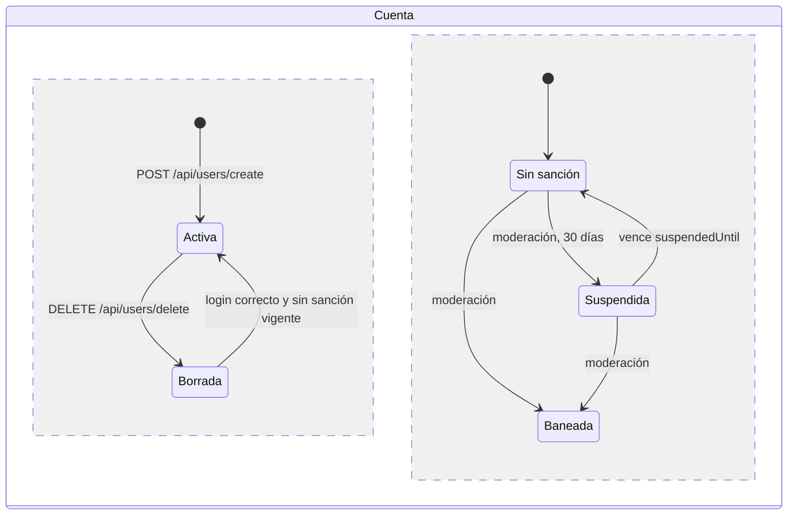

# User

## Para qué existe

El dominio `user` maneja las cuentas de la plataforma: el registro público, la edición del propio perfil (datos personales, credenciales y categorías de interés), el mensaje de agradecimiento predeterminado, el borrado lógico de la propia cuenta, la consulta del perfil de cualquier usuario y los listados de usuarios para el `ADMIN`.

El **mensaje predeterminado** (`autoThanksMessage`) es un texto por usuario, el mismo para todas sus campañas, que recibe cada donante en la respuesta de `POST /api/donations`. Se administra acá y lo lee [Donation](donation.md).

Es el dominio del que dependen casi todos los demás: el usuario autenticado sale siempre del token (ver [Seguridad](../03-seguridad.md)), y las sanciones (ban y suspensión) que aplica la moderación de reportes se guardan en la entidad `User` (ver [Reportes](report.md)). Las cuentas bancarias del usuario se gestionan en [Cuentas bancarias](bankaccount.md), pero se devuelven dentro del perfil completo. El flag `verified` lo activa el flujo de [Verificación](verification.md).

## Entidades y datos

Detalle de columnas y relaciones con el resto del modelo en [Modelo de datos](../04-modelo-de-datos.md). Lo que importa para este dominio:

| Entidad | Archivo | Qué guarda |
|---|---|---|
| `User` | `entity/user/User.java` | La cuenta: `verified`, `role`, el estado de sanción (`banned`, `bannedAt`, `suspendedUntil`, `bannedReason`), `tokensValidAfter`, `createdAt`, `updatedAt` y `deletedAt` (borrado lógico). Tabla `[user]`. |
| `UserInfo` | `entity/user/UserInfo.java` | Los datos personales y las credenciales: `firstName`, `lastName`, `email` (único), `userName` (único), `password` (hash BCrypt), `phone` (único), `description`, `profilePicture`, y el mensaje predeterminado `autoThanksMessage` (columna `auto_thanks_message`, `varchar(280)`, nulo). Tabla `user_info`, relación 1 a 1 con `User` (la FK `user_id` está en `user_info`). |
| `UserCategory` | `entity/user/UserCategory.java` | Tabla intermedia `user_category` entre `User` y `Category`: las categorías de interés del usuario (de 1 a 6). |
| `Role` | `entity/user/Role.java` | Tabla `roles` con `name` único. Los valores usados son `USER` y `ADMIN`, sembrados por `src/main/resources/data.sql`. |

Relaciones de `User` relevantes:

- `userInfo` y `verificationRequest`: `@OneToOne` inversos (`mappedBy = "user"`), con `cascade = ALL`.
- `userCategories` y `bankAccounts`: `@OneToMany` como `Set`, con `cascade = ALL` y `orphanRemoval`. Al ser `Set`, se pueden traer los dos en la misma consulta con `@EntityGraph` sin `MultipleBagFetchException`.
- `role`: `@ManyToOne` lazy, obligatorio.
- `campaigns`: `@OneToMany` hacia `Campaign`, con `cascade = ALL` y `orphanRemoval`.

**Valores iniciales.** `User` usa `@Builder` de Lombok, que ignora los inicializadores de campo que no tienen `@Builder.Default`. Como el registro arma la entidad con `User.builder()`, una cuenta recién creada queda con `banned = null` (no `false`) en la base. Por eso todas las comprobaciones de sanción toleran el `null`: `Boolean.TRUE.equals(user.getBanned())` en `AccountStatusValidationService` y `u.banned IS NULL OR u.banned = false` en el fragmento `NOT_BLOCKED`.

**Borrado lógico.** `User` tiene `@SQLRestriction("deleted_at IS NULL")`: toda consulta JPA (incluidas las `@Query` en JPQL de `repository/user/UserRepository.java`) deja afuera las cuentas borradas. Para alcanzarlas hay consultas nativas: `findByEmailIncludingDeleted` (login) y `findByIdIncludingDeleted` (moderación). `UserInfo` no tiene restricción, así que el email, el `userName` y el teléfono de una cuenta borrada siguen ocupados. La entidad también declara `@SQLDelete`, pero el borrado de cuenta no pasa por ahí: `UserService.deleteUser` pone `deletedAt` a mano y guarda.

**Fragmento `NOT_BLOCKED`.** `UserRepository` expone la constante `NOT_BLOCKED`, un fragmento JPQL con la misma regla que `AccountStatusValidationService.isBlocked`. Lo reusan los repositorios de campañas y seguidores para filtrar usuarios sancionados directamente en SQL; `:now` se pasa desde la JVM.

Repositorios: `repository/user/UserRepository.java`, `repository/user/UserInfoRepository.java` (chequeos de unicidad excluyendo al propio usuario), `repository/user/RoleRepository.java` y `repository/user/UserCategoryRepository.java`.

## Reglas de negocio

Casi todas viven en `validation/user/UserValidationService.java`. El chequeo de sanción es compartido y vive en `validation/auth/AccountStatusValidationService.java`.

| Regla | Por qué / consecuencia | Dónde |
|---|---|---|
| Un usuario tiene entre 1 y 6 categorías de interés, y todas tienen que existir. | En el registro la lista es obligatoria (vacía da error). En la edición solo se valida si se manda `categoryIds`; si no se manda, las categorías no se tocan. Los ids inexistentes se informan todos juntos en el mensaje. | `validateCategoryLimit`, `processCategories` |
| Email con formato `^[a-zA-Z0-9._%+-]+@[a-zA-Z0-9.-]+\.[a-zA-Z]{2,}$` y único. | Bean Validation solo exige que no esté vacío y su largo; el formato se chequea en la capa de validación. La unicidad se consulta excluyendo al propio usuario, para que reenviar el mismo email en una edición no choque consigo mismo. | `validateEmail` |
| `userName` de 3 a 50 caracteres, solo letras, números, `.`, `_` y `-`, y único. | Igual que el email: el DTO solo exige que no esté vacío. | `validateUserName` |
| Teléfono único. | Si el teléfono viene vacío no se consulta: consultar con `null` coincidiría con usuarios sin teléfono. | `validatePhone` |
| Contraseña de al menos 8 caracteres, con al menos un carácter especial, una mayúscula, una minúscula y un número. | Los especiales aceptados son ``! @ # $ % ^ & * ( ) , . ? " : { } \| < >``; `-` y `_` no cuentan. La contraseña se guarda con BCrypt (`PasswordEncoder` de `security/SecurityConfig.java`). | `validatePassword` |
| Los textos se normalizan solo en la edición. | En el registro, el email y el teléfono se guardan tal como llegan. En la edición, el email se guarda sin espacios y en minúsculas, y el resto de los textos (incluido el teléfono) sin espacios al principio y al final. | `createUserInfo`, `updateUserInfo` |
| Cambiar la contraseña, o el email por uno distinto, exige `currentPassword` correcta. | Se comprueba antes de modificar ningún campo. El email se compara sin espacios y en minúsculas, así que cambiar solo las mayúsculas no cuenta como cambio de credenciales. | `validateCredentialChange` |
| Un cambio de credenciales invalida todas las sesiones. | El service pone `tokensValidAfter = now`; el filtro JWT y el refresh rechazan los tokens emitidos antes (con precisión de segundos). El usuario tiene que volver a loguearse, incluida la sesión que hizo el cambio. | `service/user/UserService.java`, `service/auth/JwtService.java` |
| Todo usuario nuevo se crea con rol `USER` y `verified = false`. | No hay endpoint para crear `ADMIN` ni para cambiar el rol: los administradores se crean por SQL (`scripts/create-admin-user.sql`). | `createAndSetupUser`, `UserService.createUser` |
| "Es admin" se lee de la base, no del claim `role` del token. | El claim queda viejo si el rol cambia mientras el token sigue vigente. | `isAdmin` |
| Un usuario baneado o con suspensión vigente se oculta como si no existiera (`404`). | El perfil de un sancionado no se distingue del de un id inexistente: el mensaje es el mismo `User not found`. Una suspensión vencida (`suspendedUntil` en el pasado) ya no bloquea. | `validateProfileNotBlocked`, `AccountStatusValidationService.isBlocked` |
| El borrado es lógico y cierra las campañas del usuario. | Se marca `deletedAt` y se pasan a `CLOSED` todas sus campañas que no lo estuvieran, registrando la transición en el historial (`CampaignService.closeAllByOwner`). | `UserService.deleteUser`, `service/campaign/CampaignService.java` |
| El mensaje predeterminado es obligatorio al fijarlo, de hasta 280 caracteres. | Se guarda con `trim`. `null`, `""` o solo espacios en el `PUT` responden `400 Auto thanks message cannot be blank`: para quitarlo está el `DELETE`. El largo lo corta `@Size(max = 280)` en `UpdateAutoThanksDTO` y la validación lo repite sobre el texto recortado (`MAX_AUTO_THANKS_LENGTH`). La regla de texto es la compartida de `validation/common/TextValidationService.java`. | `validateAndNormalizeAutoThanksMessage` |
| Loguearse con una cuenta borrada la restaura. | El login busca incluyendo borrados y, si la contraseña es correcta y la cuenta no está sancionada, pone `deletedAt = null` (ver [Auth](auth.md)). Las campañas que se cerraron al borrar siguen `CLOSED`. Una cuenta borrada y además sancionada recibe `403` y sigue borrada. | `service/auth/AuthenticationService.java` |

## Estados

Este dominio no tiene un enum de estado. El estado de una cuenta se deduce de tres columnas de `User` (`deletedAt`, `banned`, `suspendedUntil`) y tiene dos ejes independientes: el borrado (lo decide el propio usuario) y la sanción (la decide la moderación de reportes, en `service/report/ReportActionService.java`). Sancionar no toca `deletedAt`, y borrar no toca las columnas de sanción:

- **Borrada:** invisible para todas las consultas JPA. Su token deja de autenticar (`401`) porque el filtro carga al usuario con `findByIdForRequest`, que respeta `@SQLRestriction`. Los tokens no se revocan: si la cuenta se restaura con un login, los tokens previos que no hayan vencido vuelven a autenticar.
- **Suspendida / Baneada:** el filtro JWT corta cualquier request autenticado con `403` y el mensaje del login (ver [Seguridad](../03-seguridad.md)). Para los demás, su perfil responde `404`. La moderación alcanza también a cuentas borradas (las busca con `findByIdIncludingDeleted`); una cuenta borrada y sancionada no se puede restaurar mientras dure la sanción, porque el login responde `403` antes de restaurar. Banear a un baneado o suspender a alguien baneado o con una suspensión vigente no cambia nada. No hay endpoint para levantar un ban.

## Visibilidad y permisos

| Quién | `GET /api/users/{id}` de otro usuario activo | De un usuario baneado o suspendido | De un usuario borrado | Su propio perfil |
|---|---|---|---|---|
| `USER` | `PublicUserProfileDTO` | `404 User not found` | `404 User not found` | `UserDTO` completo |
| `ADMIN` | `UserDTO` completo | `UserDTO` completo | `404 User not found` | `UserDTO` completo |
| Sin token | `401` | `401` | `401` | no aplica |

- **Perfil público vs completo.** El `PublicUserProfileDTO` no incluye email, teléfono, `verified` ni cuentas bancarias. El `UserDTO` completo sí, con el número de cuenta; por eso solo lo ven el propio usuario y el `ADMIN`.
- **`404` y no `403`.** Ver el perfil de otro nunca da `403`: o se devuelve el perfil público, o `404` si está sancionado o no existe. Así una sanción no se filtra a terceros. El criterio general está en [Errores y validación](../05-errores-y-validacion.md).
- **`403` del dominio:** solo los listados (`/list` y `/list/paginated`), protegidos con `@PreAuthorize("hasRole('ADMIN')")`, y el corte del filtro JWT a un usuario sancionado que llama con su token.
- **Modificar.** `PUT /update`, `DELETE /delete` y los tres verbos de `/me/auto-thanks` no reciben id: actúan siempre sobre el usuario del token (`AuthenticatedUserService.getAuthenticatedUserId`). Cada usuario solo ve y cambia su propio mensaje predeterminado; no aparece en `UserDTO`, `UserInfoDTO` ni `PublicUserProfileDTO`. No existe forma de editar ni borrar a otro usuario desde este dominio; un `ADMIN` sanciona por medio de [Reportes](report.md).
- **Listados para `ADMIN`.** Incluyen a los usuarios sancionados (el `ADMIN` los ve) pero no a los borrados (por `@SQLRestriction`). El `UserDTO` no expone las columnas de sanción.
- **Acceso por ruta.** En `security/SecurityConfig.java`, `/api/users/create` está en `PUBLIC_URLS` y `/api/users/*/supporters` en `PUBLIC_GET_URLS` (solo `GET`); el resto de `/api/users/**` cae en `anyRequest().authenticated()`. El `*` cubre un solo segmento, así que `GET /api/users/{id}` sigue pidiendo token. No hay reglas por verbo para `/api/users/**`: la restricción a `ADMIN` está en el `@PreAuthorize` de cada método del controller.
- **Supporters de un usuario.** `GET /api/users/{userId}/supporters` cuelga de la ruta del usuario, pero es del dominio donation (`controller/donation/SupporterController.java`); ver [Donation](donation.md#get-apiusersuseridsupporters). Aplica las mismas reglas de visibilidad que `GET /api/users/{id}` sobre el creador: `ID must be a positive number` para `id <= 0`, y `404 User not found` si no existe, está borrado o, para quien no es él mismo ni `ADMIN`, está sancionado.
- **La primera ruta anónima que distingue ids de usuario.** Como `GET /api/users/{userId}/supporters` es pública, sin token responde `200` para un id de usuario existente y `404` para uno inexistente: ninguna ruta anónima lo hacía antes (`GET /api/users/{id}` sin token da `401` en los dos casos). No revela sanciones, porque un usuario sancionado da el mismo `404` que uno inexistente, y los ids de los dueños de campañas ya eran públicos (`userId` en `/api/campaigns/list`).

## Endpoints

Todos están en `controller/user/UserController.java`, con prefijo `@RequestMapping("/api/users")`. Las rutas `/api/users/{userId}/follow`, `/followers/**` y `/supporters` tienen el mismo prefijo, pero son de otros dominios: [Follower](follower.md) y [Donation](donation.md#get-apiusersuseridsupporters). Errores comunes a todos los endpoints autenticados (los genera el filtro JWT o el entry point de `security/SecurityConfig.java`, con la forma `{error, message, timestamp, path}`):

| Status | Mensaje | Cuándo |
|---|---|---|
| 401 | `Full authentication is required to access this resource` | Sin header `Authorization: Bearer`, token inválido, vencido, revocado por logout, refresh token en lugar de access token, cuenta borrada o token emitido antes del último cambio de credenciales. |
| 403 | `Your account has been banned. Reason: <motivo>` | El usuario del token está baneado. |
| 403 | `Your account is suspended until <fecha>. Reason: <motivo>` | El usuario del token tiene una suspensión vigente. |

El resto de los errores los arma `exception/GlobalExceptionHandler.java` con la forma `{error, message, timestamp}`, sin `path`. Eso incluye el `403` de `@PreAuthorize` en los listados (`AccessDeniedException`), que lleva el mismo mensaje que el `accessDeniedHandler` de `SecurityConfig`. Los de Bean Validation agregan `fields` con el mensaje por defecto de cada campo (por ejemplo `"userInfo.email": "must not be blank"`). En `POST /create` y `PUT /update`, un `Content-Type` distinto de JSON responde `415` con `Content type '<tipo>' is not supported. Use application/json`.

### `GET /api/users/list`

- **Acceso:** solo `ADMIN` (`@PreAuthorize("hasRole('ADMIN')")`).
- **Parámetros:** ninguno.
- **Body:** sin body.
- **Respuesta:** `200` con una lista de `UserDTO` (ver la tabla de `UserDTO` en `GET /api/users/{id}`), sin paginar. Incluye usuarios sancionados y excluye los borrados.
- **Errores:**

| Status | Mensaje | Cuándo |
|---|---|---|
| 401 / 403 | (comunes, ver arriba) | Sin token válido o usuario sancionado. |
| 403 | `You don't have permission to access this resource` | El usuario autenticado no es `ADMIN`. |

- **Qué hace:** `UserService.listUsers` llama a `UserRepository.findAllWithDetails`, que trae con un `@EntityGraph` en una sola consulta todo lo que lee el mapper (`userInfo`, `verificationRequest`, categorías y cuentas bancarias), y mapea cada usuario con `UserMapper.toUserDTO`.

### `POST /api/users/create`

- **Acceso:** público (está en `PUBLIC_URLS`). Si se manda un token de un usuario sancionado, el filtro igual responde `403`.
- **Parámetros:** ninguno.
- **Body:** `UserUserInfoRequestDTO`, con dos objetos obligatorios (`@NotNull @Valid`):

`user` (`CreateUserDTO`):

| Campo | Tipo | Obligatorio | Validación |
|---|---|---|---|
| `categoryIds` | `List<Long>` | sí | Entre 1 y 6 ids de categorías existentes (en `UserValidationService`). Si se omite, vale lista vacía y falla por mínimo; si se manda `null` explícito, no hay anotación que lo frene y termina en `500`. |

`userInfo` (`CreateUserInfoDTO`):

| Campo | Tipo | Obligatorio | Validación |
|---|---|---|---|
| `firstName` | `String` | sí | `@NotBlank`, `@Size(max = 255)` |
| `lastName` | `String` | sí | `@NotBlank`, `@Size(max = 255)` |
| `email` | `String` | sí | `@NotBlank`, `@Size(max = 254)`; formato y unicidad en `UserValidationService` |
| `userName` | `String` | sí | `@NotBlank`; de 3 a 50 caracteres, `[a-zA-Z0-9._-]`, único |
| `password` | `String` | sí | `@NotBlank`; reglas de contraseña de "Reglas de negocio" |
| `phone` | `String` | sí | `@NotBlank`, `@Size(max = 20)`; único |
| `description` | `String` | sí (puede ser `""`) | `@NotNull`, `@Size(max = 255)` |
| `profilePicture` | `String` | no | `@Size(max = 255)` |

- **Respuesta:** `200` con el `UserDTO` del usuario creado (`verified: false`, `bankAccounts: []`).
- **Errores:**

| Status | Mensaje | Cuándo |
|---|---|---|
| 400 | `One or more fields are invalid` (con `fields`) | Falla Bean Validation (falta `user` o `userInfo`, campo vacío, largo excedido). |
| 400 | `Request body is required` / `Malformed request body` | Sin body o JSON inválido. |
| 400 | `User must have at least 1 category` | `categoryIds` vacío u omitido. |
| 400 | `User cannot have more than 6 categories` | Más de 6 ids. |
| 404 | `Categories not found: [<ids>]` | Algún id de categoría no existe. |
| 400 | `Invalid email format` | El email no cumple el formato. |
| 409 | `Email already exists` | Otro usuario (incluso borrado) tiene ese email. |
| 400 | `Username can only contain letters, numbers, '.', '_', and '-'` | Caracteres no permitidos en `userName`. |
| 400 | `Username must be between 3 and 50 characters` | Largo de `userName` fuera de rango. |
| 409 | `Username already exists` | `userName` en uso. |
| 409 | `Phone already exists` | Teléfono en uso. |
| 400 | `Password must be at least 8 characters long` | Contraseña corta. |
| 400 | `Password must contain at least one special character` | Sin carácter especial. |
| 400 | `Password must contain at least one uppercase letter` | Sin mayúscula. |
| 400 | `Password must contain at least one lowercase letter` | Sin minúscula. |
| 400 | `Password must contain at least one number` | Sin número. |
| 404 | `Role not found` | No existe el rol `USER` en la tabla `roles` (base sin el seed de `data.sql`). |
| 409 | `The request conflicts with existing data` | Una restricción única de la base salta por una carrera entre dos registros simultáneos. |
| 500 | `An unexpected error occurred. Please try again later.` | `user.categoryIds` llega como `null` explícito. |

- **Qué hace** (`UserService.createUser`, transaccional):
  1. Valida el límite de categorías y carga las categorías en una sola consulta (`validateCategoryLimit`, `processCategories`).
  2. Construye el `User` con `verified = false` y sus relaciones `UserCategory` (`createAndSetupUser`, `createUserCategoryRelations`).
  3. Valida email, `userName`, teléfono y contraseña, en ese orden, mapea el `UserInfo` tal como llegó (sin normalizar mayúsculas ni espacios) y le pone el hash BCrypt de la contraseña (`createUserInfo`).
  4. Asigna el rol `USER`, vincula `UserInfo` y guarda `User` (el `UserInfo` y las categorías se guardan en cascada).
  5. Devuelve `UserMapper.toUserDTO`. No hace login: para obtener tokens hay que llamar a `POST /auth/login`.

### `PUT /api/users/update`

- **Acceso:** cualquier usuario autenticado (`USER` o `ADMIN`); actúa sobre el usuario del token.
- **Parámetros:** ninguno.
- **Body:** `UpdateUserDTO`. Todos los campos son opcionales; un campo omitido, `null` o en blanco no se modifica (salvo `description` y `profilePicture`, que aceptan `""`). Los textos se guardan sin espacios al principio y al final, y el email además en minúsculas.

| Campo | Tipo | Obligatorio | Validación |
|---|---|---|---|
| `categoryIds` | `List<Long>` | no | Si viene, reemplaza las categorías: entre 1 y 6, todas existentes. |
| `firstName` | `String` | no | `@Size(max = 255)` |
| `lastName` | `String` | no | `@Size(max = 255)` |
| `email` | `String` | no | `@Size(max = 254)`; formato y unicidad. Si cambia, exige `currentPassword`. |
| `userName` | `String` | no | De 3 a 50 caracteres, `[a-zA-Z0-9._-]`, único. |
| `password` | `String` | no | Reglas de contraseña. Exige `currentPassword`. |
| `phone` | `String` | no | `@Size(max = 20)`; único. |
| `description` | `String` | no | `@Size(max = 255)` |
| `profilePicture` | `String` | no | `@Size(max = 255)` |
| `currentPassword` | `String` | solo si cambia `password` o `email` | Tiene que coincidir con la contraseña actual. |

- **Respuesta:** `200` con el `UserDTO` actualizado. Si cambiaron las credenciales, el token con el que se llamó ya no sirve: el siguiente request da `401` y hay que volver a loguearse.
- **Errores:**

| Status | Mensaje | Cuándo |
|---|---|---|
| 401 / 403 | (comunes, ver arriba) | Sin token válido o usuario sancionado. |
| 400 | `One or more fields are invalid` (con `fields`) | Algún `@Size` excedido. |
| 400 | `Request body is required` / `Malformed request body` | Sin body o JSON inválido. |
| 400 | `Current password is required to change email or password` | Cambia `password` o `email` sin `currentPassword`. |
| 400 | `Current password is incorrect` | `currentPassword` no coincide. |
| 400 | `Invalid email format` | Email mal formado (los espacios al principio o al final también lo rompen). |
| 409 | `Email already exists` | Email de otro usuario. |
| 400 | `Username can only contain letters, numbers, '.', '_', and '-'` | Caracteres no permitidos. |
| 400 | `Username must be between 3 and 50 characters` | Largo fuera de rango. |
| 409 | `Username already exists` | `userName` de otro usuario. |
| 400 | `Password must be at least 8 characters long` (y los otros cuatro mensajes de contraseña) | La nueva contraseña no cumple las reglas. |
| 409 | `Phone already exists` | Teléfono de otro usuario. |
| 400 | `User must have at least 1 category` | `categoryIds: []`. |
| 400 | `User cannot have more than 6 categories` | Más de 6 ids. |
| 404 | `Categories not found: [<ids>]` | Algún id de categoría no existe. |
| 409 | `The request conflicts with existing data` | Carrera contra una restricción única de la base. |

- **Qué hace** (`UserService.updateUser`, transaccional):
  1. Obtiene el id del token y carga el usuario (`UserValidationService.getUserById`).
  2. Antes de tocar nada, decide si hay cambio de credenciales y valida `currentPassword` (`validateCredentialChange`).
  3. Actualiza `updatedAt` y los campos de `UserInfo` que vinieron, validando cada uno: nombres, email, `userName`, contraseña (re-hasheada), teléfono, descripción y foto (`updateUserInfo`).
  4. Si vino `categoryIds`, valida y sincroniza las categorías: quita las que ya no están y agrega las nuevas (`updateUserCategories`, con `orphanRemoval`).
  5. Si cambiaron las credenciales, pone `tokensValidAfter = now`, lo que invalida todos los access y refresh tokens emitidos hasta ahora.
  6. Guarda y devuelve `UserMapper.toUserDTO`. Como todo corre en una transacción, un error en cualquier paso no deja cambios a medias.

### `DELETE /api/users/delete`

- **Acceso:** cualquier usuario autenticado; borra la cuenta del token.
- **Parámetros:** ninguno.
- **Body:** sin body.
- **Respuesta:** `200` con `{"message": "User deleted successfully", "success": "true"}` (`success` es un string).
- **Errores:**

| Status | Mensaje | Cuándo |
|---|---|---|
| 401 / 403 | (comunes, ver arriba) | Sin token válido o usuario sancionado. Una cuenta ya borrada recibe `401` del filtro. |
| 404 | `User not found` | El usuario del token no se encuentra (en la práctica el filtro ya respondió `401`). |
| 409 | `User is already deleted` | Definido en el service, pero no se alcanza: `findById` no ve cuentas borradas. |

- **Qué hace** (`UserService.deleteUser`, transaccional):
  1. Obtiene el id del token y carga el usuario.
  2. Cierra todas sus campañas que no estuvieran `CLOSED`, con lock sobre la meta y registro en el historial de estados (`CampaignService.closeAllByOwner`; ver [Campañas](campaign.md)).
  3. Pone `deletedAt = now` y guarda. No borra filas ni relaciones: cuentas bancarias, seguidores, publicaciones y donaciones quedan en la base.
  4. Desde ese momento sus tokens no autentican (`401`), pero no se revocan ni se toca `tokensValidAfter`. Un login posterior con la misma contraseña restaura la cuenta (y con ella vuelven a valer los tokens previos que no hayan vencido), pero no reabre las campañas.

### `GET /api/users/{id}`

- **Acceso:** cualquier usuario autenticado. Lo que devuelve depende de quién llama (ver "Visibilidad y permisos").
- **Parámetros:**

| Parámetro | Tipo | Obligatorio | Validación |
|---|---|---|---|
| `id` (path) | `Long` | sí | Mayor que 0. |

- **Body:** sin body.
- **Respuesta:** `200`. El cuerpo es uno de dos DTOs (el método del controller devuelve `Object`):

`UserDTO`, para el propio usuario y para un `ADMIN`:

| Campo | Tipo | Contenido |
|---|---|---|
| `id` | `Long` | Id del usuario. |
| `verified` | `Boolean` | Si la cuenta fue verificada. |
| `categories` | `List<String>` | Nombres de sus categorías de interés. |
| `userInfo` | `UserInfoDTO` | `firstName`, `lastName`, `email`, `userName`, `phone`, `description`, `profilePicture`. Nunca la contraseña. |
| `bankAccounts` | `List<BankAccountDTO>` | `id`, `userId`, `bankName`, `accountNumber`, `accountType`, `accountHolder`. Lista vacía si no tiene. |

`PublicUserProfileDTO`, para cualquier otro:

| Campo | Tipo | Contenido |
|---|---|---|
| `id` | `Long` | Id del usuario. |
| `categories` | `List<String>` | Nombres de sus categorías de interés. |
| `firstName`, `lastName`, `userName` | `String` | Datos públicos. |
| `description`, `profilePicture` | `String` | Datos públicos. |

- **Errores:**

| Status | Mensaje | Cuándo |
|---|---|---|
| 401 / 403 | (comunes, ver arriba) | Sin token válido o usuario sancionado. |
| 400 | `Invalid value '<valor>' for parameter 'id'` | `id` no numérico. |
| 400 | `ID must be a positive number` | `id` menor o igual a 0. |
| 404 | `User not found` | El usuario no existe o está borrado. |
| 404 | `User not found` | El usuario está baneado o suspendido y quien llama no es él mismo ni `ADMIN`. |

- **Qué hace** (`UserService.getUserById`):
  1. Valida que el id sea positivo.
  2. Carga el usuario con sus datos, categorías y cuentas bancarias en una consulta (`findByIdWithFullDetails`), o `404`.
  3. Si quien llama es el mismo usuario o es `ADMIN` (leído de la base con `isAdmin`), devuelve `UserMapper.toUserDTO`.
  4. Si no, aplica `validateProfileNotBlocked` (`404` con el mismo mensaje que un inexistente) y devuelve `UserMapper.toPublicUserProfileDTO`.

### `GET /api/users/me/auto-thanks`

- **Acceso:** cualquier usuario autenticado; lee el mensaje del usuario del token. La ruta tiene un segmento más que `GET /api/users/{id}`, así que no chocan.
- **Parámetros:** ninguno.
- **Body:** sin body.
- **Respuesta:** `200` con `AutoThanksResponseDTO`: `{"autoThanksMessage": "¡Gracias por tu apoyo!"}`, o `{"autoThanksMessage": null}` si no configuró ninguno.
- **Errores:**

| Status | Mensaje | Cuándo |
|---|---|---|
| 401 / 403 | (comunes, ver arriba) | Sin token válido o usuario sancionado. |

- **Qué hace** (`UserService.getAutoThanksMessage`): carga el usuario del token (`UserValidationService.getUserById`) y devuelve `userInfo.autoThanksMessage`.

### `PUT /api/users/me/auto-thanks`

- **Acceso:** cualquier usuario autenticado; fija el mensaje del usuario del token.
- **Parámetros:** ninguno.
- **Body:** `UpdateAutoThanksDTO`.

| Campo | Tipo | Obligatorio | Validación |
|---|---|---|---|
| `autoThanksMessage` | `String` | sí | `@Size(max = 280, message = "Auto thanks message must be at most 280 characters")`. Ausente o en blanco → `400` (regla de negocio). |

- **Respuesta:** `200` con `AutoThanksResponseDTO`, con el texto ya recortado.
- **Errores:**

| Status | Mensaje | Cuándo |
|---|---|---|
| 401 / 403 | (comunes, ver arriba) | Sin token válido o usuario sancionado. |
| 400 | `Request body is required` / `Malformed request body` | Sin body o JSON inválido. |
| 400 | `One or more fields are invalid`, con `fields.autoThanksMessage = "Auto thanks message must be at most 280 characters"` | Más de 280 caracteres, contando los espacios de los extremos. |
| 400 | `Auto thanks message cannot be blank` (con `error: "Business logic error"`) | `autoThanksMessage` ausente, `null`, `""` o solo espacios. El mensaje anterior no cambia. |

- **Qué hace** (`UserService.updateAutoThanksMessage`, transaccional):
  1. Normaliza el texto (`validateAndNormalizeAutoThanksMessage`) antes de cargar nada: un texto en blanco no toca la base.
  2. Carga el usuario del token, actualiza `userInfo.updatedAt` (`updateUserInfoTimestamp`) y fija `autoThanksMessage`.
  3. Guarda el `User` (el `cascade = ALL` llega a `UserInfo`) y devuelve el texto normalizado.

  El cambio vale para las donaciones siguientes. Las ya hechas no guardan el mensaje, así que no se modifican.

### `DELETE /api/users/me/auto-thanks`

- **Acceso:** cualquier usuario autenticado; quita el mensaje del usuario del token.
- **Parámetros:** ninguno.
- **Body:** sin body.
- **Respuesta:** `200` con `{"autoThanksMessage": null}`. Borrar sin tener un mensaje también responde `200`.
- **Errores:**

| Status | Mensaje | Cuándo |
|---|---|---|
| 401 / 403 | (comunes, ver arriba) | Sin token válido o usuario sancionado. |

- **Qué hace** (`UserService.deleteAutoThanksMessage`, transaccional): carga el usuario del token, actualiza `userInfo.updatedAt`, pone `autoThanksMessage = null` y guarda. Desde ahí, `POST /api/donations` a sus campañas devuelve `autoThanksMessage: null`.

### `GET /api/users/list/paginated`

- **Acceso:** solo `ADMIN` (`@PreAuthorize("hasRole('ADMIN')")`).
- **Parámetros** (query, todos opcionales, validados por `validation/common/SortValidationService.java`):

| Parámetro | Tipo | Default | Validación |
|---|---|---|---|
| `page` | `int` | `0` | Mayor o igual a 0. |
| `size` | `int` | `10` | Entre 1 y 100. |
| `sortBy` | `String` | `id` | Solo `id` o `createdAt` (lista `USER_SORT_FIELDS` del controller). |
| `sortDirection` | `String` | `asc` | `asc` o `desc`, sin distinguir mayúsculas. |

- **Body:** sin body.
- **Respuesta:** `200` con un `Page<UserDTO>` de Spring (`content`, `totalElements`, `totalPages`, `number`, `size`, etc.). Incluye usuarios sancionados y excluye los borrados.
- **Errores:**

| Status | Mensaje | Cuándo |
|---|---|---|
| 401 / 403 | (comunes, ver arriba) | Sin token válido o usuario sancionado. |
| 403 | `You don't have permission to access this resource` | El usuario no es `ADMIN`. |
| 400 | `Invalid value '<valor>' for parameter '<nombre>'` | `page` o `size` no numéricos. |
| 400 | `Page must be greater than or equal to 0` | `page` negativo. |
| 400 | `Size must be between 1 and 100` | `size` fuera de rango. |
| 400 | `Invalid sortBy '<valor>'. Allowed: id, createdAt` | `sortBy` no permitido. |
| 400 | `Invalid sortDirection '<valor>'. Allowed: asc, desc` | Dirección inválida. |

- **Qué hace** (`UserService.listUsersWithPagination`), en dos pasos:
  1. Pagina en SQL solo los ids (`findPageOfIds`, con el `ORDER BY` del `Pageable` y una consulta de conteo propia).
  2. Carga esos usuarios con todas sus colecciones (`findAllWithDetailsByIdIn`) y los reordena según la página. Si un usuario se borró entre las dos consultas, se saltea.

  El motivo, según el comentario del service: traer las colecciones en la consulta paginada hacía que Hibernate paginara en memoria (`HHH90003004`). Separar ids y datos mantiene la paginación en la base y evita N+1.

## Clases involucradas

| Capa | Archivos |
|---|---|
| Controller | `controller/user/UserController.java` |
| Service | `service/user/UserService.java` (usa también `service/campaign/CampaignService.java` al borrar) |
| Validation | `validation/user/UserValidationService.java`, `validation/auth/AccountStatusValidationService.java`, `validation/common/SortValidationService.java`, `validation/common/TextValidationService.java` |
| Mapper | `mapper/user/UserMapper.java`, `mapper/user/UserInfoMapper.java` (usa `mapper/bankaccount/BankAccountMapper.java`) |
| Repository | `repository/user/UserRepository.java`, `repository/user/UserInfoRepository.java`, `repository/user/RoleRepository.java`, `repository/user/UserCategoryRepository.java`, `repository/category/CategoryRepository.java` |
| DTOs | `dtos/user/UserUserInfoRequestDTO.java`, `dtos/user/CreateUserDTO.java`, `dtos/user/CreateUserInfoDTO.java`, `dtos/user/UpdateUserDTO.java`, `dtos/user/UserDTO.java`, `dtos/user/UserInfoDTO.java`, `dtos/user/PublicUserProfileDTO.java`, `dtos/user/UpdateAutoThanksDTO.java`, `dtos/user/AutoThanksResponseDTO.java`, `dtos/user/UserInfoResponseDTO.java` (sin uso en el código) |
| Entity | `entity/user/User.java`, `entity/user/UserInfo.java`, `entity/user/UserCategory.java`, `entity/user/Role.java` |
| Seguridad | `security/AuthenticatedUserService.java`, `security/JwtAuthenticationFilter.java`, `security/SecurityConfig.java` |
