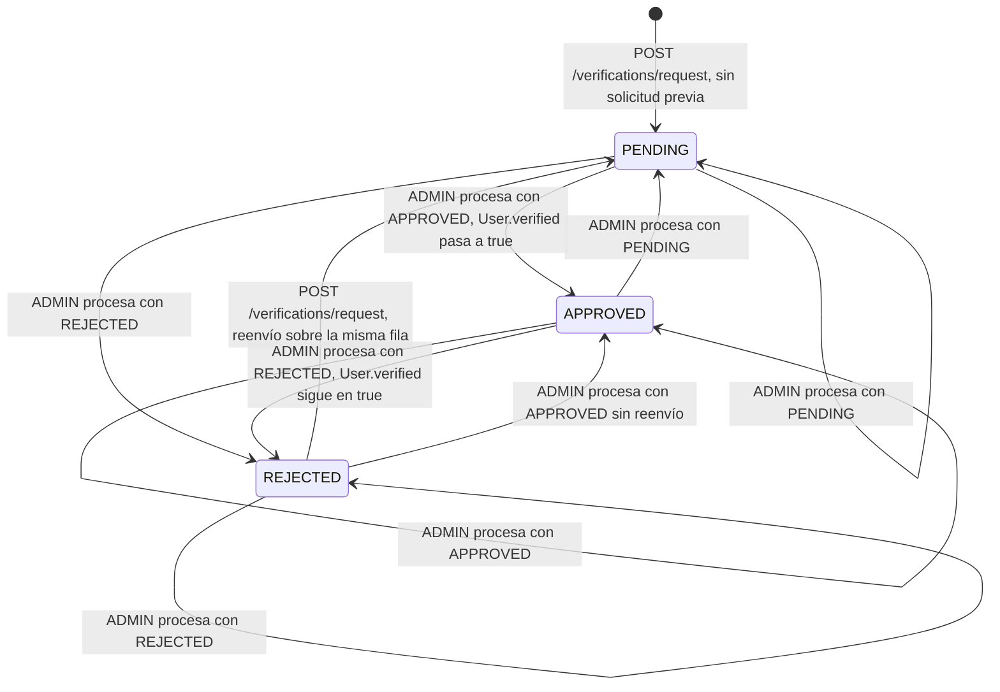

# Verification

## Para qué existe

Un usuario pide que la plataforma verifique su identidad mandando tres referencias a documentos: frente del DNI, dorso del DNI y una selfie. Un `ADMIN` aprueba o rechaza la solicitud. Aprobarla marca al usuario como verificado (`User.verified = true`).

Ese flag tiene efecto en otros dominios:

- **Cuentas bancarias:** solo un usuario verificado puede vincular una cuenta. `validation/bankaccount/BankAccountValidationService.java` (`verifyUserIsVerified`) responde `403` con `"User is not verified"` si no lo está. Ver [bankaccount.md](bankaccount.md).
- **Perfil propio:** el `UserDTO` completo (que ven el propio usuario y los `ADMIN`) incluye `verified`; el perfil público de otro usuario (`PublicUserProfileDTO`) no lo incluye. Ver [user.md](user.md).

El dominio no recibe archivos: los tres campos son strings de hasta 255 caracteres que se guardan tal cual, sin validar su formato. Lo esperable es que el cliente suba las imágenes a otro lado y mande sus URLs, pero el código no lo comprueba.

## Entidades y datos

**`VerificationRequest`** (`entity/verification/VerificationRequest.java`, tabla `verification_request`):

| Campo | Columna | Tipo | Notas |
|---|---|---|---|
| `id` | `id` | `Long` | Identidad autogenerada. |
| `user` | `user_id` | `User` | `@OneToOne` dueño de la relación, `@JoinColumn(nullable = false)`. Carga `EAGER` (default de `@OneToOne`). |
| `dniFront` | `dni_front` | `String` | Obligatorio. |
| `dniBack` | `dni_back` | `String` | Obligatorio. |
| `selfieUser` | `selfie_user` | `String` | Obligatorio. |
| `status` | `status` | `String` | Guarda el nombre de un `VerificationStatus` como texto. No es `@Enumerated`: se convierte a mano con `VerificationStatus.valueOf(...)` en la validación y en el mapper. |
| `createdAt` | `created_at` | `LocalDateTime` | No actualizable. Lo pone el mapper al crear. |
| `updatedAt` | `updated_at` | `LocalDateTime` | Se actualiza al reenviar y al procesar. |
| `deletedAt` | `deleted_at` | `LocalDateTime` | Soft delete. |

La entidad tiene `@SQLDelete` (un `delete` hace `UPDATE ... SET deleted_at = CURRENT_TIMESTAMP`) y `@SQLRestriction("deleted_at IS NULL")`, como el resto de las entidades con borrado lógico (ver [04-modelo-de-datos.md](../04-modelo-de-datos.md)). Ningún endpoint de este dominio borra solicitudes.

**Relación con `User`:** `User` tiene el lado inverso (`User.verificationRequest`, `mappedBy = "user"`, `cascade = ALL`). Es una relación uno a uno: **cada usuario tiene como máximo una solicitud**, y reenviar después de un rechazo reutiliza la misma fila. El lado inverso no se lee en ningún lugar del código, pero varios repositorios de otros dominios lo incluyen en sus `JOIN FETCH` o `@EntityGraph`: Hibernate carga los `@OneToOne` inversos aunque estén marcados `LAZY`, y traerlo en la misma consulta evita un `SELECT` extra por usuario.

**`VerificationStatus`** (`entity/verification/VerificationStatus.java`): `PENDING`, `APPROVED`, `REJECTED`.

**Flag del usuario:** `User.verified` (`entity/user/User.java`, columna `is_verified`, `false` por defecto). Es el dato que leen los demás dominios; la solicitud solo es el camino para cambiarlo.

## Reglas de negocio

| Regla | Por qué / consecuencia | Dónde |
|---|---|---|
| El usuario de la solicitud tiene que existir y no estar borrado. | `findById` respeta el `@SQLRestriction` de `User`, así que un usuario borrado da el mismo `404 "User not found."` que uno inexistente. | `validation/verification/VerificationRequestValidationService.java` (`validateAndGetUser`) |
| Un usuario ya verificado no puede pedir verificación. | No tiene sentido una segunda revisión: responde `409 "User is already verified."`. | `VerificationRequestValidationService.validateUserNotVerified` |
| No puede haber dos solicitudes pendientes del mismo usuario. | Si la solicitud existente está `PENDING`, responde `409 "There is already a pending request for this user."`. | `service/verification/VerificationRequestService.java` (la comprobación usa `isPendingRequest` de la validación, pero la excepción se lanza en el service) |
| Una solicitud rechazada se puede reenviar. | Si la existente está `REJECTED`, se sobrescriben los tres documentos, vuelve a `PENDING` y se actualiza `updatedAt`. Se reutiliza la fila (la relación es uno a uno), así que `createdAt` conserva la fecha del primer envío. | `VerificationRequestService.createVerificationRequest`, `mapper/verification/VerificationRequestMapper.java` (`updateFromDto`) |
| Solo un `ADMIN` procesa solicitudes. | `@PreAuthorize("hasRole('ADMIN')")` en el controller. | `controller/verification/VerificationRequestController.java` |
| Aprobar marca al usuario como verificado. | `approveUserVerification` pone `verified = true`, actualiza `updatedAt` del usuario y lo guarda. | `VerificationRequestValidationService.approveUserVerification` |
| Rechazar no toca el flag del usuario. | Si el usuario ya estaba verificado (por una aprobación anterior), sigue verificado: no hay ningún camino en el código que vuelva `verified` a `false`. | `VerificationRequestService.processVerificationRequest` |
| Procesar no mira el estado actual. | El `ADMIN` puede llevar la solicitud a cualquiera de los tres estados desde cualquier estado, incluido `PENDING` y el mismo estado que ya tiene. Ver "Estados". | `VerificationRequestService.processVerificationRequest` |
| El usuario de la solicitud sale del body, no del token. | `CreateVerificationRequestDTO.userId` decide para quién es la solicitud; el dominio no usa `AuthenticatedUserService`. Consecuencia: cualquier usuario autenticado puede crear o reenviar una solicitud a nombre de otro. | `dtos/verification/CreateVerificationRequestDTO.java`, `VerificationRequestService.createVerificationRequest` |
| Las sanciones no se miran. | Ninguna validación del dominio consulta ban ni suspensión. Un usuario sancionado no puede llamar a la API (el filtro JWT lo corta), pero otro usuario puede crear una solicitud a su nombre, un `ADMIN` puede aprobarla y cualquiera puede consultar su estado. | `VerificationRequestValidationService` |

## Estados

Las tres primeras transiciones (y el reenvío) son el flujo previsto. El resto existe porque `processVerificationRequest` asigna el estado del body sin comprobar el actual: el código no las prohíbe, y el diagrama las muestra porque son posibles hoy.

Desde el lado del usuario, el `POST` solo produce dos transiciones: crear (`[*] → PENDING`) y reenviar (`REJECTED → PENDING`). Con la solicitud en `PENDING` responde `409`. Con el usuario verificado responde `409` antes de mirar la solicitud. El caso "solicitud `APPROVED` y usuario no verificado" no se alcanza con la API actual (aprobar siempre deja `verified = true` y nada lo revierte); si se diera, el service intentaría insertar una segunda fila para el mismo usuario.

## Visibilidad y permisos

| Acción | Quién | Cómo se aplica |
|---|---|---|
| Crear o reenviar una solicitud | Cualquier usuario autenticado y no sancionado, para cualquier `userId` | `anyRequest().authenticated()` en `security/SecurityConfig.java`; sin control de dueño. |
| Procesar una solicitud | Solo `ADMIN` | `@PreAuthorize("hasRole('ADMIN')")`. El rol viene de la base: el filtro JWT carga el usuario en cada request y arma la autoridad `ROLE_<rol>` (ver [03-seguridad.md](../03-seguridad.md)). |
| Consultar el estado de verificación | Cualquier usuario autenticado y no sancionado, de cualquier usuario | `anyRequest().authenticated()`; sin control de dueño ni de rol. |

**`404` vs `403` en este dominio:**

- El único `403` propio es el de `@PreAuthorize` al procesar sin ser `ADMIN`. Los demás `403` vienen del filtro JWT (cuenta baneada o suspendida).
- Los `404` usan tres mensajes distintos según el caso: `"User not found."` (crear, usuario inexistente o borrado), `"Verification request not found."` (procesar, `requestId` inexistente) y `"No verification request found."` (consultar estado). El último no distingue entre "el usuario no existe" y "el usuario existe pero nunca pidió verificación".
- A diferencia de los perfiles de usuario, este dominio no oculta a los usuarios sancionados detrás de un `404`: su estado de verificación se puede consultar como el de cualquier otro.

## Endpoints

Errores comunes a los tres endpoints (todos requieren token; ver [03-seguridad.md](../03-seguridad.md) y [05-errores-y-validacion.md](../05-errores-y-validacion.md)):

| Status | Mensaje | Cuándo |
|---|---|---|
| 401 | `Full authentication is required to access this resource` | Sin header `Authorization: Bearer`, o con un token rechazado por el filtro (inválido, vencido, revocado, refresh token en lugar de access token, emitido antes del último cambio de email o contraseña, usuario borrado). |
| 403 | `Your account has been banned. Reason: <motivo>` | El usuario del token está baneado (`<motivo>` es `bannedReason` o `Violation of terms`). |
| 403 | `Your account is suspended until <fecha>. Reason: <motivo>` | El usuario del token tiene una suspensión vigente. |
| 405 | `Method <MÉTODO> is not supported for this endpoint` | Método HTTP equivocado sobre una ruta existente. |
| 500 | `An unexpected error occurred. Please try again later.` | Excepción no prevista (ver los casos concretos en cada endpoint). |

### `POST /verifications/request`

- **Acceso:** usuario autenticado (`USER` o `ADMIN`), no sancionado. No se comprueba que `userId` sea el del token.
- **Parámetros:** ninguno.
- **Body:** `CreateVerificationRequestDTO` (`dtos/verification/CreateVerificationRequestDTO.java`)

  | Campo | Tipo | Obligatorio | Validación |
  |---|---|---|---|
  | `userId` | `Long` | en la práctica sí | Sin anotaciones. Si falta, el service llega a `findById(null)` y responde `500`. |
  | `dniFront` | `String` | sí | `@NotBlank`, `@Size(max = 255)` |
  | `dniBack` | `String` | sí | `@NotBlank`, `@Size(max = 255)` |
  | `selfieUser` | `String` | sí | `@NotBlank`, `@Size(max = 255)` |

- **Respuesta:** `200 OK`, un `Map` armado en el controller (no hay `*ResponseDTO`):

  | Campo | Tipo | Valor |
  |---|---|---|
  | `message` | `String` | `Verification request created successfully` (también al reenviar una rechazada) |
  | `requestId` | `Long` | Id de la solicitud creada o reutilizada |
  | `status` | `String` | `PENDING` (fijo en el controller) |

- **Errores:**

  | Status | Mensaje | Cuándo |
  |---|---|---|
  | 400 | `One or more fields are invalid` (con `fields`: `must not be blank`, `size must be between 0 and 255`) | Algún documento vacío, ausente o de más de 255 caracteres. |
  | 400 | `Request body is required` / `Malformed request body` | Sin body, o JSON mal formado. |
  | 400 | `Invalid value '<valor>' for field 'userId'` | `userId` no numérico. |
  | 404 | `User not found.` | `userId` inexistente o de un usuario borrado. |
  | 409 | `User is already verified.` | El usuario ya tiene `verified = true`. |
  | 409 | `There is already a pending request for this user.` | El usuario ya tiene una solicitud `PENDING`. |
  | 409 | `The request conflicts with existing data` | Violación de integridad en la base al guardar. El service no se protege de dos altas simultáneas para el mismo usuario: ambas pasan la comprobación de "pendiente" y la segunda inserción depende de lo que permita la tabla. |
  | 415 | `Content type '<tipo>' is not supported. Use application/json` | Body que no es JSON. |
  | 500 | `An unexpected error occurred. Please try again later.` | Body sin `userId`. |

- **Qué hace** (`VerificationRequestService.createVerificationRequest`):
  1. `validateAndGetUser(dto.userId)`: carga el usuario o `404`.
  2. `validateUserNotVerified(user)`: `409` si ya está verificado.
  3. Busca la solicitud del usuario con `VerificationRequestRepository.findByUserId`.
  4. Si existe y está `PENDING`: `409`.
  5. Si existe y está `REJECTED`: `VerificationRequestMapper.updateFromDto` reemplaza los documentos, pone `PENDING` y `updatedAt`; guarda y devuelve el id de la misma fila.
  6. En cualquier otro caso: `VerificationRequestMapper.toEntity` crea una solicitud `PENDING` con `createdAt` y `updatedAt` iguales a ahora; guarda y devuelve el id nuevo.
  7. El controller arma la respuesta con el id.

### `PUT /verifications/process`

- **Acceso:** solo `ADMIN` (`@PreAuthorize("hasRole('ADMIN')")`). El body se valida antes que el rol: un no admin con un body inválido recibe `400`, no `403`.
- **Parámetros:** ninguno.
- **Body:** `ProcessVerificationRequestDTO` (`dtos/verification/ProcessVerificationRequestDTO.java`)

  | Campo | Tipo | Obligatorio | Validación |
  |---|---|---|---|
  | `requestId` | `Long` | sí | `@NotNull`, `@Positive` |
  | `status` | `VerificationStatus` | sí | `@NotNull`; uno de `PENDING`, `APPROVED`, `REJECTED` |

- **Respuesta:** `200 OK`, un `Map` armado en el controller a partir de la entidad guardada:

  | Campo | Tipo | Valor |
  |---|---|---|
  | `message` | `String` | `Request processed successfully` |
  | `requestId` | `Long` | Id de la solicitud |
  | `status` | `String` | Estado que quedó guardado |
  | `userVerified` | `boolean` | `User.verified` después de procesar |

- **Errores:**

  | Status | Mensaje | Cuándo |
  |---|---|---|
  | 400 | `One or more fields are invalid` (con `fields`: `must not be null`, `must be greater than 0`) | Falta `requestId` o `status`, o `requestId <= 0`. |
  | 400 | `Invalid value '<valor>' for field 'status'. Allowed: PENDING, APPROVED, REJECTED` | `status` fuera del enum. |
  | 400 | `Request body is required` / `Malformed request body` | Sin body, o JSON mal formado. |
  | 403 | `You don't have permission to access this resource` | El usuario autenticado no es `ADMIN`. |
  | 404 | `Verification request not found.` | No existe una solicitud (no borrada) con ese `requestId`. |
  | 415 | `Content type '<tipo>' is not supported. Use application/json` | Body que no es JSON. |

- **Qué hace** (`VerificationRequestService.processVerificationRequest`):
  1. `findVerificationRequestById(requestId)`: carga la solicitud o `404`.
  2. Asigna el `status` del body (como texto) y `updatedAt = ahora`, sin mirar el estado anterior.
  3. Si el nuevo estado es `APPROVED`, `approveUserVerification` pone `verified = true` en el usuario y lo guarda. Con `REJECTED` o `PENDING` el usuario no se toca.
  4. Guarda la solicitud y la devuelve al controller, que arma la respuesta leyendo la entidad.

### `GET /verifications/status/{userId}`

- **Acceso:** usuario autenticado (`USER` o `ADMIN`), no sancionado, para cualquier `userId`.
- **Parámetros:**

  | Parámetro | Ubicación | Tipo | Obligatorio |
  |---|---|---|---|
  | `userId` | path | `Long` | sí |

- **Body:** sin body.
- **Respuesta:** `200 OK`, `VerificationStatusResponseDTO` (`dtos/verification/VerificationStatusResponseDTO.java`):

  | Campo JSON | Tipo | Valor |
  |---|---|---|
  | `verified` | `boolean` | `User.verified` del dueño de la solicitud. El campo Java se llama `isVerified`, pero Lombok genera `isVerified()`/`setVerified()` y Jackson lo serializa como `verified`. |
  | `requestStatus` | `VerificationStatus` | Estado actual de la solicitud. |
  | `createdAt` | `LocalDateTime` | Fecha del primer envío (no cambia al reenviar después de un rechazo). |

- **Errores:**

  | Status | Mensaje | Cuándo |
  |---|---|---|
  | 400 | `Invalid value '<valor>' for parameter 'userId'` | `userId` no numérico. |
  | 404 | `No verification request found.` | El usuario no existe, o existe pero nunca pidió verificación. |

- **Qué hace** (`VerificationRequestService.getVerificationStatus`):
  1. Busca la solicitud con `VerificationRequestRepository.findByUserId(userId)`; si no hay, `404` (la excepción se lanza en el service, no en la validación).
  2. `VerificationRequestMapper.toStatusDTO` arma la respuesta con el flag del usuario, el estado convertido con `VerificationStatus.valueOf` y `createdAt`.

## Clases involucradas

| Capa | Clase |
|---|---|
| Controller | `controller/verification/VerificationRequestController.java` |
| Service | `service/verification/VerificationRequestService.java` |
| Validation | `validation/verification/VerificationRequestValidationService.java` |
| Mapper | `mapper/verification/VerificationRequestMapper.java` |
| Repository | `repository/verification/VerificationRequestRepository.java` (`findByUserId` por JPQL), `repository/user/UserRepository.java` (`findById`, `save` del usuario aprobado) |
| DTOs | `dtos/verification/CreateVerificationRequestDTO.java`, `dtos/verification/ProcessVerificationRequestDTO.java`, `dtos/verification/VerificationStatusResponseDTO.java` |
| Entidades | `entity/verification/VerificationRequest.java`, `entity/verification/VerificationStatus.java`, `entity/user/User.java` |
| Consumidores del flag | `validation/bankaccount/BankAccountValidationService.java`, `mapper/user/UserMapper.java` |
