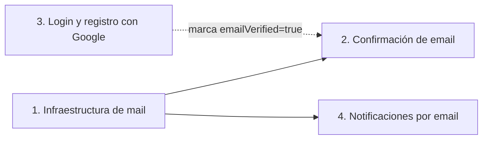

# Roadmap

> **Nada de lo que describe este archivo está implementado.** El resto de la documentación describe solo lo que existe en el código.

Son cuatro líneas de trabajo. El orden sugerido es:

1. **Infraestructura de mail.** Las líneas 2 y 4 dependen de ella.
2. **Confirmación de email.**
3. **Login y registro con Google.** Es independiente de las demás, salvo que una cuenta creada con Google nace con el email confirmado.
4. **Notificaciones por email**, una por evento.

## 1. Infraestructura de envío de correos

- Sumar `spring-boot-starter-mail`. Las plantillas HTML de los correos usarían Thymeleaf (`src/main/resources/templates/email/*.html`), que hay que volver a agregar a `pom.xml`: `spring-boot-starter-thymeleaf` se quitó porque nada lo usaba.
- Configuración SMTP por variables de entorno (`MAIL_HOST`, `MAIL_PORT`, `MAIL_USERNAME`, `MAIL_PASSWORD`, `MAIL_SMTP_AUTH`, `MAIL_STARTTLS`, `MAIL_FROM`) y la URL del frontend (`FRONTEND_URL`) para armar los links.
- **Desarrollo:** Mailpit en `docker-compose.dev.yml` (SMTP en 1025, web en 8025). Captura los correos sin enviarlos.
- **Producción:** un proveedor SMTP, todavía sin elegir.
- Un `EmailService` con envío asíncrono (`@Async`, con `@EnableAsync` en una configuración).

## 2. Confirmación de email al registrarse

- Campo nuevo `User.emailVerified`. Es distinto de `User.verified`, que es la verificación de cuenta por solicitud a un ADMIN (ver [verification](dominios/verification.md)). Los usuarios existentes se marcarían como confirmados una sola vez.
- Entidad `EmailVerificationToken`: token aleatorio de un solo uso, guardado como hash SHA-256, con vencimiento de unas 24 horas.
- Al registrarse se crea el token y se envía el link por correo, desacoplado con un evento.
- Endpoints nuevos dentro de `/auth/**`, que ya es público:
  - `POST /auth/confirm-email`: confirma con el token.
  - `POST /auth/resend-confirmation`: genera un token nuevo. Responde siempre `204` para no revelar si el email existe, con límite de reenvíos.
- El login y el refresh responderían `403` si el email no está confirmado.

## 3. Registro e inicio de sesión con Google

- El frontend obtiene un ID token de Google y el backend lo verifica con la librería de Google contra el `GOOGLE_CLIENT_ID`. El backend devuelve su propio JWT y refresh token, como en el login normal.
- Se descarta `spring-boot-starter-oauth2-client`, porque usa redirecciones y sesión HTTP, y la API es stateless.
- **Cambios de esquema:** la contraseña pasa a ser opcional, y hay una columna `google_id` única cuando no es `NULL` (en SQL Server, con un índice filtrado).
- **Registro en dos pasos**, porque Google no da los datos obligatorios del registro (`userName`, `phone`, `description`, categorías):
  - `POST /auth/google`: si la cuenta existe (por `googleId`, o por email confirmado por Google), hace login. Si no existe, devuelve un token de registro corto.
  - `POST /auth/google/register`: completa los datos faltantes con ese token y crea la cuenta con el email ya confirmado.
- Se aplican las mismas reglas del login normal: cuentas sancionadas y cuentas borradas por el propio usuario.

## 4. Notificaciones por email

Basadas en eventos de dominio que se publican después de guardar y se escuchan de forma asíncrona, solo cuando la transacción confirma (`@TransactionalEventListener` con `AFTER_COMMIT`). Así no sale un correo por una operación que hizo rollback.

Candidatas:

- Donación recibida.
- Nuevo seguidor.
- Campaña que llegó a la meta.
- Reporte resuelto.
- Baneo o suspensión.
- Opcional: preferencias para que cada usuario desactive avisos.

## Decisiones pendientes

- Qué notificaciones van primero.
- Si el registro con Google es en dos pasos (lo recomendado) o si `phone` y `description` pasan a ser opcionales para crear la cuenta directamente.
- Si al cambiar el email del perfil se vuelve a pedir la confirmación (lo recomendado: sí).
